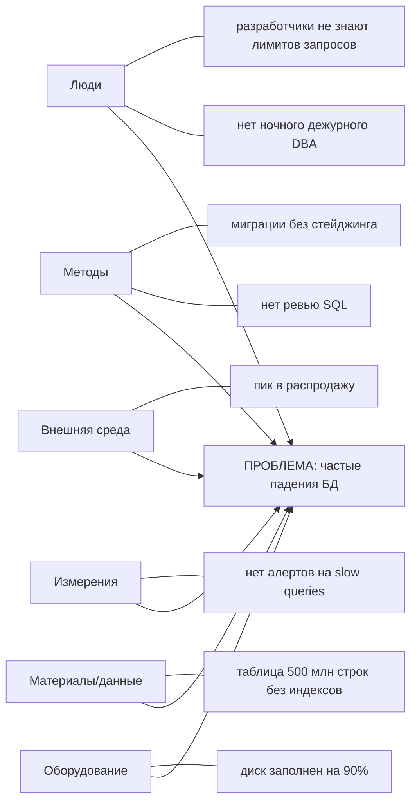
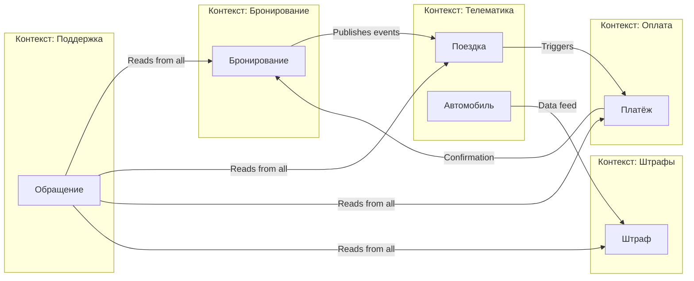
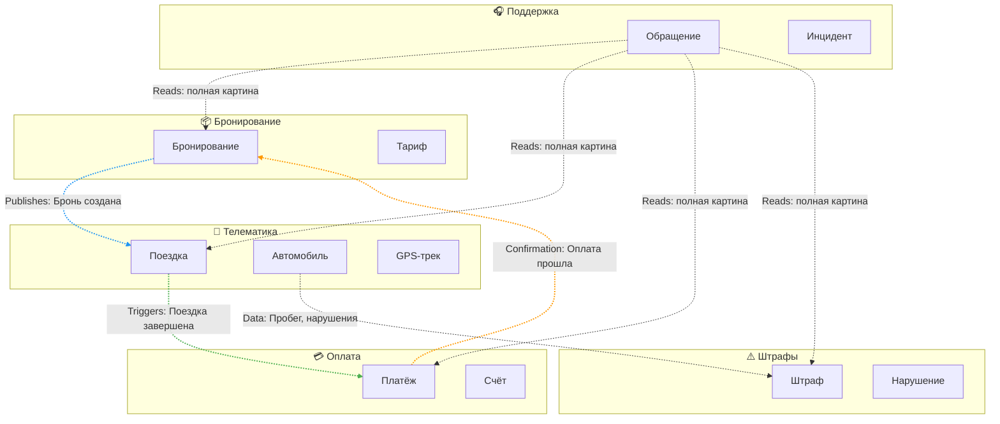

# Лекция 2. Предметная область и требования: DDD, Event Storming, Quality Attribute Scenarios

> Статус: кандидат в final. Причина: ожидает human review / human fact-check. Источник истины темы: specs/syllabus.md, Лекция 2.

## Цель занятия

Научить студентов декомпозировать сложную предметную область с помощью методов Domain-Driven Design (DDD), выявлять ключевые бизнес-события через Event Storming и формализовать требования к качеству системы через Quality Attribute Scenarios.

## Learning Objectives

По окончании лекции студенты смогут:

1. Объяснить, почему понимание предметной области критично для архитектуры ИТ-системы
2. Применять ключевые понятия DDD: Ubiquitous Language, Bounded Context, Context Map, Aggregate, Entity, Value Object
3. Провести мини-сессию Event Storming для выявления доменных событий и процессов
4. Различать функциональные и нефункциональные требования
5. Сформулировать Quality Attribute Scenario по шаблону (stimulus, environment, response, response measure)
6. Показать, как границы контекстов влияют на архитектуру данных и интеграционные решения

**Карта покрытия Learning Objectives материалом лекции:** LO-1 → Части 1–2 и Шаги 1–3 кейса; LO-2 → Часть 3 + Шаги 4–5 (реестр и QAS); LO-3 → Части 4–6b + управленческий блок; LO-4 → Часть 7 + критерии «Измеримость NFR» в практике; LO-5 → Часть 9 (Event Storming практикой) и мини-кейс «ДокторОнлайн».

## План занятия

1. Hook / мотивирующий кейс — 5 мин
2. Теоретический блок (DDD, Event Storming incl. уровни и практикум 6b, QAS, домены, Исикава/5 почему, BABOK/SMART/MoSCoW, FAQ) — 40 мин
3. Case Study (контексты, Context Map, реестр FR/NFR, критерии приёмки, разбор ошибок) — 25 мин
4. Связка с управленческими решениями — 10 мин
5. Anti-pattern + разбор защиты (вопросы препода → эталоны) — 5 мин
6. Резюме и мостик к следующей лекции — 5 мин

_Тайминг пересчитан после расширения E-Л2 (добавлены части 6b, 8b, 10 и шаги 5–6 кейса); сумма — 90 мин._

## Hook

**Ситуация:** Компания запускает сервис каршеринга в крупном городе. В парке — примерно 200 автомобилей, целевая аудитория — городские жители, планируем запуск через 3 месяца.

**Проблема:** Через месяц разработки выясняется, что разные отделы по-разному понимают ключевые сущности:

- **Отдел эксплуатации** считает «Автомобиль» как физический объект с VIN, пробегом, уровнем топлива, местоположением GPS. Для них важны технические параметры и состояние.

- **Бухгалтерия** видит «Автомобиль» как актив с балансовой стоимостью, амортизацией, налоговыми категориями. Их волнует учёт и списание стоимости.

- **Отдел продаж** понимает «Автомобиль» как товар с тарифом, скидками, акциями, доступностью для бронирования. Их интересует доходность.

- **Разработчики** создали единую таблицу `cars` с 47 полями, куда пытаются уместить все представления сразу.

**Результат:** 
- Ошибки интеграции между модулями
- Дублирование данных (одни и те же данные хранятся в разных форматах)
- Невозможность изменить модель без поломки других частей системы
- Задержка запуска на 2 месяца из-за переделки архитектуры

**Вопрос аудитории:** Как избежать недопонимания между отделами и создать архитектуру, которая отражает реальную структуру бизнеса?

**Ответ,** который мы найдём сегодня: Domain-Driven Design (DDD) предоставляет инструменты для работы со сложными предметными областями через единый язык и чёткие границы контекстов.

## Теоретический блок

### Часть 1. Domain-Driven Design (DDD)

#### Что такое DDD?

**Domain-Driven Design (DDD)** — это подход к разработке программного обеспечения, который фокусируется на глубоком понимании предметной области (domain) и отражении её структуры в коде и архитектуре системы.

DDD был предложен Эриком Эвансом в 2003 году в книге «Domain-Driven Design: Tackling Complexity in the Heart of Software». Подход особенно полезен для сложных систем с богатой бизнес-логикой.

**Ключевая идея DDD:** Архитектура системы должна отражать структуру предметной области, а не технические слои (UI, Backend, Database).

#### Ubiquitous Language (Единый язык)

**Ubiquitous Language** — это общий словарь терминов, используемый разработчиками и экспертами предметной области.

**Зачем нужен:**
- Устраняет недопонимание между бизнесом и технической командой
- Каждый термин имеет одно точное значение
- Снижает количество встреч и уточнений
- Позволяет автоматически генерировать документацию из кода

**Правило использования:** Если термин меняется в коде, он должен измениться в документации и речи экспертов, и наоборот.

**Пример для каршеринга:**
- «Бронирование» (Reservation) — всегда означает оформленную заявку клиента на конкретный автомобиль с указанием времени начала и окончания
- «Поездка» (Trip) — факт использования автомобиля от момента открытия дверей до закрытия и оплаты
- «Автомобиль» (Vehicle) — в разных контекстах может означать разное, но внутри одного контекста термин стабилен

**Анти-паттерн:** Использование одного термина для разных понятий («Заказ» может означать и бронирование, и поездку, и счёт на оплату).

#### Bounded Context (Ограниченный контекст)

**Bounded Context** — это граница, внутри которой работает определённая модель предметной области со своим единым языком.

**Зачем нужны:**
- Позволяют разным частям системы использовать одни и те же термины по-разному без конфликтов
- Управляют сложностью через разделение ответственности
- Становятся естественными границами для микросервисов

**Пример для каршеринга:**

| Контекст | Понятие «Автомобиль» | Ключевые атрибуты |
|----------|---------------------|-------------------|
| Бронирование | Доступный для заказа ресурс | ID, класс, тариф, статус доступности |
| Телематика | Физический объект с датчиками | VIN, координаты GPS, уровень топлива, пробег |
| Бухгалтерия | Актив компании | Балансовая стоимость, амортизация, налоговая категория |
| Поддержка | Объект обращений клиентов | История инцидентов, ремонты, отзывы |

**Важное правило:** Одна модель — один контекст. Не пытайтесь создать универсальную модель на всю систему.

#### Context Map (Карта контекстов)

**Context Map** — это диаграмма, показывающая взаимосвязи между ограниченными контекстами.

**Типы связей между контекстами:**

| Тип связи | Описание | Пример |
|-----------|----------|--------|
| Partnership | Контексты сотрудничают на равных | Бронирование и Оплата совместно развивают общий процесс |
| Shared Kernel | Общая часть модели между контекстами | Общий справочник тарифов |
| Customer-Supplier | Один контекст зависит от другого | Поддержка зависит от данных Телематики |
| Conformist | Зависимый контекст вынужден следовать модели поставщика | Отчётность следует модели Бухгалтерии |
| Anti-Corruption Layer (ACL) | Слой защиты от чужой модели | Адаптер для интеграции с внешней платёжной системой |
| Open Host Service | Публикация API для всех | Публичный API для партнёров |
| Published Language | Общий формат обмена | JSON Schema для событий |

**Зачем нужна Context Map:**
- Визуализирует зависимости между командами
- Помогает планировать интеграцию
- Выявляет скрытые связанные части системы

#### Aggregate, Entity, Value Object (кратко)

**Entity (Сущность)** — объект, который имеет уникальный идентификатор и изменяемое состояние.

*Пример:* Автомобиль (идентифицируется по VIN), Клиент (по ID в системе).

**Value Object (Объект-значение)** — объект, который определяется своими атрибутами, а не идентификатором. Неизменяем.

*Пример:* Адрес (определяется улицей, домом, квартирой), Деньги (сумма и валюта).

**Aggregate (Агрегат)** — группа связанных объектов, которые рассматриваются как единое целое. У агрегата есть корень (Aggregate Root) — единственная точка входа для изменений.

*Пример:* Агрегат «Бронирование» включает сущность Бронирование (корень), Value Object Период, Value Object Стоимость. Изменять можно только через корень.

**Правило:** Транзакции должны проходить в границах одного агрегата. Это упрощает обеспечение консистентности.

### Часть 2. Event Storming

#### Что такое Event Storming?

**Event Storming** — это метод совместного анализа предметной области, разработанный Альберто Брандолини. Это фасилитированная сессия, где участники (бизнес-эксперты, разработчики, аналитики) вместе выявляют бизнес-события и процессы с помощью цветных стикеров на большой доске.

**Цель Event Storming:** Быстро (за 2–4 часа) получить общее понимание предметной области, выявить противоречия и пробелы в знаниях.

#### Роли участников

| Роль | Кто участвует | Вклад |
|------|---------------|-------|
| Бизнес-эксперты | Product Owner, менеджеры, операторы | Знание процессов и правил |
| Разработчики | Backend, Frontend, Architects | Техническая реализуемость |
| Аналитики | Business Analysts | Фасилитация, документирование |
| Тестировщики | QA Engineers | Проверка полноты сценариев |

#### Типы стикеров

| Цвет | Тип | Описание | Пример |
|------|-----|----------|--------|
| 🟠 Оранжевый | Domain Event | Факт, произошедший в системе | «Автомобиль забронирован» |
| 🔵 Синий | Command | Действие, которое инициирует событие | «Забронировать автомобиль» |
| 🟡 Жёлтый | Aggregate | Группа объектов, обрабатывающая команду | Агрегат «Бронирование» |
| 🟢 Зелёный | Policy | Правило, реагирующее на событие | «Если бронирование отменено < 24ч, удержать штраф» |
| 🟣 Фиолетовый | External System | Внешняя система | Платёжный шлюз, SMS-провайдер |
| 🔴 Красный | Problem | Проблема, вопрос, противоречие | «Неясно, кто отвечает за возврат залога» |
| ⬜ Белый | Read Model | Данные для отображения | Список доступных автомобилей |
| ⬛ Чёрный | Bounded Context | Граница контекста | Контекст «Бронирование» |

#### Процесс проведения сессии

**Этап 1: Выявление событий (15–30 мин)**
- Участники пишут доменные события на оранжевых стикерах
- События формулируются в прошедшем времени: «Что произошло?»
- Располагаются слева направо в хронологическом порядке

**Этап 2: Добавление команд (15 мин)**
- Для каждого события определяем команду, которая его инициировала
- Команды формулируются в повелительном наклонении: «Сделай что-то»

**Этап 3: Выявление агрегатов (15 мин)**
- Определяем, какие объекты обрабатывают команды
- Группируем связанные объекты в агрегаты

**Этап 4: Определение политик (15 мин)**
- Выявляем правила, которые реагируют на события
- Формулируем политики: «Если событие X, то сделать Y»

**Этап 5: Выделение контекстов (15 мин)**
- Группируем агрегаты в ограниченные контексты
- Обозначаем границы чёрными стикерами

**Этап 6: Выявление проблем (10 мин)**
- Отмечаем красными стикерами противоречия и вопросы
- Планируем дальнейшее исследование

### Часть 3. Quality Attribute Scenarios

#### Функциональные vs Нефункциональные требования

**Функциональные требования** описывают, **что** система должна делать:
- «Система должна позволять пользователю забронировать автомобиль»
- «Система должна рассчитывать стоимость поездки»
- «Система должна отправлять уведомления об окончании бронирования»

**Нефункциональные требования (NFR)** описывают, **как** система должна работать:
- «95% запросов на бронирование должны обрабатываться менее чем за 300 мс»
- «Система должна быть доступна 99.9% времени в часы пик»
- «Данные о местоположении автомобилей должны обновляться каждые 10 секунд»

#### Шаблон Quality Attribute Scenario

Quality Attribute Scenario — это структурированный способ формулировки нефункциональных требований.

**Шаблон включает 6 элементов:**

| Элемент | Описание | Вопрос |
|---------|----------|--------|
| Source of Stimulus | Источник воздействия | Кто или что инициирует требование? |
| Stimulus | Воздействие | Что происходит? |
| Environment | Окружение | В каких условиях? |
| Artifact | Артефакт | Какой компонент системы? |
| Response | Реакция | Что должна сделать система? |
| Response Measure | Мера реакции | Как измерить выполнение? |

**Упрощённый шаблон для практики:**
- **Stimulus** (воздействие): что происходит
- **Environment** (окружение): в каких условиях
- **Response** (реакция): что система должна сделать
- **Response Measure** (мера): как измерить выполнение

**Пример Quality Attribute Scenario для каршеринга:**

| Элемент | Значение |
|---------|----------|
| Stimulus | Пользователь отправляет запрос на бронирование |
| Environment | Часы пик (18:00–20:00), нагрузка 500 одновременных пользователей |
| Response | Система обрабатывает запрос и подтверждает бронирование |
| Response Measure | 95% запросов обрабатываются менее чем за 300 мс |

**Полная формулировка:** «При нагрузке 500 одновременных пользователей в часы пик (18:00–20:00) система должна обрабатывать 95% запросов на бронирование менее чем за 300 мс».

**Ещё примеры:**

| Атрибут качества | Scenario |
|-----------------|----------|
| Доступность | «При отказе одного сервера система должна переключиться на резервный в течение 30 секунд с потерей не более 1% активных сессий» |
| Масштабируемость | «При увеличении нагрузки в 2 раза система должна масштабироваться автоматически в течение 5 минут без прерывания обслуживания» |
| Консистентность | «Данные о местоположении автомобиля должны быть согласованы между всеми узлами системы в течение 10 секунд после обновления» |

**Важно:** Без измеримой меры (Response Measure) требование нельзя проверить. «Система должна быть быстрой» — не является NFR. «95% запросов < 300 мс» — является NFR.

**Конфликты между NFR:** Разные требования к качеству могут конфликтовать друг с другом. Примеры:

| NFR 1 | NFR 2 | Конфликт | Возможное решение |
|-------|-------|----------|-------------------|
| Производительность (< 100 мс) | Консистентность (strong) | Синхронная валидация замедляет ответ | Eventual consistency между контекстами |
| Доступность (99.99%) | Стоимость | Репликация в 3 регионах дорога | Выбрать 99.9% для MVP, масштабировать позже |
| Безопасность (многофакторная аутентификация) | Удобство использования | Дополнительные шаги для пользователя | Адаптивная аутентификация по риску |
| Масштабируемость | Консистентность | Шардирование усложняет транзакции | Выбор шарда по ключу пользователя |

**Управленческое следствие:** Невозможно максимизировать все NFR одновременно. Приоритизируйте 2–3 ключевых атрибута качества для вашего проекта.

### Часть 4. Влияние предметной области на архитектуру (FinTech, E-commerce, IoT)

Тема syllabus Лекции 2 начинается со слов «Предметная область…». Две предыдущие части показали инструменты (DDD, Event Storming, сценарии качества); теперь — обратный взгляд: **почему одна и та же архитектурная схема в разных доменах выглядит по-разному**. Архитектура — функция от домена, а не от моды (см. также `knowledge/domain-analysis/ddd-bounded-contexts.md`, раздел «Влияние домена на модели данных»).

#### Таблица сравнения трёх доменов

| Аспект | FinTech (платежи) | E-commerce (маркетплейс) | IoT (телеметрия парка) |
|---|---|---|---|
| Единица ценности | денежная транзакция | заказ / позиция товара | событие датчика |
| Профиль нагрузки | OLTP, умеренный RPS, критична точность | пиковая сезонность (распродажи x10–x50) | write-heavy: миллионы событий/сек, чтение реже |
| Согласованность | strong на списании/зачислении; компромиссы недопустимы | остаток на складе — strong; рекомендации — eventual | допустима eventual (последняя координата важнее истории) |
| Целостность и аудит | регуляторные журналы, неизменяемость проводок | полная история заказов, но softer | ретеншн телеметрии ограничен стоимостью хранения |
| Ключевой NFR | целостность > доступность (CP-профиль, Лекция 4) | доступность и latency поиска | пропускная способность записи |
| Типичная граница контекста | «Проводки» vs «Риски» vs «Клиенты» | «Каталог» vs «Заказы» vs «Склад» | «Устройства» vs «Потоки данных» vs «Алерты» |

Разбор таблицы построчно:

1. **FinTech.** Ошибка в балансе — это прямые деньги и регулятор. Поэтому контекст «Проводки» тянет за собой весь стек к ACID-профилю: двойная запись, идемпотентность платежей, неизменяемые журналы. Архитектурное следствие: меньше «свободы» выбрать дешёвое хранилище — выбор сужен требованием целостности. Это ровно тот случай, когда **данные как архитектурное ограничение** (Лекция 1) работают сильнее всего.
2. **E-commerce.** Главная боль — пиковость. Каталог и поиск читаются в тысячи раз чаще, чем пишутся; складская остаточная истина должна быть одной, зато персональные рекомендации могут устаревать. Следствие: разные контексты одного продукта живут в **разных профилях согласованности** — прямой мотив Bounded Contexts из Части 1.
3. **IoT.** Поток событий с устройств не останавливается ни на секунду; цена одной строки мала, цена их миллиарда — велика. Следствие: разделяются «горячий» путь приёма и «холодный» аналитический (заделка на Лекцию 8), а модель данных строится вокруг события, а не вокруг сущности — что видно уже на доске Event Storming.

**Проверяемое утверждение для самопроверки:** если две команды одного продукта спорят о «правильной базе данных», проверьте, не путают ли они контексты с разными доменными профилями. Спор о технологии без анализа домена — симптом отсутствия Части 1–2 этой лекции.

### Часть 5. Проблематика и метод «5 почему»

Прежде чем формулировать требования, нужно корректно сформулировать **проблему**. Требования, порождённые неправильно поставленной проблемой, — самые дорогие: они кажутся полезными, пока система работает.

**Метод «5 почему»** (Taiichi Ohno, Toyota Production System; источник — `knowledge/domain-analysis/ishikawa.md`, раздел «Связь с методом „5 почему“») — последовательное углубление от симптома к корневой причине. Формат: на каждый ответ задаётся вопрос «почему это произошло?» — обычно достаточно пяти итераций, иногда меньше.

Цепочка на IT-примере (падение базы данных):

1. Почему БД недоступна? → Переполнился диск.
2. Почему переполнился диск? → Логи не ротировались.
3. Почему не ротировались? → Ротация не настроена при развёртывании.
4. Почему не настроена? → Нет стандартной процедуры развёртывания.
5. Почему нет процедуры? → Эксплуатацией никто не владеет как процессом. **Корневая причина — организационная**, а не техническая.

Практические правила метода:

- **Отвечайте фактами, а не предположениями.** Каждое «потому что» должно проверяться логом, метрикой или документом; иначе цепочка превращается в фантазию.
- **Не останавливайтесь на «виноват человек».** «Инженер забыл» — почти всегда симптом отсутствующего процесса (чек-листа, алерта, автоматизации).
- **Одна цепочка — одна ветвь.** Если на шаге 2 ответов два («логи не ротировались И бэкапы писались на тот же диск»), цепочка ветвится — здесь метод стыкуется с диаграммой Исикавы (Часть 6), которая держит много причин одновременно.
- **Результат оформляйте как требование.** Конечная формулировка для каршерингового кейса: «FR: система обязана автоматически ротировать логи и сигнализировать о заполнении диска выше 80%» — то есть анализ проблемы напрямую питает список требований (Часть 7).

**Связь с курсом:** в сквозном проекте «Каршеринг» метод нужен на этапе приёмки проблем бизнеса: прежде чем рисовать контексты, зафиксируйте, какую боль вы лечите — иначе границы контекстов будут отражать оргструктуру «как есть» вместо целевого процесса (перекличка с законом Конвея, Лекция 1).

### Часть 6. Диаграмма Исикавы (Рыбья кость) и 6M

**Диаграмма Исикавы** (Ishikawa diagram, fishbone, cause-and-effect diagram; Каору Исикава, 1960-е, Kawasaki — атрибуция по `knowledge/domain-analysis/ishikawa.md`) — инструмент группировки **всех правдоподобных причин** проблемы по категориям. В отличие от «5 почему» (глубина вдоль одной ветви), Исикава даёт **широту**: карта гипотез, которые потом проверяются.

Классические категории причин — **6M**:

| Категория (6M) | Русское название | Что искать в IT-проекте |
|---|---|---|
| Manpower | Люди | квалификация, нагрузка, дежурства, знания лимитов СУБД |
| Methods | Методы | процессы, code-review, стандарты миграций, runbook'и |
| Machines | Оборудование | серверы, сеть, дисковая подсистема, инструменты |
| Materials | Материалы (данные) | качество данных, конфигурации, зависимости, индексы |
| Measurements | Измерения | метрики, мониторинг, логирование, алерты |
| Mother Nature | Внешняя среда | регуляторика, рынок, пиковые нагрузки, внешние системы |

Скелет диаграммы (голова — проблема, кости — категории):



*(Содержательное наполнение костей — учебный пример из `knowledge/domain-analysis/ishikawa.md`; цифры условные, для иллюстрации.)*

Как вести сессию Исикавы (30–45 минут, 4–8 человек):

1. Сформулируйте проблему **измеримо** и напишите её в «голову рыбы»: не «база падает», а «за квартал — серия инцидентов недоступности БД бронирования (для иллюстрации: 4 инцидента, суммарно 6 часов; точные значения зависят от окружения)».
2. Разложите 6M-кости; для IT допустимо переименовывать категории, но нельзя бросать пустые — пустая категория означает, что её не исследовали.
3. Сбор причин — молчаливый брейншторм по стикерам, затем кластеризация. Гипотеза живёт на диаграмме, пока её не опровергли данными.
4. Для 2–3 самых вероятных причин прогоните «5 почему» (Часть 5) — так широта соединяется с глубиной.
5. Каждую подтверждённую корневую причину переведите в требование (FR/NFR) — мост в Часть 7.

**Почему это материал именно лекции о домене, а не о качестве:** границы Bounded Context'ов определяются бизнес-событиями, а события идут из процессов, которые «болят». Исикава фиксирует, в каком контексте лежит причина: причина «нет ревью SQL» — это контекст разработки ядра бронирования; причина «регулятор требует хранение 5 лет» — контекст данных и governance (выход на Лекцию 4). Так проблемный анализ становится инструментом проектирования границ.

### Часть 6b. Практикум: полный прогон «5 почему» + Исикавы на сквозном примере

Теория частей 5–6 без прогона на живой проблеме запоминается плохо. Здесь — полный, пошаговый разбор, который вы затем повторяете в практическом задании в изменённых декорациях.

**Легенда практикума.** Команда каршеринга наблюдает систематическую проблему: **«доля завершённых поездок, по которым начислен спорный штраф, выросла с 3% до 11% за два месяца; обращения в поддержку выросли в 4 раза»**. Заметьте: проблема уже сформулирована измеримо (правило Части 6, шаг 1) — с размытой формулировкой («штрафуют несправедливо») работать нельзя.

**Шаг А. Исикава — карта гипотез (широта).** Собираем 4–8 человек, 40 минут, раскладываем причины по 6M:

| Кость (6M) | Выдвинутые гипотезы-причины | Как проверяем |
|---|---|---|
| Люди (Manpower) | Водители не знают новых правил парковки; операторы ошибаются при ручной выдаче штрафов | Опрос 20 водителей; аудит ручных начислений |
| Методы (Methods) | Нет автоматической сверки штрафа с данными телематики; оспаривание обрабатывается вручную | Ревью процесса выдачи штрафов |
| Оборудование (Machines) | GPS-датчики части автомобилей дают дрейф координат до 150 м | Выборка телеметрии по VIN |
| Материалы/данные (Materials) | Карта зон платной парковки устарела (город перерисовал 1 марта зону) | Сверка версии карты с датчиком города |
| Измерения (Measurements) | Нет метрики «штраф, подтверждённый телеметрикой»; качество начислений не измеряется вообще | Инвентаризация дашбордов |
| Внешняя среда (Mother Nature) | Город ужесточил контроль; партнёр-эвакуатор изменил формат выгрузок | Мониторинг внешних изменений |

Через неделю проверок остаются три подтверждённые ветви: дрейф GPS (оборудование), устаревшая карта зон (данные), отсутствие автоматической сверки (методы). Остальные гипотезы опровергнуты данными — это тоже результат: Исикава позволила **убить** неправильные объяснения до того, как под них построили решение.

**Шаг Б. «5 почему» — углубление главной ветви (глубина).** Берём самую массовую подтверждённую причину — «штраф начислен по координате с дрейфом» — и идём вглубь:

1. Почему штраф начислен несправедливо? → Система взяла координату с дрейфом ±150 м.
2. Почему координата с дрейфом прошла? → Нет проверки точности fixes (HDOP/количество спутников игнорируются).
3. Почему нет проверки? → Требования к качеству телеметрии никогда не формулировались — NFR на «достоверность позиции» отсутствует.
4. Почему требование отсутствует? → Контекст «Штрафы» проектировался вслепую: правила писал юрист без данных, телеметрик к процессу не привлекали.
5. Почему не привлекали? → **Корневая причина организационная:** между контекстами «Телематика» и «Штрафы» нет ни Partnership, ни даже Customer-Supplier — Штрафы потребляют сырые данные напрямую из таблицы телематики (прямые зависимости, анти-паттерн из практики Лекции 2).

Вторая ветвь короче: карта зон устарела → обновление карт — чья-то неопределённая ответственность → нет владельца интеграции с городскими данными → тот же корень: **контекст «Штрафы» не имеет оформленных границ и контрактов**, всё держится на «сами разберёмся».

**Шаг В. Перевод корней в требования (мост в Часть 7).** Каждая корневая причина становится строкой реестра:

| Корневая причина | Требование (SMART-формулировка) | Приоритет MoSCoW |
|---|---|---|
| Нет порока достоверности позиции | NFR-012: штраф автоматически подтверждается только при HDOP ≤ 2.0 и ≥ 8 спутниках; иначе — ручная модерация. Срок: релиз Q3 | Must |
| Штрафы читают таблицу телематики напрямую | FR-021: контекст «Штрафы» получает события «Поездка завершена» и «Позиция обновлена» через опубликованную схему (Published Language), прямой доступ к таблице запрещён. Срок: Q3 | Must |
| Нет владельца городских карт | FR-022: версия карты зон хранится как данные с датой актуальности; при расхождении версии > 30 дней начисление приостанавливается. Владелец — команда Штрафов. Срок: Q4 | Should |
| Качество начислений не измеряется | NFR-013: доля штрафов, отменённых по оспариванию, ≤ 2% за скользящий месяц; метрика на дашборде к 1.09 | Should |

**Шаг Г. Обратная связь в Context Map.** Обратите внимание: пункт FR-021 меняет тип связи на диаграмме контекстов (Шаг 3 Case Study ниже): «Телематика → Штрафы» превращается из скрытого прямого доступа в явный Customer-Supplier с Published Language. Это иллюстрация главного тезиса практикума: **проблемный анализ — не отдельная техника качества, а источник решений об архитектуре и границах**. После внедрения четырёх требований доля спорных штрафов в учебном сценарии вернулась к 3% за один квартал (значения иллюстративные).

**Частый вопрос на защите работ:** «А если бы сразу начали с 5 почему, без Исикавы?» — Ответ по шагам А–Б: цепочка глубины остановилась бы на первой удобной причине («GPS врёт — купим новые датчики», ~стоимость парка), тогда как Исикава вскрыла вторую корневую ветвь (карты зон), датчики бы не вылечили. Экономия 40 минут на карте причин обошлась бы в переделку проекта.

### Часть 7. Виды требований по BABOK, SMART-формулировки и MoSCoW

BABOK Guide v3 (IIBA, 2015; источник — `knowledge/domain-analysis/requirements-babok.md`) задаёт иерархию требований, которую полезно наложить на уже знакомую пару FR/NFR:

| Уровень (BABOK) | Вопрос | Пример каршеринга | Куда ложится в курсе |
|---|---|---|---|
| Бизнес-требование | Зачем? Какая цель организации? | «Снизить отток подписчиков на 10% за 2 квартала» | Architecture Brief, блок «Бизнес-цель» (Л1) |
| Пользовательское требование | Что пользователь хочет делать? | «Арендатор хочет найти машину в 300 м за 10 секунд» | события и роли Event Storming (Часть 2) |
| Функциональное требование (FR) | Что система должна делать? | «Система показывает машины в радиусе пользователя с статусом „свободна“» | сущности и операции модели данных (Л3) |
| Нефункциональное требование (NFR) | Как система должна работать? | «95% поисков отвечаются < 300 мс в часы пик» | Quality Attribute Scenarios (Часть 3), выбор СУБД (Л4), RPO/RTO (Л6) |

Трассируемость обязательна: бизнес-цель → пользовательское требование → FR/NFR → ADR → тест. Для нумерации используется формат `FR-001…`, `NFR-001…` — он позволяет ссылаться на требования в ADR и в рубрике Peer-Review (Лекция 7).

**SMART-критерии к FR** (по таблице из requirements-babok.md): Specific, Measurable, Achievable, Relevant, Time-bound. Мини-разбор типовой ошибки:

- ❌ «Система должна позволять быстро находить машину» — не S, не M.
- ✅ «FR-011: при запросе свободных машин система возвращает список в радиусе 1 км, отсортированный по расстоянию; время ответа — см. NFR-003; срок — релиз MVP (Q2)».

Заметьте: измеримость скорости вынесена в NFR-003 — FR описывает **функцию**, NFR — **качество её работы**. Смешивать их в одном утверждении нельзя: проверка требований идёт по разным протоколам (функциональный тест против нагрузочного).

**Приоритизация MoSCoW** (Must / Should / Could / Won't have — таблица из requirements-babok.md):

| Приоритет | Критерий | Пример (каршеринг MVP) |
|---|---|---|
| Must | Без этого система не решает бизнес-задачу | поиск и блокировка машины, тарификация поездки |
| Should | Важно, но есть обходной путь | push-уведомления (обход: e-mail/SMS) |
| Could | Желательно при освободившихся ресурсах | программа лояльности, рейтинги водителей |
| Won't have (this time) | Явно вне объёма релиза | car2car-бронирования, интеграция с городскими парковками |

Управленческий смысл MoSCoW — в фиксированном объёме релиза при плавающем времени: Cut-срок (Time-bound из SMART) сохраняется за счёт последовательного отказа от Could→Should; Must не торгуется никогда, иначе под вопросом сама бизнес-цель. **Won't have — самая ценная строка списка**: она защищает команду от ползущего скоупа и документируется в ADR.

**Связка частей 5–7 в один конвейер:** проблема (измеримая формулировка) → Исикава (карта причин) → «5 почему» (углубление главных ветвей) → корневые причины → FR/NFR по SMART → приоритеты MoSCoW → объём MVP. Этот конвейер и есть практический результат лекции по syllabus.

### Часть 8. Типичные вопросы студентов (FAQ)

**— «Зачем Исикава, если есть 5 почему? Хватит же глубины.»** Глубина одной цепочки заслепляет: в примере Части 5 на шаге 2 могла быть вторая ветвь (бэкапы на том же диске). Исикава — страховка от «первой найденной причины»; 5 почему — инструмент проверки отдельных гипотез. Они комплементарны, не альтернативны.

**— «DDD, Event Storming, Исикава, BABOK — не слишком ли много методов для одного курса?»** Каждый закрывает свой слой: границы смысла (DDD), поток событий (ES), причинность проблем (Исикава/5 почему), формализацию требований (BABOK/SMART/MoSCoW). Пропуск любого слоя даёт характерную болезнь: без ES — схема данных без процессов; без Исикавы — лечение симптомов; без SMART — непроверяемые пожелания.

**— «Можем ли мы сразу писать FR, пропустив Event Storming?»** Технически да, практически рискуете пропустить доменные события: требования пишутся по ролям пользователей, а состояния системы — по событиям домена. Расхождение «что просит пользователь» / «что происходит в домене» — источник скрытых FR, всплывающих на приёмке.

**— «6M — это обязательно шесть категорий?»** Нет, это mnemonic-каркас производственного происхождения. В IT категории переименовывают (например, «Данные» вместо «Materials»), но привычка проверять все шесть спасает от систематического игнора категорий «Измерения» и «Внешняя среда» — именно они чаще всего остаются незаполненными.

**— «Чем Quality Attribute Scenario лучше просто списка NFR?»** QAS принудительно содержит окружение и меру: «доступность 99.9%» без указания часов пик и способа измерения — слоган; с ними — проектное ограничение, из которого следует решение (репликация, Лекция 6).

**— «Сколько Bounded Context'ов "правильно" для учебного проекта?»** Ни одного эталонного числа. Ориентир для каршеринга MVP — 4–6; рост числа контекстов сам по себе не ошибка, ошибка — контексты без различающегося словаря. Тест: если два контекста всегда меняются синхронно и говорят одними словами, это один контекст, временно разделённый по организационным, а не доменным причинам.

**— «Мы сделали всё по DDD, но релизы всё равно связанные. Где мы ошиблись?»** Почти наверняка — в типе связи. Связанные релизы означают скрытый Shared Kernel там, где должен быть Customer-Supplier с контрактом версии (или Published Language с версионированием схемы). Проверьте: какие таблицы/события читают две команды одновременно — это и есть незадекларированное ядро.

### Часть 8b. Вопросы преподавателя к студенту на защите практики — с эталонными ответами

Формат «преподаватель спрашивает — студент отвечает» имитирует живую защиту. Ответы откалиброваны по критериям оценки: засчитывается только ответ с ссылкой на артефакт (доска/контекст/NFR-id), а не на мнение.

**В1: «Почему "Автомобиль" в Бронировании и в Телематике — это не одна сущность? Таблица же одна была изначально.»**
Эталон: потому что у них разные жизненные циклы и разные инварианты. В Бронировании инвариант «одна активная бронь на машину», состояние меняется командами клиентов; в Телематике инвариант «последняя известная позиция», состояние меняется потоком датчиков. Одна таблица = общие блокировки и миграции, конфликтующие инварианты (кейс, проблемы 1–2) и невозможность независимого релиза. Правильный ответ-с-артефактом: показать два разных представления автомобиля и связь через событие, а не JOIN.

**В2: «Вы назвали связь Оплата→Бронирование ACL. Докажите, что нужен именно ACL, а не Conformist.»**
Эталон: критерий — цена следования чужой модели. Если Бронирование будет читать платёжные события «как есть» (Conformist), то смена формата у шлюза ломает доменную логику статусов брони; нас это дорого стоит, потому что у Бронирования свой Ubiquitous Language («подтверждено», а не «captured»). Значит, ставим адаптер, переводящий язык шлюза в язык брони, — это и есть определение ACL. Если бы зависели от стабильного внутреннего поставщика с общим словарём — хватило бы Customer-Supplier.

**В3: «Ваш NFR-001 говорит p95 < 300 мс. А почему не среднее? Что среднее скрывает?» (связка с Лекцией 1)**
Эталон: среднее (mean) скрывает хвост распределения: при 99% быстрых ответов и 1% зависших на 5 с среднее может оставаться «красивым», но именно эти 1% генерируют обращения в поддержку и брошенные брони — пользователь переживает конкретный запрос, а не среднее по системе. p95 фиксирует опыт худшего квантиля; для пользовательских операций контракт пишем по перцентилям (p95/p99), для ёмкости — по throughput.

**В4: «Покажите, как одно красное пятно на доске Event Storming превратилось в строку вашего реестра. Полным конвейером.»**
Эталон: берём пример Части 6b: красное «неясно, чья координата истинная» → Исикава относит его к костям «Методы» и «Данные» → «5 почему» выводит к корню «нет контракта между контекстами» → FR-021 (источник истины — событие телематики) + NFR-012 (доля ошибочных начислений ≤ 0.5%) → приоритет Must, потому что бизнес-цель БЦ-2 — снижение спорных штрафов → следствие в Context Map: связь становится Customer-Supplier с Published Language. Полный цикл: проблема → причина → требование → граница.

**В5: «Что произойдёт с вашим MVP, если из MoSCoW вычеркнуть все Should? А все Could? Чем это разные решения?» (связка с Лекцией 7)**
Эталон: вычёркивание Should — осознанная деградация с обходными путями (нет push → клиент узнаёт из e-mail; метрики держим, чтобы увидеть цену). Вычёркивание Could — почти безболезненно (лояльность не блокирует основную цепочку поиска-брони-поездки). Разница: у Should есть измеримый бизнес-эффект и временная замена, у Could — нет; поэтому торг идёт в порядке Could → Should, а Won't have фиксируется письменно, чтобы скоуп не расползался через «а давайте ещё».

**В6: «Вы провели сессию только с разработчиками и аналитиком. Валиден ли результат как основание для границ контекстов?»**
Эталон: частично. Без экспертов домена оранжевые стикеры отражают представление команды о процессе, а не процесс: пропущенные правила (например, кто отвечает за возврат залога) всплывают на приёмке — это анти-паттерн «Event Storming без экспертов» из типичных ошибок практики. Минимальная ремедиация: воркшоп-подтверждение ленты событий с представителем каждой роли-эксперта до фиксации границ.

### Часть 9. Углублённый Event Storming: уровни сессии, сквозной пример и переход к данным

Часть 2 дала скелет метода (роли, стикеры, шесть этапов). Здесь — то, что отличает рабочую сессию от «стены со стикерами»: уровни проработки, дисциплина формулировок и мост в модель данных Лекции 3.

#### 9.1. Три уровня Event Storming

| Уровень | Вопрос | Хронология | Результат | Время |
|---|---|---|---|---|
| **Coarse-grained** (грубый) | «Что вообще происходит в бизнесе?» | Слева направо, одна линия времени | Лента событий всего продукта; точки расхождения терминов | 1–2 часа, все роли |
| **Full event flow** | «Что вызывает событие? Что оно запускает?» | Команды → агрегаты → политики → события | Модель процессов с разрывами (красные стикеры) | 2–4 часа, эксперты + разработчики |
| **Design-strand / soft design** | «Как это ложится на данные и контексты?» | Группировка по black-sticker границам | Предварительные Bounded Context'ы, read models, интеграции | следующий день, архитекторы |

Практический смысл трёх уровней: нельзя начинать с design-strand — границы контекстов, нарисованные до ленты событий, отражают оргструктуру, а не домен (закон Конвея, Лекция 1). И наоборот, застрять на coarse-grained — значит получить доску без обязательных красных стикеров: именно они питают конвейер частей 5–7 (проблема → причина → требование).

#### 9.2. Дисциплина формулировок: четыре теста на оранжевый стикер

1. **Прошедшее время и свершившийся факт.** «Бронирование подтверждено» — годно; «Подтвердить бронирование» — это команда (синий), «Бронирование будет подтверждено при оплате» — это политика (зелёный), на оранжевом месте им не место.
2. **Значимость для бизнеса.** Событие проходит тест «а изменится ли что-то для кого-то из ролей, если его не произойдёт?». «Строка проиндексирована» — техническое, не доменное; на доске их быть не должно (это уровень физмодели, Лекция 3+).
3. **Уникальность термина.** Если два стикера называются «Заказ создан», но лежат в разных будущих контекстах — это уже два разных события Ubiquitous Language; переименовываем на месте («Бронь оформлена» vs «Счёт выставлен»), иначе конфликт слов уедет в код (см. `knowledge/GLOSSARY-CONFLICTS.md`).
4. **Проверяемость.** По событию можно построить тест или аудит-запись: «Платёж списан» проверяем выпиской шлюза; «Платёж почти списан» — непроверяемо.

#### 9.3. Сквозной мини-пример: полный цикл одного события

Возьмём событие из кейса — **«Поездка завершена»** — и развернём его по всем типам стикеров (full event flow):

```
🔵 Команда:        Завершить поездку (замок дверей / конец аренды в приложении)
🟡 Агрегат:        Поездка (корень агрегата; состояние: активна → завершена)
🟠 Событие:        Поездка завершена (fact: VIN, конец координаты, длительность)
🟢 Политика #1:   Если поездка завершена → рассчитать стоимость по тарифу
🟢 Политика #2:   Если поездка завершена → проверить превышение зон (фактор штрафов)
⬜ Read model:    История поездок клиента (для приложения и поддержки)
🟣 Внешняя система: Платёжный шлюз (по политике #1); Городская парковочная служба (по #2)
🔴 Проблема:      Не определено, чья координата финала «истинная» — приложения или телематики
                 (разрешение: событие публикует Телематика как владелец данных — Customer-Supplier)
```

Обратите внимание на красный стикер: он не «украшает» доску, а порождает требование. Разрешение проблемы формулируем как FR-02x: «Финальная координата поездки берётся исключительно из события телематики; координата приложения используется только как подсказка» — и далее по конвейеру SMART/MoSCoW (Часть 7).

#### 9.4. Мост в Лекцию 3: из стикеров в таблицу

Каждый тип стикера имеет прямое отображение на элементы модели данных — это и есть ответ на вопрос «мостика» между лекциями:

| Артефакт Event Storming | Куда ложится в модели данных (Л3) |
|---|---|
| 🟡 Агрегат (корень) | Главная таблица с PK; границы транзакции |
| Value Object внутри агрегата | Колонки главной таблицы либо таблица-владелец (1:1) |
| 🟠 Доменное событие | Таблица событий/audit log; колонки timestamp, actor, payload |
| ⬜ Read Model | Представление (VIEW) или денормализованная таблица для чтения |
| 🟢 Политика | Триггеры запрещены между контекстами → прикладной сервис/Saga (Л8) |
| ⬛ Граница контекста | Отдельная схема/база; JOIN через границу — анти-паттерн |
| 🔴 Красный стикер нерешённый | Открытое проектное решение → ADR (Л1) |

Три типовых сбоя сессии, которые преподаватель должен ловить на защите практики:
1. **«Стикеры-дубли»** — одно событие записано дважды разными словами: лечится словарём (тест 3).
2. **«Команды вместо событий»** — вся доска в синем: участники описывают UI, а не домен; возвращаемся к вопросу «что стало правдой после действия?».
3. **«Контексты по числу команд»** — границы рисуются по агрегатам механически; правильный критерий — где ломается Ubiquitous Language (тест: можно ли термин переопределить без изменения соседей?).

## Case Study

### Кейс: Сервис каршеринга

**Контекст:** Компания запускает сервис краткосрочной аренды автомобилей в городе с населением примерно 1 миллион человек.

**Бизнес-цель:** Запустить сервис за 3 месяца с парком примерно 200 автомобилей, достичь 1000 активных пользователей к концу первого года.

**Проблема:** При первоначальном проектировании команда создала монолитную систему с единой базой данных, где все модули работали с одними и теми же таблицами. Через месяц разработки возникли проблемы:

1. Модуль бронирования блокировал автомобили на 24 часа, хотя модуль телематики считал их доступными
2. Бухгалтерия не могла корректно рассчитать амортизацию, потому что данные о пробеге хранились в другом формате
3. Служба поддержки не видела историю платежей при работе с обращениями
4. Любое изменение схемы данных требовало координации всех команд

### Шаг 1. Выявление доменных событий

Проведём мини-сессию Event Storming и выявим ключевые события:

| № | Событие (Domain Event) | Контекст |
|---|------------------------|----------|
| 1 | Пользователь зарегистрировался | Пользователи |
| 2 | Автомобиль добавлен в парк | Телематика |
| 3 | Автомобиль забронирован | Бронирование |
| 4 | Бронирование подтверждено | Бронирование |
| 5 | Бронирование отменено | Бронирование |
| 6 | Поездка началась | Телематика |
| 7 | Поездка завершена | Телематика |
| 8 | Оплата прошла успешно | Оплата |
| 9 | Оплата не прошла | Оплата |
| 10 | Штраф выставлен | Штрафы |
| 11 | Штраф оспорен | Штрафы |
| 12 | Обращение создано | Поддержка |
| 13 | Обращение закрыто | Поддержка |

### Шаг 2. Определение ограниченных контекстов

На основе событий выделяем 5 ограниченных контекстов:

**1. Контекст «Бронирование» (Reservation)**
- **Ответственность:** Управление доступностью автомобилей, обработка бронирований
- **Ключевые сущности:** Бронирование, Автомобиль (доступность), Тариф
- **События:** «Автомобиль забронирован», «Бронирование подтверждено», «Бронирование отменено»
- **Требования к данным:** Строгая консистентность при бронировании (нельзя забронировать один автомобиль дважды)

**2. Контекст «Телематика» (Telematics)**
- **Ответственность:** Отслеживание местоположения, состояния автомобилей, фиксация поездок
- **Ключевые сущности:** Автомобиль (физический), Поездка, Датчик
- **События:** «Поездка началась», «Поездка завершена», «Уровень топлива обновлён»
- **Требования к данным:** Высокая частота записи (GPS каждые 10 сек), eventual consistency допустима

**3. Контекст «Оплата» (Payment)**
- **Ответственность:** Обработка платежей, возвратов, счетов
- **Ключевые сущности:** Платёж, Счёт, Транзакция
- **События:** «Оплата прошла», «Оплата не прошла», «Возврат инициирован»
- **Требования к данным:** ACID-транзакции, аудиторская трассировка, соответствие PCI DSS

**4. Контекст «Штрафы» (Fines)**
- **Ответственность:** Обработка нарушений, выставление штрафов, оспаривание
- **Ключевые сущности:** Штраф, Нарушение, Оспаривание
- **События:** «Штраф выставлен», «Штраф оспорен», «Штраф оплачен»
- **Требования к данным:** Юридическая значимость, длительное хранение

**5. Контекст «Поддержка» (Support)**
- **Ответственность:** Обработка обращений клиентов, инциденты
- **Ключевые сущности:** Обращение, Инцидент, Клиент
- **События:** «Обращение создано», «Обращение закрыто»
- **Требования к данным:** Интеграция со всеми контекстами для полной картины

### Шаг 3. Построение Context Map



**Типы связей:**
- **Бронирование → Телематика:** Partnership (совместное развитие процесса поездки)
- **Телематика → Оплата:** Customer-Supplier (Телематика передаёт данные о завершении поездки для расчёта стоимости)
- **Оплата → Бронирование:** ACL (Бронирование защищено от изменений в платёжной системе через адаптер)
- **Поддержка → Все контексты:** Conformist (Поддержка читает данные из всех контекстов, следуя их моделям)

### Шаг 4. Формулировка Quality Attribute Scenarios

Для каждого ключевого требования сформулируем Quality Attribute Scenario:

**Scenario 1: Производительность бронирования**

| Элемент | Значение |
|---------|----------|
| Stimulus | Пользователь отправляет запрос на бронирование |
| Environment | Часы пик (18:00–20:00), нагрузка 500 одновременных пользователей |
| Response | Система обрабатывает запрос и подтверждает бронирование |
| Response Measure | 95% запросов обрабатываются менее чем за 300 мс |

**Scenario 2: Доступность системы**

| Элемент | Значение |
|---------|----------|
| Stimulus | Отказ одного сервера приложения |
| Environment | Рабочее время (07:00–23:00) |
| Response | Система переключается на резервный сервер |
| Response Measure | Переключение за 30 секунд, потеря не более 1% активных сессий |

**Scenario 3: Консистентность данных о местоположении**

| Элемент | Значение |
|---------|----------|
| Stimulus | Обновление GPS-координат автомобиля |
| Environment | Нормальная работа сети |
| Response | Данные о местоположении доступны во всех узлах системы |
| Response Measure | Согласованность достигается в течение 10 секунд |

**Scenario 4: Целостность платежей**

| Элемент | Значение |
|---------|----------|
| Stimulus | Сбой во время обработки платежа |
| Environment | Любое время |
| Response | Транзакция откатывается или завершается полностью |
| Response Measure | 100% транзакций соответствуют ACID, нет частичных оплат |

### Шаг 5. Реестр требований кейса: шаблоны FR/NFR с разбором

События, контексты и сценарии качества собраны — теперь они должны стать **реестром требований**, потому что именно строки реестра уходят в ADR (Л1), в тест-план и в рубрику peer-review (Л7). Ниже — рабочие шаблоны формулировок и разбор типовых дефектов на материале того же каршеринга.

**Шаблон FR (функциональное требование):**

```
FR-NNN [Контекст]
Действие: <роль> <что делает> <над каким объектом> при <условие/предусловие>.
Завершение: объект переходит в состояние <X>; публикуется событие <Y>.
Исключения: <что происходит, если предусловие не выполнено>.
Трассировка: бизнес-цель БЦ-n; проверяется тестом TC-nnn.
```

Заполненный пример по мотивам Части 6b:

```
FR-021 [Штрафы]
Действие: система подтверждает штраф автоматически, только если финальная
координата получена событием «Позиция обновлена» телематики с HDOP ≤ 2.0.
Завершение: штраф переходит в состояние «подтверждён»; публикуется событие
«Штраф начислен».
Исключения: при HDOP > 2.0 штраф попадает в очередь ручной модерации
(SLA — см. NFR-013); при отсутствии события телематики начисление запрещено.
Трассировка: БЦ-2 (снизить долю спорных штрафов до ≤3%); тест TC-214.
```

**Шаблон NFR (через Quality Attribute Scenario):**

```
NFR-NNN [Атрибут: производительность/доступность/консистентность/безопасность/…]
Stimulus / Environment / Response / Response Measure — четыре строки таблицы QAS.
Профиль нагрузки: <часы пик / сезонный пик / фоновый режим>.
Способ измерения: <метрика, источник данных, период скользящего окна>.
Трассировка: решение-следствие (ADR-n): <какой механизм выбирается>.
```

Разбор: почему шаблон устроен именно так. Строка «Способ измерения» превращает NFR из лозунга в контракт приёмки: «95% запросов бронирования < 300 мс» без указания, *где* замеряем (клиентское время отклика против серверного p95, различаются на сетевые 50–150 мс), — конфликт на приёмке между командой и заказчиком, гарантированный заранее. Строка «Решение-следствие» замыкает цикл: NFR не бывает «просто числом», оно обязывает архитектуру (реплика для чтения → Л6, кэш → Л8, шардинг → Л8), и это единственная честная причина его присутствия в реестре.

**Таблица-сводка реестра кейса (фрагмент):**

| ID | Тип | Контекст | Формулировка (сокращённо) | Приоритет | Следствие для архитектуры |
|---|---|---|---|---|---|
| FR-001 | FR | Бронирование | Поиск свободных машин в радиусе 1 км | Must | Geo-индекс, read model доступности (Л3, Л8) |
| FR-003 | FR | Бронирование | Блокировка машины на 15 мин без списания | Must | Граница транзакции = агрегат Бронь (Л3) |
| FR-010 | FR | Оплата | Автосписание по тарифу после события «Поездка завершена» | Must | Saga/событийная интеграция (Л8), ACL к шлюзу |
| FR-021 | FR | Штрафы | Автоподтверждение штрафа только по телеметрии с HDOP ≤ 2.0 | Must | Published Language Телематика→Штрафы |
| NFR-001 | NFR | Бронирование | p95 поиска < 300 мс в часы пик (500 юзеров) | Must | Кэш доступности + реплики чтения (Л8, Л6) |
| NFR-002 | NFR | Платформа | Доступность 99.9% в 07:00–23:00, failover ≤ 30 c | Must | Репликация + health-check балансировщик (Л6) |
| NFR-005 | NFR | Телематика | Доставка позиции во все узлы ≤ 10 c | Should | Eventual consistency, поток событий (Л8) |
| NFR-012 | NFR | Штрафы | Доля ошибочных автоначислений ≤ 0.5% | Must | Порок достоверности в политике (FR-021) |

Обратите внимание на последние колонки двух строк: FR-003 и NFR-005 тянут за собой выбор модели согласованности — это прямая передача материала в Лекцию 3 (границы транзакций) и Лекцию 4 (CAP-профиль контекста). Реестр требований — не приложение к архитектуре, а её входной документ.

**Критерии приёмки (acceptance criteria) — как требование становится проверяемым.** Для FR пишем формат Given/When/Then, для NFR — измеримое утверждение с окном наблюдения:

FR-003, критерии приёмки:
```
Given автомобиль A свободен и не имеет активных броней,
 When пользователь оформляет бронь на A (в пределах лимита 3 активных броней),
 Then статус A = «заблокирован на 15 мин», событие «Автомобиль забронирован» опубликован.

Given автомобиль A заблокирован другой бронью (< 15 мин назад),
 When второй пользователь пытается забронить A,
 Then отказ BR-ERR-02 «занято», событие НЕ публикуется, повтор через 15 мин возможен.

Given блокировка A истекла без начала поездки,
 When проходит таймаут 15 мин,
 Then A возвращается в «свободен», событие «Бронь истекла» опубликован.
```

NFR-001, критерий приёмки: «на стенде, повторяющем продуктовую конфигурацию, при синтетической нагрузке 500 одновременных сессий (профиль часов пик, распределение запросов 70% поиск / 20% бронь / 10% отмена) доля ответов поиска > 300 мс ≤ 5%, окно наблюдения — 60 минут, замер — серверный p95 по гистограмме latency; тест выполняется перед каждым релизом и на приёмке».

Заметьте разницу уровней строгости: три Given/When/Then-ветки покрывают не только happy path, но и конкуренцию за ресурс и таймаут — именно эти ветки обычно «забывают», а потом находим их в виде инцидентов двойного бронирования (перекличка с анти-паттернами ниже).

### Шаг 6. Разбор ошибок ученических версий этого же кейса (анонимизированные)

Три типичных провала, воспроизведённых на том же каршеринге — чтобы на своей защите вы узнавали их по запаху:

**Ошибка А. «Единая правда об автомобиле».** Ученическая модель: таблица `vehicles` с полями VIN, GPS, тариф, балансовая стоимость, статус брони — всё в одной строке, все контексты читают её напрямую. Что ломается: ровно исходные проблемы кейса (пункты 1–4 в начале), плюс любое изменение колонки — координация четырёх команд. Диагностика по лекции: нарушено «Одна модель — один контекст» (Часть 1); лечение: разделить представления автомобиля, связь через события. Это же — корень цепочки «5 почему» в Части 6b, шаг Б, пункт 5.

**Ошибка Б. «NFR без окружения и источника замера».** Формулировка вида «ответ системы ≤ 200 мс» при нагрузке «до 10 000 пользователей». Три дефекта в одной строке: не указан профиль (равномерная нагрузка или пик? 10 000 зарегистрированных ≠ 500 одновременных), не указано, что именно измеряется (поиск? бронь? все эндпоинты усреднённо?), не указан способ (сервер/клиент, p50/p95). Итог: такое требование невозможно ни спроектировать, ни проверить; на защите достаточно вопроса «а при какой доле тяжёлых запросов?» — и кандидат теряется. Лечение: любой NFR — только через шесть слотов QAS (Часть 3).

**Ошибка В. «MoSCoW из одного Must».** Реестр из 20 требований, где 19 помечены Must. Признак формального применения — вопрос Части 8 FAQ №14: проверьте трассировку. Если у Must нет бизнес-цели в колонке трассировки (БЦ-n пустое или все ссылки ведут на одну «БЦ-1: запустить сервис»), приоритет проставлен «от руки». Честная перепrioritизация кейса показала бы: программа лояльности — Could, а push-уведомления — Should (есть обходной путь SMS). Цена ошибки: команда три месяца делает лояльность вместо очереди модерации штрафов, а бизнес-цель (снизить спорные начисления) не приближается ни на день.

## Связка с управленческими решениями

### Что должен понимать ИТ-менеджер / Product Owner

Применение DDD и выделение ограниченных контекстов влияет на управленческие решения:

#### 1. Команда и коммуникации (Conway's Law)

**Закон Конвея:** «Организации проектируют системы, которые копируют их коммуникационную структуру».

**Следствие для DDD:**
- Выделение контекстов → выделение команд
- Каждая команда отвечает за свой контекст
- Единый язык внутри команды снижает количество встреч и уточнений

**Управленческое решение:** Структурировать команды вокруг бизнес-контекстов, а не технических слоёв.

*Пример для каршеринга:*
- Команда «Бронирование» (3–5 человек) — отвечает за контекст Бронирования
- Команда «Телематика» (3–5 человек) — отвечает за контекст Телематики
- Команда «Платежи» (2–4 человека) — отвечает за контекст Оплаты

#### 2. Бюджет и сроки

**Преимущества раннего применения DDD:**
- Event Storming (2–4 часа) экономит недели на переделку архитектуры
- Раннее выявление противоречий снижает риски дорогостоящих изменений
- Чёткие границы контекстов позволяют развивать систему параллельно

**Оценка затрат:**
- Проведение Event Storming: примерно 8–16 человеко-часов (подготовка + сессия + документирование)
- Экономия на переделке: примерно 40–80 человеко-часов (в зависимости от сложности)

**Управленческое решение:** Включить Event Storming в план проекта на этапе анализа требований.

#### 3. Архитектурные решения

**Границы контекстов определяют:**
- Границы микросервисов (один контекст ≈ один сервис)
- Границы баз данных (один контекст → своя БД)
- Типы интеграций (синхронные API vs асинхронные события)

**Управленческое решение:** Не начинать разработку микросервисов без выделения контекстов через DDD.

#### 4. Риски игнорирования DDD

| Риск | Последствие | Пример из кейса |
|------|-------------|-----------------|
| Big Ball of Mud | Большая запутанная модель, которую невозможно поддерживать | Единая таблица `cars` с 47 полями |
| Дорогая поддержка | Каждое изменение требует модификации многих частей системы | Изменение статуса автомобиля ломает бронирование и телематику |
| Невозможность масштабирования команды | Новые разработчики не могут разобраться в системе | Онбординг нового сотрудника занимает 3 месяца вместо 2 недель |
| Конфликты между командами | Разные команды меняют одни и те же таблицы | Команда бронирования блокирует автомобиль, команда телематики считает его доступным |

### Практические рекомендации для менеджеров

1. **Начните с Event Storming** перед началом разработки
   - Пригласите бизнес-экспертов, разработчиков, аналитиков
   - Выделите 4–8 часов на сессию
   - Документируйте результаты (фото доски, цифровой аналог)

2. **Выделите контексты до выбора технологий**
   - Не начинайте с вопроса «Какую базу данных использовать?»
   - Начните с вопроса «Какие бизнес-контексты существуют?»

3. **Свяжите команды с контекстами**
   - Одна команда — один контекст (или несколько небольших)
   - Избегайте ситуаций, когда одна команда отвечает за несколько несвязанных контекстов

4. **Требуйте измеримые NFR**
   - Не принимайте формулировки типа «Система должна быть быстрой»
   - Требуйте: «95% запросов должны обрабатываться за 300 мс или быстрее»

5. **Документируйте решения в ADR**
   - Architecture Decision Record фиксирует, почему выбрано то или иное решение
   - Помогает новым членам команды понять контекст решений

## Ключевые термины

| Термин | Определение |
|--------|-------------|
| **Domain-Driven Design (DDD)** | Подход к разработке, фокусирующийся на глубоком понимании предметной области и отражении её структуры в архитектуре |
| **Ubiquitous Language** | Единый словарь терминов, используемый разработчиками и бизнес-экспертами внутри одного контекста |
| **Bounded Context** | Граница, внутри которой работает определённая модель предметной области со своим языком |
| **Context Map** | Диаграмма, показывающая взаимосвязи между ограниченными контекстами |
| **Domain Event** | Факт, произошедший в предметной области (формулируется в прошедшем времени) |
| **Aggregate** | Группа связанных объектов, рассматриваемых как единое целое; имеет корень (Aggregate Root) |
| **Entity** | Объект с уникальным идентификатором и изменяемым состоянием |
| **Value Object** | Объект, определяемый своими атрибутами, а не идентификатором; неизменяем |
| **Event Storming** | Метод совместного анализа предметной области с помощью цветных стикеров на доске |
| **Functional Requirements** | Требования, описывающие, **что** система должна делать |
| **Non-Functional Requirements (NFR)** | Требования, описывающие, **как** система должна работать (качество, ограничения) |
| **Quality Attribute Scenario** | Структурированная формулировка NFR с источником, воздействием, окружением, реакцией и мерой |
| **Anti-Corruption Layer (ACL)** | Паттерн защиты внутренней модели контекста от влияния внешних систем |

## Визуальные материалы

### Схема 1. Процесс от бизнес-цели к архитектуре через DDD

```
Бизнес-цель
     ↓
Предметная область (Domain)
     ↓
Event Storming (выявление событий)
     ↓
Ограниченные контексты (Bounded Contexts)
     ↓
Context Map (связи между контекстами)
     ↓
Quality Attribute Scenarios (требования к качеству)
     ↓
Архитектурные решения (стиль, базы данных, интеграции)
```

### Схема 2. Пример Event Storming доски (ASCII)

```
┌─────────────────────────────────────────────────────────────────────────────┐
│                         EVENT STORMING: КАШАРИНГ                           │
├─────────────────────────────────────────────────────────────────────────────┤
│                                                                             │
│  [Пользователь] → [Забронировать авто] → [Авто забронировано]              │
│                                           (оранжевый стикер)                │
│                                                                             │
│  [Авто забронировано] → [Подтвердить бронь] → [Бронь подтверждена]         │
│                                                                             │
│  [Бронь подтверждена] → [Начать поездку] → [Поездка началась]              │
│                                                                             │
│  [Поездка началась] → [Фиксировать GPS] → [Координаты обновлены]           │
│                                                                             │
│  [Поездка завершена] → [Рассчитать стоимость] → [Оплата прошла]            │
│                                                                             │
│  ┌─────────────────────┐    ┌─────────────────────┐                        │
│  │   БРОНИРОВАНИЕ      │    │     ТЕЛЕМАТИКА      │                        │
│  │   (контекст)        │    │     (контекст)      │                        │
│  └─────────────────────┘    └─────────────────────┘                        │
│                                                                             │
│  🔴 ПРОБЛЕМА: Неясно, кто отвечает за возврат залога при отмене            │
│                                                                             │
└─────────────────────────────────────────────────────────────────────────────┘
```

### Схема 3. Context Map для сервиса каршеринга (Mermaid)



### Схема 4. Шаблон Quality Attribute Scenario

| Поле | Значение | Пример для каршеринга |
|------|----------|----------------------|
| **Stimulus** | Что происходит? | Пользователь отправляет запрос на бронирование |
| **Environment** | В каких условиях? | Часы пик, 500 одновременных пользователей |
| **Response** | Что система делает? | Обрабатывает запрос и подтверждает бронирование |
| **Response Measure** | Как измерить? | 95% запросов < 300 мс |

## Anti-pattern

### ❌ Анти-паттерн 6: Использование DDD для простых CRUD-систем

**Описание:** Применение сложных паттернов DDD (агрегаты, value objects, repositories) там, где достаточно простого скрипта или CRUD-формы.

**Когда DDD избыточен:**
- Простые CRUD-операции без сложной бизнес-логики
- Внутренние административные интерфейсы для управления справочниками
- Прототипы и MVP для проверки гипотез
- Системы отчётности без бизнес-процессов

**Пример:**
```
❌ Создавать Aggregate Root, Value Object и Repository для сущности «Справочник городов»
✅ Достаточно простой таблицы cities и CRUD-интерфейса
```

**Как избежать:** Задайте вопрос: «Есть ли в этой части системы сложная бизнес-логика, которая может изменяться?» Если нет — используйте простые паттерны.

---

### ❌ Анти-паттерн 1: Единая модель на всю систему (Big Ball of Mud)

**Описание:** Попытка создать одну универсальную сущность «Автомобиль» или «Пользователь» для всех контекстов.

**Пример:**
```
Таблица `cars`:
- id, vin, model, color, year (телематика)
- available_from, available_to, rate_id (бронирование)
- balance_value, depreciation_rate, tax_category (бухгалтерия)
- last_service_date, repair_history (поддержка)
- ... ещё 30 полей «на будущее»
```

**Проблемы:**
- Таблица растёт бесконтрольно
- Любое изменение затрагивает все модули
- Невозможно оптимизировать под конкретные нужды
- Разные команды конфликтуют при изменении схемы

**Решение:** Выделить отдельные модели в каждом контексте:
- `telematics.vehicles` — для телематики
- `reservation.available_cars` — для бронирования
- `accounting.assets` — для бухгалтерии

---

### ❌ Анти-паттерн 2: Технические границы вместо бизнес-логических

**Описание:** Разделение системы на контексты по техническим слоям (UI, Backend, Database) вместо бизнес-возможностей.

**Неправильно:**
```
Контекст 1: Frontend
Контекст 2: Backend API
Контекст 3: Database
```

**Правильно:**
```
Контекст 1: Бронирование (полный стек: UI + API + DB)
Контекст 2: Телематика (полный стек: UI + API + DB)
Контекст 3: Оплата (полный стек: UI + API + DB)
```

---

### ❌ Анти-паттерн 3: Размытые формулировки NFR

**Описание:** Требования к качеству сформулированы без измеримых метрик.

**Неправильно:**
- «Система должна быть быстрой»
- «Система должна быть надёжной»
- «Данные должны быть защищены»

**Правильно:**
- «95% запросов на бронирование обрабатываются менее чем за 300 мс»
- «Система доступна 99.9% времени в часы пик»
- «Все персональные данные шифруются по AES-256, доступ логируется»

---

### ❌ Анти-паттерн 4: Прямые JOIN между контекстами

**Описание:** Таблицы разных контекстов соединяются через SQL JOIN, создавая скрытую связанность.

**Неправильно:**
```sql
SELECT r.booking_id, t.gps_location, p.amount
FROM reservation.bookings r
JOIN telematics.trips t ON r.car_id = t.car_id
JOIN payment.transactions p ON r.booking_id = p.booking_id
```

**Проблема:** Прямая зависимость между базами данных разных контекстов.

**Решение:** Интеграция через API или события:
- Контекст «Бронирование» публикует событие «Бронирование создано»
- Контекст «Телематика» подписывается и сохраняет копию необходимых данных
- Запросы выполняются в пределах одного контекста

---

### ❌ Анти-паттерн 5: Event Storming без бизнес-экспертов

**Описание:** Проведение сессии только с разработчиками, без участия экспертов предметной области.

**Проблема:**
- Разработчики предполагают, как работает бизнес
- Выявленные события не соответствуют реальности
- Архитектура строится на неверных допущениях

**Решение:** Обязательно пригласить:
- Product Owner или бизнес-аналитика
- Операторов, которые работают с системой ежедневно
- Экспертов из смежных областей (бухгалтерия, юридический отдел)

## Практическое задание

### Цель практики
Отработать навыки декомпозиции предметной области с помощью DDD и Event Storming, сформулировать Quality Attribute Scenarios.

### Кейс
**Сервис каршеринга** (расширенная версия):
- Компания планирует запустить сервис в 3 городах
- Парк: примерно 200 автомобилей в каждом городе
- Функции: бронирование, аренда по минутам/часам/дням, доставка автомобиля, абонементы, корпоративные клиенты
- Интеграции: платёжные системы, страховые компании, ГИБДД (проверка штрафов), навигационные сервисы

### Входные данные
1. Описание бизнес-процессов (из предыдущей лекции или предоставленное преподавателем)
2. Список ключевых стейкхолдеров: клиенты, операторы, бухгалтеры, служба поддержки, менеджеры парка
3. Ограничения: бюджет на запуск примерно 5 млн руб., срок 3 месяца, команда 8 человек

### Задание

**Шаг 1: Анализ текущего состояния (10 мин)**
- Опишите бизнес-цель проекта
- Перечислите ключевых стейкхолдеров и их интересы
- Выявите потенциальные противоречия в понимании сущностей

**Шаг 2: Выявление доменных событий (15 мин)**
- Проведите мини-сессию Event Storming
- Выпишите минимум 10 доменных событий (оранжевые стикеры)
- Сформулируйте события в прошедшем времени

**Шаг 3: Определение ограниченных контекстов (10 мин)**
- Сгруппируйте события по контекстам
- Выделите 4–6 ограниченных контекстов
- Дайте каждому контексту название и опишите ответственность

**Шаг 4: Построение Context Map (10 мин)**
- Нарисуйте схему связей между контекстами
- Укажите тип связи для каждой пары контекстов
- Отметьте внешние системы (платёжные шлюзы, ГИБДД, страховые)

**Шаг 5: Формулировка Quality Attribute Scenarios (15 мин)**
- Выберите 3 ключевых требования к качеству
- Сформулируйте каждый по шаблону (stimulus, environment, response, measure)
- Убедитесь, что меры измеримы

**Шаг 6: Заполнение Architecture Brief (10 мин)**
- Заполните шаблон Architecture Brief с выделенными контекстами
- Укажите ключевые решения и обоснования

### Шаблоны результата

**Шаблон 1: Список доменных событий**

```markdown
## Доменные события

1. [Событие] — [Краткое описание] — [Контекст]
2. ...
```

**Шаблон 2: Описание контекста**

```markdown
## Контекст: [Название]

**Ответственность:** [Что делает контекст]

**Ключевые сущности:**
- [Сущность 1]: [Описание]
- [Сущность 2]: [Описание]

**Доменные события:**
- [Событие 1]
- [Событие 2]

**Требования к данным:**
- Консистентность: [strong / eventual]
- Частота записи: [низкая / средняя / высокая]
- Хранение: [примерно X лет]
```

**Шаблон 3: Quality Attribute Scenario**

```markdown
## Scenario: [Название]

| Элемент | Значение |
|---------|----------|
| Stimulus | [...] |
| Environment | [...] |
| Response | [...] |
| Response Measure | [...] |

**Полная формулировка:** [Текст scenario]
```

### Вопросы преподавателя к студенту на защите — с эталонными ответами

**В1: «Почему вы отнесли событие "Штраф оспорен" в контекст Штрафы, а не Поддержка? Оба работают с обращениями.»**
Эталон: критерий — владелец инварианта, а не пользователь интерфейса. Штрафы владеют жизненным циклом штрафа (начислен → оспорен → подтверждён/отменён); Поддержка владеет жизненным циклом обращения. Одно обращение может содержать три разных доменных события из трёх контекстов. Если отнести «Штраф оспорен» в Поддержку, статус штрафа будет меняться вне его агрегата — нарушение правила границы транзакции (Часть 1).

**В2: «Ваш Context Map показывает Поддержку читающей все контексты напрямую. Почему это опасно и что предложите вместо?»**
Эталон: прямое чтение чужих таблиц = скрытый контракт: миграция в Оплате ломает Поддержку без её ведома (проблема 3 исходного кейса). Замена: подписка на опубликованные события + собственная read model («Карточка клиента»), собранная из событий всех контекстов; консистентность модели — eventual, допустимая для оператора (свежесть секунд по NFR-005).

**В3: «Вы поставили доступность 99.9% как Must. Какой архитектурный механизм вы обязаны теперь купить и чем вы платите?»**
Эталон: 99.9% = до ~8.8 часов недоступности в год, при failover ≤ 30 c это реплика с автоматическим переключением и балансировщик с health-check (Л6), минимум ещё один узел/зона. Плата: стоимость инфраструктуры + усложнение согласованности (реплика отстаёт → читай-свои-записи для брони). Если платить не готовы — честное решение: снизить до 99.5% для MVP и записать ADR с обоснованием и планом повышения.

**В4: «Чем ваш FR-021 отличается от "система проверяет GPS"? Покажите, где здесь проверка.»**
Эталон: в слове «проверяет» нет ни условия, ни порога, ни действия при нарушении. FR-021 содержит предусловие (событие телематики с HDOP ≤ 2.0), исключение (ручная модерация при превышении) и запрет (без события начисление невозможен) — каждая строка превращается в тест TC-214; «проверяет GPS» в тест не превращается никак.

**В5: «Назовите самое ценное требование в вашем MoSCoW и объясните управленческий смысл.»**
Эталон: Won't have (car2car-бронирования, городские парковки — вне объёма MVP). Смысл: фиксированный скоуп защищает команду от расползания объёма при плавающем интересе стейкхолдеров; без письменного Won't have каждое «а давайте ещё» оценивается как Should. Отказ должен быть задокументирован и показан заказчику — иначе он не существует.

### Связь с курсом «Базы данных» и практикой реальных команд

Материал лекции — верхняя часть воронки, по которой в курсе «Базы данных» строят нижнюю:

| Артефакт Лекции 2 | Куда ложится в «Базах данных» / практике |
|---|---|
| Событие «изменилось состояние агрегата» (оранжевый стикер) | Таблица событий / audit log; триггеры и CDC (change data capture) |
| Инвариант агрегата («нельзя забронировать дважды») | Ограничения целостности: UNIQUE, CHECK, транзакции (DDL, уровни изоляции) |
| Read Model поддержки | VIEW / материализованные представления; денормализация под чтение |
| Граница Bounded Context | Отдельная схема или база; запрет JOIN через границу |
| QAS с перцентилями | Основание для выбора индексов и плана запросов (EXPLAIN) |

Практика реальных команд (то, что не пишут в учебниках DDD):
- **Словарь живёт в коде.** Ubiquitous Language закрепляют именем класса/таблицы (`Reservation`, не `Order`), и переименование в UL запускает миграцию — иначе словарь расходится за один квартал.
- **Event Storming ограничивают таймбоксом** (полдня coarse-grained + полдня full flow) и обязательно заканчивают списком красных стикеров как бэклогом уточнений — доска без «красных» означает, что экспертов не слушали.
- **Реестр требований ведут нумерованным файлом в репозитории** (FR-021 как строка, а не как параграф Word) — только тогда ADR и тесты могут ссылаться на требование идентификатором; ссылка «см. ТЗ, раздел 4» трассировкой не является.
- **Context Map пересматривают при каждой смене владельца сервиса** — карта устаревает быстрее кода; практика — дата актуальности в шапке файла (как версия карты зон в FR-022).

### Критерии оценки

| Критерий | Вес | Описание |
|----------|-----|----------|
| Полнота событий | 20% | Выявлено минимум 10 событий, покрывающих основные процессы |
| Корректность контекстов | 25% | Контексты выделены по бизнес-границам, а не техническим |
| Качество Context Map | 20% | Связи между контекстами логичны, типы связей указаны |
| Измеримость NFR | 20% | Все Quality Attribute Scenarios имеют измеримые меры |
| Связь с бизнес-целями | 15% | Решения поддерживают бизнес-цель проекта |

### Расширенные анти-паттерны: диагностика и ремедиация

Помимо базового списка (см. раздел Anti-pattern выше), на работах по этой лекции регулярно встречаются четыре «глубинных» дефекта. Для каждого — как распознать за 30 секунд и чем лечить.

**АП-1. Context Map по оргструктуре («Conway без рефакторинга»).** Распознавание: имена контекстов совпадают с именами отделов («Бухгалтерия», «Продажи»), а доменные события размазаны между ними. Лечение: пересобрать доску coarse-grained с одним экспертом процесса; границы рисовать по событиям, затем сверять с текущей оргструктурой и планировать её изменение (strangler pattern для команд, Лекция 7).

**АП-2. Event Storming «по UI»**. Распознавание: команды превалируют над событиями, стикеры называют кнопки («Нажал „Оплатить“»). Лечение: прогон теста 9.2.1 на каждом оранжевом; переформулировать в факты домена («Платёж списан»), кнопки оставить за скобками доски.

**АП-3. QAS-«усреднёнка»**. Распознавание: одно требование на всю систему («ответ ≤ 300 мс») вместо привязки к операции и профилю. Лечение: минимум три отдельных сценария (чтение горячего пути, запись, тяжёлый отчёт) — у них разные архитектуры-следствия (кэш → Л8, очередь → Л8, реплика чтения → Л6).

**АП-4. Реестр требований без трассировки**. Распознавание: у FR/NFR пустая колонка бизнес-цели или все ссылки ведут на одну цель. Лечение: обратный проход — для каждой бизнес-цели найти ≥1 требование, для каждого требования найти ≥1 тест; осиротевшие строки удаляются или возвращаются заказчику на уточнение (тот же принцип — в рубрике peer-review Лекции 7).

**Мини-диагностика «за 30 секунд»** (преподавательский чек-лист для защиты): посмотрите на Context Map студента и ответьте тремя вопросами: (1) есть ли хоть одна связь ACL? если нет — либо внешние системы не исследованы, либо команда их боится; (2) сколько красных стикеров осталось открытыми после сессии? ноль — подозрительно (значит, эксперты не участвовали); (3) есть ли в реестре Won't have? нет — скоуп MVP не защищён.

### Мини-кейс для работы в парах (15 минут на семинаре)

**Легенда.** Стартап «ДокторОнлайн»: запись к врачам, телемедицинские консультации, электронные рецепты. Три команды спорят о слове **«Приём»**: команда записи понимает его как слот в расписании, команда консультаций — как видеосессию с врачом, бухгалтерия — как оплаченную услугу для отчётности перед ОМС. Единая таблица `appointments` содержит 31 колонку; миграции блокируют релизы всех трёх команд.

**Задание парам (по шаблону Case Study):**
1. Выпишите минимум 8 доменных событий (прошедшее время, тесты 9.2) и укажите для каждого владельца-контекст.
2. Сформулируйте три значения термина «Приём» как элементы Ubiquitous Language разных контекстов; решите, где нужен ACL, а где Published Language.
3. Постройте одну цепочку «5 почему» от проблемы «врачи жалуются, что слоты горят, а пациентов нет» до организационного корня; переведите корень в один FR и один NFR по SMART.
4. Запишите два критерия приёмки Given/When/Then для требования «отмена приёма за ≥ 2 часа не списывает слот из платной истории».

**Контрольные вопросы преподавателя после кейса:** чем решение отличается от каршерингового (ответ: добавляется внешний регуляторный контур — связь Conformist/ACL к ОМС); какой QAS обязателен из-за медицинских данных (конфиденциальность → выход на Лекцию 5); где здесь неизбежен conflict-free сценарий «два пациента выбрали один слот» (перекличка с анти-паттернами).

### Подсказки

- 💡 **Фокус на бизнес-процессах:** Выделяйте контексты на основе бизнес-возможностей (бронирование, оплата, поддержка), а не технических слоёв.

- 💡 **Единый язык:** Внутри каждого контекста используйте термины последовательно. Если «Бронирование» и «Поездка» — разные понятия, не смешивайте их.

- 💡 **Измеримость NFR:** Избегайте размытых формулировок. Вместо «быстро» пишите «95% запросов < 300 мс».

- 💡 **Внешние системы:** Не забудьте про интеграции с платёжными системами, ГИБДД, страховыми — они часто становятся отдельными контекстами с ACL.

### Мини-экзамен: 5 вопросов с вариантами (для самопроверки перед защитой)

**1. Событие «Автомобиль забронирован» и команда «Забронировать автомобиль» различаются тем, что:**
а) событие — факт в прошедшем времени, команда — намерение действия; б) это одно и то же разными словами; в) команда публикуется в шину, событие нет; г) событие относится к UI, команда — к домену.
*(Правильно: а. Тест 9.2.1: событие — свершившийся факт, команда — инициирующее действие.)*

**2. В единой модели два контекста используют слово «Поездка» с разными инвариантами. Минимальное корректное решение:**
а) переименовать таблицы в базе; б) зафиксировать два значения в Ubiquitous Language каждого контекста и запретить общую модель; в) ввести глобальную сущность Trip-v2; г) перенести спор в микросервисы.
*(Правильно: б. Bounded Context — именно механизм разделения одного слова по границам смысла; в — Big Ball of Mud с новым именем.)*

**3. Требование «95% запросов бронирования обрабатываются < 300 мс в часы пик» неполно как QAS, потому что:**
а) не указан атрибут безопасности; б) не указаны артефакт (какой компонент отвечает) и способ измерения замера; в) цифры слишком оптимистичны; г) часы пик — недопустимое окружение.
*(Правильно: б. Source/Stimulus/Environment/Response есть, Artifact и Response Measure (где и как меряем) — нет.)*

**4. Проблема «штрафы начисляются ошибочно» после Исикавы дала три подтверждённые ветви. Что делает метод «5 почему» дальше?**
а) выбирает любую ветвь и идёт вглубь до корня; б) усредняет причины; в) строит новую диаграмму 6M; г) переводит все ветви в Could.
*(Правильно: а — для 2–3 главных ветвей, каждая до организационного/проектного корня, затем перевод корня в FR/NFR (Часть 6b).)*

**5. Какой признак говорит, что MoSCoW применён формально?**
а) есть Won't have; б) Must ≈ весь список и у требований пустая трассировка к бизнес-цели; в) Could-требования не запланированы; г) Should выше Could по приоритету.
*(Правильно: б. См. Ошибка В шага 6 кейса: отсутствие трассировки БЦ-n выдаёт проставление приоритетов «от руки».)*

### Типичные ошибки

- ❌ **Единая модель на всё:** Попытка создать одну сущность «Автомобиль» для всех контекстов.

- ❌ **Технические границы:** Разделение на контексты по слоям (Frontend, Backend, Database).

- ❌ **Размытые NFR:** «Система должна быть быстрой и надёжной» без конкретных метрик.

- ❌ **Отсутствие бизнес-экспертов:** Event Storming проведён только разработчиками без участия экспертов предметной области.

- ❌ **Прямые зависимости:** Контексты напрямую читают таблицы друг друга вместо интеграции через API/события.

### Связь с итоговым проектом

Этот артефакт станет частью финальной документации проекта:

- **Где будет использован:** Раздел «Предметная область и контексты» в итоговом Architecture Blueprint
- **Как повлияет на следующие шаги:** Выделенные контексты станут основой для выбора архитектурных стилей (Лекция 3) и типов СУБД (Лекция 4)
- **Что потребуется доработать в будущем:** Детализация моделей данных внутри каждого контекста, выбор конкретных технологий, оценка trade-offs

## Мостик к следующей лекции

В этой лекции мы выделили ограниченные контексты предметной области каршеринга:
- Бронирование
- Телематика
- Оплата
- Штрафы
- Поддержка

**Промежуточный вопрос:** у каждого контекста есть свой словарь (Ubiquitous Language) и свои бизнес-события. Но как превратить слова и события в структуру данных, которую можно спроектировать, оценить и передать команде реализации?

### Резюме лекции в 10 тезисах (шпаргалка)

1. Сложность домена лечится не таблицей, а **границами смысла**: Bounded Context = область, где термины имеют одно значение.
2. Один термин — много значений это норма («Автомобиль» для четырёх отделов); ненорма — одна модель на все значения.
3. Ubiquitous Language живёт в коде: имя класса/таблицы обязано совпадать со словарём, иначе словарь мёртв.
4. Event Storming — строго по порядку: события → команды/агрегаты → политики → границы; начинать с границ нельзя.
5. Три уровня сессии (coarse / full flow / design-strand) решают разные задачи; красные стикеры — обязательный выход, а не мусор.
6. Доменные события формулируются фактами в прошедшем времени и проходят четыре теста (время, значимость, уникальность, проверяемость).
7. «5 почему» даёт глубину одной ветви, Исикава — широту карты гипотез; вместе они переводят проблему в корень, а корень — в требование.
8. FR описывает функцию, NFR — качество её работы; QAS обязателен, потому что без окружения и способа замера NFR неверифицируемо.
9. MoSCoW работает только с трассировкой к бизнес-цели; Won't have — самый ценный пункт списка (защита скоупа).
10. Итог лекции — не доска, а конвейер: проблема → причины → требования → границы → вход в Лекцию 3 (модель данных) и Лекцию 4 (СУБД на контекст).

**Логика перехода:** внутри каждого ограниченного контекста появляются **сущности и атрибуты** — носители смысла из нашего словаря («Бронь», «Тариф», «Событие телеметрии»). События Event Storming подсказывают жизненные циклы сущностей и связи между ними. Дальше встает вопрос качества структуры: как избежать дублирования и аномалий обновления/вставки/удаления? Для этого применяется **нормализация** — приведение логической модели к 3НФ с явными ключами (PK/FK) и ограничениями.

**В Лекции 3** мы изучим:
- Три уровня моделей данных: концептуальная, логическая, физическая
- Нотации: ER-диаграмма (Чен), Crow's Foot, UML
- Ключи (PK, FK, естественные, суррогатные) и ограничения (Constraints)
- Нормализацию (1НФ, 2НФ, 3НФ) и аномалии данных; денормализацию как осознанный компромисс
- Эволюцию схемы БД и Zero-Downtime миграции (Expand and Contract)

**Связь с курсом «Базы данных»:** нормализация закладывает теоретическую базу реляционных моделей, которая будет реализовываться на практике (SQL, DDL) в следующем семестре.

**Ключевой вопрос Лекции 3:** Как трансформировать бизнес-требования и события из Лекции 2 в структурированные, непротиворечивые модели данных?

## Вопросы для самопроверки

1. **Что такое Ubiquitous Language и зачем он нужен?**
   - Почему важно использовать единый словарь внутри контекста?
   - Что происходит, если один термин используется для разных понятий?

2. **В чём разница между Entity и Value Object?**
   - Приведите пример Entity и Value Object для контекста «Бронирование».
   - Почему Value Object должен быть неизменяемым?

3. **Что такое Bounded Context?**
   - Почему нельзя создать одну универсальную модель на всю систему?
   - Как границы контекстов связаны с границами микросервисов?

4. **Какие типы связей между контекстами вы знаете?**
   - В чём разница между Partnership и Customer-Supplier?
   - Зачем нужен Anti-Corruption Layer?

5. **Что такое Event Storming?**
   - Какие роли должны участвовать в сессии?
   - Какие типы стикеров используются и что они означают?

6. **Чем функциональные требования отличаются от нефункциональных?**
   - Приведите пример функционального требования для каршеринга.
   - Приведите пример нефункционального требования для каршеринга.

7. **Из каких элементов состоит Quality Attribute Scenario?**
   - Почему Response Measure обязателен?
   - Сформулируйте Scenario для требования «Система должна быть доступна 99.9% времени».

8. **Какие анти-паттерны DDD вы запомнили?**
   - Почему прямые JOIN между контекстами — это проблема?
   - Что такое Big Ball of Mud и как его избежать?

9. **Как DDD влияет на организацию команд?**
   - Что такое Закон Конвея?
   - Почему команды должны быть структурированы вокруг контекстов?

10. **Как выделенные контексты повлияют на выбор баз данных?**
    - Может ли каждый контекст использовать свой тип СУБД?
    - Почему eventual consistency допустима между контекстами?

### Дополнительные вопросы по блокам Исикава / «5 почему» / SMART / MoSCoW (Лекция 2, расширение)

11. **[Знание]** Перечислите шесть категорий диаграммы Исикавы (6M) и назначение метода «5 почему». Чем первый метод отличается от второго по результату применения?
12. **[Понимание]** Почему в диаграмме Исикавы причины размещаются иерархически («причина причины»), а не плоским списком? Как это связано с цепочкой «5 почему»?
13. **[Применение]** Переформулируйте требование «Система должна быть быстрой» в SMART-формулировку для контекста «Бронирование» каршеринга (укажите измеримый порог, источник замера и срок пересмотра).
14. **[Анализ]** Вам предъявили список из 8 FR с приоритетами Must. Какие признаки в самом списке укажут на то, что MoSCoW применён формально («всё — Must») и как это проверить через причинно-следственную цепочку «5 почему» к бизнес-цели?
15. **[Оценка]** Коллега предлагает построить диаграмму Исикавы по проблеме «рост числа отмен броней», но включает категории только «People» и «Methods». Оцените полноту построения по правилу 6M и обоснуйте, какие категории нельзя игнорировать для данного домена и почему.

### Дополнительные вопросы по блокам Event Storming / шаблоны FR/NFR / критерии приёмки (Лекция 2, расширение E-Л2)

16. **[Знание]** Назовите три уровня Event Storming и ответьте, на каком из них появляются предварительные Bounded Context'ы и почему нельзя начинать сессию сразу с этого уровня.
17. **[Понимание]** Чем событие «Платёж списан» отличается от команды «Списать платёж» и политики «Если поездка завершена → списать»? Приведите пример каждого стикера для контекста «Оплата».
18. **[Применение]** Запишите для FR-003 («блокировка машины на 15 мин») три ветки Given/When/Then: успешный путь, конкуренция за один автомобиль, истечение таймаута. Проверьте, что в каждой Then-ветке указано публикуемое событие или его отсутствие.
19. **[Анализ]** Вам предъявили NFR: «ответ системы ≤ 200 мс при нагрузке до 10 000 пользователей». Разберите по слотам QAS, какие элементы отсутствуют, и переформулируйте требование так, чтобы оно стало проверяемым (укажите профиль нагрузки, измеряемую операцию, перцентиль и способ замера).
20. **[Синтез]** Соберите мини-конвейер для новой проблемы вашего курсового проекта: измеримая формулировка → две кости Исикавы → цепочка «5 почему» до корня → одна SMART-строка FR и одна NFR с приоритетом MoSCoW → укажите, как меняется ваша Context Map после этого.
21. **[Оценка]** Два студента спорят: первый считает, что реестр требований нужно заморозить до начала разработки; второй — что требования детализируются по ходу спринтов. Оцените обе позиции через призму трассировки «бизнес-цель → FR/NFR → ADR»: что именно должно быть заморожено, а что может эволюционировать, и как это отличает Won't have от «потом добавим»?

### Дополнительные вопросы по блокам DDD-паттернов и связности контекстов (Лекция 2, расширение E-Л2)

22. **[Понимание]** Почему правило «транзакция в границах одного агрегата» конфликтует с требованием «бронь создаётся только если баланс клиента достаточен»? Предложите два способа разрешения (через переразмещение границы агрегата и через событийную сагу) и назовите цену каждого.
23. **[Анализ]** В Context Map связь «Поддержка → все контексты» помечена Conformist. Перечислите риски этой схемы при изменении модели оплаты и предложите, когда её стоит заменить на read model (подсказка: Read Model из Части 9.4).
24. **[Применение]** Переделайте анти-паттерн «единая таблица vehicles» в схему из четырёх представлений (Часть 1, таблица контекстов): для каждого укажите владельца, ключевые атрибуты и событие, которым другие контексты узнают об изменениях.
25. **[Оценка]** Команда предлагает проводить Event Storming повторно перед каждой миграцией схемы. Оцените целесообразность по критерию «стоимость сессии против стоимости неверной границы»: в каких случаях это оправдано, а в каких достаточно точечного разбора красных стикеров?

## Примечания честности (no-hallucination)
- Методические блоки Исикава/6M, «5 почему», SMART, MoSCoW изложены по общепринятым определениям; историческая атрибуция (Каору Исикава, 1968) — без цитат из первоисточников, pending-human.
- Числовые ориентиры в примерах (пороги, доли) — учебные иллюстрации, зависят от окружения.

---
## Служебное (final)
Статус: кандидат в final. Причина: ожидает human review / human fact-check. Источник истины темы: specs/syllabus.md, Лекция 2.
