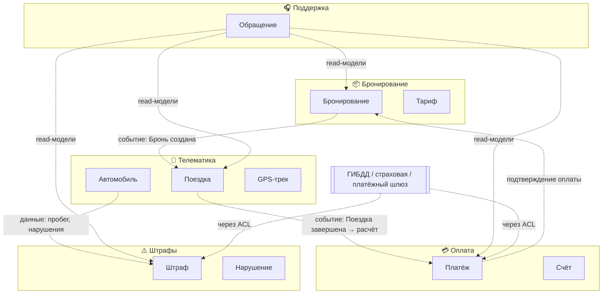

# Лекция 2. Предметная область, анализ процессов (Event Storming), требования и диаграмма Исикавы

> Статус: кандидат в final. Причина: ожидает human review / human fact-check (см. `review.md`, `fact-check.md`). Источник истины темы: `specs/syllabus.md`, Лекция 2; формальные требования — `specs/lessons/lesson-02.spec.md`, `specs/content-contracts/lesson-contract.md`.
> **Курс:** Проектирование ИТ-решений: System Design и архитектура данных · **Длительность:** 80 мин
> **Материалы:** `slides.md` (кандидат), `practice.md` (задания B1 и B2), `diagrams.md` (Д1–Д5)
> **Зависимости:** Лекция 1 (Architecture Brief, System Context Diagram, стейкхолдеры, формат ADR)
> **Следующая тема по syllabus:** Лекция 3 «Концептуальная и логическая модели данных. Нормализация и эволюция схемы»

---

## Оглавление

1. Цель занятия
2. Learning Objectives
3. План занятия (тайминг 80 минут)
4. Hook: «Один автомобиль — четыре правды»
5. Теоретический блок (Т1–Т6)
   - Т1. Влияние предметной области на архитектуру
   - Т2. DDD: Ubiquitous Language, Bounded Contexts, Context Map
   - Т3. Event Storming: цветовая кодировка, процесс, связь с БД
   - Т4. Проблематика: метод «5 почему» и диаграмма Исикавы (6M)
   - Т5. Виды требований (BABOK), SMART, нумерация и трассируемость
   - Т6. Приоритизация MoSCoW и Quality Attribute Scenarios (NFR)
6. Case Study: каршеринг DriveShare — от хаоса к контекстам и требованиям
7. Связка с управленческими решениями
8. Ключевые термины
9. Визуальные материалы
10. Anti-patterns (7 типичных ошибок)
11. Типичные вопросы студентов (FAQ)
12. Практическое задание
13. Резюме
14. Связь с курсом «Базы данных»
15. Мостик к лекции 3
16. Вопросы для самопроверки (по таксономии Блума)
17. Источники и фактическая честность

---

## Цель занятия

Научиться декомпозировать сложную предметную область с помощью Domain-Driven Design (DDD), выявлять бизнес-события и границы контекстов через Event Storming, находить корневые причины проблем домена («5 почему», диаграмма Исикавы/6M) и формализовать требования — функциональные (SMART, MoSCoW) и нефункциональные (Quality Attribute Scenarios) — так, чтобы они становились проверяемыми драйверами архитектуры и проектирования данных.

## Learning Objectives

По окончании лекции студенты смогут:

1. **Знать** ключевые понятия DDD (домен, субдомен, Ubiquitous Language, Bounded Context, Context Map, Aggregate, Entity, Value Object) и цветовую кодировку Event Storming.
2. **Понимать**, почему одна бизнес-сущность имеет разные модели в разных контекстах, и как предметная область (FinTech, E-commerce, IoT) определяет архитектуру данных.
3. **Применять** Event Storming для выявления доменных событий и границ контекстов; строить диаграмму Исикавы по категориям 6M и цепочку «5 почему»; формулировать FR по SMART и приоритизировать их по MoSCoW.
4. **Анализировать** противоречия в понимании требований между стейкхолдерами и связывать события домена с будущими артефактами данных (таблицы, агрегаты, read-модели).
5. **Оценивать** качество требований: отличать измеримый Quality Attribute Scenario от размытой формулировки, выявлять конфликты NFR и обосновывать компромиссы.
6. **Создавать** комплект артефактов анализа: список событий, описание контекстов, Context Map, диаграмму Исикавы, реестр FR/NFR с приоритетами — как вход для проектирования данных (Лекция 3) и Architecture Blueprint (Лекция 7).

## План занятия

| Время | Блок | Содержание | Материалы |
|---|---|---|---|
| 0–5 | Hook | «Один автомобиль — четыре правды»: кейс недопонимания сущностей | раздел «Hook» |
| 5–12 | Т1 | Влияние предметной области на архитектуру; субдомены (Core/Supporting/Generic) | §Т1, таблица доменов |
| 12–22 | Т2 | DDD: Ubiquitous Language, Bounded Context, Context Map, Aggregate | §Т2, Д5 |
| 22–32 | Т3 | Event Storming: цвета, шесть этапов, связь с БД | §Т3, Д2 |
| 32–40 | Т4 | Проблематика: «5 почему», диаграмма Исикавы (6M) | §Т4, пример «Частые падения БД» |
| 40–50 | Т5–Т6 | BABOK, SMART, MoSCoW, Quality Attribute Scenarios, конфликты NFR | §Т5–Т6, Д4 |
| 50–70 | Case Study | DriveShare: события → контексты → Context Map → Исикава → реестр FR/NFR | §Case Study, Д3 |
| 70–80 | Управление + резюме | Conway's Law, бюджет, риски, FAQ, мостик к Л3 | соответствующие разделы |

Практика (задания B1 + B2) вынесена в отдельное занятие/домашнюю работу — см. `practice.md`; суммарно ~70 минут вне рамок 80-минутной лекции.

**Слоты взаимодействия на лекции** (обязательные точки активности группы, фиксируются в слайдах): **0–5 мин** — вопрос Hook «где произошла ошибка?» (поднять руку / короткий ответ в чате); **~40 мин** — быстрый разбор пары «размытая формулировка → QA Scenario» (студенты предлагают свою метрику до показа эталона); **~65 мин** — мини-опрос по Case Study: «какой контекст является владельцем статуса доступности и почему не телематика?». Остальные 15+ минутSlot'ов приходятся на практику вне лекции.

> Примечание по таймингу: после расширения объёма документа теоретические блоки Т1–Т6 стали плотнее; при проведении занятия преподаватель может сократить глубину блоков Т4 и Т6 до уровня «определение + один пример», перенеся детальный разбор в практику B2.

## Hook: «Один автомобиль — четыре правды» — 5 мин

**Ситуация.** Компания запускает сервис краткосрочной аренды автомобилей (каршеринг) в городе с населением примерно 1 млн человек. Парк на старте — около 200 автомобилей, срок запуска — 3 месяца, команда разработки — 8 человек. Функции: бронирование по минутам/часам, телеметрия, оплата, штрафы, поддержка клиентов.

**Что произошло через месяц разработки.** Разработчики спроектировали единую таблицу `cars` — 47 колонок, в которые попытались уместить всё, что о себе говорят разные отделы. Через месяц выяснилось, что слово «автомобиль» в компании означает четыре разные вещи:

- **Отдел эксплуатации** видит «Автомобиль» как физический объект: VIN, координаты GPS, уровень топлива, пробег, состояние датчиков. Для них важна телеметрия в реальном времени.
- **Бухгалтерия** видит «Автомобиль» как актив: балансовая стоимость, амортизация, налоговая категория, срок списания. Их волнует учёт, а не координаты.
- **Отдел продаж** понимает «Автомобиль» как товар: тариф, класс, скидки, доступность для бронирования, доходность в час пик.
- **Служба поддержки** знает «Автомобиль» как объект обращений: история инцидентов, ремонты, жалобы, штрафы клиента за конкретную машину.

**Следствия для системы:**

1. Модуль бронирования блокировал автомобиль «на всякий случай» на 24 часа, а модуль телематики считал его свободным — клиенты видели «нет машин вблизи».
2. Бухгалтерия не могла рассчитать амортизацию: данные о пробеге хранились в формате телематики и терялись при конвертации.
3. Поддержка не видела историю платежей, работая с обращением, — каждый тикет требовал ручного запроса в другую систему.
4. Любое изменение схемы `cars` требовало согласования всех четырёх отделов; релизы тормозились.

**Итог:** задержка запуска примерно на два месяца и переделка ядра системы (оценка трудозатрат на переделку — порядка сотен человеко-часов; учебная иллюстрация масштаба, а не факт из реальной компании).

**Вопрос аудитории.** Где произошла ошибка: в выборе базы данных, языка программирования или чего-то более раннего?

**Ответ, который мы построим сегодня.** Ошибка произошла до выбора технологий: система отражала не структуру бизнеса, а представление одной команды о ней. Сегодня осваиваем четыре инструмента, которые ставят анализ предметной области перед проектированием:
1. **DDD** — как границы смысла (Bounded Contexts) становятся границами моделей данных;
2. **Event Storming** — как за одну сессию вытащить знания бизнеса на доску;
3. **«5 почему» и диаграмма Исикавы (6M)** — как находить корневые причины проблем домена, а не лечить симптомы;
4. **Требования** — как превращать высказывания стейкхолдеров в измеримые FR (SMART, MoSCoW) и NFR (Quality Attribute Scenarios).

---

## Теоретический блок — 30 мин (конспект раскрывает полноту)

### Т1. Влияние предметной области на архитектуру

#### Что такое домен и зачем он архитектору

**Домен (Domain)** — сфера деятельности, для которой создаётся программное решение (E-commerce, FinTech, HealthTech, IoT, образование). Архитектура — это отражение домена в структуре системы: если мы неправильно поняли домен, нас не спасёт ни один технологический выбор. Отсюда порядок работы курса: сначала WHAT/WHY (этот курс), потом HOW (следующий семестр, курс «Базы данных»).

**Субдомены (Subdomains)** делятся по роли в конкурентном преимуществе:

| Тип субдомена | Определение | Пример для каршеринга | Следствие для архитектуры |
|---|---|---|---|
| **Ключевой (Core)** | Источник конкурентного преимущества, ради него создаётся система | Алгоритм динамического распределения парка и ценообразования | Инвестировать усилия в модель, собственная реализация |
| **Поддерживающий (Supporting)** | Необходим, но не уникален | Учёт поездок, начисление штрафов | Стандартная модель, можно адаптировать типовое решение |
| **Общий (Generic)** | Решается готовыми продуктами | Аутентификация, эквайринг, SMS | Покупать/подключать, не изобретать; интегрировать через ACL |

Разделение на субдомены — первый инструмент приоритизации: усилия анализа (Event Storming, DDD) целесообразно направлять прежде всего на Core-субдомены. Это же отвечает на вопрос «нужен ли нам DDD вообще»: для систем с простой CRUD-логикой и бедным доменом полный набор практик DDD избыточен (см. Анти-паттерн 6).

#### Как разные домены диктуют разные архитектурные решения

| Домен | Особенности данных | Приоритетные NFR | Что это значит для хранения (детально — Л4) |
|---|---|---|---|
| FinTech | Строгие проводки, аудит, регуляторика | Консистентность, безопасность, трассируемость | ACID-транзакции, журналирование, несъёмные копии |
| Social Media / IoT | Огромные потоки записи, допустима задержка обновления | Throughput, доступность, горизонтальное масштабирование | Write-heavy схемы, eventual consistency, временные ряды |
| E-commerce | Гибкая схема каталога, поиск, read-heavy нагрузка | Производительность чтения, гибкость схемы | Документные/поисковые хранилища как дополнение к реляционному ядру |
| HealthTech | Конфиденциальность, интеграции, долгий retention | Compliance, безопасность, целостность | Разделение PII, шифрование, аудит доступа |
| Транспорт/телематика | Высокая частота сигналов, геоданные | Свежесть данных, буферизация пиков | Time-series/гео-хранение, пакетная доставка событий |

**Вывод Т1:** универсальной архитектуры «для любого бизнеса» не существует; архитектурные драйверы выводятся из природы домена. Этот вывод в Лекции 1 назывался «данные как архитектурное ограничение» — теперь видно, откуда берутся сами ограничения.

#### Мини-пример контраста

Финтех-перевод и лайк в соцсети — оба «событие пользователя». Но первый требует гарантии «списано = зачислено» (строгая консистентность, аудит), второй переживает потерю единичной записи ради доступности (eventual consistency, высокая пропускная способность). Если проектировать обе системы «одинаково правильно», одна из них будет либо чрезмерно дорогой, либо ненадёжной. Выбор гарантий — производная от домена, а не от моды на технологию.

### Т2. DDD: единый язык, ограниченные контексты, карта контекстов

#### Определение и происхождение

**Domain-Driven Design (DDD)** — подход к проектированию программного обеспечения, в котором модель предметной области является центральным элементом архитектуры. Автор — Эрик Эванс (Eric Evans, 2003, «Domain-Driven Design: Tackling Complexity in the Heart of Software»). DDD адресован системам со сложной бизнес-логикой; его инструменты делятся на стратегические (границы: субдомены, Bounded Context, Context Map) и тактические (внутри границ: Entity, Value Object, Aggregate, Domain Event).

#### Ubiquitous Language (Единый язык)

**Ubiquitous Language** — общий словарь терминов, который разработчики, аналитики и бизнес-эксперты используют внутри одного контекста; термины фиксируются в глоссарии проекта.

Правила:
- Один термин — одно значение в пределах контекста. «Бронирование» — оформленная заявка клиента на конкретный автомобиль на конкретный период; «Поездка» — факт использования автомобиля от открытия до закрытия. Не синонимы, не взаимозаменяемы.
- Язык живёт одновременно в речи, документации и коде: если термин меняется в модели — он меняется в UI-текстах и в названиях сущностей, и наоборот.
- Формулировки вида «ну, это примерно как заказ, только не совсем» — сигнал, что значение термина ещё не согласовано; такие места помечаются как Hot Spot (см. Т3).

**Что даёт дисциплина языка:** снижает число уточняющих встреч, делает требования проверяемыми (термин из FR совпадает с термином из модели данных) и предотвращает «тихий дрейф» значений, из-за которого в кейсе Hook таблица `cars` накопила 47 колонок.

**Анти-паттерн языка:** один термин — несколько понятий («Заказ» = и бронь, и поездка, и счёт). Средство лечения — не переименование «во всей системе», а разведение по контекстам (см. далее).

#### Bounded Context (Ограниченный контекст)

**Bounded Context** — явная граница, внутри которой модель предметной области остаётся консистентной: действует свой единый язык и своя модель. Ключевой принцип: **одна бизнес-сущность может иметь разные модели в разных контекстах** — и это нормально.

Пример «Автомобиль» (полная версия — диаграмма Д5):

| Контекст | «Автомобиль» — это | Ключевые атрибуты | Требования к данным |
|---|---|---|---|
| Бронирование | Резервируемый ресурс | ID, класс, тариф, слоты доступности | Строгая консистентность: нельзя забронировать дважды |
| Телематика | Физический объект с датчиками | VIN, GPS, топливо, пробег | Высокая частота записи, допустима задержка согласованности |
| Бухгалтерия | Актив компании | Балансовая стоимость, амортизация, налоговая категория | Точность учёта, долгий retention, аудиторские проверки |
| Поддержка | Объект обращений | История инцидентов, ремонтов, жалоб | Полный «разрез» данных из других контекстов (read-модель) |

Правила работы с границами:
1. **Одна модель — один контекст.** Не пытайтесь создать универсальную модель на всю систему; «общая сущность Vehicle на все случаи» — путь к Big Ball of Mud (Анти-паттерн 1).
2. **Границы контекста — граница транзакционной консистентности.** Внутри контекста гарантируется согласованность модели; между контекстами согласованность достигается интеграцией (API/события) и часто бывает ослабленной (eventual). Важная поправка: «eventual между контекстами» — правило проектирования, а не закон: для финансово значимых связей требуются саги с компенсацией и идемпотентностью (детали — Л5–Л6).
3. **Границы контекстов обычно становятся границами сервисов и баз данных** (database-per-context), но не обязаны: маленький контекст может жить модулем в монолите. Вопрос «стиль реализации» относится к архитектуре контейнеров; здесь мы фиксируем смысловые границы. Для нашего курса важно, что **границы контекста — это будущие границы схем данных**: этот тезис реализуем в Лекции 3.

#### Context Map (Карта контекстов)

**Context Map** — диаграмма взаимосвязей ограниченных контекстов с указанием **типов отношений**. Карта показывает не только «кто с кем говорит», но и «кто чьей модели подчиняется» — то есть политическую структуру проекта.

| Тип связи | Смысл | Когда применять | Риск |
|---|---|---|---|
| Partnership | Два контекста совместно развивают процесс, синхронизируют roadmap | Core-контексты, критичные друг к другу | Согласование релизов, взаимная блокировка |
| Shared Kernel | Общая часть модели, которую меняют вместе | Маленький стабильный фрагмент (например, справочник тарифов) | Каждая правка ядра затрагивает обе стороны |
| Customer-Supplier | Поставщик предоставляет данные/сервис потребителю | Односторонняя зависимость (Телематика → Оплата) | Потребитель ждёт изменений поставщика |
| Conformist | Потребитель полностью копирует модель поставщика | Поставщик крупнее/сильнее, менять ничего нельзя (отчётность ← Бухгалтерия) | Чужая модель разрушает вашу |
| Anti-Corruption Layer (ACL) | Адаптер переводит чужую модель во внутреннюю | Интеграция с внешними системами (платёжный шлюз, ГИБДД) | Стоимость поддержки слоя |
| Open Host Service / Published Language | Публичный API в общем формате (например, JSON Schema событий) | Много потребителей одного сервиса | Жёсткость контракта, необходимость версионирования |

**Зачем нужна Context Map:** визуализирует зависимости команд, позволяет планировать интеграции и заранее видеть, где чужая смена модели данных «прилетит» вам. На уровне данных: каждая стрелка карты — это будущий контракт обмена (событие, API, витрина), а не JOIN.

#### Тактический набор (кратко): Entity, Value Object, Aggregate, Domain Event

- **Entity (Сущность)** — объект с уникальным идентификатором и изменяемым состоянием: Автомобиль (VIN), Клиент (ID). Идентичность важнее атрибутов: клиент остался тем же клиентом, сменив телефон.
- **Value Object (Объект-значение)** — определяется атрибутами, не имеет идентичности, неизменяем: Адрес (улица+дом+квартира), Деньги (сумма+валюта), Период (начало+окончание). Любое «изменение» VO — замена экземпляра целиком.
- **Aggregate (Агрегат)** — группа связанных объектов, рассматриваемых как единое целое с точкой входа — **Aggregate Root**. Например, агрегат «Бронирование»: корень Booking + VO Period + VO Price; менять содержимое можно только через корень. **Агрегат — граница транзакции**: операция должна укладываться в один агрегат, иначе консистентность требует распределённых механизмов (саги, outbox — Л5–Л6).
- **Domain Event (Доменное событие)** — неизменный факт, уже произошедший в предметной области; формулируется существительным + причастием в прошедшем времени: «Бронирование подтверждено». События — «валюта общения» между контекстами и сырьё для Event Storming.

Эти четыре понятия нужны нам на курсе главным образом для одного: **увидеть соответствие между бизнес-моделью и моделью данных**. Агрегат подсказывает границу таблицы/группы таблиц и транзакции; Value Object — кандидата на составные колонки или атрибут без права частичного обновления; доменное событие — кандидата на журнал событий или триггер интеграции. Детальная проработка — в Лекции 3.

### Т3. Event Storming: совместный анализ домена

#### Определение

**Event Storming** — метод совместного анализа бизнес-процессов, предложенный Альберто Брандолини (Alberto Brandolini, 2013). Фасилитированная сессия, на которой участники (бизнес-эксперты, разработчики, аналитики, тестировщики) выкладывают на большую стену (или виртуальную доску) последовательность доменных событий цветными стикерами. Цель — за 2–4 часа получить общее понимание домена, обнажить противоречия и пробелы **до** начала проектирования.

#### Цветовая кодировка (базовый набор)

| Цвет | Элемент | Правило формулировки | Пример |
|---|---|---|---|
| 🟠 Оранжевый | Domain Event | Прошедшее время, факт: «что произошло?» | «Автомобиль забронирован», «Счёт выставлен» |
| 🔵 Синий | Command | Намерение/действие: «сделай X» | «Забронировать автомобиль» |
| 🟡 Жёлтый | Aggregate | Над чем выполняется команда | «Бронирование», «Платёж» |
| 🟣 Фиолетовый | Policy (правило) | «Если событие X, то сделать Y» | «Если отмена < 24 ч — удержать залог» |
| ⬜ Зелёный | Read Model | Данные для отображения пользователю | «Список доступных авто рядом» |
| 🩷 Розовый | Hot Spot | Проблема, неопределённость, спор | «Неясно, кто отвечает за возврат залога» |
| ⬛ Чёрный | Bounded Context | Граница группы смысла | «Контекст: Бронирование» |
| 🔴 Красный | External System | Внешняя система-участник | Платёжный шлюз, ГИБДД, страховая |

(В разных школах кодировка Policy/External System может отличаться оттенками; на занятии используется таблица выше — она зафиксирована в `knowledge/domain-analysis/event-storming.md` и `diagrams.md`.)

#### Процесс сессии: шесть этапов

1. **Chaotic Exploration (15–30 мин).** Все свободно клеят оранжевые события. Запрещено критиковать и спорить о порядке. Требование: события в прошедшем времени, один стикер — одно событие.
2. **Enforce Timeline (10–15 мин).** Выстраиваем события слева направо по времени. Появляются развилки («Оплата прошла» / «Платёж не прошёл») и дыры («а между „Бронь создана“ и „Поездка началась“ что-то потерялось?»).
3. **Identify Commands (15 мин).** Для каждого события добавляем синий стикер команды: кто/что его вызвало. Цепочка «Command → Event» становится скелетом будущего API.
4. **Identify Aggregates (15 мин).** Жёлтые стикеры: над каким объектом выполняется команда. Команда не может изменять два агрегата одновременно — это сразу видно на доске.
5. **Identify Policies & Read Models (15 мин).** Фиолетовые правила и зелёные представления: какие автоматические реакции вызывает событие, какие экраны/отчёты питаются данными.
6. **Boundaries & Hot Spots (15–20 мин).** Чёрные рамки — кандидаты в Bounded Contexts; розовые — открытые вопросы, которые уносятся в бэклог анализа или в ADR.

#### Правила фасилитации

- Обязательное участие бизнес-экспертов (Product Owner, операторы, смежные отделы) — сессия «разработчики между собой» воспроизводит ошибку из Hook (Анти-паттерн 5).
- Простой язык, без технического жаргона: стикер «POST /bookings создан» — нарушение метода; правильный — «Бронирование создано».
- Споры о формулировках полезны: каждый спор — это невысказанное бизнес-правило.
- Фото доски и цифровая копия — обязательный артефакт; без фиксации сессия теряет ценность для следующих этапов.

#### Связь Event Storming с проектированием БД

Это тот мост, по которому мы пойдём в Лекцию 3:

| Элемент Event Storming | Артефакт данных / системы |
|---|---|
| Доменное событие 🟠 | Факт для хранения: строка в таблице записей или журнал событий (event log) |
| Команда 🔵 | Операция записи: API-эндпоинт/метод сервиса; источник транзакции |
| Агрегат 🟡 | Граница транзакции; будущая таблица или группа таблиц с FK-иерархией |
| Read Model ⬜ | Представление (VIEW), денормализованная витрина или поисковый индекс |
| Политика 🟣 | Триггер интеграции, расписание, правило валидации (CHECK / бизнес-слой) |
| Hot Spot 🩷 | Открытое требование: pending-вопрос к владельцу или повод для ADR |
| Bounded Context ⬛ | Схема БД / база целиком (database-per-context), независимая эволюция |

**Практический вывод:** качество концептуальной модели данных (Л3) почти полностью определяется качеством событийной ленты, полученной здесь. Мусор на доске — мусор в схеме.

### Т4. Проблематика: «5 почему» и диаграмма Исикавы (6M)

Анализ домена полезен не только для «как устроено», но и для «что болит». Требования хорошего качества рождаются из корректно сформулированных проблем, поэтому в лекцию включён причинно-следственный аппарат.

#### Постановка проблемы

**Проблематика** — дисциплина формулирования проблемы перед её решением. Проверочный вопрос к любой формулировке требования: «Какое именно наблюдение/боль стоит за этим?» Формулировка-симптом («клиенты жалуются на медленное приложение») и формулировка-проблема («30% попыток бронирования в час пик завершаются отказом из-за конфликта доступности») задают совершенно разные архитектуры.

#### Метод «5 почему»

**«5 почему»** — итеративный опрос «почему это происходит?», ведущий от симптома к корневой причине; метод получил известность благодаря практике Toyota (популяризатор — Тайити Оно; атрибуцию требует проверить fact-check).

Канонический пример (из эксплуатации БД):
1. Почему сервис падал по вечерам? → Переполнялся диск журнала транзакций.
2. Почему переполнялся? → Логи не ротировались.
3. Почему не ротировались? → Ротация не была настроена при развёртывании.
4. Почему не была настроена? → В процедуре развёртывания нет шага настройки ротации.
5. Почему нет шага? → **Нет стандарта эксплуатации** — корневая причина организационная, а не техническая.

Правила применения:
- Каждый ответ должен быть **проверяемым утверждением** (факт, лог, метрика), а не мнением («потому что код плохой» — неприемлемый ответ).
- «5» — не магическое число: допускается остановка на 3–4 шагах, если достигнута причина **вне зоны контроля** (регулятор, внешний партнёр) или причина, на которую команда может влиять через процесс. Обоснование остановки обязательно.
- Одна цепочка — одна ветвь причин; параллельные «потому что» означают, что проблема комплексная → нужен следующий инструмент.

#### Диаграмма Исикавы (Fishbone / Cause-and-Effect)

**Диаграмма Исикавы** — инструмент визуального анализа причинно-следственных связей проблемы; предложен Каору Исикавой (Kaoru Ishikawa) в 1960-х годах, применяется в TQM и Six Sigma. «Голова рыбы» — проблема (след), «кости» — категории причин, «подветвления» — конкретные причины и «причины причин».

Классический набор категорий **6M**:

| Категория | Рус. | Типовой содержательный вопрос в IT-контексте |
|---|---|---|
| Manpower | Люди | Квалификация, обучение, мотивация, дежурства |
| Methods | Методы | Процессы, регламенты, стандарты, ревью кода |
| Machines | Оборудование | Серверы, сети, инструменты, лимиты инфраструктуры |
| Materials | Материалы/данные | Качество данных, конфигурации, зависимости |
| Measurements | Измерения | Метрики, мониторинг, логирование, алерты |
| Mother Nature | Внешняя среда | Регуляторика, рынок, сезонные факторы, внешние системы |

Пример заполнения (проблема: «Частые падения БД»):

```
Люди                          Методы                        Оборудование
  │ Нет дежурного DBA ночью     │ Нет ревью SQL               │ Диск на 90% заполнен
  │ Разработчики не знают      │ Миграции без стейджинга     │ Нет резервного сервера
  │   лимитов запросов          │                             │
        ╲                             │                            ╱
         ╲──────────► [ПРОБЛЕМА: Частые падения БД] ◄─────────────
         ╱                            │                             ╲
        ╱                             │                              ╲
Данные (Materials)             Измерения                  Внешняя среда
  │ Таблица 500 млн строк        │ Нет алертов на slow       │ Пиковая нагрузка
  │   без индексов               │   queries                 │   в праздники
  │ Нет архивирования            │ Мониторинг раз в 5 мин    │ Требование
  │   старых данных              │                           │   регулятора: 5 лет
```

Для сервиса каршеринга та же техника даёт, например, проблему «Высокая доля отмен бронирований» с ветвями: Люди (клиент не понимает условий отмены), Методы (нет процесса освобождения авто после истечения брони), Оборудование (GPS-модуль не всегда фиксирует начало поездки), Данные (статус доступности рассинхронизирован между контекстами), Измерения (метрики отказов бронирования не собраны), Внешняя среда (городские мероприятия создают пики спроса). Заметьте: половина причин оказывается **архитектурно-организационными**, а не «багами», — это и есть точка, где анализ проблем превращается в требования.

#### Как Исикава связана с остальными инструментами дня

- Категории 6M — готовые «корзины» для **FR/NFR**: причина из ветви «Измерения» порождает NFR на мониторинг, из «Методы» — требование к процессу миграций, из «Данные» — требование к качеству данных (Л3, Л6).
- Верхние (наиболее существенные) причины диаграммы проверяются цепочкой «5 почему»; результат — формулировка корневой проблемы, из которой выводится SMART-требование.
- Hot Spot-стикеры Event Storming (🩷) — естественный источник проблем для диаграммы: то, о чём спорили на доске, стоит исследовать причинно.

### Т5. Виды требований (BABOK), SMART, нумерация и трассируемость

#### Иерархия видов требований (BABOK Guide v3)

**BABOK** (A Guide to the Business Analysis Body of Knowledge, IIBA, v3, 2015) задаёт общепринятую иерархию требований; в курсе используем её как «шкалу точности» формулировок:

| Уровень | Вопрос | Пример (каршеринг) |
|---|---|---|
| Бизнес-требования | Зачем? Какая цель? | «Выйти на самоокупаемость парка в 3 городах за 12 месяцев» |
| Пользовательские требования | Что хочет делать пользователь? | «Клиент хочет найти свободную машину в пешей доступности за 3 минуты» |
| Функциональные требования (FR) | Что система должна делать? | «Система должна позволять забронировать автомобиль на период от 1 минуты» |
| Нефункциональные требования (NFR) | Как система должна работать? | «95% запросов бронирования в час пик обрабатываются менее 300 мс» |
| Требования к данным (производный слой нашего курса) | Какие данные нужны и с какими гарантиями? | «Статус доступности автомобиля должен обновляться не позднее 10 с после завершения поездки» |

Практический смысл иерархии: **каждое FR обязано «смотреть вверх»** — объяснять, какое пользовательское/бизнес-требование оно обслуживает. Требование без родителя — кандидат на удаление (это тоже анти-паттерн: «требование-сирота»).

#### SMART-критерии к функциональным требованиям

| Критерий | Суть | Нарушение → исправление |
|---|---|---|
| **S**pecific | Однозначно, без «и т.п.» | «Работа с бронированиями» ❌ → «Система позволяет клиенту отменить активное бронирование» ✅ |
| **M**easurable | Есть критерий приёмки | «Быстро искать авто» ❌ → «Поиск возвращает список доступных авто в радиусе 1 км» ✅ |
| **A**chievable | Реалистично при ограничениях | «Гарантировать подачу авто за 30 секунд в любом районе» ❌ |
| **R**elevant | Ведёт к бизнес-цели (родитель в иерархии) | «Поддержка протокола Bluetooth 4.0» без связи с целью ❌ |
| **T**ime-bound | Срок/этап, дата пересмотра | «К моменту запуска в Q2» / «Пересмотр через 6 мес.» |

Шаблон записи FR в реестре:

```
FR-012. Система позволяет клиенту отменить активное бронирование из приложения.
Родитель: UR-03 «Клиент контролирует свою аренду».
Критерий приёмки: отмена возможна до начала поездки; после начала — только через поддержку.
Приоритет: Must (MoSCoW). Срок: MVP (Q2). Владелец: Product Owner.
```

#### Нумерация и трассируемость

- Формат идентификаторов: `BR-001…` (business), `UR-001…` (user), `FR-001…`, `NFR-001…`.
- Идентификаторы позволяют ссылаться в ADR, тестах и моделях данных: «таблица bookings реализует FR-011…FR-014; индекс по daterange обслуживает NFR-002».
- Сквозная цепочка трассировки курса: **бизнес-цель (Л1) → событие домена (Л2) → требование (Л2) → элемент модели данных (Л3) → выбор СУБД/гарантий (Л4) → проверка в peer-review (Л7)**. Требование, по которому нельзя построить проверку, — формально не принято.

### Т6. Приоритизация MoSCoW и Quality Attribute Scenarios

#### MoSCoW

| Приоритет | Значение | Правило применения |
|---|---|---|
| **Must** | Без этого система не работает / не выходит в продакшн | Должно быть меньше 100% требований; «всё must» = ничего не приоритизировано |
| **Should** | Важно, но есть обходной путь на MVP | Планируется во второй итерации |
| **Could** | Желательно при наличии ресурсов | Delight-функции, откладывается без боли |
| **Won't have (this time)** | Осознанно исключено из текущего релиза | Фиксируется явно — снимает повторные переговоры |

MoSCoW — не «голосование мнений»: каждая буква привязывается к бизнес-цели и/или корневой причине из Исикавы (Must «Освобождение авто после истечения брони» ← корневая причина «статусы рассинхронизированы» ← проблема «доля отказов бронирования»). Won't have особенно ценен: это документированное «нет», защищающее scope.

#### NFR и Quality Attribute Scenarios

**Нефункциональные требования** описывают **как** система работает: производительность (latency, throughput), масштабируемость, доступность (SLA/SLO/SLI), надёжность (MTBF/MTTR), безопасность (CIA triad, GDPR/152-ФЗ), сопровождаемость, стоимость владения (TCO), а также ограничения — жёсткие рамки (бюджет, дедлайн, регулятор, квалификация команды).

Разговорное «быстрая/надёжная/безопасная» — не требование, а пожелание. Инструмент превращения пожелания в требование — **Quality Attribute Scenario** (форма, восходящая к практике SEI/CMU ATAM; в курсе используется упрощённый шестиэлементный шаблон):

| Элемент | Вопрос | Пример |
|---|---|---|
| Source of Stimulus | Кто/что инициирует? | Клиент мобильного приложения |
| Stimulus | Что происходит? | Отправляет запрос на бронирование |
| Environment | В каких условиях? | Часы пик 18:00–20:00, ~500 одновременных пользователей |
| Artifact | Какой компонент? | Сервис бронирования (контекст Reservation) |
| Response | Что обязана сделать система? | Проверить доступность и подтвердить бронь |
| Response Measure | Как измерить? | 95% запросов < 300 мс |

Полная формулировка: *«При нагрузке ~500 одновременных пользователей в часы пик (18:00–20:00) сервис бронирования должен подтверждать 95% запросов менее чем за 300 мс».*

Ещё примеры по атрибутам:

| Атрибут | Scenario |
|---|---|
| Доступность | «При отказе узла приложения в рабочее время система переключается на резервный ≤ 30 с, теряя не более 1% активных сессий» |
| Масштабируемость | «При двукратном росте нагрузки ёмкость увеличивается автоматически ≤ 5 мин без простоя» |
| Консистентность | «Координаты автомобиля согласованы во всех узлах ≤ 10 с после обновления» |
| Целостность платежей | «При сбое в обработке платежа транзакция откатывается или завершается полностью: 100% ACID, частичные оплаты исключены» |

**Тест на зрелость NFR:** если невозможно написать тест/метрику, которая падает при нарушении, — это не NFR, а лозунг.

#### Ограничения и сроки как отдельный класс входных данных

Помимо quality-атрибутов, анализ даёт **ограничения** (constraints) — параметры, которые проектировщик не выбирает, а принимает: бюджет (~5 млн руб. в кейсе DriveShare), срок MVP (3 месяца), команда (8 человек), квалификация команды, регуляторные рамки, обязательная совместимость с существующими системами. Разница с NFR принципиальна: NFR можно «покупать» деньгами и архитектурой (хотите 99,95% — платите за резервирование), ограничения покупаются нельзя — они задают пространство допустимых решений. В реестре артефактов лекции ограничения живут в Architecture Brief (Лекция 1) и участвуют в MoSCoW: требование, нарушающее ограничение по сроку, автоматически снижается в приоритете или уходит в Won't have.

#### Конфликты NFR и trade-off-дисциплина

Требования конфликтуют; задача архитектора — управлять конфликтом явно, а не делать вид, что его нет:

| Конфликт | Природа | Способ управления | Пример решения для каршеринга |
|---|---|---|---|
| Консистентность ↔ Доступность | CAP/PACELC: при сетевом разделе держим данные или держим сервис | Выбор по типу операции | Бронирование — консистентность (двойная бронь недопустима); телеметрия — доступность/пропускная способность |
| Производительность ↔ Безопасность | Шифрование, проверки, аудит добавляют задержку | Бюджет latency на проверки; асинхронный аудит | Шифрование PII офлайн-джобой; в горячем пути — только подпись запроса |
| Скорость выхода ↔ Сопровождаемость | Быстрые решения накапливают долг | Ограничение числа «temporary» решений, ADR с датой пересмотра | Общий справочник тарифов (Shared Kernel) с обязательством рефакторинга к Q4 |
| Полнота функций ↔ Стоимость (TCO) | Каждое Could — лицензия/сервер/человек | MoSCoW + расчёт TCO по вариантам | Программа лояльности — Won't have в MVP |
| Свежесть данных ↔ Нагрузка на сеть | GPS каждые 10 с × 600 авто — поток | Композиция: батчинг + приоритет событий | Трек пишется пакетами 5 с; события «начало/конец поездки» — немедленно |

Хорошая практика: конфликт фиксируется в **ADR** (формат из Лекции 1: Context / Decision / Consequences) — с указанием, какая сторона сознательно принесена в жертву и при каких условиях решение пересматривается.

---

## Case Study: каршеринг DriveShare — от хаоса к контекстам и требованиям — 20 мин

### Контекст кейса

Компания **DriveShare** запускает сервис краткосрочной аренды автомобилей. Параметры учебного кейса (вымышленные, взяты из `specs/syllabus.md` и сквозного проекта курса):

- Рынок: город с населением ~1 млн человек; старт — 3 города в течение года.
- Парк: примерно по 200 автомобилей на город (итого ~600 к концу года).
- Функции: бронирование по минутам/часам/дням, доставка автомобиля, абонементы, корпоративные клиенты.
- Интеграции: платёжные системы, страховые компании, ГИБДД (проверка штрафов), навигационные сервисы, оператор IoT-связи для телематики.
- Ограничения: бюджет запуска ~5 млн руб. (учебное допущение кейса, выбранное для правдоподобия малого стартапа; не рыночная оценка), срок MVP — 3 месяца, команда — 8 человек.
- Стейкхолдеры: клиенты, операторы парка, бухгалтерия, служба поддержки, менеджеры парка, юридическая служба, внешний партнёр (страховая).

Ситуация из Hook повторилась в реальности команды: монолитная БД, единая таблица `cars`, конфликты модулей. Разберём полный путь выхода из неё — шестью шагами, каждый из которых опирается на инструмент из теории.

### Шаг 1. Event Storming: выявление доменных событий

Проводим двухчасовую сессию с участием Product Owner, двух операторов парка, бухгалтера, руководителя поддержки и трёх разработчиков. Результат первой волны (фрагмент ленты событий; полный набор — 24 события, см. practice.md):

| № | Событие 🟠 | Актор/команда 🔵 | Кандидат в контекст ⬛ |
|---|---|---|---|
| 1 | Пользователь зарегистрирован | Пройти регистрацию | Пользователи |
| 2 | Права клиента проверены | Запросить проверку прав (внешн. сервис) | Пользователи / ACL |
| 3 | Автомобиль добавлен в парк | Зарегистрировать автомобиль | Телематика |
| 4 | Поиск автомобиля выполнен | Найти свободные авто рядом | Бронирование |
| 5 | Автомобиль забронирован | Забронировать автомобиль | Бронирование |
| 6 | Бронь подтверждена | Подтвердить бронь | Бронирование |
| 7 | Бронь отменена | Отменить бронь | Бронирование |
| 8 | Поездка начата | Открыть автомобиль | Телематика |
| 9 | Координаты обновлены | (телеметрия, автоматически) | Телематика |
| 10 | Поездка завершена | Закрыть автомобиль | Телематика |
| 11 | Стоимость поездки рассчитана | (политика: по тарифу и длительности) | Оплата |
| 12 | Счёт сформирован | Выставить счёт | Оплата |
| 13 | Платёж прошёл | Оплатить счёт | Оплата |
| 14 | Платёж не прошёл | Повторить списание / эскалация | Оплата |
| 15 | Возврат инициирован | Оспорить списание | Оплата |
| 16 | Штраф выставлен | Зафиксировать нарушение (ГИБДД/оператор) | Штрафы |
| 17 | Штраф оспорен | Оспорить штраф | Штрафы |
| 18 | Обращение создано | Написать в поддержку | Поддержка |
| 19 | Обращение закрыто | Решить обращение | Поддержка |

Что дала дисциплина формулировок: событие «Поездка оплачена» было отвергнуто на доске — оплата относится к счёту, а не к поездке; это обнаружил спор оператора и бухгалтера. Такие споры и есть цель метода.

### Шаг 2. Определение ограниченных контекстов

Группировка агрегатов и событий даёт пять контекстов (+ один кандидат на объединение):

**1. Контекст «Бронирование» (Reservation)** — Core-субдомен частично (динамика доступности).
- Ответственность: управление доступностью автомобилей, жизненный цикл брони.
- Ключевые сущности: Бронирование (агрегат), Тариф (VO-справочник), Слот доступности.
- События: «Автомобиль забронирован», «Бронь подтверждена», «Бронь отменена».
- Требования к данным: строгая консистентность (нельзя забронировать один автомобиль дважды в пересекающийся период); запись через блокировку/транзакцию.

**2. Контекст «Телематика» (Telematics)** — Supporting + инфраструктурный.
- Ответственность: слежение за состоянием парка, фиксация поездок.
- Сущности: Автомобиль (физический), Поездка, GPS-трек, Событие датчика.
- События: «Поездка начата», «Координаты обновлены», «Поездка завершена».
- Требования к данным: высокая частота записи (GPS каждые ~10 с на автомобиль — учебный порядок величины), write-heavy, eventual consistency допустима; объёмы растут линейно с парком.

**3. Контекст «Оплата» (Payment)** — Generic (эквайринг покупается) + Supporting (биллинг).
- Сущности: Платёж, Счёт, Возврат.
- События: «Счёт сформирован», «Оплата прошла», «Платёж не прошёл», «Возврат инициирован».
- Требования: ACID-транзакции, аудиторская трассировка, соответствие платёжным регуляторным требованиям (PCI DSS упоминается только как направление проверки: курс не является юридической консультацией, применимость стандарта и его редакция определяются юристами и схемой интеграции — см. «Примечания честности» и `fact-check.md`).

**4. Контекст «Штрафы» (Fines)** — Supporting, юридически значимый.
- Сущности: Нарушение, Штраф, Оспаривание.
- События: «Штраф выставлен», «Штраф оспорен», «Штраф оплачен».
- Требования: юридическая значимость записей, долгий retention, неизменяемость фактов (журнал), интеграция с внешним источником данных (ГИБДД) через ACL.

**5. Контекст «Поддержка» (Support)** — Supporting.
- Сущности: Обращение, Комментарий, Эскалация.
- Требования: агрегирует read-модели всех остальных контекстов («полная картина клиента»), не имеет права писать в чужие модели.

Проверочный вопрос на этом шаге для каждого кандидата в контексты: *«Есть ли у этой группы своя версия Ubiquitous Language, которая конфликтует с чужой?»* Если «Автомобиль» здесь означает другое, чем там, — граница настоящая.

### Шаг 3. Context Map и типы связей



Назначенные типы отношений:

| Связь | Тип | Обоснование |
|---|---|---|
| Бронирование ↔ Телематика | Partnership | Совместно развивают процесс поездки; синхронизируют контракты событий |
| Телематика → Оплата | Customer-Supplier | Оплата потребляет факт «Поездка завершена» для расчёта |
| Оплата → Бронирование | Customer-Supplier + ACL на внешнем шлюзе | Внутренний контракт простой; внешний эквайринг изолирован адаптером |
| Поддержка → все | Conformist | Поддержка строит read-модели по чужим схемам, не требуя изменений |
| Внешние системы (ГИБДД, страховая) | ACL | Их модель данных нестабильна и нам неподвластна |
| Общий справочник тарифов | Shared Kernel (осторожно!) | Маленький стабильный фрагмент; изменения — только по согласованию обеих команд |

Каждая стрелка карты — будущий контракт обмена данными (событие/API/read-модель). В терминах данных: здесь не будет ни одного межконтекстного JOIN.

**Связь с Лекцией 1.** System Context Diagram из первой лекции рисует систему как единый чёрный ящик среди внешних акторов и систем; Context Map смотрит внутрь этого ящика — на смысловые границы его частей. Вместе они дают два уровня C4 Model: Context Map описывает содержимое первого уровня (System Context) и намечает второй (Container), к которому мы придём в Лекции 7 при сборке Architecture Blueprint.

### Шаг 4. Диаграмма Исикавы для приоритетной проблемы

Прежде чем фиксировать NFR, выбираем проблему для анализа по данным беты/эксплуатации (учебно): «Высокая доля отказов при попытках бронирования в час пик». Строим рыбу по 6M:

```
Люди                         Методы                        Оборудование
 │ Операторы вручную          │ Нет регламента               │ IoT-модуль не всегда
 │   освобождают авто         │   освобождения после         │   отправляет статус
 │   после инцидентов         │   истечения брони            │   вовремя
       ╲                       │                             ╱
        ╲─────► [ОТКАЗЫ БРОНИРОВАНИЯ В ЧАС ПИК] ◄──────────
        ╱                       │                             ╲
Данные                      Измерения                   Внешняя среда
 │ Статус «занят» живёт       │ Нет метрики              │ Мероприятия города
 │  копиями в 3 модулях       │   доли отказов           │   создают пики спроса
 │  с разным временем          │   бронирования           │ Погода смещает спрос
 │   обновления                │ Дашборд показывает средний      │   на вечер
 │                             │   отклик, не отказы      │
```

Цепочка «5 почему» по самой существенной ветви (Данные):
1. Почему отказы? → Клиент видит автомобиль «доступен», а при подтверждении он занят.
2. Почему видит доступным? → Статус доступности берётся из устаревшей копии.
3. Почему копия устаревшая? → Три модуля хранят статус по отдельности и обновляют его независимо.
4. Почему независимо? → Исторически: единая таблица `cars`, каждый писал в свою группу колонок.
5. Почему так спроектировали? → **Не было границ контекстов и единого владельца статуса** ← корневая причина (организационно-архитектурная).

Формулировка решения-требования из корневой причины: «Владелец статуса доступности — единственный контекст (Бронирование); другие контексты читают его через read-модель с SLA на свежесть ≤ 10 с». Это одновременно и FR, и источник NFR — переходим к шагу 5.

### Шаг 5. Реестр требований: FR (SMART + MoSCoW) и NFR (Quality Attribute Scenarios)

Фрагмент реестра DriveShare (полный заполняется в практике):

| ID | Требование (FR) | Родитель | Критерий приёмки | MoSCoW | Срок |
|---|---|---|---|---|---|
| FR-001 | Клиент может забронировать доступный автомобиль на период от 1 минуты | BR-01 загрузка парка | Успешная бронь недоступного авто исключена (0 двойных броней в тесте) | Must | MVP Q2 |
| FR-002 | Система немедленно помечает авто занятым на период брони | UR-02 честная карта | После FR-001 авто исчезает из поиска ≤ 1 с | Must | MVP Q2 |
| FR-003 | Клиент может отменить бронь до начала поездки из приложения | UR-03 контроль аренды | Отмена создаёт событие «Бронь отменена», слот освобождён | Must | MVP Q2 |
| FR-004 | Оператор принудительно освобождает авто после инцидента | BR-03 снижение отказов | Действие фиксируется с авторством и причиной | Should | MVP+1 |
| FR-005 | Корпоративному клиенту выставляется консолидированный счёт за месяц | BR-02 B2B-сегмент | Счёт содержит все поездки сотрудников за период | Could | Q3 |
| — | Программа лояльности v2 | — | — | **Won't have** (this time) | — |

Обратите внимание: FR-002 родился прямо из корневой причины Исикавы; Won't have записан явно, чтобы закрыть повторные переговоры.

Quality Attribute Scenarios (NFR):

**NFR-001. Производительность подтверждения брони**

| Элемент | Значение |
|---|---|
| Source/Stimulus | Клиент мобильного приложения отправляет запрос бронирования |
| Environment | Часы пик 18:00–20:00, ~500 одновременных пользователей (учебная иллюстрация нагрузки) |
| Artifact | Контекст «Бронирование» |
| Response | Проверка доступности и подтверждение брони |
| Response Measure | 95% запросов < 300 мс; доля отказов «авто недоступно» < 2% |

**NFR-002. Свежесть статуса доступности**

| Элемент | Значение |
|---|---|
| Stimulus | Освобождение или занятие автомобиля |
| Environment | Штатная работа сети |
| Artifact | Read-модель доступности для поиска |
| Response | Статус обновлён во всех точках показа |
| Response Measure | ≤ 10 с (прямое требование из корневой причины шага 4) |

**NFR-003. Целостность платежей**

| Элемент | Значение |
|---|---|
| Stimulus | Сбой в момент обработки платежа |
| Environment | Любое время |
| Artifact | Контекст «Оплата» |
| Response | Транзакция откатывается или завершается полностью |
| Response Measure | 0 частичных оплат; 100% проводок проходят ACID-проверку в тесте |

**NFR-004. Доступность сервиса бронирования**

| Элемент | Значение |
|---|---|
| Stimulus | Отказ узла приложения |
| Environment | Рабочее время 07:00–23:00 |
| Artifact | Сервис бронирования |
| Response | Переключение на резервный узел |
| Response Measure | ≤ 30 с; потеря ≤ 1% активных сессий |

Конфликт, зафиксированный в ADR-001 (шаблон из Лекции 1): *Context* — NFR-002 требует мгновенной актуальности статуса, NFR-001 требует быстрого ответа; чтение «истины» из одного места добавляет задержку. *Decision* — статус держит контекст Бронирования (синхронная проверка при подтверждении), поиск отдаёт read-модель со свежестью ≤ 10 с, окончательное решение — по транзакции в момент подтверждения. *Consequences* — принимаем редкие «гонки» (клиент видит доступное, но получает отказ при подтверждении) ценой ≤ 2%; метрика отказов — триггер пересмотра.

### Шаг 6. Итоговый артефакт и Architecture Brief

Результат Case Study складывается в раздел «Предметная область» Architecture Brief (шаблон из `templates/architecture-brief.md`):

1. Список доменных событий (19+ событий, полная лента — в практике).
2. Пять ограниченных контекстов с ответственностями и требованиями к данным.
3. Context Map с типами связей и внешними системами через ACL.
4. Диаграмма Исикавы + цепочка «5 почему» для приоритетной проблемы.
5. Реестр FR (SMART, MoSCoW) и NFR (Quality Attribute Scenarios) с трассировкой к бизнес-целям.
6. ADR-001 — первый задокументированный компромисс.

**Разбор альтернативного мнения (типичный студенческий вопрос).** Часть аудитории предлагает «упростить»: оставить два контекста — Клиентский и Административный. Проверка правилом Т2: внутри «Клиентского» термины «Автомобиль» (ресурс брони) и «Автомобиль» (объект телеметрии) продолжат конфликтовать — границы проведены по пользователям интерфейса, а не по моделям. Такое разбиение воспроизводит анти-паттерн «технические границы» (см. Анти-паттерн 2), только повёрнутый на роль экранов. Границы должны совпадать со сменой смысла, а не со сменой экрана.

---

## Связка с управленческими решениями

### Что должен понимать ИТ-менеджер / Product Owner

#### 1. Команды и коммуникации (Conway's Law)

**Закон Конвея:** организации проектируют системы, которые копируют свою коммуникационную структуру. Следствие: выделение контекстов — это одновременно решение об оргструктуре.

- Одна команда владеет одним (максимум двумя небольшими) контекстом; владение включает модель данных, API и эксплуатацию.
- Единый язык сокращает число согласительных встреч: термин из бэклога = термин из кода = термин из схемы БД.
- Reverse Conway maneuver: сначала меняешь состав команд под целевые границы контекстов, потом система «складывается» сама.

Для DriveShare (8 человек на MVP): команда «Мобильный + Бронирование» (4 чел.), «Телеметрия» (2 чел.), «Оплата/Интеграции» (2 чел.); Поддержка и Штрафы временно живут модулями/внешними решениями — осознанное упрощение, записанное в ADR.

#### 2. Бюджет и сроки

- Стоимость анализа: Event Storming-сессия — примерно 8–16 человеко-часов суммарно (подготовка, сессия 2–4 ч, документирование); Исикава с командой — ещё 2–4 ч (учебные ориентиры, не норматив).
- Стоимость переделки без анализа: кейс Hook показывает масштаб — месяцы задержки и сотни человеко-часов (иллюстративная оценка).
- Экономика требования: каждое «Must» конвертируется в стоимость владения (серверы, лицензии, поддержка); MoSCoW — инструмент защиты бюджета, а не «классификация хотелок».
- Раннее выявление Hot Spot'ов дешевле поздних инцидентов: вопрос «кто владелец статуса авто» на доске стоит час обсуждения, тот же вопрос в проде — неделю разбора отказов.

#### 3. Архитектурные решения, вытекающие из анализа

| Решение анализа | Как оно влияет на архитектуру | Когда принимается окончательно |
|---|---|---|
| Границы контекстов | Границы сервисов и схем БД (database-per-context) | Лекция 3 (модели), Лекция 4 (СУБД) |
| Классы субдоменов (Core/Generic) | Покупать vs строить (эквайринг — купить, распределение парка — строить) | Выбор стека, Л4–Л5 |
| Quality Attribute Scenarios | Требования к СУБД, консистентности, репликации | Л4, Л6 |
| Типы связей Context Map | Синхронные API vs асинхронные события; где нужен ACL | Л5, Л6 |

Управленческий вывод: **не начинать выбор технологий до фиксации контекстов и измеримых NFR**. Вопрос «какую базу данных выбрать?» без ответов «сколько контекстов и какие гарантии им нужны?» не имеет корректного ответа.

#### 4. Риски игнорирования дисциплины анализа

| Риск | Последствие | Симптом в проекте |
|---|---|---|
| Big Ball of Mud | Модель, которую невозможно поддерживать | Таблица с десятками колонок «на все случаи» |
| Дорогая поддержка | Каждое изменение затрагивает всё | Code review одной колонки собирает 4 отдела |
| Невозможность масштабировать команду | Онбординг вместо недель занимает кварталы | Новый разработчик боится менять схему |
| Межкомандные конфликты | Гонки за одни таблицы | «Бронь блокирует авто, телеметрия его освобождает» |
| Неизмеримые NFR | Споры о готовности без критериев | «Система медленная» как баг-репорт без метрик |
| Лечение симптомов | Бюджет уходит на следствия причин | Десятый фикс статуса доступности вместо одного владельца статуса |

### Практические рекомендации менеджерам

1. **Включайте Event Storming в план проекта** до начала разработки; требуйте фото/цифровую копию доски как артефакт.
2. **Выделяйте контексты до выбора технологий**; начинайте совещания с вопроса «какие бизнес-контексты существуют?», а не «какую СУБД берём?».
3. **Привязывайте команды к контекстам**, избегайте команд-«слоёв» (фронтенды/бэкенды отдельно).
4. **Требуйте измеримости**: не принимайте «быстро/надёжно/безопасно»; принимайте «95% < 300 мс», «RTO ≤ 30 мин», «0 частичных оплат».
5. **Заведите ритуал причинного анализа** для повторяющихся инцидентов: Исикава + «5 почему» → корневая причина → требование в бэклог, а не «ещё один хотфикс».
6. **Документируйте решения в ADR** — включая сознательно принятые жертвы trade-off'ов и дату пересмотра.
7. **Явно фиксируйте Won't have** — это защищает команду от стейкхолдерского давления дешевле любых договорённостей «в кулуарах».

---

## Ключевые термины

Все определения соответствуют `knowledge/glossary.md`. Если формулировка требования в вашей команде расходится с глоссарием курса — это кандидат в Hot Spot: расхождение терминов лечится договорённостью о едином языке (Т2), а не молчаливым выбором «кто кого переспорит».

| Термин | Определение (соответствует `knowledge/glossary.md`) |
|---|---|
| **Domain-Driven Design (DDD)** | Подход к разработке, фокусирующийся на глубоком понимании предметной области и отражении её структуры в архитектуре (Эванс, 2003) |
| **Домен / Субдомен** | Сфера деятельности системы / её часть; субдомены бывают ключевыми (Core), поддерживающими (Supporting) и общими (Generic) |
| **Ubiquitous Language** | Единый словарь терминов, используемый разработчиками и бизнес-экспертами внутри одного контекста |
| **Bounded Context** | Явная граница, внутри которой модель предметной области остаётся консистентной; разные контексты могут иметь разные модели одной бизнес-сущности |
| **Context Map** | Диаграмма взаимосвязей ограниченных контекстов с типами отношений |
| **Anti-Corruption Layer (ACL)** | Паттерн защиты внутренней модели контекста от влияния внешних моделей |
| **Aggregate / Aggregate Root** | Кластер сущностей и объектов-значений как единое целое; точка входа изменений; граница транзакции |
| **Entity** | Объект с уникальным идентификатором и изменяемым состоянием |
| **Value Object** | Объект, определяемый атрибутами, а не идентификатором; неизменяем |
| **Domain Event** | Факт, произошедший в предметной области; формулируется в прошедшем времени |
| **Event Storming** | Метод совместного анализа бизнес-процессов стикерами (Брандолини, 2013) |
| **Hot Spot** | Проблемная зона/неопределённость, обнаруженная на сессии (розовый стикер) |
| **Read Model** | Данные, подготовленные для отображения пользователю |
| **Диаграмма Исикавы (6M)** | Причинно-следственная «рыба»: проблема по категориям Люди/Методы/Оборудование/Данные/Измерения/Внешняя среда (Исикава, 1960-е) |
| **«5 почему»** | Итеративный опрос от симптома к корневой причине (Toyota) |
| **BABOK** | Свод знаний бизнес-аналитика (IIBA v3, 2015); иерархия видов требований |
| **SMART** | Критерии качества FR: Specific, Measurable, Achievable, Relevant, Time-bound |
| **MoSCoW** | Приоритизация: Must / Should / Could / Won't have (this time) |
| **NFR** | Нефункциональные требования: как система работает (производительность, доступность, безопасность…) |
| **Quality Attribute Scenario** | Структурированная формулировка NFR: stimulus, environment, artifact, response, response measure |
| **Трассироваемость** | Связь «бизнес-цель → требование → реализация → проверка» через идентификаторы BR/UR/FR/NFR |
| **Big Ball of Mud** | Анти-паттерн архитектуры: бесструктурная «грязь» из взаимозависимостей |

---

## Визуальные материалы

Полный комплект с пояснениями и рекомендациями по показу — в `diagrams.md` (Д1–Д5); здесь рабочие версии.

### Д1. Процесс от бизнес-цели к архитектуре через анализ домена

```
Бизнес-цель (Л1) ──► Problem statement: «что болит?»
        │                     │
        │              «5 почему» + Исикава (6M)
        │                     │  корневые причины
        ▼                     ▼
Предметная область ──► Event Storming: события 🟠
        │                     │
        ▼                     ▼
Субдомены Core/Supp/Generic ─► Bounded Contexts ⬛
        │                     │
        ▼                     ▼
   ADR / выбор стиля    Context Map (типы связей)
                              │
                              ▼
              FR (SMART, MoSCoW) + NFR (QA Scenarios)
                              │
                              ▼
      Проектирование данных (Л3) → выбор СУБД (Л4) → интеграции (Л5)
```

### Д2. Фрагмент доски Event Storming (ASCII)

```
┌──────────────────────────── EVENT STORMING: DRIVESHARE ────────────────────────────┐
│                                                                                      │
│  🟡Клиент  🔵Забронировать авто → 🟠Авто забронирован → 🔵Подтвердить → 🟠Бронь      │
│                                                            подтверждена              │
│                                     🔵Отменить ↓                    │                │
│                            🟠Бронь отменена                  🟣Политика:             │
│                                                                отмена<24ч → залог    │
│  ⬛ КОНТЕКСТ: БРОНИРОВАНИЕ      │                                          │          │
│  ───────────────────────────────┼──────────────────────────────────────────┼─────     │
│                                 ▼                                          ▼          │
│  🟡Агрегат: Бронирование   🔵Открыть авто → 🟠Поездка начата → 🟠Координаты   │          │
│  🟢Read: список доступных       🟡Агрегат: Поездка   обновлены (каждые ~10 с) │          │
│                                 ⬛ КОНТЕКСТ: ТЕЛЕМАТИКА ──────────────────────┘         │
│                                                                                      │
│  🩷 HOT SPOT: кто отвечает за возврат залога при отмене?                               │
│  🔴 EXTERNAL: платёжный шлюз · ГИБДД · страховая                                       │
└──────────────────────────────────────────────────────────────────────────────────────┘
```

### Д3. Context Map DriveShare — см. Mermaid-диаграмму в Case Study, шаг 3 (идентична диаграмме Д3 из `diagrams.md`).

### Д4. Шаблон Quality Attribute Scenario (раздатка)

| Поле | Вопрос | Пример |
|---|---|---|
| Source of Stimulus | Кто инициирует? | Клиент приложения |
| Stimulus | Что происходит? | Запрос бронирования |
| Environment | В каких условиях? | Час пик, ~500 юзеров |
| Artifact | Какой компонент? | Контекст Бронирования |
| Response | Что обязана сделать? | Подтвердить бронь |
| Response Measure | Как измерить? | 95% < 300 мс |

### Д5. Один термин — четыре модели (сущность «Автомобиль»)

```
                 ┌────────────────────┐
                 │   «АВТОМОБИЛЬ»     │  ← одно слово в речи
                 └─────────┬──────────┘
      ┌───────────┬────────┴───────┬────────────┐
      ▼           ▼                ▼            ▼
 БРОНИРОВАНИЕ  ТЕЛЕМАТИКА     БУХГАЛТЕРИЯ    ПОДДЕРЖКА
 ресурс брони  объект с       актив:         объект
 id,тариф,     датчиков:      балансовая     обращений:
 слоты         VIN,GPS,       стоимость,     история
               топливо        амортизация    инцидентов
 ────────────  ────────────   ────────────   ────────────
 strong         eventual       точность       read-модель
 consistency    consistency    учёта          всех систем
```

**Рекомендация преподавателю:** Д5 показывать сразу после Hook — она превращает нарратив в структурную картинку; Д2 — перед практической частью; Д4 раздавать как шаблон для задания B2.

### Д6. Диаграмма Исикавы — пустой шаблон (раздатка для задания B2)

Шаблон печатается/копируется студентам перед практикой B2; категории подписаны по 6M, проблема формулируется измеримо.

```
   ЛЮДИ                МЕТОДЫ              ОБОРУДОВАНИЕ
     │                    │                    │
     ├─                   ├─                   ├─
     ├─                   ├─                   ├─
      ╲                   │                   ╱
       ╲                  │                  ╱
        ╲────────► [ПРОБЛЕМА: ______________ ] ◄────────
        ╱                  │                  ╲
       ╱                   │                   ╲
     ├─                   ├─                   ├─
     ├─                   ├─                   ├─
   ДАННЫЕ             ИЗМЕРЕНИЯ          ВНЕШНЯЯ СРЕДА
  (Materials)        (Measurements)     (Environment)
```

---

## Anti-patterns

### ❌ Анти-паттерн 1: Единая модель на всю систему (Big Ball of Mud)

Попытка создать одну сущность «Автомобиль»/«Пользователь» на все контексты. Пример — та самая `cars` из 47 колонок: телеметрические поля рядом с налоговыми, статусы «на всякий случай». Последствия: неконтролируемый рост таблицы, любое изменение затрагивает всех, невозможность оптимизировать хранение под конкретную нагрузку, конфликты команд при миграциях схемы. **Лечение:** отдельные модели в каждом контексте (`reservation.availability`, `telematics.vehicles`, `accounting.assets`) и связи через контракты, а не через общие таблицы.

### ❌ Анти-паттерн 2: Технические или «экранные» границы вместо бизнес-логических

Разделение на контексты по слоям (Frontend/Backend/Database) или по ролям интерфейсов (Клиентский/Административный). Внутри такого «контекста» конфликт смыслов сохраняется, а к нему добавляется распределение одной бизнес-операции по нескольким командам. **Признак:** чтобы реализовать «отмену брони», нужно менять три «контекста». **Лечение:** граница там, где меняется значение термина (Т2, правило проверочного вопроса).

### ❌ Анти-паттерн 3: Размытые формулировки требований

«Система должна быть быстрой, надёжной и безопасной». Не проверяемо → не является требованием; порощает бесконечные споры о готовности и «бесхозные» инциденты. **Лечение:** SMART для каждого FR (критерий приёмки), Quality Attribute Scenario для каждого NFR (Response Measure). Тест: «Каким автоматическим тестом/метрикой это проверяется?»

### ❌ Анти-паттерн 4: Прямые JOIN между контекстами

```sql
-- НЕЛЬЗЯ: скрытая связанность через чужие таблицы
SELECT r.booking_id, t.gps_location, p.amount
FROM reservation.bookings r
JOIN telematics.trips t ON r.car_id = t.car_id
JOIN payment.transactions p ON r.booking_id = p.booking_id;
```

Пока базы физически общие, такой запрос «работает», но связывает эволюцию трёх контекстов: переименование колонки в телеметрии ломает отчётность поддержки. **Лечение:** события и read-модели; запросы — в границах одного контекста; federation-запросы к чужим схемам запрещены архитектурным правилом (ADR).

### ❌ Анти-паттерн 5: Event Storming без бизнес-экспертов

Сессия «разработчики между собой» производит правдоподобную, но вымышленную модель домена: события придуманы, политики угаданы, границы нарисованы по микросервисным предпочтениям. Архитектура строится на неверных допущениях, а расходы всплывают на интеграциях. **Лечение:** обязательное присутствие PO, операторов, смежных отделов (бухгалтерия, юристы); фасилитатор следит, чтобы жаргонные стикеры переформулировались бизнес-языком.

### ❌ Анти-паттерн 6: DDD везде, где не надо

Полный набор стратегических и тактических паттернов применяется к CRUD-админке из пяти таблиц. Цена: раздутая модель, лишние слои, обучение команды ради экономии, которой нет. **Признак необходимости DDD:** сложная бизнес-логика, разные значения одних терминов, частые изменения правил. Для простых форм «поле → колонка» достаточно прямого отображения. **Лечение:** классификация субдоменов (Т1) — тяжёлое modeling-вооружение только против Core-сложности.

### ❌ Анти-паттерн 7: Лечение симптомов вместо корневых причин

Десятый по счёту фикс «статуса доступности» без вопроса «почему статусов несколько». Каждая заплатка локально оправдана и глобально удорожает систему; проблема возвращается под новым именем. **Лечение:** ритуал Исикава + «5 почему» для повторяющихся инцидентов; выход на процессную/архитектурную причину; результат — требование (FR/NFR) или ADR, а не тикет «пофиксить».

---

## FAQ: типичные вопросы студентов

**Q1. Чем Bounded Context отличается от микросервиса?**
Контекст — граница смысла и модели; микросервис — способ физической реализации. Один маленький контекст может жить модулем в монолите; большой контекст может быть несколькими сервисами. Сначала находим контексты, потом решаем, во что их «лить» (Лекции 3–5).

**Q2. Зачем называть события прошедшим временем?**
Прошедшее время фиксирует факт, который уже нельзя отменить, — то есть данные, годные для хранения и аудита. «Забронировать автомобиль» — намерение (может не осуществиться); «Автомобиль забронирован» — факт (есть время, субъект, последствия). Это напрямую переносится в модель данных: факты становятся записями.

**Q3. Сколько контекстов «правильно» — 5, 10, 20?**
Ни одно число не правильно само по себе. Ориентир: новый контекст оправдан, если (а) термины внутри него конфликтуют с терминами снаружи, (б) у группы событий разный режим консистентности/нагрузки, (в) может быть назначен отдельный владелец. Иначе — это модуль, а не контекст.

**Q4. Event Storming и User Story Mapping — одно и то же?**
Нет. Event Storming смотрит на домен глазами бизнес-фактов и границ (что происходит в мире системы), Story Mapping — на путь пользователя к цели (какими шагами он получает ценность). Первое питает модель данных и интеграции, второе — backlog UI. На курсе рабочий инструмент — Event Storming.

**Q5. Можно ли хранить историю статусов автомобиля в очереди сообщений вместо базы?**
Нет. Очередь/брокер — канал передачи событий, а не система хранения истины: гарантии persistence, запросов и целостности у него другие (детали — Л5–Л6). Факты «Статус изменён» сохраняются в хранилище контекста-владельца; брокер лишь доставляет копии подписчикам.

**Q6. Что делать, если бизнес-эксперт говорит «всё равно всё поменяем трижды за год»?**
Зафиксировать как ограничение и как риск: high-churn правила — кандидат на вынос в конфигурацию/policy-движок (политики 🟣 из Event Storming), плюс более частый пересмотр ADR. Это управленческое решение с известной ценой, а не повод отказаться от анализа.

**Q7. Чем Quality Attribute Scenario лучше обычного списка NFR?**
Список «latency < 300 мс, availability 99.9%» без окружения и источника ложных нагрузок допускает бесконечные трактовки («а ночью тоже?»). Scenario привязывает метрику к стимулу, условиям и артефакту — то есть превращает требование в тест.

**Q8. Обязательны ли все 6 категорий 6M в каждой диаграмме?**
Нет. 6M — стартовый набор «корзин», предотвращающий tunnel vision. Если категория пуста — так и пишем («внешняя среда: значимых факторов не найдено»); иногда полезнее адаптированный набор (для people-heavy процессов — Policies вместо Mother Nature). Важно, чтобы анализ был многоветвенным, а не ритуально-шестицветным.

---

## Практическое задание

Полный текст с шаблонами и рубрикой — в `practice.md`; здесь — постановка.

**Задание B1 (аудиторно/домашне, ~40 мин), кейс DriveShare (расширенная версия: 3 города, ~600 авто, абонементы, корпоративные клиенты, интеграции с ГИБДД/страховыми):**
1. Выделить ≥10 доменных событий (прошедшее время), собрать связную ленту.
2. Выделить 4–6 ограниченных контекстов, описать ответственность и требования к данным каждого.
3. Построить Context Map (Mermaid) с типами связей и внешними системами (ACL).
4. Сформулировать 3 Quality Attribute Scenarios с измеримыми мерами.
5. Перенести результат в раздел «Предметная область» Architecture Brief.

**Задание B2 (~30 мин, обязательное):** причинно-следственный анализ и приоритизация:
1. Диаграмма Исикавы по 6M для одной проблемы домена (≥3 категории × ≥2 причины, допускается иерархия «причина причины»).
2. Цепочка «5 почему» от верхней причины до корневой (3–5 шагов, остановка обоснована).
3. Реестр ≥5 FR по SMART с идентификаторами и родителями + приоритизация MoSCoW (обоснование каждой буквы; Must < 100%).
4. Минимум один NFR в форме QA Scenario, выведенный из корневой причины.

**Критерии оценки (сводно, детальная rubric — в practice.md):** полнота и связность событий (20%), корректность границ контекстов (25%), качество Context Map (20%), измеримость NFR (20%), связь решений с бизнес-целью (15%). Для B2: причинно-следственная корректность рыбы, проверяемость шагов «5 почему», SMART у FR, обоснованность M/S/C/W.

**Типичные ошибки при выполнении** — см. раздел Anti-patterns (особенно 1, 2, 3, 5): экзаменатор узнает их по одинаковым признакам — единая сущность на всё, «фронт/бэк»-контексты, «быстрая система», события-намерения.

**Связь с итоговым проектом:** артефакты B1+B2 войдут в Architecture Blueprint (Лекция 7) и станут входом для концептуальной модели данных (Лекция 3) и peer-review (Лекция 7).

---

## Резюме

1. Архитектура начинается с домена: субдомены Core/Supporting/Generic определяют, куда направлять усилия моделирования и что покупать.
2. DDD задаёт границы смысла: Ubiquitous Language, Bounded Context, Context Map; одна сущность — много моделей, и это норма.
3. Event Storming — быстрый способ достать знания бизнеса: события 🟠 → команды 🔵 → агрегаты 🟡 → политики 🟣 → границы ⬛; каждый элемент предсказывает артефакт данных.
4. Проблемы лечатся причинами: «5 почему» доходит до корня, Исикава (6M) не даёт забыть целые классы причин; вывод — требования, а не заплатки.
5. Требования имеют форму: FR — SMART, с ID, родителем и критерием приёмки; приоритеты — MoSCoW (включая явное Won't have); NFR — Quality Attribute Scenarios с мерой.
6. Каждое решение — компромисс; конфликты NFR фиксируются в ADR.
7. Границы контекстов — это будущие границы схем данных. Дальше — Лекция 3.

## Связь с курсом «Базы данных»

Согласно syllabus, текущий курс задаёт уровень WHAT/WHY, а курс «Базы данных» следующего семестра — HOW. Сегодня мы произвели ровно те артефакты, из которых техническая реализация выводится, а не изобретается заново:

| Артефакт Лекции 2 | Использование в курсе «Базы данных» / Лекциях 3–6 |
|---|---|
| Лента доменных событий | Источник сущностей и связей ER-модели (Л3); кандидатов на таблицы-журналы и event log |
| Агрегаты | Границы транзакций и групп таблиц с FK-иерархией (Л3, Л5) |
| Read Models | Представления/витрины, денормализация с ADR (Л3) |
| Границы контекстов | Схема-per-контексту, полиглотное хранение (Л3, Л4) |
| Требования консистентности из NFR | Выбор уровня изоляции, ACID vs BASE (Л4) |
| Событийные связи Context Map | Outbox/саги, выбор брокера (Л5, Л6) |
| Freshness-SLO (NFR-002) | Пороги репликации и инвалидации кэша (Л6, Л8) |

Итоговый отчёт курса (Лекция 7) станет ТЗ для технической реализации (HOW) в следующем семестре — поэтому неполный анализ домена сегодня превращается в переделку схемы завтра.

## Мостик к следующей лекции

Мы получили пять контекстов и требования к их данным, но пока говорили только словами: «Бронирование — строгая консистентность», «Телематика — много записей», «Поддержка — разрез всех данных». Ни одна из этих характеристик ещё не выражена структурой:

- Событие «Автомобиль забронирован» → какая таблица, какие колонки, какие ключи?
- Агрегат «Бронирование» → как отобразить границу транзакции в реляционной схеме?
- Read Model «список доступных авто» → VIEW, денормализация или поисковый индекс?
- Два разных «Автомобиля» в двух контекстах → две разные схемы? как не потерять связь?

**Лекция 3** («Концептуальная и логическая модели данных. Нормализация и эволюция схемы») переводит бизнес-события и контексты в модели данных: три уровня моделей, нотации ER/Crow's Foot, ключи и ограничения, нормализация до 3НФ и устранение аномалий, осознанная денормализация и Zero-Downtime миграции (Expand and Contract). Наша событийная лента станет входом для концептуальной модели.

## Вопросы для самопроверки

**Знать (remember)**
1. Назовите элементы цветовой кодировки Event Storming и правило формулировки доменного события.
2. Перечислите шесть категорий 6M диаграммы Исикавы.
3. Какие уровни иерархии требований выделяет BABOK?

**Понимать (understand)**
4. Почему одна бизнес-сущность должна иметь разные модели в разных Bounded Contexts? Приведите свой пример (не из лекции).
5. Чем Value Object отличается от Entity и почему неизменяемость VO важна для модели данных?
6. В чём разница между формулировкой-симптомом и формулировкой-проблемой? Почему вторая полезна архитектору?

**Применять (apply)**
7. Составьте ленту из ≥5 событий для выбранного домена (ритейл/финтех/логистика/госсектор) с командами и кандидатами в контексты.
8. Сформулируйте по одному FR (SMART) и NFR (QA Scenario) для «долгой обработки возвратов» в e-commerce.
9. Приоритизируйте ваш список FR по MoSCoW и обоснуйте хотя бы одно Won't have.

**Анализировать (analyze)**
10. Постройте диаграмму Исикавы для проблемы «частые двойные бронирования» и проведите «5 почему» по наиболее существенной ветви. Где остановитесь и почему?
11. Найдите в приведённом фрагменте схемы `cars` (Анти-паттерн 1) признаки минимум трёх различных контекстов; предложите границы.

**Оценивать (evaluate)**
12. Оцените пару: «Shared Kernel для справочника тарифов» vs «Customer-Supplier с копированием тарифа». Какие NFR и риски командной работы решают в пользу каждого варианта?
13. Экспертная группа предложила 20 контекстов для системы из 8 человек. Оцените предложение по критерию стоимости координации; что вы возразите?

**Создавать (create)**
14. Соберите мини-Architecture Brief раздела «Предметная область»: события, контексты, Context Map (Mermaid), реестр FR/NFR, один ADR с конфликтом NFR — как заготовку для Лекции 3 и Blueprint Лекции 7.

## Источники и фактическая честность

**Основная литература и источники понятий:**
- Evans, E. (2003). *Domain-Driven Design: Tackling Complexity in the Heart of Software*. Addison-Wesley.
- Brandolini, A. (2019). *Introducing EventStorming*. eventstorming.com.
- Ishikawa, K. (1968). *Guide to Quality Control*. Asian Productivity Organization. (Атрибуция автора и набора 6M — medium confidence, см. `fact-check.md`, пункт 3.)
- IIBA. (2015). *A Guide to the Business Analysis Body of Knowledge (BABOK Guide)*, Version 3. (Соотнесение уровней требований с редакцией — pending-human, `fact-check.md`, пункт 5.)
- Bass, L., Clements, P., Kazman, R. — практика Quality Attribute Scenarios (форма stimulus–response–measure восходит к ATAM/SEI); в курсе используется упрощённый шестиэлементный вариант.
- Cockburn, D. (1994) — происхождение MoSCoW (medium confidence, `fact-check.md`, пункт 7).
- База знаний курса: `knowledge/domain-analysis/*` (ddd-bounded-contexts, event-storming, ishikawa, requirements-babok), `knowledge/system-design/nfr.md`, `knowledge/system-design/trade-offs.md`, `knowledge/glossary.md`.

**Примечания честности (no-hallucination):**
- Кейс DriveShare — вымышленный учебный проект курса (`specs/syllabus.md`); параметры парка, городов, команды и бюджета — художественные допущения, синхронизированные со сквозным кейсом.
- Все количественные значения (≈200/600 авто, 500 одновременных пользователей, 300 мс, 10 с, 24 часа, «сотни человеко-часов», 8–16 ч на сессию) — учебные иллюстрации/порядки величин, не эмпирические замеры; точные значения зависят от окружения и подтверждаются нагрузочным тестированием.
- Формулировки регуляторных ориентиров (PCI DSS, GDPR/152-ФЗ) даны как указание направление соответствия; юридические детали требуют сверки с актуальными редакциями (см. `fact-check.md`, задача 2.3 плана работ).
- Упоминания конкретных технологий отсутствуют намеренно или даны как примеры сценарной применимости; ни одна технология не подаётся как единственно верная (lesson-contract §4.2). Очереди/брокеры не позиционируются как хранилище данных (§4.3; см. FAQ Q5).
- Все спорные утверждения сведены в `fact-check.md`; до человеческого вердикта по `review.md` и `fact-check.md` документ остаётся **кандидатом в final**.

*Дата генерации: 31 октября 2026. Конвейер: brief → outline → draft (+ Исикава/5 почему/BABOK/SMART/MoSCoW) → practice/diagrams/case → review (AI) → fact-check (протокол) → final (кандидат) → slides.*
