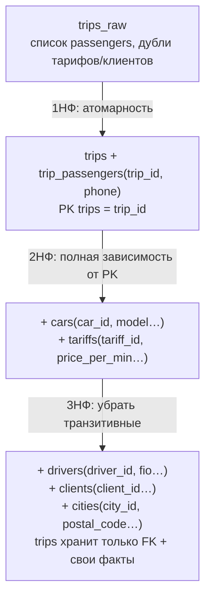
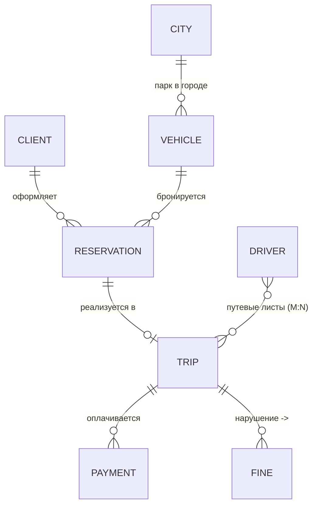
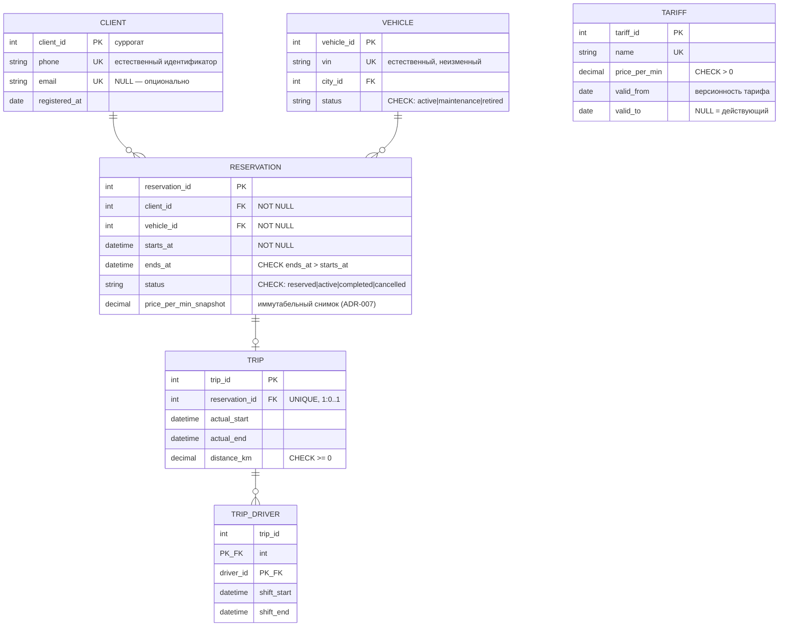
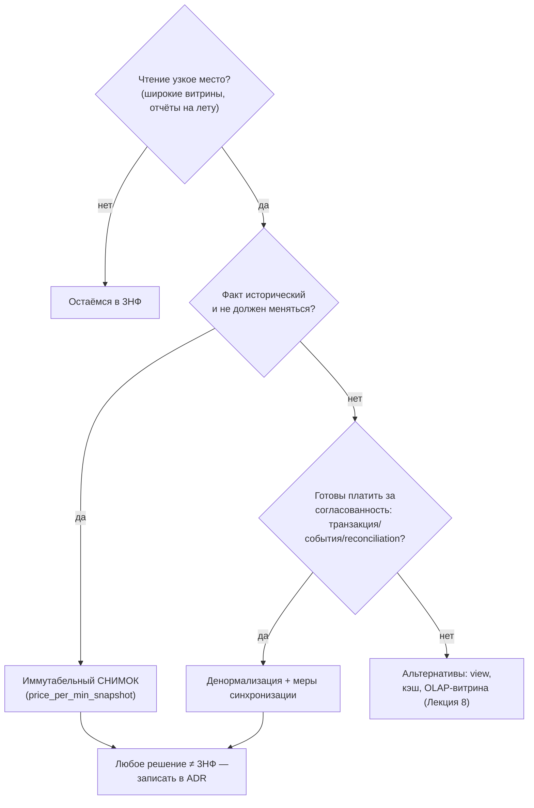

# Диаграммы к Лекции 3

## Введение

Этот файл содержит диаграммы и схемы для Лекции 3 «Концептуальная и логическая модели данных. Нормализация и эволюция схемы» (источник истины темы — `specs/syllabus.md`).

Диаграммы предназначены для:
- визуализации трёх уровней моделей данных (ANSI/SPARC) и распределения аудиторий;
- показа различий нотаций ER (Чен), Crow's Foot и UML;
- иллюстрации аномалий данных и последовательной нормализации таблицы-монолита до 3НФ;
- демонстрации концептуальной и логической моделей сквозного кейса «Каршеринг»;
- объяснения протокола Zero-Downtime миграции Expand and Contract.

Все Mermaid-схемы совместимы с GitHub/GitLab-рендерингом; ASCII-версии даны для печати и слайдов.

---

## Диаграмма 1. Три уровня моделей данных (ANSI/SPARC)

**Описание:** последовательность концептуальная → логическая → физическая модель, с аудиторией и примером артефакта на каждом уровне. Граница текущего курса — первые два уровня.


ASCII-версия:

```
┌─────────────────────┐   ┌──────────────────────┐   ┌──────────────────────┐
│ КОНЦЕПТУАЛЬНАЯ      │   │ ЛОГИЧЕСКАЯ           │   │ ФИЗИЧЕСКАЯ           │
│ (бизнес)            ├──▶│ (архитекторы)        ├──▶│ (разработчики/DBA)   │
│ Клиент 1—N Бронир.  │   │ reservations(client_ │   │ VARCHAR(24), btree   │
│ "не может брониро-  │   │ id FK NOT NULL, 3НФ) │   │ индекс, партиция     │
│  вать без прав"     │   │ независима от СУБД   │   │ по месяцам, PostgreSQL│
└─────────────────────┘   └──────────────────────┘   └──────────────────────┘
     ◀—— граница курса ——◀
```

**Как использовать в лекции:** показать после формулировки цели; спросить аудиторию, на каком уровне возник спор из Hook (ответ: пропущены уровни 1–2, сразу «физическая таблица»).

---

## Диаграмма 2. Сравнение нотаций: Чен vs Crow's Foot vs UML

**Описание:** один фрагмент модели каршеринга («Клиент оформляет Бронирование», 1:N) в трёх нотациях рядом.

```
ЧЕН:                               CROW'S FOOT (Mermaid):
+--------+      +----------+       CLIENT ||--o{ RESERVATION : "оформляет"
| КЛИЕНТ |──1──>( оформля- <──N──(| БРОНИ- |
+--------+      |   ет   ) |     | рование|
   [овал]       +----------+     +--------+
                <ромб>             || = «один обязательно»
                                   o{ = «ноль или много»

UML CLASS DIAGRAM:
┌────────────┐  оформляет  ┌────────────────┐
│  Client    │ 1 -------- * │  Reservation   │
│ - phone    │              │ - starts_at    │
└────────────┘              └────────────────┘
```

Итоговая сравнительная таблица (дублирует раздел «Часть 2» draft'а):

| Критерий | Чен | Crow's Foot | UML |
|:---|:---|:---|:---|
| Обсуждение с бизнесом | ✅ | ✅ | ⚠️ |
| Промышленный стандарт схем БД | ❌ | ✅ | ✅ (смежные задачи) |
| Компактность на больших схемах | ❌ | ✅ | ✅ |
| Поведение/методы | ❌ | ❌ | ✅ |

---

## Диаграмма 3. Аномалии данных на таблице-монолите (Hook)

**Описание:** три классические аномалии на примере `trips_raw` из начала лекции.

```
Таблица trips_raw (нарушает 1НФ, избыточна):
trip_id | client          | passengers        | tariff    | price_per_min | car
101     | Иван, +7-900…   | +7-900-222,+7-900-333 | Minute-2.5 | 2.5       | v-123
102     | Анна, +7-900…   | (пусто)          | Minute-2.5 | 2.5           | v-123

INSERT-аномалия: новый тариф "Hour-120" добавить НЕКУДА — нет строки поездки.
UPDATE-аномалия: цена 2.5→2.2 требует правки ВСЕХ 400 000 строк; часть осталась старой.
DELETE-аномалия: удалили тестовые поездки 101–102 → исчезли данные клиентов Ивана и Анны.
```

**Как использовать:** показать до теоретического блока — аудитория сама «нащупывает» мотивацию нормализации.

---

## Диаграмма 4. Нормализация trips_raw: 1НФ → 2НФ → 3НФ

**Описание:** пошаговая декомпозиция таблицы-монолита.



Итог: каждая единица информации хранится ровно один раз; все три аномалии Диаграммы 3 устранены.

---

## Диаграмма 5. Концептуальная ER-модель кейса «Каршеринг» (Crow's Foot, Mermaid)

**Описание:** результат Шагов 1–2 Case Study; вход для утверждения бизнесом.



Бизнес-правила на схеме: обязательный клиент у бронирования `||`; поездка опциональна `o|` (отмена); M:N через путевые листы.

---

## Диаграмма 6. Логическая модель контекста «Бронирование» в 3НФ

**Описание:** фрагмент из Шага 3 Case Study — таблицы, PK/FK, ограничения как формализованные бизнес-правила.



---

## Диаграмма 7. Expand and Contract: три фазы Zero-Downtime миграции

**Описание:** протокол изменения схемы без простоя (пример: `full_name` → `last_name`/`first_name`; общий вид для любого изменения).


Инварианты (подписать под диаграммой): сервис доступен на каждой фазе; откат возможен на фазах EXPAND и MIGRATE; CONTRACT необратим — поэтому он последний и отдельный.

ASCII-версия для слайда:

```
 ФАЗА 1 EXPAND      ФАЗА 2 MIGRATE            ФАЗА 3 CONTRACT
 old ──write──┐     old ─┐ (только откат)     old ✖ удалена
 new ──(пусто)│     new ←┴ dual write,        new ── read/write
              │          backfill, read→new
 [откат лёгкий]   [откат: чтение обратно на old]  [откат невозможен]
```

---

## Диаграмма 8. Денормализация как компромисс (decision tree)

**Описание:** когда допустимо ввести избыточность.



---

## Примечания по использованию

1. Диаграммы 1–4 — теоретический блок ( Части 1–4 ), 5–6 — Case Study, 7 — Часть 6, 8 — Часть 5.
2. Для slides.md используются сокращённые ASCII-версии 1, 5, 7.
3. Все entity/table-имена соответствуют draft'у и практике; при изменении схемы в draft — синхронизировать этот файл (входит в review-чеклист).
