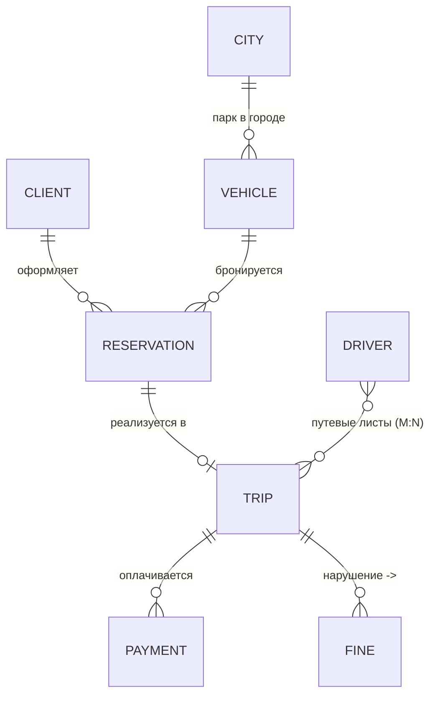
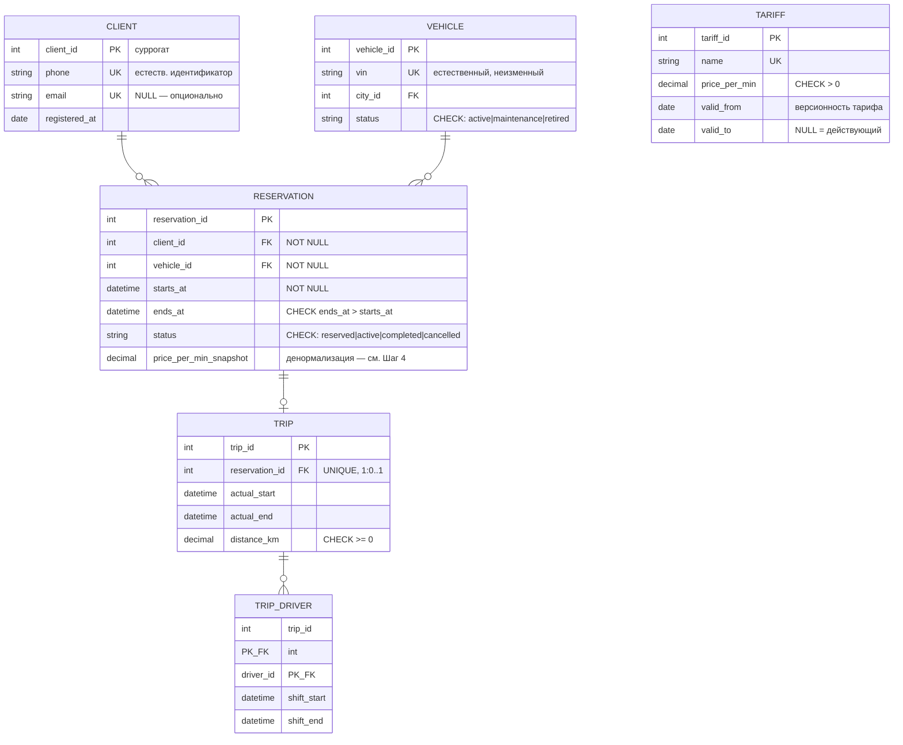

# Лекция 3. Концептуальная и логическая модели данных. Нормализация и эволюция схемы

> Статус: черновик (draft), этап перегенерации brief → outline → draft.
> Источник истины темы: `specs/syllabus.md`, раздел «Лекция 3».
> Предыдущая лекция: `content/lectures/02-domain-and-requirements/final.md` (сквозной кейс «Сервис каршеринга»).

## Цель занятия

Научиться проектировать структуру данных от бизнес-уровня до логической схемы: строить концептуальные и логические модели данных, применять нормализацию до 3НФ для устранения аномалий данных и понимать принципы эволюции схемы БД (Zero-Downtime миграции).

## Learning Objectives

По окончании лекции студенты смогут:

1. **Понимать** три уровня моделей данных (концептуальная, логическая, физическая) и распределять артефакты по аудиториям.
2. **Применять** нотации ER (Чен), Crow's Foot и UML для построения моделей; **строить** концептуальную модель по бизнес-событиям.
3. **Проектировать** логическую схему: выбирать первичные и внешние ключи (естественные/суррогатные), задавать ограничения (Constraints) как формализованные бизнес-правила.
4. **Анализировать** аномалии данных и **приводить** схему к 1НФ → 2НФ → 3НФ через функциональные зависимости.
5. **Оценивать** денормализацию как осознанный компромисс (с фиксацией в ADR) и **планировать** изменения схемы по паттерну Expand and Contract без простоя сервиса.

## План занятия

| № | Блок | Время |
|---|------|-------|
| 1 | Hook / мотивирующий кейс | 5 мин |
| 2 | Теоретический блок | 30 мин |
| 3 | Case Study (сквозной кейс «Каршеринг») | 20 мин |
| 4 | Связка с управленческими решениями | 5 мин |
| 5 | Практическое задание (мини-упражнение в аудитории) + Резюме и мостик к Лекции 4 | 10 мин |
| | **Итого** | **80 мин** |

*Полноценная практика (построение моделей своими руками) вынесена на отдельное практическое занятие — 15–20 минут по contract'у выполняются как домашняя работа/следующий этап.*

## Hook

**Таблица, которая похоронила релиз.**

Команда каршеринга из нашего сквозного кейса (Лекции 1–2) быстро сделала «первую версию» базы поездок — одну таблицу `trips_raw`:

| trip_id | client | passengers | car | tariff | price_per_min | driver | start | end |
|---------|--------|------------|-----|--------|---------------|--------|-------|-----|
| 101 | Иван Петров, +7-900-111 | +7-900-222, +7-900-333 | Kia Rio v-123 | Minute-2.5 | 2.5 | Пётр Сидоров | 10:00 | 10:41 |
| 102 | Анна Смирнова, +7-900-444 | (пусто) | Kia Rio v-123 | Minute-2.5 | 2.5 | Пётр Сидоров | 12:00 | 12:19 |

Через полгода случились три истории:

1. **Юристы попросили завести справочник тарифов** — оказалось, нельзя добавить новый тариф, не имея ни одной поездки по нему: данные о тарифе живут только внутри строк поездок.
2. **Маркетинг снизил цену минуты с 2.5 до 2.2** — разработчик написал скрипт, который две ночи правил 400 000 строк; часть поездок осталась со старой ценой, часть — с новой. Бухгалтерия не смогла объяснить расхождения.
3. **Отдел поддержки удалил «тестовые» поездки** — вместе с ними исчезли данные о клиентах и водителях, потому что нигде больше они не хранились.

**Вопрос аудитории:** это проблема SQL, PostgreSQL или того, как спроектирована *структура* данных? Почему никакая СУБД не спасает от плохой схемы?

**Ответ лекции:** структура данных проектируется до выбора технологии — на уровне концептуальной и логической моделей, по правилам нормализации; а менять схему живой системы нужно по протоколу эволюции (Expand and Contract). Это сегодня и разберём — превратим события и контексты Лекции 2 в модель данных.

## Теоретический блок

### Часть 1. Три уровня моделей данных

Классическая схема абстракции ANSI/SPARC (1975) разделяет описание данных на три уровня. Каждый уровень — свой язык для своей аудитории:

| Уровень | Аудитория | Зависимость от СУБД | Что фиксирует |
|:---|:---|:---|:---|
| **Концептуальная** | Бизнес, стейкхолдеры | Нет | Сущности, связи, бизнес-правила — без типов данных |
| **Логическая** | Архитекторы, аналитики | Нет (независима) | Таблицы, колонки, PK/FK, ограничения, нормальные формы |
| **Физическая** | Разработчики, DBA | Да (конкретная СУБД) | Типы данных (VARCHAR vs TEXT), индексы, партиции |

**Концептуальная модель** отвечает на вопрос *«что знает бизнес?»*: Клиент оформляет Бронирование; Бронирование реализуется в Поездку; за Поездкой может быть выставлен Штраф. Элементы: сущность (Entity), атрибут, идентификатор, связь (Relationship), кардинальность (1:1, 1:N, M:N) и обязательность связи.

**Логическая модель** отвечает на вопрос *«как это устроено структурно?»*: сущности становятся таблицами, атрибуты — колонками, связи — внешними ключами или промежуточными таблицами. Здесь появляются PK/FK, NOT NULL, UNIQUE, CHECK. Модель остаётся независимой от конкретной СУБД.

**Физическая модель** отвечает на вопрос *«в чём и как хранить?»*: конкретные типы, индексы, партиции. **Граница курса:** наш курс — архитектурный (WHAT и WHY), мы работаем на первых двух уровнях; физическая реализация (DDL, SQL, тюнинг) — предмет следующего семестра (курс «Базы данных»).

**Зачем три уровня, если «можно сразу таблицы»?** Разделение уровней — это управление коммуникацией и рисками: бизнес утверждает концептуальную модель (смыслы), архитектор — логическую (структуру), и только потом команда меняет физическую реализацию, не пересогласовывая бизнес. Ошибка уровня «подешевле»: спорить с заказчиком о типах колонок вместо согласования сущностей и связей.

### Часть 2. Нотации: ER (Чен), Crow's Foot, UML

**Нотация Чена** (Peter P.-S. Chen, 1976): прямоугольник — сущность, овал — атрибут, ромб — связь, подписи 1/N/M — кардинальность. Академический стандарт, максимально наглядный для обсуждения с бизнесом; громоздок на больших схемах.

```
[Клиент] ── (оформляет) ── [Бронирование]        1 ── (ромб) ── N
```

**Crow's Foot («воронья лапка»)** — промышленный стандарт: символы на конце линии кодируют «один/много/обязательно/опционально»:

| Символ | Значение |
|:---|:---|
| `\|` | один, обязательно |
| `\|\|` | один и только один |
| `\|<` | один или много |
| `O<` | ноль или много |
| `O\|` | ноль или один |

Пример: `Клиент ||---o{ Бронирование` (у клиента может не быть бронирований; бронирование обязано иметь клиента). Поддержка в инструментах: ERwin, MySQL Workbench, DBeaver, Mermaid.

**UML Class Diagram**: классы с атрибутами, ассоциации/агрегации/композиции, мультипликаторы `1`, `0..1`, `*`, `1..*`. Уместна, когда модель данных живёт рядом с объектной моделью проекта (анализ требований, проектирование сервисов); методы на диаграмме данных обычно избыточны.

**Сравнение и рекомендация курса:**

| Критерий | Чен | Crow's Foot | UML |
|:---|:---|:---|:---|
| Обучение, обсуждение с бизнесом | ✅ | ✅ | ⚠️ |
| Промышленный стандарт схем БД | ❌ | ✅ | ✅ (в смежных задачах) |
| Компактность на больших схемах | ❌ | ✅ | ✅ |
| Показывает поведение/методы | ❌ | ❌ | ✅ |

Рабочее правило: концептуальную модель обсуждаем по-ченски (сущность–связь–кардинальность), итоговую логическую модель сдаём в Crow's Foot (Mermaid/draw.io).

### Часть 3. Ключи и ограничения

**Первичный ключ (PK)** уникально идентифицирует строку, не может быть NULL, один на таблицу. Требования: уникальность, неизменность по возможности, минимальность.

**Внешний ключ (FK)** ссылается на PK другой таблицы и обеспечивает ссылочную целостность: в системе не может существовать Поездка, принадлежащая несуществующему Бронированию. Политика при удалении: `CASCADE` (удаляем зависимое), `SET NULL` (осиротело — допустимо ли?), `RESTRICT` (запрещаем удалять, пока есть ссылки) — каждая политика это отражение бизнес-правила, а не техническая настройка.

**Естественный vs суррогатный ключ — проектное решение с trade-offs:**

| Аспект | Естественный (email, VIN, ИНН) | Суррогатный (SERIAL, UUID) |
|:---|:---|:---|
| Бизнес-смысл | Есть, понятен | Нет |
| Стабильность | Может измениться (смена телефона, перерегистрация) | Неизменен |
| Размер/производительность FK | Может быть длинным, составным | Компактный (для SERIAL) |
| Риск утечки PII | Ключ содержит персональные данные | Нейтрален |

Практическая рекомендация (не догма): суррогатный PK + `UNIQUE` на естественный идентификатор. Для каршеринга `VIN` автомобиля — отличный кандидат на уникальный естественный ключ, но делать его FK во всех таблицах рискованно: перерегистрация/замена кузова меняют «идентификатор».

**Составной ключ и M:N.** Связь «многие-ко-многим» реализуется промежуточной таблицей (ПК) с составным PK из двух FK. Пример из Лекции 2: «Путевые листы» — связь many-to-many между Водителем и Автомобилем:

```
work_sheets: PK (trip_id, driver_id), FK trip_id → trips, FK driver_id → drivers
```

**Ограничения (Constraints) — код бизнеса:**

| Ограничение | Бизнес-правило | Пример для каршеринга |
|:---|:---|:---|
| `NOT NULL` | «без этого объект не существует» | Бронирование обязано иметь клиента |
| `UNIQUE` | «не может быть двух одинаковых» | Один автомобиль забронирован на интервал времени только один раз (через контроль пересечения интервалов) |
| `CHECK` | «значения вне диапазона недопустимы» | `status IN ('reserved','active','completed','cancelled')`; `price_per_min > 0` |
| `DEFAULT` | «значение по умолчанию» | `created_at = NOW()` |

### Часть 4. Нормализация: 1НФ → 2НФ → 3НФ

Реляционная модель — Эдгар Кодд (E.F. Codd, 1970). **Нормализация** — организация структуры, устраняющая избыточность и аномалии данных.

**Аномалии** — три болезни денормализованных «таблиц-монолитов» (из Hook):
- **INSERT**: нельзя внести данные об одном объекте, не имея данных о другом (тариф без поездок).
- **UPDATE**: изменение одного факта требует правки многих строк (цена минуты в 400 000 записей).
- **DELETE**: удаление одних данных теряет другие (поездки удалили — клиента нет).

**Функциональные зависимости** — инструмент анализа: X → Y означает, что каждому значению X соответствует единственное Y. Бывают полные (от всего составного ключа), частичные (от части составного ключа) и транзитивные (X → Y → Z).

- **1НФ**: все атрибуты атомарны, нет повторяющихся групп и «списков через запятую», есть PK. *Таблица `trips_raw` из Hook нарушает 1НФ колонкой `passengers` — выносим пассажиров в отдельную таблицу `trip_passengers(trip_id, phone)`.*
- **2НФ**: 1НФ + каждый неключевой атрибут полностью зависит от всего PK. *Нарушение: `car_model` зависит только от `car_id` (части составного ключа поездки) → выносим в таблицу Автомобилей.*
- **3НФ**: 2НФ + нет транзитивных зависимостей неключевых атрибутов друг от друга. *Нарушение: в таблице поездок храним `city` и `postal_code` города — `postal_code` зависит от `city`, а не от поездки → выносим справочник городов.*

Эволюция таблицы из Hook:

```
trips_raw (1 нарушение 1НФ: passengers)
   ↓ 1НФ: trips + trip_passengers
   ↓ 2НФ: trips(car_id→cars), tariff-атрибуты → tariffs
   ↓ 3НФ: водитель и его данные → drivers; город → cities
Итог: cars, drivers, clients, tariffs, reservations, trips, trip_passengers —
связаны FK, каждая_FACT_хранится_один_раз.
```

**Дальше — редко.** БКНФ, 4НФ, 5НФ существуют теоретически; практическое правило из базы знаний курса: в 95% случаев достаточно 3НФ [источник: knowledge/data-modeling/normalization.md]. Гнаться за высшими формами «любой ценой» — типичная переработка (over-engineering).

### Часть 5. Денормализация как осознанный компромисс

Нормализация оптимизирует запись и целостность, но усложняет чтение: «витрина поездки» требует JOIN пяти таблиц. **Денормализация** — осознанное введение избыточности в уже нормализованную схему ради производительности чтения. Это НЕ ошибка проектирования — это архитектурное решение, которое:

- допустимо при Read-heavy нагрузке, предвычисленных агрегатах, поисковых/аналитических витринах (OLAP — см. Лекцию 8);
- порождает **риск рассинхронизации** (факт хранится в нескольких местах) и требует мер: синхронизация в одной транзакции, события/очереди, reconciliation-проверки, TTL;
- **обязательно документируется в ADR** (формат — Лекция 1).

| Аспект | Нормализация (3НФ) | Денормализация |
|:---|:---|:---|
| Избыточность | Минимальная | Осознанно повышенная |
| Аномалии UPDATE | Устранены | Возможны |
| Чтение (широкие витрины) | Медленнее (JOIN) | Быстрее |
| Запись | Быстрее | Медленнее (обновление копий) |
| Целостность | Гарантирует СУБД | Гарантирует приложение/процессы |

Пример обоснованной денормализации для каршеринга: хранить `total_cost` поездки как вычисляемый столбец, чтобы не суммировать поминутно историю каждые 10 секунд на экране. Альтернатива — view/агрегат на лету; выбор зависит от нагрузки [точные цифры latency зависят от нагрузки — требуется проверка на этапе нагрузочного тестирования].

### Часть 6. Эволюция схемы и Zero-Downtime миграции (Expand and Contract)

Схема БД живёт дольше любого релиза приложения: бизнес меняется — меняются сущности, атрибуты, связи. Принципы зрелой команды:

- **Схема как код**: миграции версионируются в Git, применяются последовательно и воспроизводимо, имеют обратный шаг (down-миграция). Инструменты — примеры, не догма: Flyway/Liquibase (Java-экосистема), Alembic/Django migrations (Python), Knex.js (Node).
- **Проблема «большого ALTER»**: блокирующее изменение на большой таблице может сделать сервис недоступным на минуты/часы [порядок величины; точное время зависит от СУБД и объёма — требует проверки]. Для сервиса, который должен быть доступен 24/7 (бронирование в час пик!), это неприемлемо.

**Паттерн Expand and Contract** — трёхфазный протокол изменения схемы без простоя:


Иллюстративный пример (без production-кода): бизнес просит заменить у водителя одно поле `full_name` на `last_name`/`first_name`:
1. **Expand**: добавили две новые nullable-колонки; приложение пишет и читает старое поле.
2. **Migrate**: двойная запись (пишем во все три), фоновый backfill заполнил новые колонки из старых, чтение переключили на новые, `full_name` переведён в режим «только запись для отката».
3. **Contract**: когда ни один клиент не читает `full_name` — удаляем колонку отдельной миграцией.

Ключевые свойства: приложение доступно на каждом шаге; откат возможен на любом шаге; удаление старого — всегда отдельный, поздний шаг. Тяжесть изменений — градация: добавить nullable-колонку (низкий риск) → переименовать колонку (средний) → изменить тип/разделить таблицу (высокий, только через Expand and Contract).

## Case Study

**Сквозной кейс курса: сервис каршеринга** (контексты и события — из Лекции 2: ~200 автомобилей, 3 города, запуск MVP за 3 месяца, команда 8 человек; NFR: доступность 99.9%, консистентность при бронировании, eventual consistency допустима между контекстами).

### Шаг 1. От событий — к сущностям (концептуальный уровень)

Доменные события Лекции 2 — это глаголы бизнеса; существительные при них — кандидаты в сущности:

| Событие (Лекция 2) | Сущности | Связь |
|:---|:---|:---|
| Пользователь зарегистрировался | Клиент | — |
| Автомобиль добавлен в парк | Автомобиль, Город | Город 1—N Автомобиль |
| Автомобиль забронирован | Бронирование | Клиент 1—N Бронирование; Бронирование N—1 Автомобиль |
| Поездка началась / завершена | Поездка | Бронирование 1—0..1 Поездка |
| Оплата прошла | Платёж | Поездка 1—N Платёж (частичные оплаты/возвраты) |
| Штраф выставлен | Штраф | Поездка 1—N Штраф |
| Путевой лист (many-to-many, из Лекции 2) | Путевой лист | Поездка M—N Водитель через промежуточную сущность |

### Шаг 2. Концептуальная ER-диаграмма (фрагмент, Mermaid/Crow's Foot)



Бизнес-правила, которые мы здесь формализуем: «Бронирование не может существовать без клиента» (обязательный FK); «Один автомобиль не может быть забронирован на пересекающиеся интервалы» (уникальность интервала + CHECK/логика); «Штраф может быть выставлен постфактум» (Поездка 1—N Штраф, штраф опционально связан с оплатой).

### Шаг 3. Логическая модель (фрагмент контекста «Бронирование», 3НФ)



Проверка нормальности: тариф больше не дублируется в каждой поездке (нет UPDATE-аномалии из Hook); клиент живёт отдельно от поездок (нет DELETE-аномалии); список пассажиров вынесен в атомарную таблицу (1НФ); все неключевые атрибуты зависят от PK целиком и не транзитивно (2НФ/3НФ).

### Шаг 4. Компромисс: снимок цены в бронировании

Бизнес-требование: чек клиенту должен показывать цену **на момент поездки**, даже после смены тарифа. Варианты:

| Вариант | Плюсы | Минусы |
|:---|:---|:---|
| Только FK на тариф + история тарифов (`valid_from/valid_to`) | Нет избыточности, единый источник | Сложный запрос «как было тогда»; цена зависит от корректности истории |
| Снимок `price_per_min_snapshot` в бронировании | Простое воспроизведение чека,иммутабельная история | Дублирование факта; рассинхронизация невозможна по смыслу (снимок не обновляется) |

Выбор для кейса: **снимок** — это не «плохая денормализация», а намеренная иммутабельность исторического факта; зафиксирован в ADR-007 с обоснованием и последствиями. Если бы требование звучало «показывать актуальную цену» — выбрали бы JOIN к тарифу. **Вывод: решение диктуется бизнес-смыслом поля, а не «правильностью» нормальных форм.**

### Шаг 5. Эволюция схемы: платные зоны парковки

Новое бизнес-правило (после запуска): автомобили стоят в зонах с разной тарификацией парковки. Меняем концептуальную модель (Парковка → Зона → Тариф зоны), затем логическую — и применяем Expand and Contract:

1. **Expand**: таблица `parking_zones` + nullable `zone_id` в `vehicle`; приложение пишет старый способ определения зоны.
2. **Migrate**: backfill определяет зоны по GPS-истории; чтение переключено; двойная запись.
3. **Contract**: удаление legacy-логики и колонки-временщика — отдельным релизом, когда мониторинг показал: старых читателей не осталось.

Важно: сервис доступен на всех шагах; любой шаг откатывается.

### Управленческие выводы (Product Owner / ИТ-менеджер)

- **Скорость изменений = качество схемы.** Плохая схема превращает каждое бизнес-пожелание в «двухночный скрипт правки 400 000 строк» (см. Hook) — это прямой time-to-market.
- **TCO.** Нормализованная схема дешевле в поддержке (один факт — одно место хранения); денормализация экономит деньги на инфраструктуре чтения, но требует бюджета на процессы согласованности и reconciliation.
- **Регуляторика и PII.** Выбор естественного ключа (телефон/email как PK) «размазывает» персональные данные по связям — удаление по GDPR/152-ФЗ становится сложной операцией. Суррогатные ключи + изоляция PII упрощают исполнение права на удаление (детально — Лекция 4, Data Governance).
- **Zero-Downtime — страховка выручки.** Простои в час пик бьют по конверсии бронирований; протокол Expand and Contract — управляемая процедура, а не импровизация.
- **ADR дисциплинирует споры.** Каждая денормализация и каждый выбор ключа — запись с контекстом/решением/последствиями: новые сотрудники понимают «почему так», повторные дискуссии не жгут время.

## Ключевые термины

(полностью согласованы с `knowledge/glossary.md`)

- **Концептуальная / логическая / физическая модель данных** — уровни абстракции ANSI/SPARC.
- **Сущность (Entity), атрибут, связь, кардинальность** — элементы ER-модели.
- **PK / FK** — первичный / внешний ключ; **ключ естественный / суррогатный / составной**; **ПК (промежуточная таблица)**.
- **Constraints** — NOT NULL, UNIQUE, CHECK, DEFAULT; **ссылочная целостность**.
- **Нормализация; 1НФ / 2НФ / 3НФ; функциональная зависимость (полная, частичная, транзитивная)**.
- **Аномалия данных** — INSERT/UPDATE/DELETE.
- **Денормализация** — осознанный компромисс, требует ADR.
- **Миграция БД; Zero-Downtime миграция; Expand and Contract**.
- **ER (Чен), Crow's Foot, UML Class Diagram** — нотации.

## Визуальные материалы

1. Таблица трёх уровней моделей (раздел «Часть 1»).
2. Сравнительная таблица нотаций (раздел «Часть 2»).
3. Таблица trade-offs ключей и ограничений (раздел «Часть 3»).
4. Пошаговая декомпозиция `trips_raw` до 3НФ (раздел «Часть 4»).
5. Mermaid erDiagram: концептуальная и логическая модели каршеринга (Case Study, шаги 2–3).
6. Flowchart Expand → Migrate → Contract (раздел «Часть 6»).

*Файл diagrams.md будет создан на следующем этапе генерации (см. generation-report.md).*

## Anti-pattern

**«Колонка-список» и «вечный ALTER».** Комбинация двух ошибок из Hook: хранить несколько значений в одной колонке (нарушение 1НФ) и менять схему одним блокирующим `ALTER` на живой системе.

Почему это ошибка: списки ломают атомарность → невозможно запросить/проиндексировать элемент, возникают UPDATE-аномалии; блокирующий ALTER → простой сервиса ровно в самый неподходящий момент. Последствия: рассинхронизированные данные, аудиторские дыры, потерянные часы доступности и репутация «медленной» команды.

Как распознать: в коде обработки данных появились `split(",")` и регулярки над значениями колонок; DBA спрашивает «можно ли окном в 3 часа ночи?» на каждое изменение схемы.

Лечение: проектирование от 1НФ; миграции строго по Expand and Contract; регламент — ни одна денормализация/снимок без ADR.

Второй анти-паттерн дня: **«нормализовать до 5НФ любой ценой»** — схема из 30 таблиц для отчёта, который читают раз в месяц: JOIN-ад вместо решения. Нормализация обслуживает бизнес-нагрузку, а не академический идеал.

## Практическое задание (аудиторная мини-версия, 10 мин)

Для контекста «Штрафы» кейса «Каршеринг»:
1. Выпишите 4–6 сущностей и связи с кардинальностями (концептуальный уровень).
2. Нарисуйте логическую схему: PK (укажите тип ключа: естественный/суррогатный), FK, минимум два ограничения (CHECK/UNIQUE/NOT NULL) как бизнес-правила.
3. Найдите в своей схеме потенциальную транзитивную зависимость и устраните её (3НФ).

Расширенная домашняя версия (15–20 мин, полноценный practice.md — следующий этап): то же для контекста «Оплата» + один ADR на обоснованную денормализацию + план Expand and Contract для требования «добавить подписку-абонемент, привязанную к нескольким тарифам».

**Результат:** концептуальная и логическая модели в 3НФ с ключами и ограничениями — артефакт входит в итоговый Architecture Blueprint.

## Мостик к следующей лекции

Мы спроектировали структуру данных независимо от СУБД — и специально оставили вопросы «где это жить будет?»:
- Транзакционность бронирования (нельзя забронировать автомобиль дважды) требует ACID — но какие гарантии даёт конкретная СУБД при сетевом разделе?
- Телеметрия (GPS каждые ~10 секунд на 600 авто) — тот же движок, что и для бронирований, или другой класс СУБД?
- Как выбрать между реляционной, документной, key-value, колоночной БД под наши контексты?

**Лекция 4** («История, эволюция и виды СУБД. Транзакции, PACELC и Data Governance») выбирает технологический стек для логических моделей, спроектированных сегодня: критерии выбора СУБД, CAP/PACELC, ACID и уровни изоляции, защита PII (GDPR/152-ФЗ, crypto-shredding). Наша 3НФ-схема станет входом для матрицы выбора СУБД.

## Вопросы для самопроверки

1. Чем логическая модель отличается от физической и почему наш курс останавливается на логической? Приведите пример решения, которое относится к физическому уровню.
2. Клиент жалуется: «меняем цену тарифа — приходится переписывать историю». Какая аномалия это была бы в денормализованной схеме и какая нормальная форма её предотвращает? Всегда ли правильно хранить цену снимком?
3. Когда естественный ключ уместен как PK, а когда лучше суррогатный + UNIQUE? Приведите пример из каршеринга и объясните trade-off.
4. Таблица: `trip(id PK, city, postal_code, city_population)`. Какие нарушения 3НФ видны? Как перестроить?
5. Почему удаление старой колонки в Expand and Contract выносят в отдельный поздний релиз? Что произойдёт, если удалить её одновременно с переключением чтения?

## Связь с курсом «Базы данных»

Концептуальная и логическая модели, 3НФ-схема и ADR-компромиссы, созданные в этом курсе, становятся Техническим Заданием для следующего семестра: там они будут реализованы средствами DDL/SQL (PostgreSQL и др.), дополнятся индексами и физическими параметрами. Теоретическая база реляционной модели (Кодд) — фундамент лабораторных работ по SQL.

## Источники

- Codd, E. F. (1970). A relational model of data for large shared data banks. *Communications of the ACM*, 13(6), 377–387.
- Chen, P. P.-S. (1976). The Entity-Relationship Model — Toward a Unified View of Data. *ACM Transactions on Database Systems*, 1(1), 9–36.
- Клейтманн, М. (2017). *Проектирование интенсивно используемых приложений* (DDIA), гл. 3–4.
- ANSI/SPARC Architecture (1975) — трёхуровневая абстракция данных.
- База знаний курса: `knowledge/data-modeling/*` (conceptual-logical-physical, er-notations, keys-constraints, normalization, denormalization, schema-evolution).
- Предыдущие лекции: `content/lectures/01-intro-system-design/final.md`, `content/lectures/02-domain-and-requirements/final.md`.

> Примечания честности (no-hallucination): оценки длительности блокирующих ALTER и latency — порядковые, зависят от СУБД и объёма [требуется проверка]; цифра «95% случаев достаточно 3НФ» — из базы знаний курса [требуется подтверждение источника при ревью]; параметры кейса (200 авто, 3 города) унаследованы из Лекции 2.
