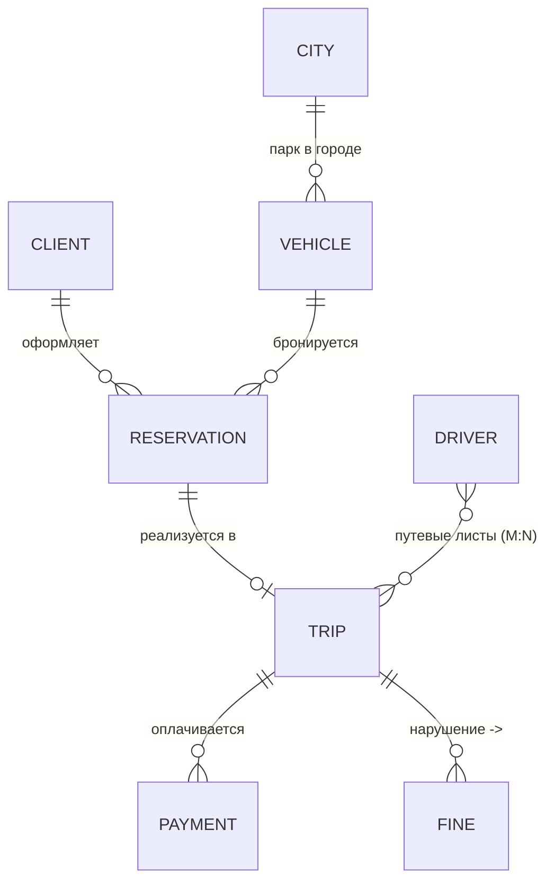

# Лекция 3. Концептуальная и логическая модели данных. Нормализация и эволюция схемы

> Статус: кандидат в final. Причина: ожидает human review / human fact-check. Источник истины темы: specs/syllabus.md, Лекция 3.

## Цель занятия

Научиться проектировать структуру данных от бизнес-уровня до логической схемы: строить концептуальные и логические модели данных, применять нормализацию до 3НФ для устранения аномалий данных и понимать принципы эволюции схемы БД (Zero-Downtime миграции).

## Learning Objectives

По окончании лекции студенты смогут:

1. **Понимать** три уровня моделей данных (концептуальная, логическая, физическая) и распределять артефакты по аудиториям.
2. **Применять** нотации ER (Чен), Crow's Foot и UML для построения моделей; **строить** концептуальную модель по бизнес-событиям.
3. **Проектировать** логическую схему: выбирать первичные и внешние ключи (естественные/суррогатные), задавать ограничения (Constraints) как формализованные бизнес-правила.
4. **Анализировать** аномалии данных и **приводить** схему к 1НФ → 2НФ → 3НФ через функциональные зависимости.
5. **Оценивать** денормализацию как осознанный компромисс (с фиксацией в ADR) и **планировать** изменения схемы по паттерну Expand and Contract без простоя сервиса.

## План занятия (80 минут)

| № | Блок | Время |
|---|------|-------|
| 1 | Hook / мотивирующий кейс | 5 мин |
| 2 | Теоретический блок | 30 мин |
| 3 | Case Study (сквозной кейс «Каршеринг») | 20 мин |
| 4 | Связка с управленческими решениями | 5 мин |
| 5 | Мини-упражнение + Резюме и мостик к Лекции 4 | 10 мин |

Полноценная практика — отдельное занятие (`practice.md`).

## Hook: таблица, которая похоронила релиз

Команда каршеринга из сквозного кейса курса (Лекции 1–2) сделала «первую версию» базы поездок — одну таблицу `trips_raw`: телефон клиента и список пассажиров «через запятую» жили в одной строке с тарифом, ценой минуты и данными водителя.

Через полгода случились три истории:

1. **Юристы попросили справочник тарифов** — нельзя добавить новый тариф, не имея ни одной поездки по нему: данные о тарифе живут только внутри строк поездок (INSERT-аномалия).
2. **Маркетинг снизил цену минуты с 2.5 до 2.2** — скрипт две ночи правил 400 000 строк; часть осталась со старой ценой, бухгалтерия не свела расхождения (UPDATE-аномалия).
3. **Поддержка удалила «тестовые» поездки** — вместе с ними исчезли клиенты и водители, потому что больше нигде они не хранились (DELETE-аномалия).

**Вопрос аудитории:** это проблема SQL, PostgreSQL или того, как спроектирована *структура* данных? Почему никакая СУБД не спасает от плохой схемы?

**Ответ лекции:** структура данных проектируется до выбора технологии — на уровне концептуальной и логической моделей, по правилам нормализации; а менять схему живой системы нужно по протоколу эволюции (Expand and Contract). Сегодня превратим события и контексты Лекции 2 в модель данных.

## Теоретический блок

### Часть 1. Три уровня моделей данных

Классическая схема абстракции ANSI/SPARC (1975) разделяет описание данных на три уровня. Каждый уровень — свой язык для своей аудитории:

| Уровень | Аудитория | Зависимость от СУБД | Что фиксирует |
|:---|:---|:---|:---|
| **Концептуальная** | Бизнес, стейкхолдеры | Нет | Сущности, связи, бизнес-правила — без типов данных |
| **Логическая** | Архитекторы, аналитики | Нет (независима) | Таблицы, колонки, PK/FK, ограничения, нормальные формы |
| **Физическая** | Разработчики, DBA | Да (конкретная СУБД) | Типы данных (VARCHAR vs TEXT), индексы, партиции |

**Концептуальная модель** отвечает на вопрос *«что знает бизнес?»*: Клиент оформляет Бронирование; Бронирование реализуется в Поездку; за Поездкой может быть выставлен Штраф. Элементы: сущность (Entity), атрибут, идентификатор, связь (Relationship), кардинальность (1:1, 1:N, M:N) и обязательность связи.

**Логическая модель** отвечает на вопрос *«как это устроено структурно?»*: сущности становятся таблицами, атрибуты — колонками, связи — внешними ключами или промежуточными таблицами. Здесь появляются PK/FK, NOT NULL, UNIQUE, CHECK. Модель остаётся независимой от конкретной СУБД.

**Физическая модель** отвечает на вопрос *«в чём и как хранить?»*: конкретные типы, индексы, партиции. **Граница курса:** наш курс — архитектурный (WHAT и WHY), мы работаем на первых двух уровнях; физическая реализация (DDL, SQL, тюнинг) — предмет следующего семестра (курс «Базы данных»).

**Зачем три уровня, если «можно сразу таблицы»?** Разделение уровней — управление коммуникацией и рисками: бизнес утверждает концептуальную модель (смыслы), архитектор — логическую (структуру), и только потом команда меняет физическую реализацию, не пересогласовывая бизнес. Типичная ошибка: спорить с заказчиком о типах колонок вместо согласования сущностей и связей.

### Часть 2. Нотации: ER (Чен), Crow's Foot, UML

**Нотация Чена** (Peter P.-S. Chen, 1976): прямоугольник — сущность, овал — атрибут, ромб — связь, подписи 1/N/M — кардинальность. Академический стандарт, максимально наглядный для обсуждения с бизнесом; громоздок на больших схемах.

**Crow's Foot («воронья лапка»)** — промышленный стандарт: символы на конце линии кодируют «один/много/обязательно/опционально»: `||` — один и только один, `o|` — ноль или один, `|{`/`o{` — один/ноль или много. Пример: `Клиент ||--o{ Бронирование` (у клиента может не быть бронирований; бронирование обязано иметь клиента). Поддержка: ERwin, MySQL Workbench, DBeaver, Mermaid.

**UML Class Diagram**: классы с атрибутами, ассоциации/агрегации/композиции, мультипликаторы `1`, `0..1`, `*`, `1..*`. Уместна, когда модель данных живёт рядом с объектной моделью проекта; методы на диаграмме данных обычно избыточны.

| Критерий | Чен | Crow's Foot | UML |
|:---|:---|:---|:---|
| Обучение, обсуждение с бизнесом | ✅ | ✅ | ⚠️ |
| Промышленный стандарт схем БД | ❌ | ✅ | ✅ (в смежных задачах) |
| Компактность на больших схемах | ❌ | ✅ | ✅ |
| Показывает поведение/методы | ❌ | ❌ | ✅ |

Рабочее правило курса: концептуальную модель обсуждаем по-ченски, итоговую логическую сдаём в Crow's Foot (Mermaid/draw.io).

### Часть 3. Ключи и ограничения

**Первичный ключ (PK)** уникально идентифицирует строку, не может быть NULL, один на таблицу. Требования: уникальность, неизменность по возможности, минимальность.

**Внешний ключ (FK)** ссылается на PK другой таблицы и обеспечивает ссылочную целостность: не может существовать Поездка, принадлежащая несуществующему Бронированию. Политики при удалении — отражение бизнес-правил, а не технические настройки: `CASCADE` (удаляем зависимое), `SET NULL` (осиротело — допустимо ли?), `RESTRICT` (запрещаем удалять, пока есть ссылки).

**Естественный vs суррогатный ключ — проектное решение с trade-offs:**

| Аспект | Естественный (email, VIN, ИНН) | Суррогатный (SERIAL, UUID) |
|:---|:---|:---|
| Бизнес-смысл | Есть, понятен | Нет |
| Стабильность | Может измениться (смена телефона, перерегистрация) | Неизменен |
| Размер/производительность FK | Может быть длинным, составным | Компактный (для SERIAL) |
| Риск утечки PII | Ключ содержит персональные данные | Нейтрален |

Практическая рекомендация (не догма): суррогатный PK + `UNIQUE` на естественный идентификатор. Для каршеринга `VIN` — отличный кандидат на уникальный естественный ключ, но делать его FK во всех таблицах рискованно: перерегистрация/замена кузова меняют «идентификатор».

**Составной ключ и M:N.** Связь «многие-ко-многим» реализуется промежуточной таблицей (ПК) с составным PK из двух FK. Пример из Лекции 2: путевые листы — M:N между Водителем и Поездкой: `work_sheets PK (trip_id, driver_id)`.

**Ограничения (Constraints) — код бизнеса:**

| Ограничение | Бизнес-правило | Пример для каршеринга |
|:---|:---|:---|
| `NOT NULL` | «без этого объект не существует» | Бронирование обязано иметь клиента |
| `UNIQUE` | «не может быть двух одинаковых» | Один автомобиль забронирован на интервал только один раз |
| `CHECK` | «значения вне диапазона недопустимы» | `status IN ('reserved','active','completed','cancelled')`; `price_per_min > 0` |
| `DEFAULT` | «значение по умолчанию» | `created_at = NOW()` |

### Часть 4. Нормализация: 1НФ → 2НФ → 3НФ

Реляционная модель — Эдгар Кодд (E.F. Codd, 1970). **Нормализация** — организация структуры, устраняющая избыточность и аномалии данных (INSERT/UPDATE/DELETE — см. Hook).

**Функциональные зависимости** — инструмент анализа: X → Y означает, что каждому значению X соответствует единственное Y. Бывают полные (от всего составного ключа), частичные (от части ключа) и транзитивные (X → Y → Z).

- **1НФ**: все атрибуты атомарны, нет повторяющихся групп и «списков через запятую», есть PK. *`trips_raw` нарушает 1НФ колонкой `passengers` → выносим в `trip_passengers(trip_id, phone)`.*
- **2НФ**: 1НФ + каждый неключевой атрибут полностью зависит от всего PK. *`car_model` зависит только от `car_id` → выносим в таблицу Автомобилей.*
- **3НФ**: 2НФ + нет транзитивных зависимостей неключевых атрибутов друг от друга. *В таблице поездок храним `city` и `postal_code`: `postal_code` зависит от `city`, а не от поездки → выносим справочник городов.*

Эволюция таблицы из Hook: `trips_raw` → (1НФ) `trips + trip_passengers` → (2НФ) `+ cars, tariffs` → (3НФ) `+ drivers, clients, cities`. Итог: каждая единица информации хранится ровно один раз.

**Дальше — редко.** БКНФ, 4НФ, 5НФ существуют теоретически; практическое правило базы знаний курса: в 95% случаев достаточно 3НФ [фактчек: цифра из knowledge/data-modeling/normalization.md, внешний источник не подтверждён]. Гнаться за высшими формами «любой ценой» — over-engineering.

### Часть 5. Денормализация как осознанный компромисс

Нормализация оптимизирует запись и целостность, но усложняет чтение: «витрина поездки» требует JOIN пяти таблиц. **Денормализация** — осознанное введение избыточности в уже нормализованную схему ради производительности чтения. Это НЕ ошибка проектирования, а архитектурное решение, которое:

- допустимо при Read-heavy нагрузке, предвычисленных агрегатах, аналитических витринах (OLAP — Лекция 8);
- порождает **риск рассинхронизации** и требует мер: синхронизация в одной транзакции, события/очереди, reconciliation-проверки, TTL;
- **обязательно документируется в ADR** (формат — Лекция 1).

| Аспект | Нормализация (3НФ) | Денормализация |
|:---|:---|:---|
| Избыточность | Минимальная | Осознанно повышенная |
| Аномалии UPDATE | Устранены | Возможны |
| Чтение (широкие витрины) | Медленнее (JOIN) | Быстрее |
| Запись | Быстрее | Медленнее (обновление копий) |
| Целостность | Гарантирует СУБД | Гарантирует приложение/процессы |

Отдельный вид — **иммутабельный снимок факта** (цена на момент поездки): формально избыточность, фактически — иной бизнес-смысл поля (история не должна переписываться). Дерево принятия решения — Диаграмма 8 в `diagrams.md`.

### Часть 6. Эволюция схемы и Zero-Downtime миграции (Expand and Contract)

Схема БД живёт дольше любого релиза приложения. Принципы зрелой команды:

- **Схема как код**: миграции версионируются в Git, применяются последовательно и воспроизводимо, имеют обратный шаг (down-миграция). Инструменты — примеры, не догма: Flyway/Liquibase, Alembic/Django migrations, Knex.js.
- **Проблема «большого ALTER»**: блокирующее изменение на большой таблице может сделать сервис недоступным на минуты/часы [фактчек: порядок величины зависит от СУБД и версии — есть механизмы online DDL; формулировку проверяет человек]. Для сервиса с доступностью 99.9% (бронирование в час пик!) это неприемлемо.

**Паттерн Expand and Contract** — трёхфазный протокол изменения схемы без простоя:

Иллюстративный пример (без production-кода): заменить у водителя `full_name` на `last_name`/`first_name`:
1. **Expand**: добавили две nullable-колонки; приложение пишет и читает старое поле.
2. **Migrate**: двойная запись, фоновый backfill, чтение переключено на новые колонки, `full_name` — «только запись для отката».
3. **Contract**: когда мониторинг показал отсутствие читателей старого поля — удаление отдельной миграцией.

Ключевые свойства: приложение доступно на каждом шаге; откат возможен на фазах Expand и Migrate; удаление старого — всегда отдельный, поздний, необратимый шаг. Градация тяжести изменений: добавить nullable-колонку (низкий риск) → переименовать колонку (средний) → изменить тип/разделить таблицу (высокий, только через Expand and Contract).

## Case Study: от событий Лекции 2 к модели данных «Каршеринга»

Вход: контексты и события Лекции 2 (~200 автомобилей, 3 города, MVP за 3 месяца, команда 8 человек; NFR: доступность 99.9%, консистентность бронирования, eventual consistency между контекстами).

### Шаг 1. От событий — к сущностям

| Событие (Лекция 2) | Сущности | Связь |
|:---|:---|:---|
| Пользователь зарегистрировался | Клиент | — |
| Автомобиль добавлен в парк | Автомобиль, Город | Город 1—N Автомобиль |
| Автомобиль забронирован | Бронирование | Клиент 1—N; Бронирование N—1 Автомобиль |
| Поездка началась / завершена | Поездка | Бронирование 1—0..1 Поездка |
| Оплата прошла | Платёж | Поездка 1—N Платёж (частичные оплаты/возвраты) |
| Штраф выставлен | Штраф | Поездка 1—N Штраф |
| Путевой лист (M:N из Лекции 2) | Путевой лист | Поездка M—N Водитель через промежуточную сущность |

### Шаг 2. Концептуальная ER-диаграмма

Формализуемые бизнес-правила: «Бронирование не может существовать без клиента» (обязательный FK); «Один автомобиль не может быть забронирован на пересекающиеся интервалы» (контроль пересечения интервалов); «Штраф может быть выставлен постфактум» (Поездка 1—N Штраф).

### Шаг 3. Логическая модель контекста «Бронирование» (3НФ)

Полная Mermaid-схема — Диаграмма 6 в `diagrams.md` (CLIENT, VEHICLE, TARIFF, RESERVATION, TRIP, TRIP_DRIVER с PK/FK/UK/CHECK). Проверка нормальности: тариф не дублируется в поездках (нет UPDATE-аномалии), клиент живёт отдельно (нет DELETE-аномалии), пассажиры — атомарная таблица (1НФ), неключевые атрибуты зависят от PK целиком и не транзитивно (2НФ/3НФ).

### Шаг 4. Компромисс: снимок цены в бронировании

Требование: чек показывает цену **на момент поездки**, даже после смены тарифа.

| Вариант | Плюсы | Минусы |
|:---|:---|:---|
| Только FK на тариф + история (`valid_from/valid_to`) | Нет избыточности | Сложный запрос «как было тогда»; цена зависит от корректности истории |
| Снимок `price_per_min_snapshot` | Простое воспроизведение чека, иммутабельная история | Дублирование факта (по смыслу не обновляется) |

Выбор: **снимок** — намеренная иммутабельность исторического факта, зафиксирована в ADR-007. Если бы требование звучало «показывать актуальную цену» — выбрали бы JOIN. **Вывод: решение диктуется бизнес-смыслом поля, а не «правильностью» нормальных форм.**

### Шаг 5. Эволюция схемы: платные зоны парковки

Новое правило после запуска: автомобили стоят в зонах с разной тарификацией парковки. Применяем Expand and Contract: **Expand** — таблица `parking_zones` + nullable `zone_id`; **Migrate** — backfill по GPS-истории, двойная запись, переключение чтения; **Contract** — удаление legacy-логики отдельным релизом по данным мониторинга. Сервис доступен на всех шагах, любой шаг (до Contract) откатывается.

## Связка с управленческими решениями

- **Скорость изменений = качество схемы.** Плохая схема превращает каждое бизнес-пожелание в «двухночный скрипт правки 400 000 строк» — это прямой time-to-market.
- **TCO.** Нормализованная схема дешевле в поддержке (один факт — одно место); денормализация экономит инфраструктуру чтения, но требует бюджета на процессы согласованности и reconciliation.
- **Регуляторика и PII.** Телефон/email как PK «размазывает» персональные данные по связям — удаление по GDPR/152-ФЗ становится сложной операцией. Суррогатные ключи + изоляция PII упрощают исполнение права на удаление (детали — Лекция 4).
- **Zero-Downtime — страховка выручки.** Простои в час пик бьют по конверсии; Expand and Contract — управляемая процедура, а не импровизация.
- **ADR дисциплинирует споры.** Каждая денормализация и выбор ключа — запись с контекстом/решением/последствиями.

## Ключевые термины

Термины сверены с `knowledge/glossary.md`; помеченные *(предложение)* ещё не внесены в глоссарий — решение о включении за редактором (см. `generation-report.md`).

| Термин | Определение коротко | Где в лекции |
|---|---|---|
| Концептуальная модель | Что существует в бизнесе: сущности и связи, без полей и технологий | Часть 1, Кейс шаг 2 |
| Логическая модель | Как устроено: таблицы, колонки, PK/FK, ограничения — независимо от СУБД | Часть 1, Кейс шаг 3 |
| Физическая модель | Где и на чём живёт: движок, индексы, партиционирование | Часть 1 (за рамками курса → Л4, Л8) |
| ER-диаграмма (Чен) | Нотация «сущность-связь»: прямоугольники, ромбы, кардинальности 1:N у линий | Часть 2 |
| Crow's Foot | «Гусиная лапка»: множественность связи отмечена на конце линии; стандарт для схем БД | Часть 2 |
| Сущность / атрибут / связь | Объект предметной области / свойство / правило взаимодействия | Части 1–2 |
| Кардинальность и обязательность связи | Сколько экземпляров участвует с каждой стороны и обязан ли хотя бы один *(предложение)* | Части 1–2 |
| PK / FK | Первичный ключ (уникально идентифицирует строку) / внешний ключ (ссылается на PK другой таблицы) | Часть 3 |
| Естественный ключ | PK из данных бизнеса (номер паспорта, VIN); хрупкий: меняется бизнес-правило — рвётся ссылка | Часть 3 |
| Суррогатный ключ | Искусственный идентификатор без бизнес-смысла (BIGINT GENERATED ALWAYS AS IDENTITY); стабилен, но требует UNIQUE на бизнес-ключ *(предложение)* | Часть 3 |
| Кандидатный ключ | Минимальный набор атрибутов, способный быть PK; выбираемый становится PK, остальные — UNIQUE | Часть 3 |
| CHECK / NOT NULL / UNIQUE | Ограничения домена и обязательности, переносимые в любую СУБД | Часть 3 |
| Функциональная зависимость (ФЗ) | A → B: значение A однозначно определяет B; фундамент определения НФ | Часть 4 |
| Транзитивная зависимость | A → B → C: неключевой атрибут зависит от неключевого; нарушает 3НФ | Часть 4 |
| 1НФ / 2НФ / 3НФ | Атомарность значений / нет частичной зависимости от составного PK / нет транзитивных зависимостей | Часть 4 |
| Аномалии INSERT / UPDATE / DELETE | Цена плохой схемы: нельзя внести факт / факт рассинхронизируется / удаление одного теряет другой | Hook, Часть 4 |
| Денормализация | Осознанное нарушение НФ ради измеренной выгоды чтения; только с ADR и механизмом согласованности | Часть 5 |
| Иммутабельный снимок факта | Зафиксированные в момент операции значения (цена тарифа в бронировании), не подлежащие переписыванию *(предложение)* | Часть 5, Кейс шаг 4 |
| Bounded Context (граница контекста) | Граница модели, внутри которой термин имеет один смысл; таблица принадлежит одному контексту-владельцу | Части 1, 5; кейс |
| Expand and Contract | Миграция схемы без простоя: расширить → перевести трафик → сузить *(предложение)* | Часть 6 |
| Backfill | Пакетное заполнение новой колонки/таблицы по существующим данным во время миграции *(предложение)* | Часть 6 |
| Down-миграция | Обратный скрипт миграции; при E&C может быть сознательно невозможен после Contract *(предложение)* | Часть 6 |
| OLTP / OLAP | Транзакционная нагрузка (много мелких операций) / аналитическая (редкие большие сканы) — развилка к Л4 | Мостик |
| PII | Персональные данные; влияют на выбор PK и хранение (GDPR/152-ФЗ — детали в Л4) | Управленческая связка |

## Визуальные материалы

Все восемь диаграмм подготовлены в `diagrams.md` (Mermaid + ASCII, пригодны для слайдов). Порядок показа привязан к блокам плана занятия.

| № | Диаграмма (diagrams.md) | Когда показывать | Зачем |
|---|---|---|---|
| Д1 | Три уровня моделей данных (ANSI/SPARC) | Часть 1 | Общее окно: одна реальность — три уровня описания |
| Д2 | Сравнение нотаций: Чен vs Crow's Foot vs UML | Часть 2 | Показать одну связь в трёх нотациях; договориться, что чертим на практике |
| Д3 | Аномалии данных на таблице-монолите | Hook | Визуализировать INSERT/UPDATE/DELETE-аномалии из истории про `trips_raw` |
| Д4 | Нормализация trips_raw: 1НФ → 2НФ → 3НФ | Часть 4 | Главный «до/после» урока: пошаговая перестройка той же таблицы |
| Д5 | Концептуальная ER-модель «Каршеринга» (Crow's Foot, Mermaid) | Кейс, шаг 2 | Результат движения от событий Л2 к сущностям |
| Д6 | Логическая модель контекста «Бронирование» в 3НФ | Кейс, шаг 3 | Схема с PK/FK и ограничениями — образец для practice |
| Д7 | Expand and Contract: три фазы Zero-Downtime миграции | Часть 6, кейс шаг 5 | Таймлайн релизов: чего нельзя делать в одной фазе |
| Д8 | Денормализация как компромисс (decision tree) | Часть 5 | Ветвление «норма ↔ денорм» с обязательным ADR на нижней ветке |

Рекомендация по слайдам: Д3→Д4 идут подряд (проблема→метод), Д5→Д6 подряд (концепция→логика); Д7 показывается до обсуждения шага 5 кейса, чтобы студенты спорили уже по схеме фаз.

## Anti-pattern

**«Колонка-список» + «вечный ALTER».** Хранить несколько значений в одной колонке (нарушение 1НФ) и менять схему одним блокирующим `ALTER` на живой системе. Распознать: `split(",")` и регулярки над значениями колонок; DBA спрашивает «можно ли окном в 3 часа ночи?». Лечение: проектирование от 1НФ; миграции строго по Expand and Contract; регламент — ни одна денормализация/снимок без ADR.

**«Нормализовать до 5НФ любой ценой»** — схема из 30 таблиц для отчёта раз в месяц: JOIN-ад вместо решения. Нормализация обслуживает бизнес-нагрузку, а не академический идеал.

## Практическое задание

- **Аудиторная мини-версия (10 мин):** для контекста «Штрафы» — 4–6 сущностей со связями, логическая схема с PK/FK и двумя ограничениями, устранение одной транзитивной зависимости.
- **Полная практика (`practice.md`, домашняя/отдельное занятие):** аудит таблицы-монолита, концептуальная и логическая модели выбранного контекста в 3НФ, ADR о компромиссе, план Expand and Contract. Критерии оценки и шаблоны — в `practice.md`.

**Результат урока (по syllabus):** концептуальная и логическая модели данных, приведённые к 3НФ, с определёнными ключами и ограничениями — артефакт Architecture Blueprint.

## Мостик к следующей лекции

Мы спроектировали структуру данных независимо от СУБД — и оставили вопросы «где это жить будет?»:
- Транзакционность бронирования требует ACID — какие гарантии даёт конкретная СУБД при сетевом разделе?
- Телеметрия (GPS каждые ~10 секунд на 600 авто) — тот же движок, что и для бронирований, или другой класс СУБД?
- Как выбрать между реляционной, документной, key-value, колоночной БД под наши контексты?

**Лекция 4** («История, эволюция и виды СУБД. Транзакции, PACELC и Data Governance») выбирает технологический стек для спроектированных сегодня логических моделей. Наша 3НФ-схема станет входом для матрицы выбора СУБД.

## Вопросы для самопроверки

1. Чем логическая модель отличается от физической и почему наш курс останавливается на логической? Приведите пример решения физического уровня.
2. «Меняем цену тарифа — приходится переписывать историю». Какая аномалия это в денормализованной схеме и какая НФ её предотвращает? Всегда ли правильно хранить цену снимком?
3. Когда естественный ключ уместен как PK, а когда лучше суррогатный + UNIQUE? Пример из каршеринга с trade-off.
4. Таблица `trip(id PK, city, postal_code, city_population)` — какие нарушения 3НФ? Как перестроить?
5. Почему удаление старой колонки в Expand and Contract выносят в отдельный поздний релиз? Что произойдёт при одновременном удалении и переключении чтения?

## Источники

- Codd, E. F. (1970). A relational model of data for large shared data banks. *Communications of the ACM*, 13(6), 377–387.
- Chen, P. P.-S. (1976). The Entity-Relationship Model — Toward a Unified View of Data. *ACM Transactions on Database Systems*, 1(1), 9–36.
- Клейтманн, М. (2017). *Проектирование интенсивно используемых приложений* (DDIA), гл. 3–4.
- ANSI/SPARC Architecture (1975).
- База знаний курса: `knowledge/data-modeling/*`.
- Материалы урока: `brief.md`, `outline.md`, `draft.md`, `practice.md`, `diagrams.md`, `slides.md`; проверка — `review.md`.
