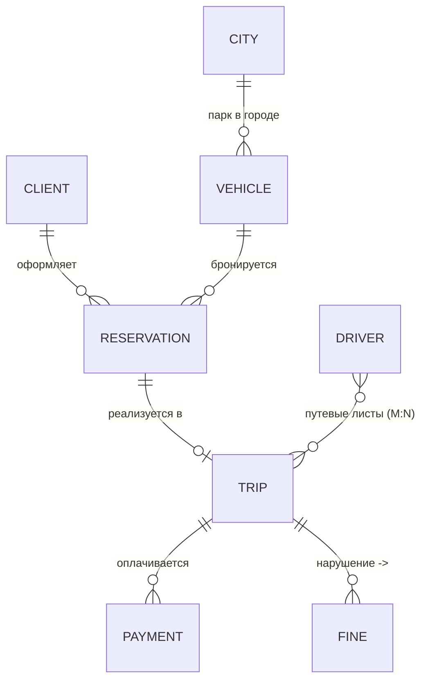
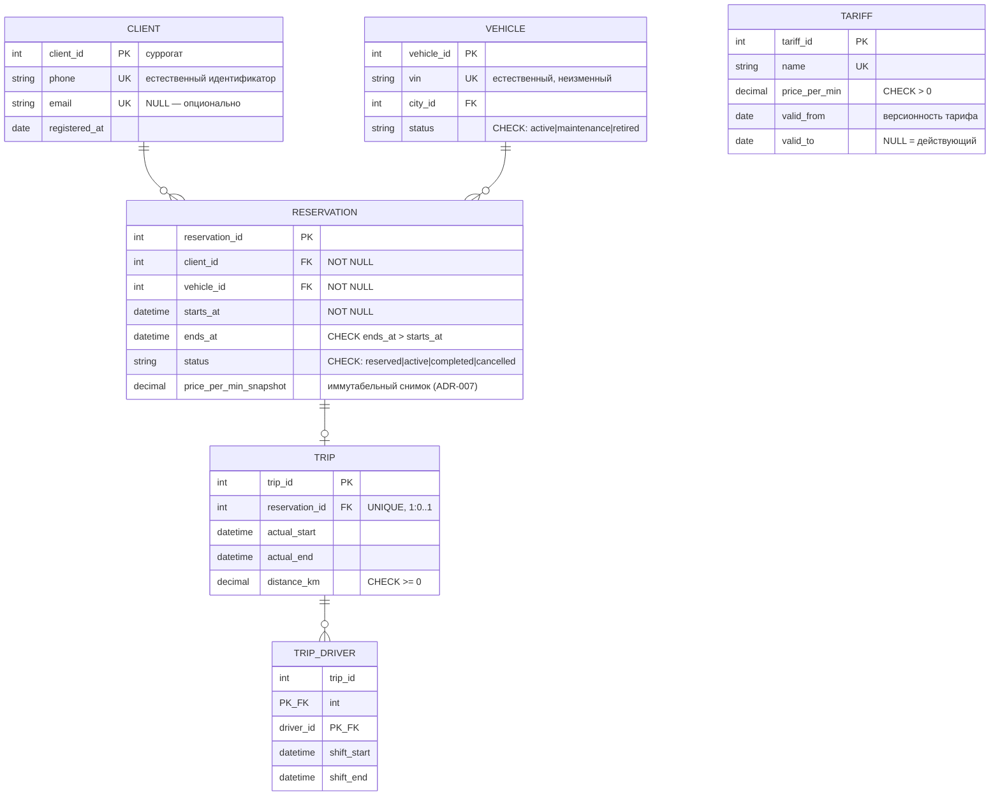

# Лекция 3. Концептуальная и логическая модели данных. Нормализация и эволюция схемы

> **Формат проведения (актуализация, окт. 2026):** тема ведётся как **два практических занятия по 1 ч 20 мин подряд**; документ ниже самодостаточен как инструкция преподавателя — таймлайны обоих занятий, теория Т1–Т6, раздатка Р1–Р7, регламенты игр, эталоны ответов и рубрика напечатаны в этом файле (см. «План курса»). Файл `practice.md` остаётся индивидуальным домашним заданием к теме.
>
> Статус: финальная версия (approved for release), расширена по Этапу E (итерация E-Л3, 21.10.2026): добавлены блоки «bis» (углублённая теория), доменные варианты кейса К2/К3, протокол рецензии схем, шаблоны артефактов, расширенные вопросы и методические заметки; формат пересобран под два практикума 2×80 мин с полным комплектом материалов для преподавателя. Обязательный минимум занятия (части 1–6, Case Study шаги 1–5) не изменён по содержанию — расширение аддитивно. Основание: человеческий review закрыт вердиктом «Готов к итоговой генерации» (`review.md`, блок «Вердикт (Преподаватель)», 20.10.2026); замечания fact-check №1–2 применены к тексту (см. `fact-check.md`). Источник истины темы: specs/syllabus.md, Лекция 3. Остаточные риски для преподавателя: библиография (пункты 3–5 протокола) и правила академической честности (пункт 8) — на усмотрение кафедры.

## Цель занятия

Научиться проектировать структуру данных от бизнес-уровня до логической схемы: строить концептуальные и логические модели данных, применять нормализацию до 3НФ для устранения аномалий данных и понимать принципы эволюции схемы БД (Zero-Downtime миграции).

## Learning Objectives

По окончании лекции студенты смогут:

1. **Понимать** три уровня моделей данных (концептуальная, логическая, физическая) и распределять артефакты по аудиториям.
2. **Применять** нотации ER (Чен), Crow's Foot и UML для построения моделей; **строить** концептуальную модель по бизнес-событиям.
3. **Проектировать** логическую схему: выбирать первичные и внешние ключи (естественные/суррогатные), задавать ограничения (Constraints) как формализованные бизнес-правила.
4. **Анализировать** аномалии данных и **приводить** схему к 1НФ → 2НФ → 3НФ через функциональные зависимости.
5. **Оценивать** денормализацию как осознанный компромисс (с фиксацией в ADR) и **планировать** изменения схемы по паттерну Expand and Contract без простоя сервиса.

## План курса: два практических занятия по 1 ч 20 мин (подряд)

> **Как читать этот документ.** Материал ниже — не конспект лекции, а рабочий комплект для преподавателя, ведущего **два практических занятия подряд по 80 минут каждое** (итого 160 минут). Всё необходимое — правила игр, раздаточный материал, эталоны ответов, критерии оценки — напечатано в этом файле; обращаться к другим документам папки во время занятия не нужно. Формат занятий — практикум: теория даётся короткими блоками (5–10 мин) строго перед тем действием, где она применяется, остальное время группы работают за доской/на бумаге. Занятие 1 заканчивается «на середине» — после того как каждая группа предъявит логическую схему в 3НФ; занятие 2 начинается с её проверки и доводит артефакт до конца (ADR, план миграции, защита).

### Карта двух занятий

| | Занятие 1 «От хаоса к структуре» (80 мин) | Перерыв | Занятие 2 «От структуры к решению» (80 мин) |
|---|---|---|---|
| Фокус | Аудит монолита, концептуальная модель, нормализация до 3НФ | — | Ключи и ограничения, денормализация/ADR, эволюция схемы, защита |
| Результат участников | Заполненный лист аудита; ER-диаграмма; журнал нормализации; черновик логической схемы в 3НФ | — | Доработанная схема (PK/FK/CHECK); ADR; план Expand and Contract; протокол взаимной рецензии |
| Раздел-эталон этого файла | «Теория Т1–Т3», «Раздаточный материал Р1–Р3», игра «Аномалии-детективы» | — | «Теория Т4–Т6», «Раздаточный материал Р4–Р7», игры «Суд над схемой», «Гонка миграций» |

### Таймлайн занятия 1 (80 мин) — «От хаоса к структуре»

| Время | Блок | Формат | Материалы здесь же |
|---|---|---|---|
| 0–10 | Вход в ситуацию: история «таблицы, которая похоронила релиз», распределение ролей в группах | рассказ + жеребьёвка ролей | текст Hook ниже, роли — §«Роли в группе» |
| 10–18 | Т1: три уровня моделей данных + критерий «исчезает при смене СУБД» | мини-блок у доски | §«Теория Т1» |
| 18–35 | Игра 1 «Аномалии-детективы»: группы ищут нарушения в своём монолите, заполняют лист аудита | работа в группах 3–5 чел. | Р1 (монолит варианта), Р2 (лист аудита), эталон — §«Эталоны аудита» |
| 35–43 | Т2: нотации Crow's Foot и Чен; кардинальность vs обязательность; разбор находок групп | мини-блок + обсуждение | §«Теория Т2», таблица четырёх комбинаций |
| 43–60 | Построение концептуальной ER-модели своего контекста (5–8 сущностей, связи, ≥4 бизнес-правила подписями) | группы у флипчартов/доски | Р3 (события контекста), образец — §«Кейс шаг 1–2» |
| 60–68 | Т3: алгоритм нормализации 5 шагов, ФЗ, мнемоника Кента; демонстрация на доске 1 цепочка | мини-блок + показ | §«Теория Т3», прогон примера А |
| 68–78 | Старт нормализации: группы раскладывают свой монолит по таблицам, ведут журнал нормализации | группы | Р2 (журнал), эталон — §«Эталоны аудита» |
| 78–80 | Домашняя установка к занятию 2: дочитать журнал, принести черновик логической схемы; exit ticket (3 вопроса на 60 сек) | фиксация | §«Exit tickets» |

### Таймлайн занятия 2 (80 мин) — «От структуры к решению»

| Время | Блок | Формат | Материалы здесь же |
|---|---|---|---|
| 0–8 | Ритуал входа: группы вывешивают схему занятия 1; экспресс-опрос по exit tickets прошлой группы | стендовая прогулка | результаты §«Exit tickets» |
| 8–16 | Т4: ключи (естественные/суррогатные/составные) и ограничения как код бизнеса; матрица trade-off | мини-блок | §«Теория Т4», сводная матрица |
| 16–30 | Игра 2 «Суд над схемой»: каждая группа защищает PK/FK/CHECK своей схемы, оппоненты обвиняют по протоколу семи проходов | суд: 4 мин защита + 3 мин обвинение на группу | Р5 (протокол рецензии), регламент суда — §«Игра 2» |
| 30–38 | Т5: пять паттернов денормализации П1–П5, протокол принятия решения, формат мини-ADR | мини-блок | §«Теория Т5», шаблон ADR |
| 38–50 | Группы пишут ADR о компромиссе своего контекста (или ADR «остаёмся в 3НФ») | группы | Р4 (карточка требования на снимок) |
| 50–58 | Т6: Expand and Contract, инвентарь рисков изменений, антишаблоны | мини-блок | §«Теория Т6», таблица рисков |
| 58–70 | Игра 3 «Гонка миграций»: карточки событий ломают/спасают план миграции, команды перестраивают план на лету | соревнование команд | Р6 (карточки игры), Р7 (шаблон плана), эталон — шаг 5 кейса |
| 70–78 | Взаимная приёмка: пары групп сверяют пакеты по чек-листу готовности; выставление самооценок по рубрике | пары | §«Чек-лист готовности», §«Рубрика» |
| 78–80 | Резюме обоих занятий, связка с проектным артефактом (Blueprint), мостик к Лекции 4 | закрытие | §«Резюме», §«Мостик» |

### Что взять в аудиторию (подготовка за 1 день)

- Распечатать по числу групп: Р1 (монолит своего варианта), Р2 (лист аудита+журнал), Р3 (события контекста), Р4 (карточка требования), Р5 (протокол рецензии), Р6 (карточки «Гонки миграций» — 12 шт. на группу), Р7 (шаблон плана миграции).
- На доску/флипчарт — заготовить сетку: колонки «Сущности | Связи | Правила» для занятия 1; «Фаза Expand | Migrate | Contract» для занятия 2.
- Проектор нужен только для диаграмм Д3→Д4 (проблема→метод) и Д7 (таймлайн фаз); при его отсутствии таблицы продублированы текстом в разделах Т1–Т6.
- Мел/маркеры двух цветов: второй цвет для «нарушений» в играх 1–2.

### Роли в группе (3–5 человек; назначаются жеребьёвкой на блоке 0–10 занятия 1)

| Роль | Отвечает за | Право голоса в играх |
|---|---|---|
| Ведущий моделирования | держит маркер, рисует схему на доске | защищает схему в «Суде» |
| Адвокат дьявола | задаёт вопрос «зная A, однозначно ли я знаю B?» по каждой колонке | единственный, кто обязан спорить со своей группой |
| Хранитель правил | переписывает бизнес-правила текстом, следит, чтобы каждое было закрыто ограничением | заполняет колонку «место исполнения» |
| Секретарь журнала | ведёт журнал нормализации и лист аудита (Р2) | сдаёт пакет на приёмку |
| (если пятый) Наблюдатель нагрузки | считает JOIN в типовых запросах, ловит «пере-нормализацию» | голосует в «Гонке миграций» |

Все роли меняются, если занятия проводятся повторно для другой группы; на защите (игра 2) говорит только Ведущий, но оценивается вклад всех по журналу.

## Hook: таблица, которая похоронила релиз

Команда каршеринга из сквозного кейса курса (Лекции 1–2) сделала «первую версию» базы поездок — одну таблицу `trips_raw`: телефон клиента и список пассажиров «через запятую» жили в одной строке с тарифом, ценой минуты и данными водителя.

Через полгода случились три истории:

1. **Юристы попросили справочник тарифов** — нельзя добавить новый тариф, не имея ни одной поездки по нему: данные о тарифе живут только внутри строк поездок (INSERT-аномалия).
2. **Маркетинг снизил цену минуты с 2.5 до 2.2** — скрипт две ночи правил 400 000 строк; часть осталась со старой ценой, бухгалтерия не свела расхождения (UPDATE-аномалия).
3. **Поддержка удалила «тестовые» поездки** — вместе с ними исчезли клиенты и водители, потому что больше нигде они не хранились (DELETE-аномалия).

**Вопрос аудитории:** это проблема SQL, PostgreSQL или того, как спроектирована *структура* данных? Почему никакая СУБД не спасает от плохой схемы?

**Ответ лекции:** структура данных проектируется до выбора технологии — на уровне концептуальной и логической моделей, по правилам нормализации; а менять схему живой системы нужно по протоколу эволюции (Expand and Contract). Сегодня превратим события и контексты Лекции 2 в модель данных.

## Теория для занятий: блоки Т1–Т6 (читать преподавателю перед соответствующим слотом таймлайна)

> Каждый блок Т рассчитан на 5–8 минут устного изложения с записью ключевой таблицы на доске. Это полный текст того, что нужно сказать; разделы «Часть Nbis» и «Дополнительные материалы» ниже — углублённый фонд для ответов на вопросы групп и для дифференциальной работы сильных студентов (в таймлайн двух занятий целиком не входят).

### Теория Т1. Три уровня моделей данных (слот 10–18 занятия 1)

Классическая схема абстракции ANSI/SPARC (1975) разделяет описание данных на три уровня. Каждый уровень — свой язык для своей аудитории:

| Уровень | Аудитория | Зависимость от СУБД | Что фиксирует |
|:---|:---|:---|:---|
| **Концептуальная** | Бизнес, стейкхолдеры | Нет | Сущности, связи, бизнес-правила — без типов данных |
| **Логическая** | Архитекторы, аналитики | Нет (независима) | Таблицы, колонки, PK/FK, ограничения, нормальные формы |
| **Физическая** | Разработчики, DBA | Да (конкретная СУБД) | Типы данных (VARCHAR vs TEXT), индексы, партиции |

**Концептуальная модель** отвечает на вопрос *«что знает бизнес?»*: Клиент оформляет Бронирование; Бронирование реализуется в Поездку; за Поездкой может быть выставлен Штраф. Элементы: сущность (Entity), атрибут, идентификатор, связь (Relationship), кардинальность (1:1, 1:N, M:N) и обязательность связи.

**Логическая модель** отвечает на вопрос *«как это устроено структурно?»*: сущности становятся таблицами, атрибуты — колонками, связи — внешними ключами или промежуточными таблицами. Здесь появляются PK/FK, NOT NULL, UNIQUE, CHECK. Модель остаётся независимой от конкретной СУБД.

**Физическая модель** отвечает на вопрос *«в чём и как хранить?»*: конкретные типы, индексы, партиции. **Граница курса:** наш курс — архитектурный (WHAT и WHY), мы работаем на первых двух уровнях; физическая реализация (DDL, SQL, тюнинг) — предмет следующего семестра (курс «Базы данных»).

**Зачем три уровня, если «можно сразу таблицы»?** Разделение уровней — управление коммуникацией и рисками: бизнес утверждает концептуальную модель (смыслы), архитектор — логическую (структуру), и только потом команда меняет физическую реализацию, не пересогласовывая бизнес. Типичная ошибка: спорить с заказчиком о типах колонок вместо согласования сущностей и связей.

**Опорный критерий для игр (записать на доску):** если элемент исчезает при замене СУБД — он физический; если исчезает при переходе от реляционной модели к документной — логический; если переживает всё — концептуальный. По этому критерию группы будут спорить в игре 2.

### Теория Т2. Нотации и кардинальности (слот 35–43 занятия 1)

**Нотация Чена** (Peter P.-S. Chen, 1976): прямоугольник — сущность, овал — атрибут, ромб — связь, подписи 1/N/M — кардинальность. Академический стандарт, максимально наглядный для обсуждения с бизнесом; громоздок на больших схемах.

**Crow's Foot («воронья лапка»)** — промышленный стандарт: символы на конце линии кодируют «один/много/обязательно/опционально»: `||` — один и только один, `o|` — ноль или один, `|{`/`o{` — один/ноль или много. Пример: `Клиент ||--o{ Бронирование` (у клиента может не быть бронирований; бронирование обязано иметь клиента). Поддержка: ERwin, MySQL Workbench, DBeaver, Mermaid.

**UML Class Diagram**: классы с атрибутами, ассоциации/агрегации/композиции, мультипликаторы `1`, `0..1`, `*`, `1..*`. Уместна, когда модель данных живёт рядом с объектной моделью проекта; методы на диаграмме данных обычно избыточны.

| Критерий | Чен | Crow's Foot | UML |
|:---|:---|:---|:---|
| Обучение, обсуждение с бизнесом | ✅ | ✅ | ⚠️ |
| Промышленный стандарт схем БД | ❌ | ✅ | ✅ (в смежных задачах) |
| Компактность на больших схемах | ❌ | ✅ | ✅ |
| Показывает поведение/методы | ❌ | ❌ | ✅ |

Рабочее правило курса: концептуальную модель обсуждаем по-ченски, итоговую логическую сдаём в Crow's Foot (Mermaid/draw.io).

**Кардинальность ≠ обязательность.** Четыре комбинации, которые группы обязаны различать (примеры про поездку — продублировать на доске):

| Сторона | Обязательна? | Множественна? | Пример | Запись |
|:---|:---|:---|:---|:---|
| один | да | нет | у поездки ровно одно бронирование | `\|\|` |
| ноль или один | нет | нет | бронирование реализуется не всегда (отмена) | `o\|` |
| один или много | да | да | у автомобиля много поездок | `\|{` |
| ноль или много | нет | да | у клиента может не быть поездок | `o{` |

**Четыре типичные ошибки нотации** (преподаватель демонстрирует «испорченные» рисунки, группы находят дефект — это разминка перед игрой 2): 1) потеря роли связи при самосвязи (`transfer(from_account, to_account)` одной линией); 2) M:N без промежуточной сущности — до первой попытки добавить атрибут связи; 3) шаблонное `\||--\|` везде («ровно один с обеих сторон» там, где бизнес говорит «ноль или много»); 4) смешение уровней — `id BIGINT PK` на концептуальной диаграмме (проверка: критерию Т1).

### Теория Т3. Нормализация: алгоритм, а не определения (слот 60–68 занятия 1)

Реляционная модель — Эдгар Кодд (E.F. Codd, 1970). **Нормализация** — организация структуры, устраняющая избыточность и аномалии данных (INSERT/UPDATE/DELETE — см. Hook). Инструмент анализа — **функциональные зависимости (ФЗ)**: X → Y означает, что каждому значению X соответствует единственное Y; бывают полные, частичные (от части составного ключа) и транзитивные (X → Y → Z).

Алгоритм из пяти шагов (группы применяют его в слоте 68–78, преподаватель демонстрирует на доске):

1. Выписать все атрибуты «плоской» таблицы-монолита и гипотетический PK.
2. Найти ФЗ — вопрос «зная A, однозначно ли я знаю B?» (работает Адвокат дьявола).
3. Проверить 1НФ (атомарность), затем 2НФ (нет частичных зависимостей от части составного PK), затем 3НФ (нет транзитивных).
4. Для каждого нарушения — вынести детерминант ФЗ в отдельное отношение, оставив FK.
5. Пересобрать «до/после» и проверить мнемонику У. Кента: каждый неключевой атрибут зависит «от ключа, всего ключа и ничего кроме ключа».

Дефиниции для доски: **1НФ** — все атрибуты атомарны, нет повторяющихся групп и «списков через запятую», есть PK; **2НФ** — 1НФ + каждый неключевой атрибут полностью зависит от всего PK (релевантна только составным ключам!); **3НФ** — 2НФ + нет транзитивных зависимостей неключевых атрибутов друг от друга.

Эволюция таблицы из Hook: `trips_raw` → (1НФ) `trips + trip_passengers` → (2НФ) `+ cars, tariffs` → (3НФ) `+ drivers, clients, cities`. Итог: каждая единица информации хранится ровно один раз.

**Дальше — редко.** БКНФ, 4НФ, 5НФ существуют теоретически; практическое правило базы знаний курса: для подавляющего большинства прикладных систем достаточно 3НФ (эмпирическая оценка; точная доля внешним источником не подтверждена — см. `knowledge/data-modeling/normalization.md`). Гнаться за высшими формами «любой ценой» — over-engineering. Если группа «уходит в 5НФ» без запроса бизнеса — это минус по рубрике (см. §«Рубрика»).

### Теория Т4. Ключи и ограничения (слот 8–16 занятия 2)

**Первичный ключ (PK)** уникально идентифицирует строку, не может быть NULL, один на таблицу. Требования: уникальность, неизменность по возможности, минимальность. **Внешний ключ (FK)** ссылается на PK другой таблицы и обеспечивает ссылочную целостность. Политики при удалении — отражение бизнес-правил, а не технические настройки: `CASCADE` (удаляем зависимое), `SET NULL` (осиротело — допустимо ли?), `RESTRICT` (запрещаем удалять, пока есть ссылки).

**Естественный vs суррогатный ключ — проектное решение с trade-offs:**

| Аспект | Естественный (email, VIN, ИНН) | Суррогатный (SERIAL, UUID) |
|:---|:---|:---|
| Бизнес-смысл | Есть, понятен | Нет |
| Стабильность | Может измениться (смена телефона, перерегистрация) | Неизменен |
| Размер/производительность FK | Может быть длинным, составным | Компактный (для SERIAL) |
| Риск утечки PII | Ключ содержит персональные данные | Нейтрален |

Практическая рекомендация (не догма): суррогатный PK + `UNIQUE` на естественный идентификатор. Для каршеринга `VIN` — отличный кандидат на уникальный естественный ключ, но делать его FK во всех таблицах рискованно: перерегистрация/замена кузова меняют «идентификатор». Составной ключ и M:N: связь «многие-ко-многим» реализуется промежуточной таблицей с составным PK из двух FK (пример Лекции 2: `work_sheets PK (trip_id, driver_id)`).

**Ограничения (Constraints) — код бизнеса** (таблица на доску, затем группы заполняют её для своей схемы в игре 2):

| Ограничение | Бизнес-правило | Пример для каршеринга |
|:---|:---|:---|
| `NOT NULL` | «без этого объект не существует» | Бронирование обязано иметь клиента |
| `UNIQUE` | «не может быть двух одинаковых» | Один автомобиль забронирован на интервал только один раз |
| `CHECK` | «значения вне диапазона недопустимы» | `status IN ('reserved','active','completed','cancelled')`; `price_per_min > 0` |
| `DEFAULT` | «значение по умолчанию» | `created_at = NOW()` |

Дисциплина проектирования (требование приёмки): перед сдачей логической модели пройдитесь по списку правил из концептуальной и для каждого скажите, каким ограничением оно закрыто; незакрытые правила — явный долг, который надо записать (в приложении к ADR или в бэклог), а не «помнить». Где живёт правило: клиент (слабое место — обходится любым другим клиентом) → сервисный слой (обходится прямым доступом к БД и batch-скриптами) → СУБД (сильное — действует на любой путь). Правило должно иметь ровно одного владельца исполнения.

### Теория Т5. Денормализация как осознанный компромисс (слот 30–38 занятия 2)

Нормализация оптимизирует запись и целостность, но усложняет чтение: «витрина поездки» требует JOIN пяти таблиц. **Денормализация** — осознанное введение избыточности в уже нормализованную схему ради производительности чтения. Это НЕ ошибка проектирования, а архитектурное решение, которое допустимо при Read-heavy нагрузке, предвычисленных агрегатах, аналитических витринах (OLAP — Лекция 8); порождает **риск рассинхронизации** и требует мер (синхронизация в одной транзакции, события/очереди, reconciliation-проверки, TTL); **обязательно документируется в ADR**.

| Аспект | Нормализация (3НФ) | Денормализация |
|:---|:---|:---|
| Избыточность | Минимальная | Осознанно повышенная |
| Аномалии UPDATE | Устранены | Возможны |
| Чтение (широкие витрины) | Медленнее (JOIN) | Быстрее |
| Запись | Быстрее | Медленнее (обновление копий) |
| Целостность | Гарантирует СУБД | Гарантирует приложение/процессы |

Каталог пяти паттернов (П1–П5) с механизмами поддержки — сокращённо для занятия; полное описание с протоколом — в разделе «Часть 5bis»:

| Паттерн | Что это | Механизм синхронизации | Обязателен ADR |
|:---|:---|:---|:---|
| П1 агрегат-витрина | `trips_count` в таблице клиента | транзакция или событие + reconciliation | да |
| П2 снимок факта | `price_per_min_snapshot` | не нужен; защита тестом «чек не меняется» | да (защита смысла) |
| П3 display copy | имя города в строке поездки | не нужен; согласие бизнеса на «как в момент операции» | да |
| П4 матпредставление | широкая таблица для аналитики | job/ETL + watermark «данные актуальны до T» | да |
| П5 hot/cold | архив старых поездок | политика хранения, SLA на подъём архива | желателен |

Протокол принятия решения (группы проходят по нему, прежде чем писать ADR): 1) есть измеренная проблема чтения (замер, а не «кажется»)? 2) проблема не решается индексом/пагинацией? (сначала дешёвое) 3) какой паттерн из каталога, чем рискуем? 4) кто поддерживает согласованность? 5) как обнаружим рассинхрон? 6) как откатимся? 7) ADR-запись: контекст → решение → последствия. Отдельный вид — **иммутабельный снимок факта** (цена на момент поездки): формально избыточность, фактически — иной бизнес-смысл поля (история не должна переписываться).

### Теория Т6. Эволюция схемы: Expand and Contract (слот 50–58 занятия 2)

Схема БД живёт дольше любого релиза приложения. Принципы зрелой команды: **схема как код** (миграции версионируются в Git, применяются последовательно, имеют обратный шаг; инструменты — примеры, не догма: Flyway/Liquibase, Alembic/Django migrations, Knex.js) и понимание **проблемы «большого ALTER»**: блокирующее изменение на большой таблице может сделать сервис недоступным на минуты и даже часы — порядок величины сильно зависит от СУБД, версии и механизма выполнения DDL (в современных СУБД есть online DDL / менее блокирующие варианты; точные значения не приводятся сознательно). Для сервиса с доступностью 99.9% это неприемлемо.

**Паттерн Expand and Contract** — трёхфазный протокол изменения схемы без простоя:


Иллюстративный пример (без production-кода): заменить у водителя `full_name` на `last_name`/`first_name`:
1. **Expand**: добавили две nullable-колонки; приложение пишет и читает старое поле.
2. **Migrate**: двойная запись, фоновый backfill, чтение переключено на новые колонки, `full_name` — «только запись для отката».
3. **Contract**: когда мониторинг показал отсутствие читателей старого поля — удаление отдельной миграцией.

Ключевые свойства: приложение доступно на каждом шаге; откат возможен на фазах Expand и Migrate; удаление старого — всегда отдельный, поздний, необратимый шаг (точка невозврата). Правило порядка: миграция применяется раньше релиза кода, читающего новую структуру; удаление структуры — строго позже релиза, который гарантированно её не читает. Инвентарь изменений по профилю риска и антишаблоны — полная таблица в «Часть 6bis»; для игры 3 достаточно формулы: *добавить nullable-колонку — низкий риск; переименовать/изменить тип/разделить таблицу — только через E&C; удалить — поздний отдельный релиз.*

## Раздаточный материал Р1–Р7 (раздать согласно таймлайну; всё печатается из этого файла)

### Р1. Таблицы-монолиты для аудита (по одному варианту на группу; игра 1, занятие 1)

**Вариант A — «Оплата»:**

`payments_raw(payment_id, trip_id, client_name, client_phone, client_email, card_last4, amount, fee_percent, fee_amount, status, provider_name, provider_reply_code, paid_at, refund_amount, refunded_at)`

Скрытые дефекты (преподавательская шпаргалка, студентам не показывается до обсуждения): списки не нарушают 1НФ явно, но `client_*` дублируются в каждом платеже одного клиента (3НФ через `client_phone → client_name/email`); `fee_percent → fee_amount` — транзитивная/производная; `provider_name/provider_reply_code` — справочник провайдеров; частичные возвраты требуют несколько строк на платёж (повторяющаяся группа `refund_*` — скрытое нарушение 1НФ).

**Вариант B — «Штрафы»:**

`fines_raw(fine_id, trip_id, driver_name, driver_license, car_plate, car_model, offense_types /* 'превышение, парковка в зоне' */, offense_addresses, fine_amount, status, appeal_count, appeal_reason, issued_at, photo_urls)`

Дефекты: `offense_types`, `offense_addresses`, `photo_urls` — списки через запятую (1НФ); `driver_license → driver_name` (3НФ); `car_plate → car_model` (3НФ); `appeal_reason` при `appeal_count > 1` физически не помещается — структура противоречит правилу «апелляция один раз» (обсудить, что первично: данные или правило).

**Вариант C — «Поддержка»:**

`tickets_raw(ticket_id, client_name, client_phone, category_names /* 'тариф, блокировка' */, assigned_operator, operator_team, messages_count, last_message_at, sla_deadline, resolution_text, status, escalation_history /* 'тимлид->дежурный АДС' */)`

Дефекты: `category_names`, `escalation_history` — 1НФ; `operator → operator_team` — 3НФ; `messages_count` и `last_message_at` — производные от сообщений, которых в таблице нет вообще (витрина П1 без источника — редкий тип ошибки, обсудить отдельно); `sla_deadline` зависит от категории (транзитивность).

**Вариант D — «Телематика»:**

`telemetry_raw(trip_id, gps_lat, gps_lng, recorded_at, speed, vehicle_vin, vehicle_model, driver_name, event_flags /* 'резкое торможение, превышение' */)`

Дефекты: `event_flags` — 1НФ; `gps_lat/lng + recorded_at + speed` — повторяющаяся группа одной поездки (главная: это разные granularity — поездка и точка); `vehicle_vin → vehicle_model`, `vin → driver_name?` (водитель меняется — ловушка «зависимость ли?»); итог обсуждения: здесь нормализация даёт разбиение по granularity, а не только по ФЗ — повод показать границу метода.

### Р2. Лист аудита и журнал нормализации (пустые бланки для групп)

```markdown
## Лист аудита монолита (игра 1)
Группа: ____ Вариант: ____
| № | Находка (колонка/паттерн) | Тип: 1НФ / 2НФ / 3НФ / аномалия INSERT / UPDATE / DELETE | Доказательство: вопрос «зная A, однозначно ли B?» | Последствие для бизнеса |
|---|---|---|---|---|

## Журнал нормализации (слот 68–78 занятия 1 и далее)
| Шаг | Нарушение (НФ) | Где (таблица.колонка) | Действие (что куда выносим) | Итоговая таблица с PK |
|---|---|---|---|---|
```

### Р3. События и правила контекстов (для построения ER-модели, слот 43–60 занятия 1)

**A. Оплата:** Платёж инициирован; Платёж подтверждён провайдером; Платёж отклонён; Возврат оформлен (частичный или полный). Правила: «платёж без поездки возможен (депозит) — уточнить у бизнеса»; «возврат не может превышать сумму платежа»; «статус платежа переживает удаление поездки»; «у клиента несколько способов оплаты».

**B. Штрафы:** Штраф выявлен камерой; Штраф выставлен клиенту; Штраф оспорен; Жалоба рассмотрена; Штраф оплачен; Штраф снят по решению оператора. Правила: «штраф может ссылаться на одно или несколько нарушений»; «апелляция возможна один раз»; «между выставлением и оплатой штраф может быть изменён только оператором с записью причины».

**C. Поддержка:** Обращение создано; Назначено оператору; Оператор ответил; Клиент ответил; Эскалировано; Обращение решено; Оценка поставлена. Правила: «обращение может относиться к нескольким категориям»; «у обращения ровно один ответственный оператор в каждый момент (история назначений сохраняется)»; «SLA считается по самой приоритетной категории».

**D. Телематика:** GPS-точка получена; Поездка начата; Поездка завершена; Превышение скорости зафиксировано; Аккумулятор низкий. Правила: «одна поездка — много точек»; «событие-нарушение привязано к точке и к поездке»; «сырые точки хранятся 90 дней, нарушения — бессрочно» (первый намёк на П5 hot/cold — преподаватель подхватывает на занятии 2).

### Р4. Карточка нового бизнес-требования (пишется ADR, слот 38–50 занятия 2)

Каждая группа тянет одну карточку и решает: денормализовать (какой паттерн П1–П5) или остаться в 3НФ; результат — мини-ADR по шаблону ниже.

- A: «Бухгалтерия требует: сумма и процент комиссии в чеке должны совпадать с тарифом на дату платежа, даже после изменения тарифа».
- B: «В списке обращений поддержка хочет видеть счётчик сообщений и время последнего ответа без JOIN к таблице сообщений».
- C: «Юристы требуют: между выявлением штрафа и его выставлением могла стоять проверка оператора, и её результаты нельзя менять задним числом».
- D: «Аналитики хотят ежедневную витрину "средняя скорость по зонам города", обновляемую ночью».
- E (ловушка): «Давайте продублируем имя клиента в таблицу платежей — так удобнее разработчику». Задача группы — доказать, что это П3 без измеренной проблемы, и отвергнуть или легализовать как display copy с явным согласием бизнеса.

### Р5. Протокол семи проходов для рецензии схемы (игра 2, занятие 2; по экземпляру на оппонента)

1. **Границы контекстов.** Есть ли подпись, какому контексту принадлежит каждая таблица? Таблица без владельца — будущий конфликт записи.
2. **Copy — таблицы-дубли («сущности-призраки»).»** Допустимый дубль — documented snapshot/витрина; недопустимый — забытая копия.
3. **PK/FK инвентарь.** У каждой таблицы ровно один PK; каждый FK ссылается на PK/UNIQUE; ни одного «висячего» строкового поля вида `client_phone` там, где ожидается ссылка.
4. **Кардинальности против правил.** Взять 3 правила из концептуальной модели и найти, каким ограничением каждое закрыто. Отсутствие ограничения ≠ ошибка, но требует заметки «реализуется в приложении, владелец такой-то».
5. **ФЗ-сканирование.** Для каждой неключевой колонки: «зависит от ключа, всего ключа, ничего кроме ключа?» Три кандидата на ошибку: справочные поля, производные суммы, даты «на всякий случай».
6. **Профиль нагрузки.** 2–3 главных запроса продукта: сколько JOIN после нормализации? Если >5 — есть ли витрина (П1/П4) с ADR?
7. **Эволюция.** Как добавляется следующее известное требование? Если ответ «ALTER живой таблицы» — схема не готова к эксплуатации, независимо от НФ.

Формат замечания оппонента: «Проход N: <дефект> в <таблица.колонка>. Предлагаемое исправление: <...>». Замечания без привязки к проходу не засчитываются.

### Р6. Карточки игры «Гонка миграций» (12 шт. на группу; разрезать; занятие 2, слот 58–70)

Каждая карточка вскрывается ведущим игры в указанном порядке; команда за 60 секунд должна сказать: ломает ли событие их план миграции, какое действие добавляет (в фазу Expand/Migrate/Contract), какой детектор и откат. Балл команде соперников, если те поймали то, что автор плана пропустил.

1. Backfill GPS-истории зон идёт быстрее, чем запись новых поездок («гонка хвоста»). *(Детектор: watermark последней обработанной поездки.)*
2. Новый код пишет `zone_id`, старый — нет; чтение из новой таблицы врёт на старых строках. *(Детектор: алерт «доля NULL zone_id у свежих поездок > порога»; откат — возврат читателей.)*
3. Месячный отчёт эксплуатации всё ещё читает старую колонку в момент Contract. *(Мониторинг обращений за полный бизнес-цикл; восстановление только из бэкапа — точка невозврата.)*
4. Бухгалтерия потребовала историю пересчёта штрафов задним числом за прошлый квартал. *(Ответ уровня команды: backfill по правилам на дату vs снимок — обсуждение П2.)*
5. Деплой миграции упал на 40% инстансов; часть читает новую колонку, часть старую. *(Идемпотентность, порядок: миграция раньше релиза кода.)*
6. Product просит «переименовать» `price_per_min` в `tariff_price` к пятнице. *(Прямой RENAME = антишаблон; только E&C: представление/новая колонка.)*
7. UPDATE-backfill на миллион строк в одной транзакции раздувает WAL. *(Пачки с курсором по PK + паузы; размер пачки — замером.)*
8. ORM-маппинг старого кода сломался из-за новой NOT NULL колонки без DEFAULT. *(Expand: nullable/с дефолтом; проверка SELECT * и маппингов.)*
9. Даун-миграция существует «на словах», никто не исполнял. *(Правило: down-миграция протестирована на копии данных, либо письменная необратимость в ADR.)*
10. Contract отложили «на потом», через полгода легаси-колонка живёт в трёх сервисах. *(Задача Contract заводится одновременно с Expand — Definition of Done.)*
11. Аналитики требуют read-only флаг на время переключения чтения. *(Компромисс доступности: назвать цену, зафиксировать в ADR.)*
12. Схема готова, но следующая фича («частичные отгрузки») снова упирается в ALTER. *(Проход 7 протокола: план эволюции — часть приёмки схемы.)*

### Р7. Шаблон плана миграции Expand and Contract (заполняется группами в игре 3)

```markdown
Изменение: <что и зачем>
| Фаза | Действие со схемой | Действие приложения | Чтение | Откат |
|---|---|---|---|---|
| Expand | миграция #___ (nullable/с дефолтом), down #___ | старый код не тронут | старая структура | безопасен |
| Migrate | backfill пачками по ___ (размер ___, курс) | двойная запись (компонент ___) | переключение: флаг ___, доля трафика ___ | возврат читателей + down-миграции |
| Contract | удалить ___ отдельным релизом | убрать legacy-код | новая структура | невозможен — точка невозврата (риск принят?) |
Реконсиляция: запрос ___ ; Детекторы: ___ ; Метрика готовности к Contract: ноль обращений к старой структуре за полный бизнес-цикл.
```

## Эталоны для преподавателя (не раздавать до окончания соответствующего блока)

### Эталоны аудита (проверка листов Р2, игра 1)

**Каршеринг `trips_raw` (основной демонстрационный прогон):** `passengers` через запятую → 1НФ → `trip_passenger(trip_id FK, passenger_phone)` PK из двух колонок; `car_plate → car_model` и `tariff_name → price_per_min`, `postal_code → city` → три транзитивные цепочки 3НФ → справочники `car`, `tariff(+valid_from/valid_to)`, `city`; PK атомарный — 2НФ не нарушается (подчеркнуть: 2НФ релевантна только составным ключам). Проверка результата: новый тариф заводят без поездок (INSERT), цена минуты правится в одной строке (UPDATE), удаление поездки не трогает клиента (DELETE).

Для вариантов A–D см. шпаргалки дефектов в Р1; минимальный проход для зачёта игры 1: 3 находки с доказательством через вопрос ФЗ + хотя бы одна аномалия названа следствием для бизнеса (не «некрасиво», а «бухгалтерия не сведёт»).

### Эталон концептуальной модели (слот 43–60 занятия 1, образец каршеринга)

| Событие (Лекция 2) | Сущности | Связь |
|:---|:---|:---|
| Пользователь зарегистрировался | Клиент | — |
| Автомобиль добавлен в парк | Автомобиль, Город | Город 1—N Автомобиль |
| Автомобиль забронирован | Бронирование | Клиент 1—N; Бронирование N—1 Автомобиль |
| Поездка началась / завершена | Поездка | Бронирование 1—0..1 Поездка |
| Оплата прошла | Платёж | Поездка 1—N Платёж (частичные оплаты/возвраты) |
| Штраф выставлен | Штраф | Поездка 1—N Штраф |
| Путевой лист (M:N из Лекции 2) | Путевой лист | Поездка M—N Водитель через промежуточную сущность |



Бизнес-правила подписями: «Бронирование не может существовать без клиента» (обязательный FK); «Один автомобиль не забронирован на пересекающиеся интервалы» (контроль пересечения — не выражается декларативно, записать как долг); «Штраф может быть выставлен постфактум» (Поездка 1—N Штраф).

### Эталон логической схемы 3НФ (проверка черновика к занятию 2; печатается из этого файла — Диаграмма 6 продублирована полностью)



Контрольные вопросы проверки: тариф не дублируется в поездках (нет UPDATE-аномалии), клиент живёт отдельно (нет DELETE-аномалии), пассажиры — атомарная таблица (1НФ), неключевые атрибуты зависят от PK целиком и не транзитивно (2НФ/3НФ). Обратите внимание групп на два «неочевидных» решения в эталоне: `price_per_min_snapshot` — единственное отступление от строгой 3НФ, закрытое ADR (см. эталон ADR ниже); `valid_from/valid_to` в тарифе — версионность справочника, которая делает снимок избыточным по форме, но необходимым по смыслу (история не должна переписываться при ошибке в истории тарифов).

### Эталон ADR (после слота 38–50 занятия 2; образец на карточке A)

```
ADR-007: Снимок цены минуты в бронировании (паттерн П2)
Статус: принято
Контекст: чек обязан показывать цену на момент поездки; запрос воспроизведения истории
  через temporal-историю тарифов дороже и зависит от дисциплины версионирования.
Решение: колонка price_per_min_snapshot в reservation; источник — тариф на момент подтверждения.
Последствия: риск подмены смысла (разработчик «починит» снимок актуальным тарифом) —
  защита: комментарий в миграции + тест «чек не меняется после апдейта тарифа»; откат — не требуется (значение иммутабельно).
```

Критерий принятия ADR группы: пройдены 7 пунктов протокола Т5; отсутствие п.1 (измеренная проблема) = отказ в зачёте компромисса.

### Эталон плана миграции (игра 3; кейс «платные зоны парковки»)

Новое правило после запуска: автомобили стоят в зонах с разной тарификацией парковки. **Expand** — таблица `parking_zones` + nullable `zone_id`; **Migrate** — backfill по GPS-истории пачками, двойная запись, переключение чтения по флагу; **Contract** — удаление legacy-логики отдельным релизом по данным мониторинга. Карта рисков (продублировать после игры):

| Шаг | Что может пойти не так | Детектор | Откат |
|:---|:---|:---|:---|
| Expand | гонка хвоста backfill vs новые записи | watermark | отключение job, колонка остаётся пустой |
| Migrate | старый код не пишет зону — чтение врёт на старых строках | алерт доли NULL у свежих записей | возврат читателей |
| Contract | месячный отчёт читает старую колонку | мониторинг за полный бизнес-цикл | только бэкап (точка невозврата!) |

### Exit tickets (броня для слота 78–80 занятия 1 и входа в занятие 2)

Три вопроса на 60 секунд в конце занятия 1 (собираются анонимно):
1. Назовите одну аномалию, которую вы сегодня научились *видеть* в чужой таблице, и её признак.
2. Что вы спросите у бизнеса перед выбором PK сущности вашего домашнего кейса?
3. Одна фаза Expand and Contract, без которой миграция почти наверняка простоит сервис — и почему.

Интерпретация: массовый провал вопроса 3 означает, что таймлайн фаз (Д7) надо повторно разобрать в слоте 50–58 занятия 2 до игры 3; провал вопроса 2 — усилить Т4 примером VIN/телефона.

### Игра 2 «Суд над схемой»: регламент (слот 16–30 занятия 2)

Рождение суда: каждая группа — «ответчик» со своей логической схемой; соседняя группа — «обвинитель» по Р5 (проходы 3–5 обязательны, 6–7 по жребию ведущего). Регламент на группу: 4 мин защита (Ведущий показывает схему и заполненную таблицу «правило → ограничение → место исполнения»), 3 мин обвинение (не более 4 замечаний, каждое с привязкой к проходу), 1 мин вердикт преподавателя. Вердикт фиксируется тремя цифрами: число незакрытых правил / число нарушений ФЗ / наличие обоснованных исключений. Судебная ошибка обвинителя (замечание не по протоколу или некорректное) — штрафной балл группе обвинителей (сдерживает «критиканство ради критики»).

### Игра 3 «Гонка миграций»: регламент (слот 58–70 занятия 2)

Команды получают свой вариант требования: A — «история комиссий по карточкам» (temporal vs снимок), B — «один штраф — несколько поездок» (1:N→M:N), C — «эскалации становятся отдельной сущностью с историей», D — «зоны телеметрии: сырые точки vs события». 5 мин — команды заполняют Р7; затем ведущий вскрывает карточки Р6 в порядке 1→12 (жёсткий темп 60 сек, ответы пишут на доске в колонку «детектор/откат»). Очки: +1 за корректное действие в нужной фазе, +1 соперникам, если они поймали пропуск. Побеждает команда, чей план после 12 карточек не содержит прямых ALTER на живой структуре и имеет записанный Contract с владельцем и сроком.

### Рубрика оценки пакета (общая для двух занятий; итог ставится по занятию 2)

| Критерий | Вес | Проверяется |
|---|---|---|
| Полнота анализа (лист аудита Р2) | 15% | игра 1: реальные нарушения и аномалии, а не абстракции |
| Корректность 3НФ и анализ ФЗ | 25% | журнал нормализации + суд (проход 5) |
| Обоснованность решений (ключи, FK-политики, ADR) | 25% | игра 2 + ADR (протокол Т5, все 7 пунктов) |
| План эволюции схемы | 20% | игра 3: фазы, детекторы, откаты, точка невозврата |
| Качество артефакта и взаимная приёмка | 15% | чек-лист готовности (см. «Проектная техника»), заполненный парной группой |

Соответствие домашней практике: пакет групповой работы — та же структура, что индивидуальное задание `practice.md` (Шаги 0–5); групповые баллы не переносятся автоматически, индивидуальный срез — по журналу и вкладу ролей.

### Чек-лист готовности пакета (для взаимной приёмки в слоте 70–78 занятия 2; каждая пара групп проверяет по этому списку, преподаватель верифицирует выборочно)

- [ ] Концептуальная диаграмма: сущности, связи, кардинальности, ≥4 бизнес-правил текстом подписями на связях.
- [ ] Логическая схема: PK/FK/UNIQUE/CHECK подписаны; таблицы размечены по контекстам; M:N реализовано промежуточной таблицей.
- [ ] Таблица «правило → ограничение → место исполнения» заполнена; незакрытые правила помечены явным долгом с владельцем.
- [ ] Анализ ФЗ: для каждой спорной колонки указано, от чего она зависит («от ключа, всего ключа, ничего кроме ключа»).
- [ ] Все отступления от 3НФ имеют ADR-запись (пройдены 7 пунктов протокола Т5, есть измеренная проблема).
- [ ] План E&C хотя бы для одного известного будущего изменения: три фазы, детекторы, откаты, точка невозврата названа.
- [ ] Лист аудита (игра 1) и журнал нормализации приложены к пакету — по ним видно, что схема получена методом, а не «угадана».

Типовые сигналы отклонения приёмки (преподавателю): заявленная 3НФ без анализа ФЗ; «снимок» без ADR; статусы булевыми флагами (`is_reserved/is_active/is_completed` допускают невозможные комбинации); FK на не-уникальную колонку; план миграции в одном ALTER. Каждый сигнал соответствует конкретному месту этого файла — указывайте студентам на раздел вместо переписывания работы.

## Теоретический блок (расширенный фонд: части 1–6 и «bis»)

### Часть 1. Три уровня моделей данных

Классическая схема абстракции ANSI/SPARC (1975) разделяет описание данных на три уровня. Каждый уровень — свой язык для своей аудитории:

| Уровень | Аудитория | Зависимость от СУБД | Что фиксирует |
|:---|:---|:---|:---|
| **Концептуальная** | Бизнес, стейкхолдеры | Нет | Сущности, связи, бизнес-правила — без типов данных |
| **Логическая** | Архитекторы, аналитики | Нет (независима) | Таблицы, колонки, PK/FK, ограничения, нормальные формы |
| **Физическая** | Разработчики, DBA | Да (конкретная СУБД) | Типы данных (VARCHAR vs TEXT), индексы, партиции |

**Концептуальная модель** отвечает на вопрос *«что знает бизнес?»*: Клиент оформляет Бронирование; Бронирование реализуется в Поездку; за Поездкой может быть выставлен Штраф. Элементы: сущность (Entity), атрибут, идентификатор, связь (Relationship), кардинальность (1:1, 1:N, M:N) и обязательность связи.

**Логическая модель** отвечает на вопрос *«как это устроено структурно?»*: сущности становятся таблицами, атрибуты — колонками, связи — внешними ключами или промежуточными таблицами. Здесь появляются PK/FK, NOT NULL, UNIQUE, CHECK. Модель остаётся независимой от конкретной СУБД.

**Физическая модель** отвечает на вопрос *«в чём и как хранить?»*: конкретные типы, индексы, партиции. **Граница курса:** наш курс — архитектурный (WHAT и WHY), мы работаем на первых двух уровнях; физическая реализация (DDL, SQL, тюнинг) — предмет следующего семестра (курс «Базы данных»).

**Зачем три уровня, если «можно сразу таблицы»?** Разделение уровней — управление коммуникацией и рисками: бизнес утверждает концептуальную модель (смыслы), архитектор — логическую (структуру), и только потом команда меняет физическую реализацию, не пересогласовывая бизнес. Типичная ошибка: спорить с заказчиком о типах колонок вместо согласования сущностей и связей.

### Часть 2. Нотации: ER (Чен), Crow's Foot, UML

**Нотация Чена** (Peter P.-S. Chen, 1976): прямоугольник — сущность, овал — атрибут, ромб — связь, подписи 1/N/M — кардинальность. Академический стандарт, максимально наглядный для обсуждения с бизнесом; громоздок на больших схемах.

**Crow's Foot («воронья лапка»)** — промышленный стандарт: символы на конце линии кодируют «один/много/обязательно/опционально»: `||` — один и только один, `o|` — ноль или один, `|{`/`o{` — один/ноль или много. Пример: `Клиент ||--o{ Бронирование` (у клиента может не быть бронирований; бронирование обязано иметь клиента). Поддержка: ERwin, MySQL Workbench, DBeaver, Mermaid.

**UML Class Diagram**: классы с атрибутами, ассоциации/агрегации/композиции, мультипликаторы `1`, `0..1`, `*`, `1..*`. Уместна, когда модель данных живёт рядом с объектной моделью проекта; методы на диаграмме данных обычно избыточны.

| Критерий | Чен | Crow's Foot | UML |
|:---|:---|:---|:---|
| Обучение, обсуждение с бизнесом | ✅ | ✅ | ⚠️ |
| Промышленный стандарт схем БД | ❌ | ✅ | ✅ (в смежных задачах) |
| Компактность на больших схемах | ❌ | ✅ | ✅ |
| Показывает поведение/методы | ❌ | ❌ | ✅ |

Рабочее правило курса: концептуальную модель обсуждаем по-ченски, итоговую логическую сдаём в Crow's Foot (Mermaid/draw.io).

### Часть 3. Ключи и ограничения

**Первичный ключ (PK)** уникально идентифицирует строку, не может быть NULL, один на таблицу. Требования: уникальность, неизменность по возможности, минимальность.

**Внешний ключ (FK)** ссылается на PK другой таблицы и обеспечивает ссылочную целостность: не может существовать Поездка, принадлежащая несуществующему Бронированию. Политики при удалении — отражение бизнес-правил, а не технические настройки: `CASCADE` (удаляем зависимое), `SET NULL` (осиротело — допустимо ли?), `RESTRICT` (запрещаем удалять, пока есть ссылки).

**Естественный vs суррогатный ключ — проектное решение с trade-offs:**

| Аспект | Естественный (email, VIN, ИНН) | Суррогатный (SERIAL, UUID) |
|:---|:---|:---|
| Бизнес-смысл | Есть, понятен | Нет |
| Стабильность | Может измениться (смена телефона, перерегистрация) | Неизменен |
| Размер/производительность FK | Может быть длинным, составным | Компактный (для SERIAL) |
| Риск утечки PII | Ключ содержит персональные данные | Нейтрален |

Практическая рекомендация (не догма): суррогатный PK + `UNIQUE` на естественный идентификатор. Для каршеринга `VIN` — отличный кандидат на уникальный естественный ключ, но делать его FK во всех таблицах рискованно: перерегистрация/замена кузова меняют «идентификатор».

**Составной ключ и M:N.** Связь «многие-ко-многим» реализуется промежуточной таблицей (ПК) с составным PK из двух FK. Пример из Лекции 2: путевые листы — M:N между Водителем и Поездкой: `work_sheets PK (trip_id, driver_id)`.

**Ограничения (Constraints) — код бизнеса:**

| Ограничение | Бизнес-правило | Пример для каршеринга |
|:---|:---|:---|
| `NOT NULL` | «без этого объект не существует» | Бронирование обязано иметь клиента |
| `UNIQUE` | «не может быть двух одинаковых» | Один автомобиль забронирован на интервал только один раз |
| `CHECK` | «значения вне диапазона недопустимы» | `status IN ('reserved','active','completed','cancelled')`; `price_per_min > 0` |
| `DEFAULT` | «значение по умолчанию» | `created_at = NOW()` |

### Часть 4. Нормализация: 1НФ → 2НФ → 3НФ

Реляционная модель — Эдгар Кодд (E.F. Codd, 1970). **Нормализация** — организация структуры, устраняющая избыточность и аномалии данных (INSERT/UPDATE/DELETE — см. Hook).

**Функциональные зависимости** — инструмент анализа: X → Y означает, что каждому значению X соответствует единственное Y. Бывают полные (от всего составного ключа), частичные (от части ключа) и транзитивные (X → Y → Z).

- **1НФ**: все атрибуты атомарны, нет повторяющихся групп и «списков через запятую», есть PK. *`trips_raw` нарушает 1НФ колонкой `passengers` → выносим в `trip_passengers(trip_id, phone)`.*
- **2НФ**: 1НФ + каждый неключевой атрибут полностью зависит от всего PK. *`car_model` зависит только от `car_id` → выносим в таблицу Автомобилей.*
- **3НФ**: 2НФ + нет транзитивных зависимостей неключевых атрибутов друг от друга. *В таблице поездок храним `city` и `postal_code`: `postal_code` зависит от `city`, а не от поездки → выносим справочник городов.*

Эволюция таблицы из Hook: `trips_raw` → (1НФ) `trips + trip_passengers` → (2НФ) `+ cars, tariffs` → (3НФ) `+ drivers, clients, cities`. Итог: каждая единица информации хранится ровно один раз.

**Дальше — редко.** БКНФ, 4НФ, 5НФ существуют теоретически; практическое правило базы знаний курса: для подавляющего большинства прикладных систем достаточно 3НФ (эмпирическая оценка; точная доля внешним источником не подтверждена — см. `knowledge/data-modeling/normalization.md`). Гнаться за высшими формами «любой ценой» — over-engineering.

### Часть 5. Денормализация как осознанный компромисс

Нормализация оптимизирует запись и целостность, но усложняет чтение: «витрина поездки» требует JOIN пяти таблиц. **Денормализация** — осознанное введение избыточности в уже нормализованную схему ради производительности чтения. Это НЕ ошибка проектирования, а архитектурное решение, которое:

- допустимо при Read-heavy нагрузке, предвычисленных агрегатах, аналитических витринах (OLAP — Лекция 8);
- порождает **риск рассинхронизации** и требует мер: синхронизация в одной транзакции, события/очереди, reconciliation-проверки, TTL;
- **обязательно документируется в ADR** (формат — Лекция 1).

| Аспект | Нормализация (3НФ) | Денормализация |
|:---|:---|:---|
| Избыточность | Минимальная | Осознанно повышенная |
| Аномалии UPDATE | Устранены | Возможны |
| Чтение (широкие витрины) | Медленнее (JOIN) | Быстрее |
| Запись | Быстрее | Медленнее (обновление копий) |
| Целостность | Гарантирует СУБД | Гарантирует приложение/процессы |

Отдельный вид — **иммутабельный снимок факта** (цена на момент поездки): формально избыточность, фактически — иной бизнес-смысл поля (история не должна переписываться). Дерево принятия решения — Диаграмма 8 в `diagrams.md`.

### Часть 6. Эволюция схемы и Zero-Downtime миграции (Expand and Contract)

Схема БД живёт дольше любого релиза приложения. Принципы зрелой команды:

- **Схема как код**: миграции версионируются в Git, применяются последовательно и воспроизводимо, имеют обратный шаг (down-миграция). Инструменты — примеры, не догма: Flyway/Liquibase, Alembic/Django migrations, Knex.js.
- **Проблема «большого ALTER»**: блокирующее изменение на большой таблице может сделать сервис недоступным на минуты и даже часы — порядок величины сильно зависит от СУБД, версии и механизма выполнения DDL (в современных СУБД есть online DDL / менее блокирующие варианты; точные значения не приводятся сознательно). Для сервиса с доступностью 99.9% (бронирование в час пик!) это неприемлемо.

**Паттерн Expand and Contract** — трёхфазный протокол изменения схемы без простоя:


Иллюстративный пример (без production-кода): заменить у водителя `full_name` на `last_name`/`first_name`:
1. **Expand**: добавили две nullable-колонки; приложение пишет и читает старое поле.
2. **Migrate**: двойная запись, фоновый backfill, чтение переключено на новые колонки, `full_name` — «только запись для отката».
3. **Contract**: когда мониторинг показал отсутствие читателей старого поля — удаление отдельной миграцией.

Ключевые свойства: приложение доступно на каждом шаге; откат возможен на фазах Expand и Migrate; удаление старого — всегда отдельный, поздний, необратимый шаг. Градация тяжести изменений: добавить nullable-колонку (низкий риск) → переименовать колонку (средний) → изменить тип/разделить таблицу (высокий, только через Expand and Contract).

### Часть 1bis. Сквозной мини-кейс «Финтех»: от одного экрана — к трём уровням модели

Все дальнейшие примеры в лекции строятся на двух сквозных кейсах: основном (каршеринг) и дополнительном (финтех-переводы). Начнём с финтеха — он короче, и на нём удобно показать, как один и тот же фрагмент реальности описывается на трёх уровнях.

**Бизнес-формулировка (словами заказчика):** «Клиент оформляет перевод со своего счёта на счёт другого клиента; перевод исполняется только при положительном остатке; по каждому переводу остаётся запись навсегда, даже если клиент закроет счёт».

**Концептуальный уровень** — фиксируем только смыслы, без таблиц и типов:

- Сущности: `Клиент`, `Счёт`, `Перевод`.
- Связи: Клиент `1—N` Счёт («владеет»); Перевод связывает два счёта — «Отправитель» и «Получатель», это две одноимённые связи между одними и теми же сущностями (в ER-терминах — отношение «Счёт участвует в Перевод» дважды, в разных ролях).
- Бизнес-правила: «у перевода ровно два участника-счёта, они различны»; «перевод не удаляется вместе со счётом» (правило из слов заказчика про «навсегда»).

Обратите внимание: на этом уровне ещё нет ни слова о том, *как* обеспечить «различность счетов» — ограничение появится ниже, на логическом уровне. Концептуальная модель отвечает на «что», логическая — на «как устроено», физическая — на «в чём хранить».

**Логический уровень** — сущности становятся отношениями:

```sql
account (account_id PK, client_id FK NOT NULL, currency, balance)
transfer (transfer_id PK, from_account_id FK NOT NULL, to_account_id FK NOT NULL,
          amount, executed_at, CHECK (from_account_id <> to_account_id))
```

Здесь мы приняли три проектных решения, каждое из которых позже будет защищено через trade-off: (1) баланс хранится в таблице счёта (быстрое чтение), а не вычисляется суммой проводок (целостность); (2) «навсегда» реализовано запретом удаления счёта с историей (`RESTRICT`), а не soft-delete; (3) различность отправителя и получателя — через `CHECK`, а не через приложение (поэтому правило нельзя обойти кривым скриптом).

**Физический уровень** — здесь начинаются вопросы, которые мы осознанно не раскрываем (это предмет курса «Базы данных»): числовые типы для денег (`NUMERIC` против целого числа минорных единиц), тип идентификатора, индексы по `client_id` и паре `(from_account_id, executed_at)`, партиционирование таблицы переводов по году. Фиксируем границу: **на выходе этого занятия — концептуальная и логическая модели; физическая модель упоминается только для того, чтобы её не путали с логической.**

**Мини-проверка понимания.** Коллега предлагает: «зачем два уровня, давай сразу покажем заказчику таблицы». Что плохо в такой демонстрации? Три причины: (1) заказчик компетентен в бизнес-формах, а не в нормальных формах — он не заметит транзитивную зависимость, но заметит отсутствующую сущность; (2) утверждённая таблица превращается в обязательство реализации, и любое «а давайте ещё вот так» становится пересогласованием договора, а не правкой схемы; (3) теряется язык для спора о денормализации: «избыточность» имеет смысл только относительно нормализованного логического уровня.

### Часть 2bis. Практикум по нотациям: одна связь — три рисунка и четыре ошибки

Возьмём правило каршеринга: **«Клиент может иметь ноль или много бронирований; каждое бронирование оформлено ровно одним клиентом».** Разберём, как оно выглядит в каждой нотации и где его чаще всего портят.

**Чен.** Прямоугольник `Клиент`, ромб `оформляет`, прямоугольник `Бронирование`; на рёбрах ромба пометки `0,N` (сторона клиента) и `1,1` (сторона бронирования). Сильная сторона — явная «связь как объект обсуждения»: ромб можно назвать глаголом и спорить именно о глаголе. Слабая — на 20+ сущностях диаграмма становится нечитаемой, а атрибуты-овалы перегружают рисунок.

**Crow's Foot.** Линия `CLIENT ||--o{ RESERVATION`: со стороны `RESERVATION` — «воронья лапка» с кружком (ноль или много), со стороны `CLIENT` — двойная черта (ровно один). Мнемоника чтения: «у клиента ноль или много бронирований; каждое бронирование связано ровно с одним клиентом». Это промышленный стандарт: ERwin, MySQL Workbench, DBeaver, Mermaid. Именно этот вид мы требуем в домашних работах.

**UML.** Класс `Reservation` с ассоциацией к `Client`, мультипликаторы `1` и `0..*`. Уместно, когда модель данных живёт рядом с объектной (доменный код на Java/C#), но методы на диаграмме данных отвлекают, а композиция/агрегация соблазняют выразить ими ссылочную целостность — не стоит: семантика владения жизненным циклом и семантика FK разные.

**Кардинальность ≠ обязательность.** Четыре комбинации, которые надо уметь различать (примеры про поездку):

| Сторона | Обязательна? | Множественна? | Пример | Запись |
|:---|:---|:---|:---|:---|
| один | да | нет | у поездки ровно одно бронирование | `\|\|` |
| ноль или один | нет | нет | бронирование реализуется не всегда (отмена) | `o\|` |
| один или много | да | да | у автомобиля много поездок | `\|{` |
| ноль или много | нет | да | у клиента может не быть поездок | `o{` |

**Типичные ошибки студентов (по прошлым потокам — иллюстративная сводка, не статистика):**

1. **Потеря роли связи при самосвязи.** `transfer(from_account, to_account)` в UML часто рисуют одной линией `Account *—* Transfer` — и теряют направление. Лечение: именованные роли («Отправитель», «Получатель») или отдельные линии.
2. **M:N без промежуточной сущности.** «Студент учится на курсе» рисуют как `o{—o{` и живут до первой попытки добавить атрибут связи («дата зачисления»). Если у связи есть атрибуты — это уже сущность (association class / ПК-таблица).
3. **Обязательность «с обеих сторон одна».** Шаблонное `\|\|--\|\|` везде: «у каждого водителя ровно одна поездка, у каждой поездки ровно один водитель» — формально красивая, фактически неверная модель.
4. **Смешение уровней.** В концептуальную диаграмму вставляют `id BIGINT PK` и индексы. Критерий проверки: если элемент исчезает при замене СУБД — он физический; если исчезает при переходе от реляционной модели к документной — он логический; если переживает всё — концептуальный.

**Упражнение на 90 секунд (можно прямо на парте).** Правило телемедицины: «Врач проводит ноль или много приёмов; приём проводится ровно одним врачом; у приёма может не быть назначений, назначения относятся к одному приёму». Нарисуйте в Crow's Foot, затем переведите в Чена. Проверка: две связи, четыре символа кратности, ни одного типа данных.

### Часть 3bis. Ключи как проектное решение: разбор на четырёх сущностях

Выбор PK — это не «SERIAL по умолчанию», а решение с последствиями для интеграций, миграций и регуляторики. Пройдём четыре кандидата из нашего кейса.

**Автомобиль: VIN (естественный) или `vehicle_id` (суррогатный)?** VIN уникален в мире, неизменен по замыслу производителя, понятен юристам и страховым. Но: перерегистрация/замена кузова меняют VIN; VIN попадает в PII-сопоставимые данные (по нему можно деанонимизировать владельца в связке с госреестром); длинные FK во всех дочерних таблицах. Решение курса: суррогатный PK + `UNIQUE(vin)`; внешний мир общается через VIN (он — бизнес-идентификатор в API), внутренняя схема — через `vehicle_id`. Компромисс: каждый вход по VIN требует lookup — но он один на запрос и покрыт индексом.

**Клиент: телефон или email?** Оба изменчивы (смена номера, смена почты), оба — PII, оба могут отсутствовать у части пользователей. Хранить PII в PK — значит размазать персональные данные по всем зависимым таблицам: право на удаление (152-ФЗ/GDPR, детали в Лекции 4) превращается в обход графа ссылок. Решение: суррогатный PK, контактные данные — в отдельной таблице `client_contact(client_id FK, type, value, UNIQUE(type,value))`, что дополнительно даёт «у клиента несколько телефонов» без ALTER.

**Тариф: составной ключ `(city_id, name, valid_from)`?** Кандидатных наборов два: суррогатный `tariff_id` и естественный составной `(city_id, tariff_plan_id, valid_from)`. Оставляем оба: PK — суррогат, `UNIQUE` — составной естественный. Причина: история тарифов опрашивается по «город + план + дата», и уникальный составной ключ защищает от дублей версий лучше любого кода валидации.

**Путевой лист: M:N-связь с атрибутами.** Из Лекции 2: поездка может обслуживаться несколькими водителями (смена за рулём), водитель участвует во многих поездках. Промежуточная таблица `trip_driver(trip_id FK, driver_id FK, started_at, ended_at)`. PK — составной `(trip_id, driver_id)`, если пара уникальна; но если допустимы повторные назначения одного водителя в поездке, составной ключ перестаёт быть уникальным — нужен суррогат. Дилемма решается вопросом к бизнесу: «может ли один и тот же водитель дважды появиться в одном путевом листе?» Нет ответа у бизнеса — нет выбора ключа у архитектора.

**Сводная матрица trade-off (заполняется на занятии для своей сущности):**

| Критерий | Вес для MVP | Вес для зрелого продукта |
|:---|:---|:---|
| Стабильность значения | высокий | высокий |
| Понятность человеку/внешним системам | средний | низкий (API маскирует) |
| Размер FK-наследия | низкий (мало данных) | высокий (шардинг, JOIN) |
| PII-риски | средний | высокий (регуляторика) |
| Риск коллизий при генерации | — | UUID vs identity: детали — курс БД |

**Ограничения как тесты.** Каждое бизнес-правило, которое можно выразить декларативно, переживает любой код: `NOT NULL` («без этого объект не существует»), `UNIQUE` («не может быть двух одинаковых»), `CHECK` («значение вне диапазона недопустимо»), FK-политика («что будет, если удалят родителя»). Дисциплина проектирования: перед сдачей логической модели пройдитесь по списку правил из концептуальной и для каждого скажите, каким ограничением оно закрыто; незакрытые правила — явный долг, который надо записать (в приложении к ADR или в бэклог), а не «помнить».

### Часть 4bis. Полный прогон нормализации: пример А (каршеринг) и пример Б (телемедицина)

Нормализацию удобнее преподавать как алгоритм, а не как определения. Алгоритм из пяти шагов:

1. Выписать все атрибуты «плоской» таблицы-монолита и гипотетический PK.
2. Найти функциональные зависимости (ФЗ) — вопрос «зная A, однозначно ли я знаю B?».
3. Проверить 1НФ (атомарность), затем 2НФ (нет частичных зависимостей от части составного PK), затем 3НФ (нет транзитивных).
4. Для каждого нарушения — вынести детерминант ФЗ в отдельное отношение, оставив FK.
5. Пересобрать «до/после» и проверить: каждая единица информации звучит ровно один раз; каждый неключевой атрибут зависит «от ключа, всего ключа и ничего кроме ключа» (мнемоника У. Кента).

**Пример А. Монолит поездок `trips_raw`.** Исходная таблица (фрагмент реального антипаттерна):

| trip_id | client_phone | client_name | passengers | car_plate | car_model | city | postal_code | tariff_name | price_per_min | total_price | fine_amount |
|---|---|---|---|---|---|---|---|---|---|---|---|

PK объявлен как `trip_id`. Шаг 2 — ФЗ: `trip_id → {client_phone, car_plate, city, tariff_name, total_price, ...}`; далее `car_plate → {car_model}`; `postal_code → {city}`; `tariff_name → {price_per_min}`; в итоге `trip_id → car_model` цепочкой через `car_plate`.

- **1НФ.** Колонка `passengers` («Иван, Мария») — повторяющаяся группа внутри ячейки. Дробим: `trip_passenger(trip_id FK, passenger_phone)` с PK `(trip_id, passenger_phone)`. Побочный эффект: поиск «клиент X ездил с пассажиром Y» стал возможен средствами SQL, а не регулярками.
- **2НФ.** PK здесь атомарный, поэтому частичных зависимостей нет — идём дальше. (Важно для экзамена: 2НФ релевантна только составным ключам; если студент «ищет» нарушение 2НФ в таблице с одиночным PK — он механически применяет формулу, а не понимает её.)
- **3НФ.** Три транзитивные цепочки порождают три справочника: `car(plate PK, model, ...)`, `city(postal_code PK, city_name)`, `tariff(tariff_id PK, name, price_per_min, valid_from, valid_to)`. В `trips` остаются FK и снимок цены (см. шаг 4 Case Study — там мы сознательно оставляем избыточность).
- **Проверка результата.** INSERT-аномалия устранена: новый тариф можно завести без поездок. UPDATE-аномалия устранена: цена минуты меняется в одной строке справочника (исторические поездки сохраняют свой снимок — это не рассинхрон, а другой бизнес-смысл). DELETE-аномалия устранена: удаление поездки не трогает клиента/автомобиль.

**Пример Б. Телемедицина, таблица приёмов.** Монолит `appointments_raw`: `appt_id, patient_name, patient_snils, doctor_name, dept_name, dept_phone, specialization, date_time, diagnosis_codes (через запятую), prescription_list`.

Шаг ФЗ: `appt_id → snils → patient_name`; `doctor_name → dept_name, specialization`; `dept_name → dept_phone` (если отделение единолично — иначе это M:N врача и отделений).

Разбор по формам:

| Нарушение | Тип | Действие |
|:---|:---|:---|
| `diagnosis_codes` — список через запятую | 1НФ | `appointment_diagnosis(appt_id FK, code FK)` |
| `patient_name` зависит от `snils`, который неключевой | 3НФ (транзитивная) | `patient(snils PK, name)`; в приёме — FK |
| `dept_phone` зависит от `dept_name` | 3НФ | `department(dept_id PK, name, phone)` |
| врач ↔ отделения «многие ко многим» | структура | `doctor_department(doctor_id, dept_id)` PK из двух FK |
| `specialization` у врача повторяется в каждом приёме | 3НФ | `doctor(doctor_id PK, spec_id FK)` + справочник специальностей |

Итоговая схема: `patient, doctor, department, specialization, appointment, appointment_diagnosis, doctor_department, prescription(+prescription_drug)`. Теперь ответим на вопросы бизнеса, которые монолит не позволял: «сколько приёмов у врача N за квартал» (GROUP BY по FK), «добавить специалиста без приёмов» (нет INSERT-аномалии), «телефон отделения изменился» (UPDATE одной строки).

**БКНФ и дальше — коротко, чтобы знать название двери.** БКНФ (BCNF, Кейт, 1986): детерминант любой нетривиальной ФЗ обязан быть кандидатным ключом. Классический нарушитель 3НФ-но-не-БКНФ: `preach(subject, parishioner, priest)`, где каждый прихожанин исповедуется одному священнику, но один священник служит нескольким прихожанам в разных предметах; пары `(subject, parishioner)` и `(subject, priest)` — обе кандидатные ключи, ФЗ `priest → subject` имеет неключевой детерминант. Дальше идут 4НФ (многозначные зависимости — независимые повторяющиеся группы: курсы и книги автора) и 5НФ (зависимости соединения). Практическое правило базы знаний курса: для подавляющего большинства прикладных систем достаточно 3НФ (эмпирическое правило; точная доля внешним источником не подтверждена); выход выше 3НФ оправдан, когда найдено конкретное аномальное поведение, а не «для чистоты». Гнаться за высшими формами «любой ценой» — over-engineering (см. Anti-pattern).

### Часть 5bis. Каталог денормализаций: пять паттернов с протоколом согласованности

Денормализация — это не «когда лень делать JOIN», а пять разных решений с разными механизмами поддержки. Формат описания каждого паттерна: зачем → чем рискуем → как синхронизируем → как проверяем → как документируем.

**П1. Кэшируемый агрегат («витрина»).** Колонка `trips_count` в таблице клиента для списка «мои поездки». Риск: расходится с реальностью. Синхронизация: обновление в той же транзакции (простая нагрузка) либо событие `TripCompleted` + консьюмер (распределённая). Проверка: ночной reconciliation-запрос `COUNT(*)` против витрины, алерт по доле расхождений. Документирование: ADR с указанием допустимого lag.

**П2. Снимок неизменяемого факта.** `price_per_min_snapshot` в бронировании. Риск почти нулевой по определению (значение не обновляется), но есть риск подмены смысла: разработчик потом «починит» снимок, начав брать актуальный тариф. Синхронизация: не нужна; защита — комментарий в схеме/миграции и тест «чек не меняется после апдейта тарифа».

**П3. Резолв отображения (display copy).** Имя города в строке поездки для печати чека. Отличается от П2 тем, что значение *должно* было бы меняться при переименовании — но бизнес согласился на «как на момент операции». Тот же протокол, что у П2, плюс явное требование к UX.

**П4. Материализованное представление.** Широкая таблица/представление для аналитики отдела эксплуатации (OLAP-направление, Лекция 8). Синхронизация: пакетное обновление по расписанию или инкрементально; риск — устаревшие отчёты; проверка — watermark-метрика «данные актуальны до отметки T».

**П5. Разделение «горячего» и «холодного».** Не денормализация в строгом смысле, но частый спутник: архив старых поездок в отдельную таблицу/хранилище. Требует правила маршрутизации запросов и договорённости об SLA на «поднять архив».

| Паттерн | Частота записи | Допустимый lag | Механизм синхронизации | Обязателен ADR |
|:---|:---|:---|:---|:---|
| П1 агрегат | высокая | секунды–минуты | транзакция или событие | да |
| П2 снимок | разово | нет | — | да (защита смысла) |
| П3 display copy | разово | нет | — | да |
| П4 матпредставление | пачками | часы | job/ETL | да |
| П5 hot/cold | — | дни на подъём | политика хранения | желателен |

**Протокол принятия решения (чек-лист, который студенты переносят в свои ADR):**
1. Есть измеренная проблема чтения (замер, а не «кажется»)?
2. Проблема не решается индексом/пулом соединений/пагинацией? (Сначала дешёвое.)
3. Какой паттерн из каталога? Чем рискуем?
4. Кто и как поддерживает согласованность? Где код-владелец?
5. Как обнаружим рассинхрон (метрика/реконсиляция)?
6. Как откатимся, если решение окажется ошибочным (миграция обратно)?
7. ADR-запись: контекст → решение → последствия (формат из Лекции 1).

### Часть 6bis. Расширенный протокол Zero-Downtime: чек-листы и антишаблоны миграций

Expand and Contract — каркас; в реальной инженерии он обрастает правилами безопасности. Ниже — свод, который рекомендуется распечатать как страницу Blueprint'а.

**Инвентарь изменений по профилю риска:**

| Изменение | Риск | Прямой ALTER допустим? | Схема |
|:---|:---|:---|:---|
| Добавить nullable-колонку | низкий | как правило да (зависит от СУБД/версии) | E→C без Migrate |
| Добавить NOT NULL с DEFAULT | средний | осторожно: переписывание таблицы | E с nullable → backfill → contract-ограничение |
| Переименовать колонку/таблицу | высокий | нет (ломает старый код) | E: новая колонка/представление → Migrate → C |
| Изменить тип колонки | высокий | нет | E: колонка нового типа → двойная запись → переключение → C |
| Разделить таблицу | очень высокий | нет | E: вторая таблица + FK → двунаправленная синхронизация → C |
| Удалить колонку | высокий (необратимо) | только поздним релизом | финальная фаза C |

**Правило порядка применения:** миграция применяется раньше релиза кода, читающего новую структуру; удаление структуры — строго позже релиза, который гарантированно её не читает. Между этими релизами — период наблюдения (метрики обращений к старой колонке = 0).

**Чек-лист фазы Expand:** новая структура nullable/с дефолтом; старый код не сломан (проверить: SELECT *, ORM-маппинги, экспортные формы); миграция идемпотентна (повторный запуск безопасен); down-миграция написана и протестирована на копии данных.

**Чек-лист фазы Migrate:** двойная запись включена (write path пишет старое+новое в одной транзакции); backfill идёт пачками с ограничением скорости (не создаёт блокировок; размер пачки подбирается замером, не «на глаз»); чтение переключается постепенно (feature flag / доля трафика); реконсиляция «старое == новое» на всём объёме до переключения; план отката включает возврат читателей, а не только схему.

**Чек-лист фазы Contract:** мониторинг показал ноль обращений к старой структуре за полный бизнес-цикл (недели, включая месячные отчёты); удалён legacy-код записи; удаление — отдельный релиз; в CHANGELOG/blueprint зафиксировано, что точка невозврата пройдена.

**Антишаблоны (каждый ломает доступность или корректность):**
- **Один релиз = ALTER + переключение чтения**: окно, когда старый код читает удалённую колонку, равно времени деплоя по всем инстансам.
- **Backfill одним UPDATE на миллион строк**: длинная транзакция, раздувание журнала/WAL, блокировки; лечение — пачки + паузы.
- **NOT NULL без DEFAULT на живой таблице**: мгновенный отказ всех старых инстансов приложения.
- **Переименование через прямое RENAME**: то же самое, что DROP+ADD с потерей readers.
- **Contract «на следующей неделе, когда-нибудь»**: вечный легаси-слой, двойная поддержка, рост ошибок. Лечение: задача на Contract заводится одновременно с задачей на Expand и считается частью Definition of Done фичи.
- **Даун-миграция «на словах»**: отсутствие реально исполняемого обратного скрипта; политика проекта — либо down-миграция, либо письменное обоснование необратимости в ADR.

**Метрики сопровождения миграций (для управленческой связки):** длительность окна деплоя, доля миграций с ручным вмешательством, время от обнаружения проблемы до отката, количество «висящих» Contract-задач. Эти четыре числа показывают руководству, является ли эволюция схемы инженерной процедурой или серией подвигов.

## Дополнительные материалы к теоретическому блоку

### ER → реляционное отображение: восемь правил перевода

Между диаграммой Части 2 и таблицами Части 3 стоит формальный мост — правила отображения ER-моделей в отношения (классика — Chen 1976 и последующие уточнения). Их полезно знать как «конвейер», потому что споры о схеме обычно оказываются спорами о том, какое правило применено.

| № | Конструкция ER | Правило отображения | Примечание |
|:---|:---|:---|:---|
| 1 | Сущность (сильная) | Таблица; идентификатор → PK | Атрибуты сущности → колонки |
| 2 | Слабая сущность | Таблица с составным PK из FK владельца + локального идентификатора | Пример: `trip_passenger` |
| 3 | 1:N связь | FK на стороне «многие» + политика удаления | `||--o{`: FK в RESERVATION |
| 4 | 1:1 связь | FK + UNIQUE на стороне ссылки; выбор стороны — вопрос обязательности | `||--o|`: бронирование↔поездка |
| 5 | M:N связь | Промежуточная таблица (ПК) с составным PK из двух FK | `trip_driver` |
| 6 | Атрибуты связи | Переносятся в ПК (для M:N) или «перетягиваются» к сущности при 1:N | Почему путевой лист — сущность |
| 7 | Многозначный атрибут (телефоны клиента) | Отдельная таблица `entity_value` (1:N) | Реализация 1НФ для «списка» |
| 8 | Наследование (транспорт: авто/скутер) | Варианты: single-table / class-table / junction | Выбор — физический уровень, обсуждается в Л4/курс БД |

Отдельно про **роли связей**: 1:N связь «Перевод ↔ Счёт» существует дважды (отправитель/получатель) — отображается двумя FK с разными именами; UNIQUE здесь не нужен, CHECK на неравенство — нужен.

### Транзакции на уровне схемы: почему CHECK сильнее кода

Граница курса запрещает писать SQL-приложение, но позволяет обсудить, *где* живёт бизнес-правило. Три места: клиент (самое слабое — обходится любым другим клиентом), сервисный слой (обходится прямым доступом к БД и batch-скриптами), СУБД (самое сильное — действует на любой путь изменения данных). Правило проектирования: ограничения, выражимые декларативно (уникальность, обязательность, диапазон, ссылка), всегда выгружаются в схему; сложная бизнес-логика (пересечение интервалов бронирования одного автомобиля) декларативно не выражается — её варианты: приложение + транзакция с блокировкой строки автомобиля, эксклюзивное ограничение на интервалы (возможность конкретных СУБД — предмет Л4/курса БД, здесь называем как существующий класс решений), или сериализация через очередь заявок. Мы фиксируем архитектурную позицию: **правило должно иметь ровно одного владельца исполнения**, иначе при рассинхроне логики никто не виноват.

### Модель данных и границы контекстов (DDD-продолжение из Лекции 2)

Из Лекции 2 у нас есть Bounded Contexts: «Бронирование», «Поездки», «Платежи», «Штрафы», «Пользователи». На лекции 3 добавляется принцип распределения схем:

- **Таблица принадлежит ровно одному контексту-владельцу.** Другие контексты имеют read-модель или ссылку по идентификатору, но не пишут в чужую таблицу напрямую.
- **Один термин — один смысл внутри контекста.** «Поездка» в «Бронировании» (зарезервированный интервал) и в «Поездках» (фактический рейс с телеметрией) — разные сущности с разным жизненным циклом; попытка сделать одну таблицу порождает null-поля «на все случаи».
- **Общий язык важнее общей базы.** Соблазн «просто сделать FK между контекстами» конвертируется в скрытую распределённую транзакцию; альтернатива — события eventual consistency (NFR из Л2), а ссылочную целостность обеспечивает consuming-контекст проверкой/ретраем.
- **Последствие для нормализации:** 3НФ достижима *внутри* контекста. Попытка нормализовать «сквозь» границы контекстов создаёт распределённую избыточность без ADR — худший из обоих миров.

### Прикидка как часть моделирования: сколько весит наша схема

Архитектор обязан оценивать порядок величины своих решений (метод — Лекция 1). Параметры из Л2: ~200 автомобилей, 3 города, MVP 3 месяца; примем иллюстративные допущения: 10 000 поездок/сутки, средняя поездка 25 минут, GPS-телеметрия каждые 10 секунд.

- Строка `trip` ≈ 100 байт → 10 000×100 = ~1 МБ/сутки → ~365 МБ/год. Схема 3НФ для поездок — задача скромного диска; узкое место не бронирования.
- Телеметрия: 200 авто × 6 записей/мин × 1440 мин ≈ 1.7 млн точек/сутки; при ~50 байт/точка ≈ 87 МБ/сутки сырых данных, ~32 ГБ/год. Вывод для модели: телеметрию нельзя класть в ту же нормализованную схему, что и бронирования, — это отдельная подсистема хранения (выбор движка — Л4, обработка — Л8).
- Таблица `fine` с постфактум-выставлением: редкие записи, но требующие аудита → в модели появляется `fine_history` или поля версии; решение документируем как снимок-паттерн П2.

Эти оценки не требуют точности: цель — показать, что **структура модели данных следует из профиля нагрузки**, а профиль нагрузки считается до рисования таблиц.

### FAQ: вопросы преподавателей и студентов прошлых потоков

**Q1. «Мы же не курс баз данных — зачем вообще про 2НФ, если PK обычно суррогатный и 2НФ не о чём нарушать?»**
Затем, что 2НФ объясняет логику составных ключей, а они живут в промежуточных таблицах и matviews. Плюс на экзамене встречаются таблицы с составным PK, и умение отличить частичную зависимость от транзитивной — проверяемый навык анализа, а не ремесла DBA.

**Q2. «Разве суррогатный PK не ломает locality и не замедляет вставку из-за случайных UUID?»**
Верное наблюдение — и оно относится к физическому уровню (тип идентификатора, последовательные vs случайные значения, кластерные индексы). На нашем уровне важно: выбор типа PK — это trade-off, а не привычка; в ADR фиксируем критерии (распределённая генерация, безопасность угадывания, размер). Детали движков — Л4.

**Q3. «Если снимок цены — денормализация, почему вы пишете, что "денормализация допустима", а студенты снимают балл за избыточность?»**
Потому что оценка ставится не за наличие избыточности, а за наличие обоснования: измеренная потребность, механизм поддержки, ADR. Снимок без комментария «почему» на практике неотличим от забытого дубля — поэтому в practice.md требуется текстовое обоснование каждого отступления от 3НФ.

**Q4. «Можно ли вместо Expand and Contract просто остановить сервис на тех. окно?»**
Можно, если бизнес согласен: для B2B-внутренней системы ночное окно — законное решение. Паттерн обязателен там, где простой стоит денег (бронирование в час пик, NFR 99.9%). Архитектор выбирает не «модный» метод, а метод, соответствующий NFR; это и есть связка с управленческими решениями.

**Q5. «Что делать, если backfill на миллионах строк идёт неделю и двойная запись всё это время конфликтует с историей?»**
Стандартный ответ: backfill пачками по первичному ключу с фиксированным курсором, идемпотентная запись («новое поле перезаписывается из старого, если старое изменилось позже»), реконсиляция в конце. Если объём таков, что неделя неприемлема — меняем план: migration-окно с read-only флагом (компромисс доступности) или поэтапный rollout по шардам. Все три варианта — trade-off, все три должны быть названы в ADR.

**Q6. «ER-диаграмма или класс-диаграмма — что сдавать в blueprint?»**
ER/Crow's Foot — это модель данных; класс-диаграмма — модель кода. В Architecture Blueprint раздела «данные» ожидаем Crow's Foot. UML принимается, если доменная модель объектно-ориентированного сервиса показана отдельно и не подменяет собой схему хранения.

**Q7. «Как понять, что моя схема "пере-нормализована"?»**
Практический сигнал: типичный пользовательский запрос требует JOIN больше 4–5 таблиц, а нагрузка read-heavy; второй сигнал — половина таблиц являются справочниками с <100 строками, заведёнными «для чистоты». Тогда допустимо ввести П1/П4 (витрину) с ADR — то есть решить проблему денормализацией *осознанно*, а не откатом к монолиту.

**Q8. «Почему вы не учите 4НФ/5НФ?»**
Соответствие программе: syllabus требует 1–3НФ; высшие формы названы поимённо и с критерием выхода (найденное аномальное поведение). Курсовая программа проверяет умение обнаружить и устранить нарушение до 3НФ и объяснить, когда остановиться.

### Разбор решений студентов: три варианта практической работы и их оценка

**Вариант 1 (зачтён с высоким баллом, контекст «Штрафы»).** Сущности: `Offense`, `Fine`, `Appeal`; логическая схема в 3НФ, PK суррогатные, `FINE.status` с CHECK-списком статусов, сумма — числовой точный тип (упомянуто как физическое решение, вынесено за рамки модели), FK на поездку с `RESTRICT` («штраф переживает удаление поездки» — обосновано ссылкой на регуляторные требования). Обоснована одна денормализация: снимок суммы штрафа на момент выставления (П2) с ADR. Замечание: не формализовано правило «апелляция возможна один раз» — стоило UNIQUE(fine_id) в Appeal.

**Вариант 2 (зачтён с medium).** Студент построил правильную концептуальную модель, но в логической оставил `client_phone` списком через запятую в таблице клиента («для быстрого поиска») — нарушение 1НФ, не закрытое ADR. Дополнительно: хранение `city` в таблицах и клиента, и автомобиля без справочника — транзитивная зависимость. Оценка снижена за отсутствие анализа ФЗ, хотя сами таблицы читаемы.

**Вариант 3 (не зачтён, потребовала пересдачи).** Схема «одна таблица на всё» мотивирована скоростью разработки MVP; студент перепутал этапность: отсутствие нормализации представлено как временная мера без плана перехода, без ADR и без указания аномалий, которые команда приняла на себя. Правильная форма этого аргумента: «осознанно работаем в 1НФ-монолите до конца квартала; Known Issues: INSERT/UPDATE/DELETE-аномалии (перечислены), план нормализации — веха Q2, триггер пересмотра — >X строк». То есть нарушение контракта не в «плохой схеме», а в отсутствии управления решением.

**Обобщение рубрики (детальная rubric — в practice.md):** анализ ФЗ и аномалий — 30%, корректность 3НФ — 25%, ключи и ограничения — 20%, обоснованные компромиссы/ADR — 15%, качество нотации и читаемость — 10%.

### Мини-упражнение в аудитории (полный сценарий на 10 минут)

Формат: пары, доска/листок, без ноутбуков. Вход — фраза заказчика (варьируется по потокам):

> «Курьер доставляет заказы; у доставки может быть несколько попыток; по каждой попытке фиксируются адрес, время и фото; адрес может принадлежать нескольким заказам; курьер не может иметь две активные доставки одновременно».

Ход: 2 мин — выписать сущности и связи (ожидаем Order, Delivery, Attempt, Address, Courier); 3 мин — определить кардинальности и обязательности (попытка 1:N к доставке; адрес 1:N к попыткам; «две активные» — правило, которое декларативно не выражается → обсуждение владельца исполнения); 3 мин — найти нарушения в предложенной преподавателем «готовой» таблице `deliveries(order_id, courier_name, courier_phone, attempts_json, address, address_city)` (ожидаем: 1НФ — attempts; 3НФ — courier_* и address_*); 2 мин — одна пара защищает перестройку у доски.

Критерий успеха: студенты называют *аномалию*, а не только «некрасиво». Типичный провал упражнения: забывают, что «несколько заказов на один адрес» — это не ошибка, а 1:N, и начинают «нормализовать» лишнюю связь.

### Семинарский кейс для самостоятельного разбора (с эталоном ответа)

**Условие.** Финтех-стартап (доменный вариант из syllabus) хранит переводы в таблице:

`transfers(id PK, client_name, client_email, sender_acc, receiver_acc, amount, fee_percent, fee_amount, status, created_at)`

Известны факты: (a) при смене email клиента нужно править все его переводы; (b) изменение комиссии тарифа ломает сверку исторических начислений; (c) один и тот же клиент может выступать и отправителем, и получателем; (d) статус меняется по жёстному маршруту `created → sent → settled` (или `failed`).

**Вопросы:** 1) какие НФ нарушены и какими ФЗ это обосновывается; 2) предложите перестройку; 3) где здесь законная денормализация и как её защитить; 4) какое правило вообще не ложится на декларативные ограничения.

**Ответ (эталон разбора).** (1) `client_email → client_name` при неключевом детерминанте — транзитивная зависимость, нарушение 3НФ (факт a). `fee_percent → fee_amount` — тоже транзитивная (при фиксированном amount), нарушение 3НФ; но учтите смысл: fee_amount — производная величина, её хранение это либо денормализация-снимок, либо вычисляемое поле. (2) Перестройка: `client(id PK, name, email UNIQUE)`, `account(id PK, client_id FK)`, `transfer(id PK, from_acc FK, to_acc FK, amount, fee_snapshot, status, created_at)`, `tariff(valid_from, valid_to, percent)`. (3) `fee_snapshot` — паттерн П2: иммутабельный снимок начисленной комиссии; защита — запрет обновления на уровне приложения + тест; обоснование — требование (b) бухгалтерской сверки. (4) Маршрут статусов (d) — конечный автомат, декларативно не выражается; владелец исполнения — сервисный слой, при необходимости с транзакцией; фиксируем как явный долг в ADR. Балл за ответ ставится по наличию обоснований, а не по «угадыванию» эталонной схемы.

### Контрольные точки понимания (exit tickets)

Три вопроса на 60 секунд в конце занятия (не входят в «Вопросы для самопроверки», собираются анонимно для преподавателя):
1. Назовите одну аномалию, которую вы сегодня научились *видеть* в чужой таблице, и её признак.
2. Что вы спросите у бизнеса перед выбором PK сущности вашего домашнего кейса?
3. Одна фаза Expand and Contract, без которой миграция почти наверняка простоит сервис — и почему.

Интерпретация для преподавателя: массовый провал вопроса 3 означает, что таймлайн фаз надо повторно разобрать на слайдах (Д7) до начала практики.

## Case Study: от событий Лекции 2 к модели данных «Каршеринга» (эталонный прогон для доски)

> Методическая роль раздела: это **эталон**, который преподаватель частично воспроизводит у доски в соответствующих слотах двух занятий (шаги 1–2 — занятие 1, шаги 3–5 — занятие 2), чтобы группы сверяли свой процесс с образцом. Группы при этом работают на своих вариантах контекстов (Р1/Р3: Оплата, Штрафы, Поддержка, Телематика) — каршеринг остаётся общим знаменателем курса.

Вход: контексты и события Лекции 2 (~200 автомобилей, 3 города, MVP за 3 месяца, команда 8 человек; NFR: доступность 99.9%, консистентность бронирования, eventual consistency между контекстами).

### Шаг 1. От событий — к сущностям

| Событие (Лекция 2) | Сущности | Связь |
|:---|:---|:---|
| Пользователь зарегистрировался | Клиент | — |
| Автомобиль добавлен в парк | Автомобиль, Город | Город 1—N Автомобиль |
| Автомобиль забронирован | Бронирование | Клиент 1—N; Бронирование N—1 Автомобиль |
| Поездка началась / завершена | Поездка | Бронирование 1—0..1 Поездка |
| Оплата прошла | Платёж | Поездка 1—N Платёж (частичные оплаты/возвраты) |
| Штраф выставлен | Штраф | Поездка 1—N Штраф |
| Путевой лист (M:N из Лекции 2) | Путевой лист | Поездка M—N Водитель через промежуточную сущность |

### Шаг 2. Концептуальная ER-диаграмма


Формализуемые бизнес-правила: «Бронирование не может существовать без клиента» (обязательный FK); «Один автомобиль не может быть забронирован на пересекающиеся интервалы» (контроль пересечения интервалов); «Штраф может быть выставлен постфактум» (Поездка 1—N Штраф).

### Шаг 3. Логическая модель контекста «Бронирование» (3НФ)

Полная Mermaid-схема — Диаграмма 6, продублирована в §«Эталон логической схемы 3НФ» этого файла (CLIENT, VEHICLE, TARIFF, RESERVATION, TRIP, TRIP_DRIVER с PK/FK/UK/CHECK). Проверка нормальности: тариф не дублируется в поездках (нет UPDATE-аномалии), клиент живёт отдельно (нет DELETE-аномалии), пассажиры — атомарная таблица (1НФ), неключевые атрибуты зависят от PK целиком и не транзитивно (2НФ/3НФ).

### Шаг 4. Компромисс: снимок цены в бронировании

Требование: чек показывает цену **на момент поездки**, даже после смены тарифа.

| Вариант | Плюсы | Минусы |
|:---|:---|:---|
| Только FK на тариф + история (`valid_from/valid_to`) | Нет избыточности | Сложный запрос «как было тогда»; цена зависит от корректности истории |
| Снимок `price_per_min_snapshot` | Простое воспроизведение чека, иммутабельная история | Дублирование факта (по смыслу не обновляется) |

Выбор: **снимок** — намеренная иммутабельность исторического факта, зафиксирована в ADR-007. Если бы требование звучало «показывать актуальную цену» — выбрали бы JOIN. **Вывод: решение диктуется бизнес-смыслом поля, а не «правильностью» нормальных форм.**

### Шаг 5. Эволюция схемы: платные зоны парковки

Новое правило после запуска: автомобили стоят в зонах с разной тарификацией парковки. Применяем Expand and Contract: **Expand** — таблица `parking_zones` + nullable `zone_id`; **Migrate** — backfill по GPS-истории, двойная запись, переключение чтения; **Contract** — удаление legacy-логики отдельным релизом по данным мониторинга. Сервис доступен на всех шагах, любой шаг (до Contract) откатывается.

## Связка с управленческими решениями

- **Скорость изменений = качество схемы.** Плохая схема превращает каждое бизнес-пожелание в «двухночный скрипт правки 400 000 строк» — это прямой time-to-market.
- **TCO.** Нормализованная схема дешевле в поддержке (один факт — одно место); денормализация экономит инфраструктуру чтения, но требует бюджета на процессы согласованности и reconciliation.
- **Регуляторика и PII.** Телефон/email как PK «размазывает» персональные данные по связям — удаление по GDPR/152-ФЗ становится сложной операцией. Суррогатные ключи + изоляция PII упрощают исполнение права на удаление (детали — Лекция 4).
- **Zero-Downtime — страховка выручки.** Простои в час пик бьют по конверсии; Expand and Contract — управляемая процедура, а не импровизация.
- **ADR дисциплинирует споры.** Каждая денормализация и выбор ключа — запись с контекстом/решением/последствиями.

## Ключевые термины

Термины сверены с `knowledge/glossary.md`; помеченные *(предложение)* ещё не внесены в глоссарий — решение о включении за редактором (см. `generation-report.md`).

| Термин | Определение коротко | Где в лекции |
|---|---|---|
| Концептуальная модель | Что существует в бизнесе: сущности и связи, без полей и технологий | Часть 1, Кейс шаг 2 |
| Логическая модель | Как устроено: таблицы, колонки, PK/FK, ограничения — независимо от СУБД | Часть 1, Кейс шаг 3 |
| Физическая модель | Где и на чём живёт: движок, индексы, партиционирование | Часть 1 (за рамками курса → Л4, Л8) |
| ER-диаграмма (Чен) | Нотация «сущность-связь»: прямоугольники, ромбы, кардинальности 1:N у линий | Часть 2 |
| Crow's Foot | «Гусиная лапка»: множественность связи отмечена на конце линии; стандарт для схем БД | Часть 2 |
| Сущность / атрибут / связь | Объект предметной области / свойство / правило взаимодействия | Части 1–2 |
| Кардинальность и обязательность связи | Сколько экземпляров участвует с каждой стороны и обязан ли хотя бы один *(предложение)* | Части 1–2 |
| PK / FK | Первичный ключ (уникально идентифицирует строку) / внешний ключ (ссылается на PK другой таблицы) | Часть 3 |
| Естественный ключ | PK из данных бизнеса (номер паспорта, VIN); хрупкий: меняется бизнес-правило — рвётся ссылка | Часть 3 |
| Суррогатный ключ | Искусственный идентификатор без бизнес-смысла (BIGINT GENERATED ALWAYS AS IDENTITY); стабилен, но требует UNIQUE на бизнес-ключ *(предложение)* | Часть 3 |
| Кандидатный ключ | Минимальный набор атрибутов, способный быть PK; выбираемый становится PK, остальные — UNIQUE | Часть 3 |
| CHECK / NOT NULL / UNIQUE | Ограничения домена и обязательности, переносимые в любую СУБД | Часть 3 |
| Функциональная зависимость (ФЗ) | A → B: значение A однозначно определяет B; фундамент определения НФ | Часть 4 |
| Транзитивная зависимость | A → B → C: неключевой атрибут зависит от неключевого; нарушает 3НФ | Часть 4 |
| 1НФ / 2НФ / 3НФ | Атомарность значений / нет частичной зависимости от составного PK / нет транзитивных зависимостей | Часть 4 |
| Аномалии INSERT / UPDATE / DELETE | Цена плохой схемы: нельзя внести факт / факт рассинхронизируется / удаление одного теряет другой | Hook, Часть 4 |
| Денормализация | Осознанное нарушение НФ ради измеренной выгоды чтения; только с ADR и механизмом согласованности | Часть 5 |
| Иммутабельный снимок факта | Зафиксированные в момент операции значения (цена тарифа в бронировании), не подлежащие переписыванию *(предложение)* | Часть 5, Кейс шаг 4 |
| Bounded Context (граница контекста) | Граница модели, внутри которой термин имеет один смысл; таблица принадлежит одному контексту-владельцу | Части 1, 5; кейс |
| Expand and Contract | Миграция схемы без простоя: расширить → перевести трафик → сузить *(предложение)* | Часть 6 |
| Backfill | Пакетное заполнение новой колонки/таблицы по существующим данным во время миграции *(предложение)* | Часть 6 |
| Down-миграция | Обратный скрипт миграции; при E&C может быть сознательно невозможен после Contract *(предложение)* | Часть 6 |
| OLTP / OLAP | Транзакционная нагрузка (много мелких операций) / аналитическая (редкие большие сканы) — развилка к Л4 | Мостик |
| PII | Персональные данные; влияют на выбор PK и хранение (GDPR/152-ФЗ — детали в Л4) | Управленческая связка |

## Визуальные материалы

Все восемь диаграмм подготовлены в `diagrams.md` (Mermaid + ASCII, пригодны для слайдов). Порядок показа привязан к слотам двух занятий; Д6 дополнительно продублирована текстом в §«Эталон логической схемы 3НФ» этого файла — при отсутствии проектора занятие проходит без `diagrams.md` вовсе.

| № | Диаграмма (diagrams.md) | Когда показывать | Зачем |
|---|---|---|---|
| Д1 | Три уровня моделей данных (ANSI/SPARC) | Т1 (занятие 1, 10–18) | Общее окно: одна реальность — три уровня описания |
| Д2 | Сравнение нотаций: Чен vs Crow's Foot vs UML | Т2 (занятие 1, 35–43) | Показать одну связь в трёх нотациях; договориться, что чертим на практике |
| Д3 | Аномалии данных на таблице-монолите | Hook (занятие 1, 0–10) | Визуализировать INSERT/UPDATE/DELETE-аномалии из истории про `trips_raw` |
| Д4 | Нормализация trips_raw: 1НФ → 2НФ → 3НФ | Т3 (занятие 1, 60–68) | Главный «до/после» урока: пошаговая перестройка той же таблицы |
| Д5 | Концептуальная ER-модель «Каршеринга» (Crow's Foot, Mermaid) | эталон ER (занятие 1, 43–60) | Результат движения от событий Л2 к сущностям — образец для групп |
| Д6 | Логическая модель контекста «Бронирование» в 3НФ | эталон 3НФ (вход занятия 2, 0–8) | Схема с PK/FK и ограничениями — образец для practice |
| Д7 | Expand and Contract: три фазы Zero-Downtime миграции | Т6 (занятие 2, 50–58) | Таймлайн релизов: чего нельзя делать в одной фазе |
| Д8 | Денормализация как компромисс (decision tree) | Т5 (занятие 2, 30–38) | Ветвление «норма ↔ денорм» с обязательным ADR на нижней ветке |

Рекомендация по показу: Д3→Д4 идут подряд (проблема→метод), Д5→Д6 подряд (концепция→логика); Д7 показывается до игры 3, чтобы команды спорили уже по схеме фаз.

## Резюме занятия (что уходит в Blueprint)

1. Модель данных проектируется слоями: концептуальная (бизнес) → логическая (структура) → физическая (СУБД, вне рамок курса). Артефакты этого занятия — первые два слоя.
2. Нотация обсуждения — Чен, нотация сдачи — Crow's Foot; кардинальность и обязательность читаются по символу на конце линии.
3. Ключ и ограничения — формализация бизнес-правил; выбор PK — trade-off с регуляторными и интеграционными последствиями.
4. Нормализация управляется функциональными зависимостями: 1НФ (атомарность) → 2НФ (нет частичных) → 3НФ (нет транзитивных); остановка на 3НФ — норма, выход выше — по найденной аномалии.
5. Денормализация законна только в пяти узнаваемых паттернах (П1–П5) с механизмом синхронизации и ADR.
6. Схема эволюционирует по Expand and Contract: расширяемся → мигрируем данными → сужаемся; удаление старого — всегда отдельный поздний шаг.
7. Домен определяет стоимость аномалий: в каршеринге дорог пересчёт цены во время активной поездки, в маркетплейсе — переоценка задним числом, в телемедицине — правка уже выставленного диагноза.

## Anti-pattern

**«Колонка-список» + «вечный ALTER».** Хранить несколько значений в одной колонке (нарушение 1НФ) и менять схему одним блокирующим `ALTER` на живой системе. Распознать: `split(",")` и регулярки над значениями колонок; DBA спрашивает «можно ли окном в 3 часа ночи?». Лечение: проектирование от 1НФ; миграции строго по Expand and Contract; регламент — ни одна денормализация/снимок без ADR.

**«Нормализовать до 5НФ любой ценой»** — схема из 30 таблиц для отчёта раз в месяц: JOIN-ад вместо решения. Нормализация обслуживает бизнес-нагрузку, а не академический идеал.

## Практическое задание

- **Основной формат (реализован таймлайнами двух занятий выше):** вся работа выполняется в аудиторию — игра 1 (аудит монолита), ER-модель контекста, нормализация до 3НФ, суд над схемой, ADR, гонка миграций; между занятиями — домашняя установка: дочитать журнал нормализации и принести черновик логической схемы своего контекста. Итоговый пакет группы сдаётся на взаимную приёмку в слоте 70–78 занятия 2 по чек-листу готовности.
- **Индивидуальная домашняя практика (`practice.md`):** аудит таблицы-монолита, концептуальная и логическая модели выбранного контекста в 3НФ, ADR о компромиссе, план Expand and Contract — самостоятельное продолжение групповой работы на индивидуальном контексте студента. Критерии оценки и шаблоны — в `practice.md`.

**Результат урока (по syllabus):** концептуальная и логическая модели данных, приведённые к 3НФ, с определёнными ключами и ограничениями — артефакт Architecture Blueprint.

## Мостик к следующей лекции

Мы спроектировали структуру данных независимо от СУБД — и оставили вопросы «где это жить будет?»:
- Транзакционность бронирования требует ACID — какие гарантии даёт конкретная СУБД при сетевом разделе?
- Телеметрия (GPS каждые ~10 секунд на 600 авто) — тот же движок, что и для бронирований, или другой класс СУБД?
- Как выбрать между реляционной, документной, key-value, колоночной БД под наши контексты?

**Лекция 4** («История, эволюция и виды СУБД. Транзакции, PACELC и Data Governance») выбирает технологический стек для спроектированных сегодня логических моделей. Наша 3НФ-схема станет входом для матрицы выбора СУБД.

## Вопросы для самопроверки

1. Чем логическая модель отличается от физической и почему наш курс останавливается на логической? Приведите пример решения физического уровня.
2. «Меняем цену тарифа — приходится переписывать историю». Какая аномалия это в денормализованной схеме и какая НФ её предотвращает? Всегда ли правильно хранить цену снимком?
3. Когда естественный ключ уместен как PK, а когда лучше суррогатный + UNIQUE? Пример из каршеринга с trade-off.
4. Таблица `trip(id PK, city, postal_code, city_population)` — какие нарушения 3НФ? Как перестроить?
5. Почему удаление старой колонки в Expand and Contract выносят в отдельный поздний релиз? Что произойдёт при одновременном удалении и переключении чтения?

## Проектная техника: шаблоны артефактов этого занятия

### Шаблон таблицы «Правило → ограничение → место исполнения» (для practice и blueprint)

| № | Бизнес-правило (формулировка заказчика) | Тип | Ограничение в схеме | Если не выражается декларативно |
|:---|:---|:---|:---|:---|
| 1 | «Бронь без клиента не существует» | обязательность связи | FK NOT NULL | — |
| 2 | «Один автомобиль не забронирован на пересекающиеся интервалы дважды» | инвариант времени | — | приложение+транзакция; вариант СУБД-ограничения → Л4 |
| 3 | «Цена в чеке — та, что была в момент поездки» | иммутабельность факта | snapshot-колонка (П2) | тест «чек не меняется» |
| 4 | «Штраф переживает удаление поездки» | политика удаления | FK RESTRICT + отдельное хранение | — |
| 5 | «Апелляция по штрафу возможна один раз» | уникальность события | UNIQUE(fine_id) в Appeal | — |

Заполненная таблица — обязательный артефакт практики: она делает видимыми правила, которые «живут только в коде», и превращает неявный долг в явный.

**Шаблон мини-ADR для денормализации (3–5 строк, формат Л1 в сжатии):**

```
ADR-NNN: <решение: что денормализуем>
Статус: принято/отклонено/предложено
Контекст: измеренная проблема (<запрос/метрика>), почему не помогли индексы/пагинация
Решение: паттерн П1..П5, где именно (таблица/колонка/представление)
Последствия: риск рассинхрона + механизм синхронизации + метрика обнаружения + план отката
```

**Шаблон записи миграции E&C (для раздела «план эволюции» в blueprint):**

```
Изменение: <что и зачем>
Expand:   миграция #___ (nullable/с дефолтом), down #___; риск: низкий
Migrate:  двойная запись (компонент ___), backfill пачками по ___ (размер ___, курс),
          реконсиляция: запрос ___; переключение чтения: флаг ___, доля трафика ___
Contract: задача #___ (владелец ___, дедлайн после полного бизнес-цикла наблюдения)
Откат:    до Contract — возврат читателей + down-миграции; после Contract — восстановление по бэкапу (риск принят?)
```

**Чек-лист готовности модели к сдаче (для самопроверки перед practice):**
- [ ] Концептуальная диаграмма: сущности, связи, кардинальности, ≥5 бизнес-правил текстом.
- [ ] Логическая схема: PK/FK/UNIQUE/CHECK подписаны; таблицы размечены по контекстам.
- [ ] Таблица «правило → ограничение/место исполнения» заполнена, незакрытые правила помечены долгом.
- [ ] Анализ ФЗ: для каждой спорной колонки указано, от чего зависит.
- [ ] Все отступления от 3НФ имеют ADR-запись.
- [ ] План E&C хотя бы для одного известного будущего изменения.

## Расширенный Case Study: три доменных варианта сквозного кейса

Основной разбор (шаги 1–5 выше) выполнен на каршеринге. Ниже — параллельные прогоны той же методологии на двух других доменах из syllabus (маркетплейс и телемедицина) плюс детальный разбор типичных студенческих ошибок на основном кейсе. Цель блока: показать, что алгоритм не зависит от домена, а решения — зависят.


### Кейс-задача для семинара: «Дилемма состава поездки» (полный разбор)

**Постановка.** Продукт запускает совместные поездки: несколько клиентов едут в одном автомобиле по одному счёту. Владелец требования — маркетинг; владелец данных — контекст «Поездки». Формулировка заказчика: «чтобы можно было делить счёт и видеть, кто с кем ездил».

**Проектные вопросы по порядку:**
1. Клиент участвует в поездке напрямую или через бронирование? Если через бронирование — совместная поездка = одно бронирование с несколькими участниками или несколько бронирований на пересекающиеся интервалы одного автомобиля? Первое ломает правило «бронь = один клиент», второе ломает контроль пересечения интервалов (два «активных» бронирования одной машины).
2. Эталонное разрешение: ввести сущность `ride_participant(trip_id FK, client_id FK, joined_at, share_percent)` — связь M:N поездка↔клиент с атрибутами; бронирование остаётся «заявкой одного клиента», участники добавляются после начала. Контроль интервалов при этом проверяется по поездке, а не по сумме броней.
3. Где живёт доля оплаты: в `ride_participant` (структура) или в платежах (факт)? Ответ зависит от того, может ли доля меняться после поездки; если да — снимок в платеже (П2), ссылка на участника — неточна со временем.
4. Как это эволюционирует из текущей 3НФ-схемы без простоя? Expand: новая таблица + nullable колонка `is_shared` у trips; Migrate: двойная запись для новых поездок, история остаётся с `is_shared=false`; Contract: удаление гипотезы «один клиент на поездку» из кода — по метрике обращений.

**Критерии хорошей оценки за разбор:** названы оба конфликтующих инварианта; введена связывающая сущность с атрибутами; оплата отделена от структуры участия; план E&C содержит точку невозврата. **Типичная слабая работа:** «добавим колонку second_client_id» — нарушение атомарности смысла (почему ровно двое?), тупик для масштабирования до трёх участников.

### Углубление шага 4: альтернатива «temporal table» и как её защитить

Третья опция вместо снимка — история тарифов с окнами валидности (`tariff_version(tariff_id, valid_from, valid_to, price)`), запрос «цена на дату»: `WHERE :moment BETWEEN valid_from AND valid_to`. Плюсы: нет дублирования цены; минусы: корректность зависит от непрерывности окон (дыра в истории = несуществующий чек), дороже поддержка. Критерий выбора: если бизнес может гарантировать дисциплину версионирования — temporal; если нет (MVP, несколько авторов справочника) — снимок П2. На занятии полезно провести этот выбор голосованием аудитории: он показывает, что «правильная НФ» не существует без контекста процесса.

### Углубление шага 5: карта рисков миграции «платные зоны» (продолжение кейса)

| Шаг | Что может пойти не так | Детектор | Откат |
|:---|:---|:---|:---|
| Expand: таблица + nullable FK | backfill GPS-истории идёт быстрее записи новых поездок — «гонка хвоста» | watermark: дата последней обработанной поездки | отключение job, колонка остаётся пустой |
| Migrate: двойная запись | новый код пишет зону, старый — нет; чтение из новой таблицы врёт на старых строках | алерт «доля NULL zone_id у свежих поездок > порога» | возврат читателей на старую логику |
| Contract: удаление legacy | месячный отчёт эксплуатации всё ещё читает старую колонку | мониторинг обращений за полный бизнес-цикл | восстановление только из бэкапа (точка невозврата!) |


### Вариант К2. Маркетплейс: витрина продавца

**Вход из Лекции 2 (события):** `ProductPublished`, `OrderPlaced`, `OrderItemShipped`, `SellerPayoutCalculated`. Контексты: «Каталог», «Заказы», «Выплаты».

**Шаг А. Сущности и связи.**

| Событие | Сущности | Связь |
|:---|:---|:---|
| ProductPublished | Product, Seller, Category | Seller 1—N Product; Product N—1 Category |
| OrderPlaced | Order, OrderItem | Order 1—N OrderItem |
| OrderItemShipped | Shipment | OrderItem 1—N Shipment (частичные отгрузки) |
| SellerPayoutCalculated | Payout, PayoutLine | Payout 1—N PayoutLine; PayoutLine N—1 OrderItem |

Ключевое отличие от каршеринга: состав заказа — M:N между Product и Order через OrderItem, причём у связи есть атрибуты (цена, количество) → ПК-таблица обязательна, «FK в обе стороны» не вариант.

**Шаг Б. Монолит-нарушитель и его разбор.** Типичная стартовая таблица MVP:

`orders_items_raw(order_id, order_date, customer_name, customer_email, product_title, product_price, qty, seller_name, seller_rating, line_total)`

ФЗ-анализ: `order_id → {order_date, customer_name, customer_email}`; `product_title → {product_price, seller_name, seller_rating}`; PK — составной `(order_id, product_title)` (уникальность «позиция заказа = товар»).

Нарушения: частичная зависимость `customer_*` от части PK (`order_id`) — **нарушение 2НФ**, редкий учебный случай, когда 2НФ реально срабатывает; транзитивная `seller_rating` через `product_title` — **3НФ**; `line_total = price*qty` — производное значение (см. ниже). Перестройка: `customer(id PK, name, email UNIQUE)`, `product(id PK, title, seller_id FK)`, `seller(id PK, name, rating)`, `order(id PK, customer_id FK, date)`, `order_item(order_id, product_id, unit_price_snapshot, qty)` PK из двух FK.

**Шаг В. Компромиссы.** `unit_price_snapshot` — паттерн П2 (цена на момент покупки): без него переоценка товара переписывает историю продаж — UPDATE-аномалия, которую бизнес не потерпит (финансовая сверка). `seller.rating` — паттерн П1 (агрегат-витрина): пересчитывается по отзывам, допустимый lag минуты, ADR с механизмом события `ReviewSubmitted`. `line_total` — храним как generated/вычисляемое либо не храним вовсе: хранение суммы при хранении цены и количества — третья зависимость от двух первых, классический кандидат на рассинхрон.

**Шаг Г. Эволюция схемы.** Новое требование: мультиштучные отгрузки со склада (одна позиция — несколько посылок с трек-номерами). Expand: таблица `shipment(id PK, order_item_id FK, tracking_no, shipped_at)`; Migrate: существующие строки «одна отгрузка на позицию» конвертируются backfill-ом, чтение переключается на новый путь; Contract: удаление колонок `tracking_no/shipped_at` из `order_item` отдельным релизом. Отметьте для себя: добавление таблицы — самая безопасная форма E&C (старый код вообще не трогается), в отличие от изменения колонки.

### Вариант К3. Телемедицина: назначения и справочники

**Особенность домена:** высокая доля справочников (МКБ-10, лексикон препаратов) и жёсткие требования аудита. Это меняет расстановку сил: нормализация здесь не только про аномалии, но и про легитимность данных (справочник — объект регулирования).

**Модель контекста «Приём»:** `patient(snils/external_id PK*, name...)`, `doctor(id PK, spec_id FK)`, `appointment(id PK, patient_id FK, doctor_id FK, scheduled_at, status)`, `diagnosis_ref(code PK, title)`, `appointment_diagnosis(appointment_id, diagnosis_code)` PK из двух FK, `prescription(id PK, appointment_id FK, issued_at, status)`, `prescription_drug(prescription_id, drug_code, dose, duration_days)`.

*Сноска: выбор PK пациента — пример регуляторно-обусловленного решения: SNILS как естественный ключ удобен интеграциям с госсистемами, но остаётся PII; компромисс курса — суррогат + UNIQUE на внешний идентификатор (подробнее — Л4, блок Data Governance).*

Разбор трёх характерных решений:

1. **Почему диагноз — отдельная связь, а не колонка.** У приёма может быть несколько диагнозов (основной + сопутствующие); попытка хранить «M13.9,J45.0» нарушает 1НФ и ломает статистику заболеваемости (GROUP BY по коду невозможен без парсинга). Побочный выигрыш: справочник `diagnosis_ref` позволяет валидировать коды CHECK/FK — недопустимый код физически не запишется.
2. **Почему доза живёт в `prescription_drug`, а не в справочнике.** Доза — свойство конкретного назначения, а не препарата: один и тот же препарат разным пациентам назначается в разных дозах. Ошибочная модель (доза в `drug_ref`) создаёт транзитивную зависимость и блокирует назначение.
3. **Аудит вместо UPDATE.** Требование «видно, кто и когда изменил назначение» выталкивает нас к паттерну event-sourcing на уровне модели: `prescription_event(prescription_id, changed_at, actor, field, old_value, new_value)` или версионирование строки. Формально это денормализация истории; по смыслу — новое требование целостности. ADR обязателен: выбираем между «полная история в каждой строке» (дорого) и «дельты событий» (сложно читать).

**Проверка 3НФ.** Все неключевые атрибуты `appointment` зависят от `id`; `scheduled_at` и `status` — свойства приёма; врач и пациент — FK. Нарушений нет; справочники вынесены; M:N разведены ПК-таблицами.

### Детальный разбор ошибок основного кейса (каршеринг)

Ниже — пять ошибок, которые чаще всего встречаются в домашних работах по каршерингу, с диагностикой «почему так кажется правильным» и лечением.

**Ошибка 1. «Один автомобиль — одна поездка».** Студент связывает VEHICLE и TRIP как 1:1, потому что «во время поездки машина занята одним клиентом». Смешение состояний и структуры: занятость — временный факт (атрибут статуса/интервал бронирования), а не кардинальность связи. Лечение: различайте «сколько экземпляров связано вообще» (структура) и «сколько активно сейчас» (правило/поведение). Правило активности выражается CHECK/частичным уникальным индексом (физический уровень, Л4) или сервисной логикой — но не 1:1 в ER.

**Ошибка 2. Статусы поездок колонкой-флагом.** Три булевых колонки `is_reserved, is_active, is_completed`: допускают невозможные комбинации (все true). Диагноз: отсутствие ограничения домена. Лечение: одно поле `status` + CHECK по списку значений (или ссылка на справочник статусов, если статусов много и они общие для нескольких сущностей). Плюс: маршруты переходов (`reserved→active→completed`, `cancelled` из любых незавершённых) остаются приложению — фиксируем это как известное ограничение декларативных средств.

**Ошибка 3. Хранение геозоны полигоном в колонке поездки.** «Поездка началась в зоне X» — студент кладёт координаты полигона зоны в таблицу trips. Нарушение 3НФ (полигон зависит от зоны, не от поездки) и смешение уровней (геометрия — физический уровень, типы данных ГИС). Лечение: `parking_zone(id PK, ...)` + FK в поездке/автомобиле; геометрия — предмет Л4/Л8.

**Ошибка 4. Таблица «всё о клиенте» с историей адресов в JSON.** Мотивация — «быстро грузить профиль». Проблема: поиск «клиенты, жившие в районе N» нереализуем средствами модели; нарушение 1НФ по смыслу (повторяющаяся группа адресов). Лечение: `client_address(client_id FK, address_id FK, from_date, to_date)` — M:N с историчностью; витрина профиля — паттерн П4 (matview), не исходная структура.

**Ошибка 5. Backfill «в одну миграцию вместе с фичей».** Не ошибка моделирования, а ошибка эволюции схемы: ALTER+UPDATE+переключение чтения в одном релизе. Разобрано в Части 6bis (антишаблоны); здесь повторяем, потому что в домашних работах по кейсу каршеринга этот антипаттерн встречается в разделе «план миграции» чаще остальных.


### Разбор типичного студенческого ответа: «витрина вместо нормализации»

Типичное предложение студентов для каршеринга: не строить 3НФ вообще, а держать широкую таблицу-витрину, которую пересобирает ночной job («зачем два раза делать то же самое»). Сильное зерно: для аналитики это действительно паттерн П4. Ошибки: (1) витрина выбрана как *первичная* структура — значит, транзакционная запись (бронь в час пик) идёт через тяжёлую пересборку, а не через компактные отношения; (2) lag ночного job конфликтует с NFR 99.9% и «консистентностью бронирования» из Л2; (3) аномалии UPDATE никуда не делись — они переехали в job. Эталонная форма ответа: 3НФ как источник истины + витрина П4 как производный read-слой с ADR и watermark. Балл ставится за различение «источник истины vs производная копия».

### Итоговое сравнение трёх вариантов (сводная таблица для слайда)

| Аспект | Каршеринг (К1) | Маркетплейс (К2) | Телемедицина (К3) |
|:---|:---|:---|:---|
| Главная M:N | путевой лист (поездка↔водитель) | заказ↔товар (order_item) | приём↔диагноз, рецепт↔препарат |
| Работает ли 2НФ | нет (PK атомарный) | да (частичные зависимости от order_id) | нет |
| Основной снимок (П2) | цена минуты | цена товара в позиции | доза/код на момент назначения |
| Основной агрегат (П1) | счётчик поездок | рейтинг продавца | — (аудит важнее) |
| Движущая сила схемы | доступность/час пик | финансовая сверка | регулирование/справочники |

Вывод для студентов: **домен диктует, какие аномалии дороги**. В каршеринге дорог UPDATE тарифа во время поездки; в маркетплейсе — переоценка задним числом; в телемедицине — изменение уже выставленного диагноза. Методология та же: ФЗ → НФ → осознанный компромисс → ADR → E&C.

## Расширенные вопросы для самопроверки и задачи с разбором

Полные ответы на эти вопросы не приводятся в лекции (они проверяются на практике); здесь — формулировки, сгруппированные по уровням таксономии Блума, чтобы студент мог сам калибровать глубину подготовки.

**Знание/Понимание:**
1. Назовите три уровня модели данных и аудиторию каждого. Почему спор о типах колонок с заказчиком — ошибка уровня?
2. Чем отличается кардинальность от обязательности? Запишите Crow's Foot для правила: «у водителя ноль или много путевых листов; каждый путевой лист обязан иметь водителя».
3. Дайте определение ФЗ и поясните мнемонику Кента — как она связана с 2НФ и 3НФ?
4. Какие три аномалии устраняет нормализация и как они проявились в таблице `trips_raw`?

**Применение/Анализ:**
5. Приведите `transfers(...)` из семинарского кейса к 3НФ; обоснуйте каждую выносимую таблицу конкретной ФЗ.
6. В схеме `order_item(order_id, product_id, price, qty, total)` найдите все нарушения и предложите два разных разрешения для `total` (хранить/не хранить) с критериями выбора.
7. Таблица `enrollment(student_id, course_id, instructor_id, instructor_phone)` с PK `(student_id, course_id)`: определите, какая НФ нарушена, если `course_id → instructor_id`, `instructor_id → phone`. Постройте итоговую схему.
8. Рецензируйте по протоколу семи проходов схему соседа по парте; оформите минимум три замечания с привязкой к проходам.

**Оценка/Создание:**
9. Команда предлагает убрать историю тарифов и всегда показывать актуальную цену («зачем дубли, у нас и так 3НФ»). Оцените предложение: какое скрытое предположение оно делает, какие последствия для чеков и бухгалтерии, какой минимальный артефакт согласования нужен.
10. Спроектируйте эволюцию «одна фотофиксация на штраф» → «множество материалов по штрафу» с полным планом E&C и точкой невозврата.
11. Создайте критерий приёмки для practice.md в форме «модель passes, если…»: сформулируйте 5 проверяемых условий, включая обработку сознательных исключений из 3НФ.

**Дополнительные задачи повышенной сложности (для сильных студентов; на экзамен не выносятся):**
12. Найдите в своей домашней схеме место, где 3НФ выполнена, но БКНФ нарушена (подсказка: ищите пару пересекающихся кандидатных ключей). Объясните, появится ли практическая аномалия при ваших нагрузках.
13. Смоделируйте «мягкое удаление» клиента (soft delete) и обычное удаление с `RESTRICT` — сравните по четырём критериям: соответствие праву на удаление, сложность запросов, объём хранения, честность истории. Какой вариант выбрал бы ваш домен и почему?
14. Для схемы К2 спроектируйте партиционирование `order_item` по времени (только на уровне аргументации «зачем/против чего») и объясните, как оно взаимодействует с FK и PK.

## Глоссарий занятия: расширенные определения и типичные подмены понятий

Дополнение к таблице «Ключевые термины»: пять терминов, которые студенты систематически путают, с формулировкой «как правильно» и «как обычно говорят неправильно».

| Термин | Правильно | Частая подмена |
|:---|:---|:---|
| Нормализация | процесс над *структурой* отношения, управляемый ФЗ | «нормализация = очистка/дедупликация данных» (это data cleansing, другая операция) |
| Денормализация | осознанное отступление от НФ с измеренной выгодой и ADR | «оптимизация» — не всякая избыточность оптимизирует |
| Естественный ключ | идентификатор, пришедший из предметной области | «PRIMARY KEY, объявленный на колонке id» — это не естественно |
| Суррогатный PK | искусственный, без бизнес-смысла, стабильный | «UUID везде» — выбор без критериев |
| Zero-Downtime | отсутствие недоступности *для пользователей* во время изменения схемы | «миграция заняла 5 секунд» — при заблокированной таблице пользователи стояли в очереди |
| Backfill | пакетное заполнение новой структуры по существующим данным | любая фоновая задача — не backfill |
| History table | отдельная структура для версий/событий | «сделаем nullable-колонку updated_at» — это не история |

## Связь с курсом «Базы данных» и реальной командной практикой

**Карта продолжений (что и где доучивается):**

| Тема сегодняшнего занятия | Что остаётся за рамками | Куда идёт |
|:---|:---|:---|
| Логическая модель, 3НФ | DDL, типы данных, индексы, планировщик запросов | курс «Базы данных», Л8 |
| Выбор PK (trade-off) | последовательности vs UUID, кластеризация, fragmentation | курс «Базы данных» |
| Ограничения CHECK/FK | уровни изоляции транзакций, сериализуемость, deadlock | Л4, Л6 |
| Expand and Contract | online DDL конкретных СУБД, gh-ost/pg-repack, логическое реплицирование | Л4, Л5 |
| Витрины П1/П4 | OLAP-движки, кубы, dbt-модели | Л8 |
| Мульти-tenancy моделей | схемы на tenant / schema-per-tenant / row-level security | Л4, Л5 |

**Как это живёт в реальных командах (практика индустрии, обобщённо):** в продуктовых командах модель данных проходит через те же ритуалы, что и код: pull request с миграцией, ревью DBA или старшего разработчика, CI-проверка «миграция вперёд/назад на копии прод-данных», feature flags для переключения чтения. Architectural Decision Records — стандартная практика для спорных решений (выбор ключа, денормализация). На защите blueprint (Лекция 7) от вас не ждут знания всех возможностей конкретной СУБД — но ждут, что каждое решение имеет автора, обоснование и план изменений.

**Мини-исследование для желающих (вне оценивания):** возьмите открытую схему популярного приложения (например, публичные схемы OSS-проектов) и выполните проходы 3–5 протокола рецензии. Задание тренирует именно тот навык, который теряется при работе только с учебными монолитами: чтение чужой модели без авторского комментария.

## Лаборатория чтения схем: как рецензировать чужую модель за 15 минут

Полезный навык, который тренируется на этом занятии и проверяется на защите blueprint: быстрая рецензия чужой логической схемы. Протокол из семи проходов (каждый — 1–2 минуты, порядок фиксирован, чтобы не «тонуть» в деталях):

1. **Границы контекстов.** Есть ли подпись, какому контексту принадлежит каждая таблица? Таблица без владельца — будущий конфликт записи.
2. **Copy — таблицы-дубли («сущности-призраки»).** Есть ли таблицы, которые только «переносят данные» (дублируют смысл другой таблицы без ADR)? Допустимый дубль — documented snapshot/витрина; недопустимый — забытая копия.
3. **PK/FK инвентарь.** У каждой таблицы ровно один PK; каждый FK ссылается на PK/UNIQUE; ни одного «висячего» строкового поля вида `client_phone` там, где ожидается ссылка.
4. **Кардинальности против правил.** Возьмите 3 правила из концептуальной модели и найдите, каким ограничением каждое закрыто. Отсутствие ограничения ≠ ошибка, но требует явной заметки «реализуется в приложении, владелец такой-то».
5. **ФЗ-сканирование.** Для каждой неключевой колонки спросите: «она зависит от ключа, всего ключа, ничего кроме ключа?» Три кандидата на ошибку: справочные поля (город, модель), производные суммы, даты «на всякий случай».
6. **Профиль нагрузки.** Посмотрите на 2–3 главных запроса продукта: сколько JOIN требуется после нормализации? Если >5 — проверьте, есть ли витрина (П1/П4) с ADR.
7. **Эволюция.** Как будет добавляться следующее известное требование (например, «частичные отгрузки» / «платные зоны»)? Если ответ «ALTER живой таблицы» — схема не готова к эксплуатации, независимо от НФ.

**Как проводить такую рецензию на peer-review (Лекция 7):** семь проходов дают естественную структуру комментариев — каждый замечание привязано к проходу, что убирает споры «нравится/не нравится».

## Методические заметки для преподавателя (расширение Л3, итерация E)

Блок для преподавателя: как распределять расширенный материал между аудиторией и самостоятельной работой. **Штатный формат проведения темы — два практических занятия по 80 минут подряд (таймлайн в начале файла); сценарий «лекция 80 мин» ниже — резервный вариант для случая, когда практикумы сокращают до одного слота.** Обязательный минимум — части 1–6, Case Study (шаги 1–5), управленческая связка; всё, что помечено «bis» и последующие расширенные секции, — фонд вариативности: его можно выдать как pre-reading, разобрать на семинаре или использовать для дифференциации сильных студентов.

**Рекомендуемые сценарии проведения:**

| Формат | Что берём из расширения | Что остаётся самостоятельным чтением |
|:---|:---|:---|
| **Два практикума 2×80 мин (основной формат)** | таймлайн занятия 1+2 (Т1–Т6, игры 1–3, Р1–Р7, эталоны) | блоки «bis», доменные варианты К2/К3, FAQ, seminar case |
| Лекция 80 мин (базовый резерв) | Части 1–6, кейс К1, мини-упражнение | Часть 4bis пример Б, FAQ, seminar case |
| Лекция + семинар 80+45 | плюс прогон нормализации К2 на доске | протокол рецензии, шаблоны артефактов |
| Перевернутый класс | pre-reading: части bis + К3 | на занятии: разбор ошибок К1, exit tickets |

**Правила проведения двух занятий (критично для качества):**
1. Не опережайте теорию практикой: блок Т даётся строго перед слотом, где он применяется (см. колонку «Материалы» в таймлайнах). Группы, начавшие нормализацию без Т3, воспроизводят «интуитивную 3НФ» и не учатся методу.
2. Держите темп игр по таймеру; недообсужденное уносится в ADR/журнал как открытый вопрос, а не съедает следующий слот.
3. Эталоны (§«Эталоны для преподавателя») раскрываются только после завершения соответствующего блока — раньше они превращают практикум в списывание.
4. Между занятиями 1 и 2 — обязательная установка домашней работы: черновик логической схемы своего контекста (без неё игра 2 «Суд над схемой» не состоится).
5. Если группа закончила раньше: дифференциал — вариант D (телеметрия, граница метода нормализации) или карточка E из Р4 (ловушка без измеренной проблемы).

**Куда смотреть при проверке домашних работ (топ-5 сигналов):** отсутствие анализа ФЗ при заявленной 3НФ; «снимок» без ADR; статусы булевыми флагами; FK на не-уникальную колонку; план миграции в одном ALTER. Каждый сигнал соответствует конкретному месту лекции — укажите студенту на раздел вместо того, чтобы переписывать работу.

**Ресурсные требования расширения:** диаграммы Д1–Д8 покрывают базовые части; для блоков bis достаточно таблиц (они самодостаточны); отдельная диаграмма «каталог денормализаций П1–П5» может быть добавлена в diagrams.md по запросу потока.

**Как расширение связано с оценкой:** rubric practice.md не меняется; дополнительные задачи (12–14) — факультативный бонус, не влияющий на основную оценку; exit tickets — обратная связь преподавателю, не студенту.

## Источники

- Codd, E. F. (1970). A relational model of data for large shared data banks. *Communications of the ACM*, 13(6), 377–387.
- Chen, P. P.-S. (1976). The Entity-Relationship Model — Toward a Unified View of Data. *ACM Transactions on Database Systems*, 1(1), 9–36.
- Клейтманн, М. (2017). *Проектирование интенсивно используемых приложений* (DDIA), гл. 3–4.
- ANSI/SPARC Architecture (1975).
- Date, C. (1986). Fundamental principles of normal form for database relations. *ACM Computing Surveys*, 18(1), 48–72. (БКНФ — упоминание в Части 4bis.)
- Kent, W. (1979). A simple guide to five normal forms in relational databases theory. *SIGMOD Record*, 9(2), 12–16. (Мнемоника «от ключа, всего ключа…» — Часть 4bis.)
- Fahlberg, N., Ullén, J. (2016). *Database Migration: Step-by-Step Data Migrations and Zero-Downtime Deployments Made Easy*. (Практика E&C — Части 6, 6bis.)
- Праксис командной работы с миграциями (PR-ревью, CI-проверки) — обобщённая отраслевая практика, конкретные инструменты названы как примеры; источник по запросу в `knowledge/databases/*`.
- База знаний курса: `knowledge/data-modeling/*`.
- Материалы урока: `brief.md`, `outline.md`, `draft.md`, `practice.md`, `diagrams.md`, `slides.md`; проверка — `review.md`.
