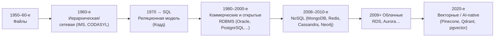
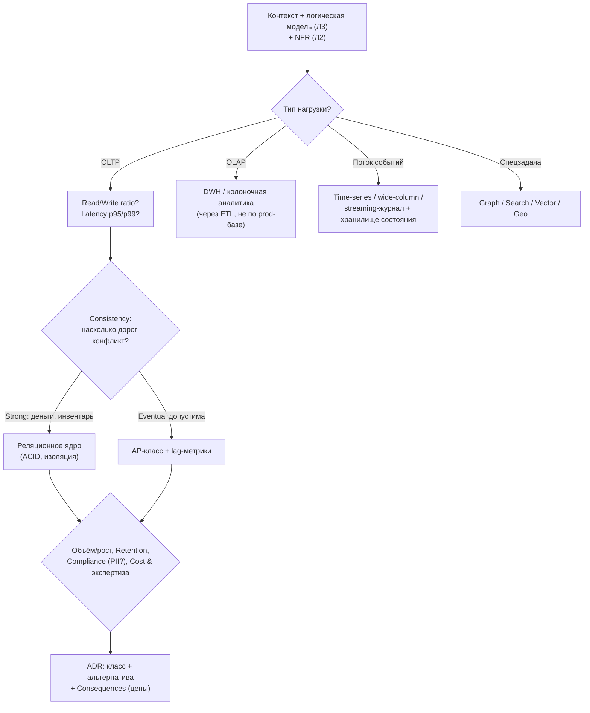
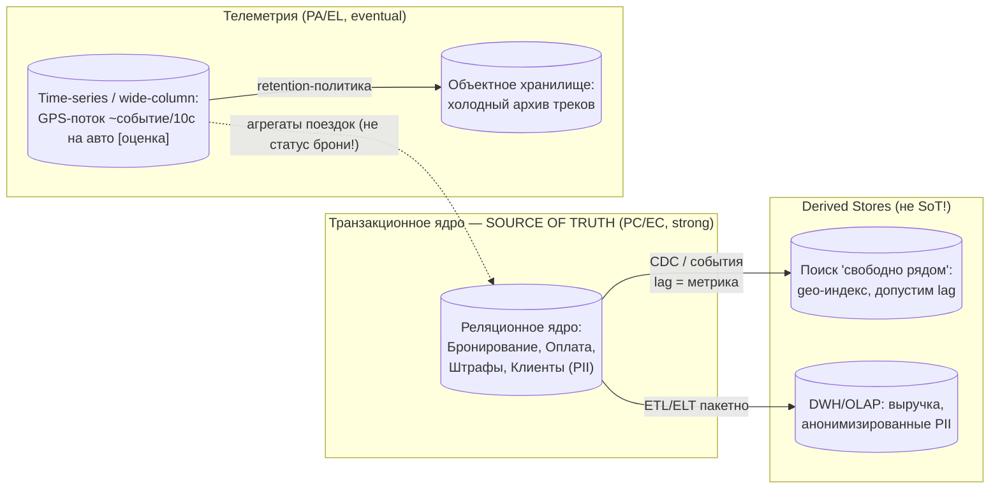
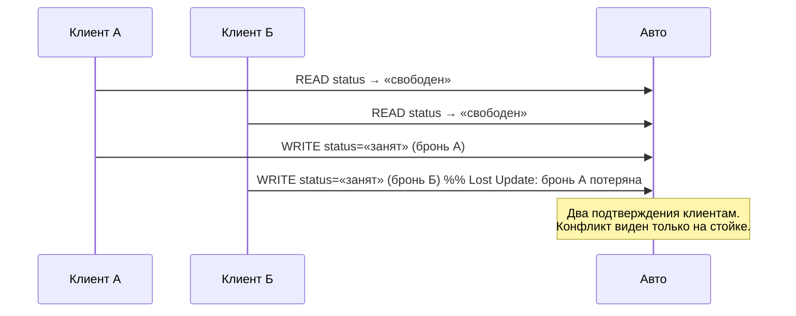
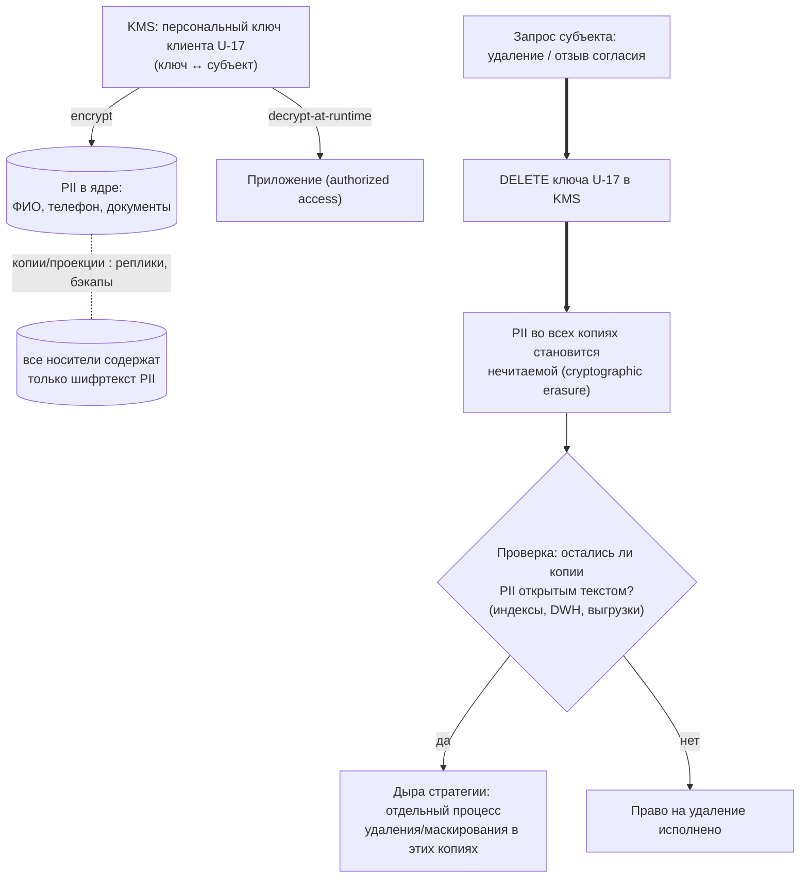

# Диаграммы к Лекции 4. История, эволюция и виды СУБД. Транзакции, PACELC и Data Governance

## Введение

Этот файл содержит диаграммы и схемы для Лекции 4 «История, эволюция и виды СУБД. Транзакции, PACELC и Data Governance» (источник истины темы — `specs/syllabus.md`; перечень визуальных материалов — `outline.md`, раздел draft «Визуальные материалы»).

Диаграммы предназначены для:
- визуализации волн эволюции СУБД как ответов на нерешённые проблемы;
- сводки классов СУБД и их trade-offs;
- дерева применения Storage Selection Matrix;
- CAP-треугольника и классификации PACELC;
- таблицы компромиссов «уровни изоляции × аномалии»;
- полиглотного стека каршеринга с явным Source of Truth и derived stores;
- sequence-разбора Lost Update из Hook;
- схемы crypto-shredding как ответа на право на удаление.

Все Mermaid-схемы совместимы с GitHub/GitLab-рендерингом; ASCII-версии даны для печати и слайдов. Технологии на схемах — примеры классов решений, не стандарты.

---

## Диаграмма 1. Волны эволюции СУБД (таймлайн)

**Описание:** каждая волна — ответ на проблему предыдущей. Опорная точка лекции: «лучшей СУБД не существует, существуют решения для конкретных проблем».



ASCII-версия:

```
файлы → иерарх./сетев. → реляц.(SQL) → RDBMS (com.+OSS) → NoSQL → cloud → векторные/AI
 дубли-  жёсткие      аномалии     лицензии,         слабый   lock-in, семантический
 data    связи        без масштаба масштаб           ACID     residency поиск(RAG)
```

**Как использовать в лекции:** показать в начале Части 1 (5 мин); под таблицей годов задать вопрос «какую проблему решала каждая волна?». Годы релизов — [требуется проверка] (перенесены из `knowledge/databases/dbms-history.md`).

---

## Диаграмма 2. Сводная карта классов СУБД (trade-offs)

**Описание:** одиннадцать классов из Части 2 draft, сгруппированные по «основной валюте» компромисса. Полная таблица trade-offs — в draft; здесь — мнемоническая карта для слайда.

```
                         ПО ПАТТЕРНУ ДОСТУПА
 ┌──────────────────────────────────────────────────────────────┐
 │ ТОЧЕЧНЫЕ/ТРАНЗАКЦ.   БЫСТРЫЙ КЛЮЧ      ГИБКАЯ СХЕМА          │
 │ Реляционные         Key-value          Документные          │
 │ (PostgreSQL, MySQL) (Redis, DynamoDB)  (MongoDB, CouchDB)    │
 │ ACID, JOIN          O(1) по ключу      агрегат целиком      │
 ├──────────────────────────────────────────────────────────────┤
 │ ПОТОК/ОБЪЁМ         СВЯЗИ              ПОИСК/СХОЖЕСТЬ        │
 │ Wide-column         Графовые           Search / Vector       │
 │ Time-series         (Neo4j)            (Elasticsearch,       │
 │ (Cassandra,         обход на N уровн.  Qdrant, pgvector)     │
 │ TimescaleDB)        глубоких связей    полнотекст / k-NN     │
 │ поток, диапазон                        НЕ SoT для фактов     │
 ├──────────────────────────────────────────────────────────────┤
 │ ФАЙЛЫ/АРХИВ         АНАЛИТИКА          ЖУРНАЛ СОБЫТИЙ        │
 │ Объектное хранилище DWH / Lakehouse    Event streaming       │
 │ (S3, MinIO)         (BigQuery-класс)   (Kafka-класс)         │
 │ immutable объекты   OLAP-сканирования  append+replay;         │
 │                     не для OLTP        НЕ замена БД состояния│
 └──────────────────────────────────────────────────────────────┘
```

**Как использовать в лекции:** проецировать поверх таблицы Части 2; каждый блок закрывать вопросом аудитории «когда этот класс — плохой выбор?» (колонка «Когда НЕ использовать» в draft).

---

## Диаграмма 3. Storage Selection Matrix — дерево принятия решения

**Описание:** восемь осей оценки как последовательность вопросов; листья — классы-кандидаты. Инструмент курса: решение принимается по осям, а не по моде.



**Как использовать в лекции:** основа мини-практики (Шаг 2 кейса); пустой шаблон матрицы — в `practice.md`. Красная рамка контракта курса: red flag «одна СУБД для всего» проверяется на оси 1.

---

## Диаграмма 4. CAP-треугольник и PACELC-классификация

**Описание:** слева — треугольник Брюэра с уточнением «P — не опция, а факт»; справа — матрица Абади «при разделе / в норме».

```
                 C — Consistency
                    /\
                   /  \        При разделе (P — факт сети):
                 CP/    \CA     • CP: меньшинство отказывает (ZooKeeper, etcd)
                 /  P—A\        • AP: пишут обе стороны, конфликт потом (Cassandra)
                /________\      • «CA»: вне кластера — иллюзия при первом же разделе
               A          \    PACELC добавляет штатный режим:
                            EL/EC — latency vs consistency «в норме»
```

```mermaid
quadrantChart
    title PACELC: поведение системы
    x-axis "Норма: платим Latency" --> "Норма: платим Consistency"
    y-axis "При разделе: Availability" --> "При разделе: Consistency"
    quadrant-1 "PC/EC: strong всегда": ["PostgreSQL single-node/sync repl", "etcd"]
    quadrant-2 "PA/EC: quorum": ["MongoDB writeConcern majority", "Cassandra QUORUM"]
    quadrant-3 "PA/EL: fast & available": ["Cassandra eventual", "DynamoDB", "Redis Cluster"]
    quadrant-4 "PC/EL: редкая комбинация": ["Spanner"]
```

**Как использовать в лекции:** Часть 4 (5 мин). Классификация конкретных продуктов зависит от версий и конфигураций — [требуется проверка]; на слайде держать формулировку «типовая конфигурация». Правило проверки вендора: два вопроса — «что при partition?» и «чем платите в норме?».

---

## Диаграмма 5. Уровни изоляции × аномалии конкурентного доступа

**Описание:** лестница SQL-изоляций с ценами; формальный стандарт ANSI (реализации СУБД различаются — детали версий [требуется проверка]).

```
Безопаснее ◄──────────────────────────────────────────► Конкурентнее
Serializable │ Repeatable Read │ Read Committed │ Read Uncommitted
   нет аномалий│ no dirty, no   │ no dirty read │ всё возможно
   минимум     │ non-repeat.;   │ строка может  │ (почти никто
   throughput  │ phantom —      │ меняться между│  не использует
               │ *зависит от    │ чтениями      │  сознательно)
               │ реализации     │               │
Цена: блокировки/MVCC-конфликты ▼ падает, риск аномалий ▲
```

| Уровень | Dirty Read | Non-repeatable | Phantom | Пропускная способность |
|---|---|---|---|---|
| Read Uncommitted | возможен | возможен | возможен | максимальная |
| Read Committed | нет | возможен | возможен | высокая |
| Repeatable Read | нет | нет | возможен* | средняя |
| Serializable | нет | нет | нет | минимальная |

\* формально по стандарту; например, PostgreSQL реализует Snapshot Isolation, где и фантомы подавляются (детали — [требуется проверка]).

**Как использовать в лекции:** Часть 5; завершить управленческой формулировкой «изоляция — страховка, priced per transaction».

---

## Диаграмма 6. Полиглотный стек каршеринга: Source of Truth → Derived Stores

**Описание:** итоговый стек кейса (Шаги 2–3) с явными направлениями потоков и профилями согласованности. Правило курса: у каждого бизнес-факта — один SoT; проекции не становятся «параллельной правдой».



**Как использовать в лекции:** финальная схема Case Study; подчеркнуть пунктир: обратный поток из телеметрии в ядро обновляет только производные статусы по явному правилу, но «занято/свободно» живёт исключительно в ядре.

---

## Диаграмма 7. Lost Update: две параллельные бронирования одного автомобиля

**Описание:** sequence-разбор аварии из Hook (Часть 5 / Шаг 4) — как аномалия рождается без транзакционной гарантии, и три лечения.



Лечения (варианты Шага 4):
1. Serializable — гарантирует отсутствие аномалии, режет конкурентность часа пик;
2. **Условное обновление при Read Committed** — «занять, только если ещё свободен» одной атомарной операцией (выбор кейса);
3. Оптимистичная блокировка версией (version check + повтор) — при низкой коллизии.

**Как использовать в лекции:** показывать после таблицы изоляций; спросить аудиторию: «какой вариант дешевле всего покупает безопасность этой конкретной операции?»

---

## Диаграмма 8. Crypto-shredding: право на удаление, исполнимое во всех копиях

**Описание:** механизм исполнения GDPR/152-ФЗ (Шаг 5): PII субъекта шифруется персональным ключом; удаление данных = уничтожение ключа в KMS.



**Как использовать в лекции:** завершение Части 7/Шага 5; ключевой вопрос аудитории — «почему физическое удаление строк из основной таблицы недостаточно?» Ответ: PII уже растеклась по репликам, бэкапам и проекциям.

---

## Матрица соответствия диаграмм блокам лекции

| № | Диаграмма | Блок (тайминг) | Слайды (этап slides) |
|---|-----------|----------------|----------------------|
| 1 | Волны эволюции | Теория Ч.1 (5 мин) | 2–3 |
| 2 | Карта классов | Теория Ч.2 (8 мин) | 4–6 |
| 3 | Дерево матрицы | Теория Ч.3 (4 мин) + мини-практика | 7 |
| 4 | CAP/PACELC | Теория Ч.4 (5 мин) | 8–9 |
| 5 | Изоляции | Теория Ч.5 (5 мин) | 10 |
| 6 | Полиглотный стек | Case Study шаги 2–3 (10 мин) | 12–13 |
| 7 | Lost Update | Case Study шаг 4 (4 мин) | 14 |
| 8 | Crypto-shredding | Case Study шаг 5 (4 мин) | 15 |
