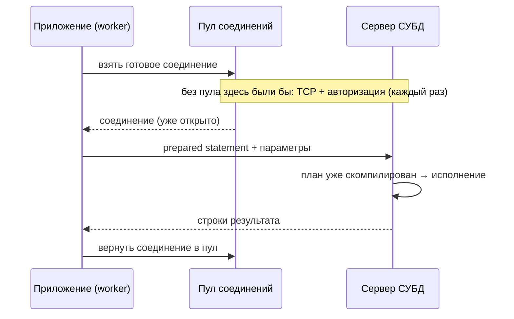
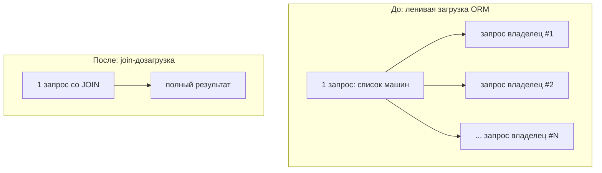
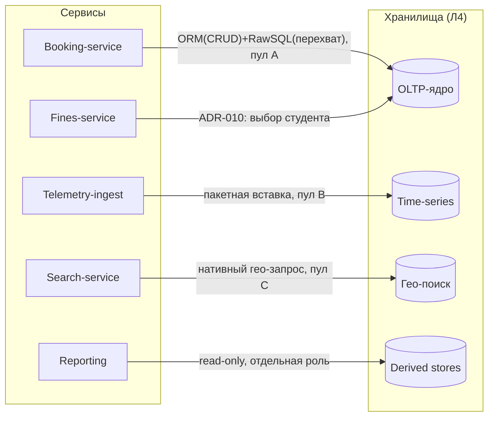
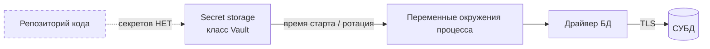

# Диаграммы Лекции 5 — «Взаимодействие приложений с СУБД, уязвимости и инструменты разработчика»

Все диаграммы уровня WHAT/WHY; схемы условно-учебные, без реальных скриншотов и рабочих эксплойтов. Mermaid-блоки готовы для вставки в `slides.md`; ASCII-версии — для handout.

## Д1. Жизнь одного запроса (клиент-серверная модель)



Смысл: фиксированная плата за установку/авторизацию соединения убирается с горячего пути пулом; структура запроса и данные разделены (контур защиты из Т4).

## Д2. Пул соединений: trade-off размера

```
      мало соединений                      много соединений
  ┌───────────────────┐               ┌───────────────────────┐
  │ 10 инстансов app   │               │ 10 инстансов app       │
  │ × пул по 5 = 50    │               │ × пул по 100 = 1000    │
  └─────────┬─────────┘               └──────────┬──────────┘
            ▼                                     ▼
   очередь за соединением            лимит подключений сервера
   → latency растёт ДО нагрузки БД    → конкуренция за ресурсы,
     (симптом: wait-for-connection)     отказы новых соединений
                     компромисс зависит от СУБД/нагрузки [требуется проверка ориентиров]
```

Ключевая формула рассуждения (не норматив): суммарные пулы всех инстансов ≤ разумный предел активных подключений сервера.

## Д3. N+1 против одного JOIN



Подпись: при выдаче ~200 машин — примерно 201 round-trip против 1 [порядок оценки, требует проверки]; опасность — непрозрачность умножения для бизнес-кода.

## Д4. Радиус взрыва инъекции и слои обороны

```
                 ┌────────────────────────────────────────┐
                 │  вся база (DDL/DML всё) ← superuser    │  радиус без least privilege
                 │  ┌──────────────────────────────────┐  │
                 │  │ таблицы контекста ← роль app     │  │  радиус с least privilege
                 │  │  ┌────────────────────────────┐  │  │
                 │  │  │ представления SELECT-only  │  │  │  радиус search-app
                 │  │  │  ┌──────────────────────┐  │  │  │
                 │  │  │  │ параметризованный    │◀─┼──┼──┼── слой 1: prepared statements
                 │  │  │  │ запрос + whitelist   │  │  │  │  слой 2: enum для ORDER BY/имён
                 │  │  │  └──────────────────────┘  │  │  │  слой 3: роли (эта диаграмма)
                 │  │  └────────────────────────────┘  │  │  слой 4: секреты вне кода
                 │  └──────────────────────────────────┘  │
                 └────────────────────────────────────────┘
```

Иллюстративный механизм (без рабочего кода): ввод `' OR '1'='1` меняет *структуру* запроса только там, где данные склеены с текстом; prepared statement делает структуру неизменяемой для данных.

## Д5. Карта каналов кейса (сервисы × хранилища ADR-008)



Каждая стрелка = канал со своим connection string, политикой пула, способом доступа и ролью.

## Д6. Контур секрета (vault → env → драйвер)



Инварианты: секрет не попадает в код/артефакты/GUI-историю; креды различаются по окружениям; ротация плановая и внеплановая (при инциденте).

## Д7. Способы доступа × критерии (обобщение Т2 — матрица для выбора)

| Критерий | Raw SQL | ORM | Хранимая процедура |
|---|---|---|---|
| Контроль плана запроса | +++ | + | ++ (внутри СУБД) |
| Скорость CRUD-разработки | + | +++ | + |
| Переносимость между СУБД | − | ++ | −− |
| Защита от инъекций по умолчанию | зависит от дисциплины | выше (параметризация) | выше (параметры вызова) |
| Round-trip на составную операцию | 1 сложный запрос | риск 1+N | 1 вызов |
| Эволюция схемы (Л3) / versioning | средняя | хорошая | слабая (логика в движке) |
| Порог компетенции команды | SQL-зрелость | диагностика скрытых запросов | + процедурный язык движка |

Правило чтения: колонка «лучшая» выбирается под контекст (команда/нагрузка/сроки), идеологии «везде ORM/везде SQL» нет.

## Д8. Окно инструмента разработчика (схематично)

```
┌─────────────────────────────────────────────────────────────┐
│ Навигация        │ Редактор запроса          │ Результаты     │
│ ┌─────────────┐  │  SELECT ... WHERE id = ?  │ ┌───────────┐ │
│ │ db          │  │                           │ │ rows...   │ │
│ │ ├ schema    │  │ Места использования:      │ └───────────┘ │
│ │ │ ├ tables  │  │ • диагностика N+1 (лог    │ Метаданные:   │
│ │ │ ├ views   │  │   запросов, счётчик)      │ • DDL таблиц  │
│ │ │ └ procs   │  │ • проверка миграций Л3    │ • ограничения │
│ └─────────────┘  │ • сверка SoT vs derived   │ • индексы     │
│                  │                           │ ER-диаграмма  │
│                  │                           │ из метаданных │
└─────────────────────────────────────────────────────────────┘
Зоны: (1) навигация по каталогу, (2) выполнение/подсчёт запросов, (3) метаданные, (4) ER из реальной схемы.
Предостережение: правки через GUI в проде — анти-паттерн №5 (обход миграций).
```

## Матрица соответствия блокам лекции и будущим слайдам

| Диаграмма | Блок лекции | Слайды (plan slides.md) |
|---|---|---|
| Д1 | Т1 клиент-сервер | С6–С7 |
| Д2 | Т1 пулы | С8 |
| Д3 | Т3 N+1 | С11 |
| Д4 | Т4 безопасность | С12–С13 |
| Д5 | Case шаг 1 | С15 |
| Д6 | Т4 секреты | С14 |
| Д7 | Т2 способы доступа | С9–С10 |
| Д8 | Т5 инструменты | С17 |
