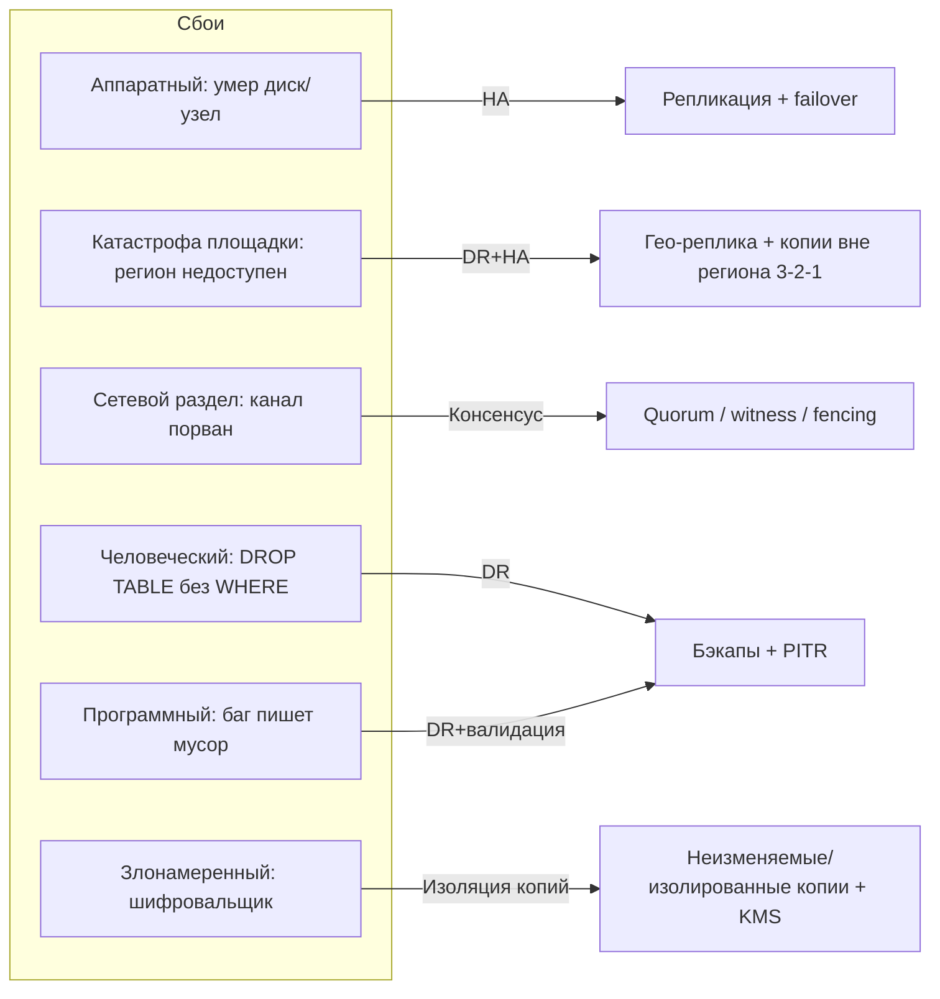
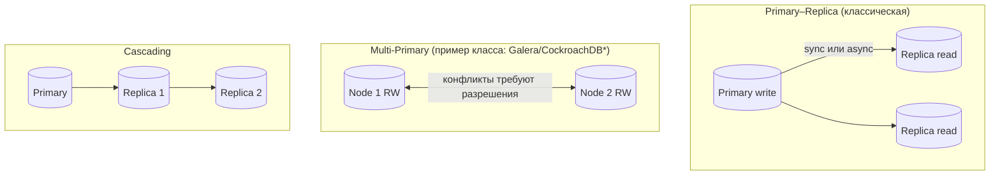
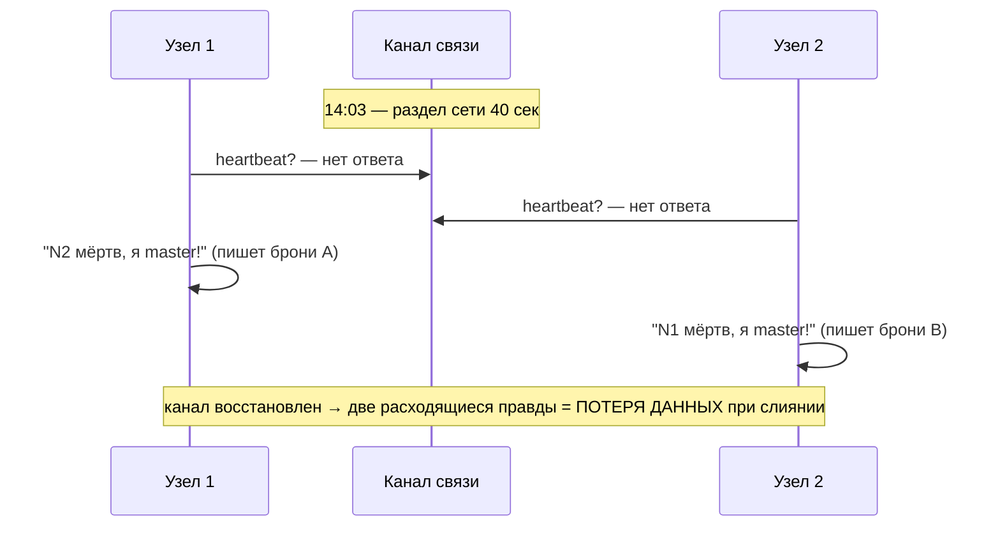

# Диаграммы к лекции 6

Все схемы — уровень WHAT/WHY (без команд и конфигураций). Технологии в подписях — примеры классов, не стандарты. Соответствуют перечню outline.md (Д1–Д8) и блоку «Визуальные материалы» draft.md.

---

## Д1. Карта: классы сбоев × методы защиты (к Теории §1)



Табличная версия (для слайда):

| Класс сбоя | HA (репликация/failover) | DR (бэкапы/PITR) | Консенсус/арбитраж |
|---|---|---|---|
| Аппаратный | ✅ основное средство | ➕ запас | — |
| Катастрофа площадки | ✅ если гео | ✅ обязательно | — |
| Сетевой раздел | ⚠️ риск split-brain | ➖ | ✅ quorum/witness/fencing |
| Человеческий фактор | ❌ реплицирует ошибку | ✅ PITR | — |
| Программный | ❌ | ✅ откат на точку | — |
| Злонамеренный | ❌ | ✅ изолированные копии | — |

✅ защищает · ❌ не защищает · ⚠️ требует механизма · ➕ дополняет

---

## Д2. Топологии репликации (к Теории §3)


*примеры классов СУБД, поведение при разделах зависит от версии [требуется проверка].

Ось trade-off для слайда:

```
latency записи ▲
   высокая     │ Синхронная (RPO≈0 локально, платим каждым commit)
               │ Полусинхронная (компромисс)
   низкая      │ Асинхронная (быстрый commit, платим Lag и потерей хвоста)
               └──────────────────────────────▶ свежесть чтения на реплике
```

---

## Д3. Таймлайн инцидента: зоны RPO и RTO (к Теории §2, Hook)

```
 время ───────────────────────────────────────────────▶
 ... нормальная работа ...|        |          |         |
                          t_loss   t_сбой     t_failover t_восстановлен
                          ◄─RPO──►           ◄──RTO────►
                          потерянные          недоступность
                          изменения           сервиса
```

Пояснение: RPO измеряется «назад от сбоя» (сколько последних изменений может не пережить катастрофу — ограничивается частотой копирования/синхронности репликации); RTO измеряется «вперёд от сбоя» (детект + переключение + подъём данных + проверка). Обе точки — бизнес-обещания из Л1–2, а не технические настройки.

---

## Д4. Политики бэкапов и путь к PITR (к Теории §5–6)

```
День:      1        2        3        4        5 ...
Full:     [FULL]────────────────────[FULL]──────────  (еженедельно)
Diff:             [D]    [D]    [D]                  (изменения с последнего FULL)
Incr:             [i]    [i]    [i]                  (изменения с последней копии; цепочка!)
WAL-архив:  ~~~~~~~~~~~~~~~~~~~~~~~~~~~~~~~▶ непрерывно → точка на любой момент t
Восстановление:
  из Differential: FULL + последний D            (короткий путь)
  из Incremental:  FULL + ВСЕ i цепочки          (длинный путь, хрупче)
  из WAL:          FULL + архив до t−ε           (PITR: машина времени)
```

Мнемоника слайда: «Incremental дешевле делать, дороже поднимать; Differential — наоборот; WAL даёт точку, а не копию».

---

## Д5. Split-Brain vs Quorum (к Теории §4)



Вариант с арбитром (для слайда рядом):

```
3 узла (N1 primary, N2 replica, W witness) — раздел N1↔N2:
  N1 видит большинство (N1+W = 2 из 3)? НЕТ, если W на стороне N2 → N1 останавливает запись
  N2+W имеют quorum → промоушение N2, старый primary fenced (права на запись сняты)
2 узла без свидетеля: quorum недостижим ни у кого → корректное поведение — отказ от записи
(лучше временная недоступность, чем два primary)
```

---

## Д6. Матрица кейса: контекст → RPO/RTO → решение (Case Study, шаги 1–4)

| Контекст | RPO | RTO | Репликация | Бэкапы/восстановление |
|---|---|---|---|---|
| Бронирование | ≤ 1 мин [учебная оценка] | ≤ 5 мин | sync-локально + async гео; quorum в регионе | WAL-архив + weekly full; PITR |
| Оплата | ≈ 0 | ≤ 15 мин | синхронная (платим latency commit) | WAL-архив; сверка контрольных сумм |
| Телеметрия | ≤ 15 мин | ≤ 2 ч | async (lag допустим) | снапшоты платформы; частичная потеря приемлема |
| Поиск (derived) | n/a (rebuild) | ≤ 30 мин | — | перестройка индексов из SoT (CDC) |
| Аналитика (DWH) | ≤ 24 ч | ≤ 8 ч | — | ETL повторной загрузки |

Все числа — учебные оценки, [требуют проверки бизнесом]; смысл таблицы — дифференциация, а не конкретные значения.

---

## Д7. Правило 3-2-1 для каршеринга (к Теории §5)

```
 копия 1: production primary (регион А, зона 1)
 копия 2: синхронная реплика (регион А, зона 2) — другой носитель: отдельный volume/сервис
 копия 3: WAL-архив + шифрованные полные копии (регион Б, объектное хранилище) — off-site
 Все копии шифрованы (KMS); crypto-shredding применяется включая копии (связь с Л4)
 Анти-паттерн на схеме: ✗ «копия в том же ДЦ» — зачёркнуто
```

---

## Д8. Структура ADR-011 (Case, шаг 5; формат — templates/adr.md)

```
 ADR-011: Стратегия репликации и восстановления
 ├── Context: таблица RPO/RTO шага 1 + SLA корпоративных договоров + ограничения команды (8 чел., без DBA)
 ├── Decision: sync-локально + async-гео для ядра; quorum-выбор primary; weekly full + daily differential + WAL-архив; derived stores — rebuild; DR-учения ежеквартально
 ├── Alternatives: master-master (отклонено: split-brain-риск), только async (отклонено: RPO Оплаты), всё managed (принято частично — см. TCO)
 └── Consequences: налог latency на commit ядра; стоимость гео-копий; обязательные учения (часы инженеров); операционная сложность HA-стека [риск экспертизы]
```

---

## Привязка к блокам лекции и слайдам

| Диаграмма | Блок draft | Слайды slides.md |
|---|---|---|
| Д1 | Теория §1 | 6–7 |
| Д2 | Теория §3 | 10–12 |
| Д3 | Теория §2, Hook | 5, 9 |
| Д4 | Теория §5–6 | 14–16 |
| Д5 | Теория §4 | 13 |
| Д6 | Case шаги 1–4 | 17–20 |
| Д7 | Теория §5 | 15 |
| Д8 | Case шаг 5 | 21 |
