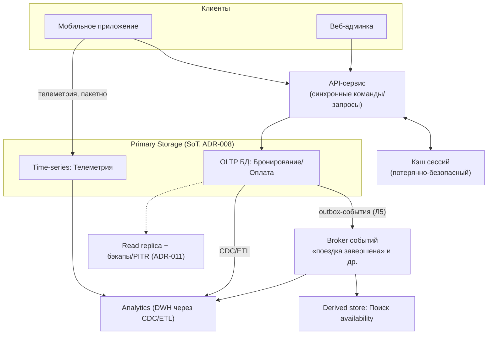
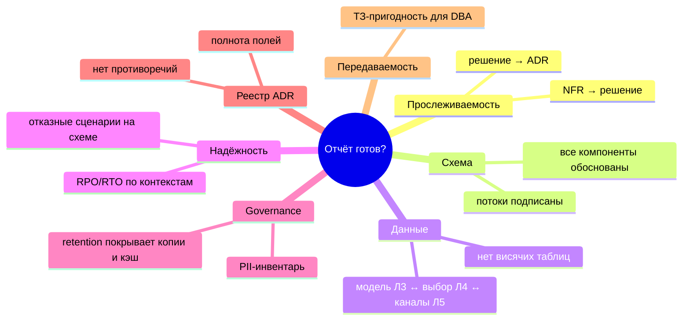

# Диаграммы Лекции 7 — System Design: финальная сборка, Peer-Review и защита отчета

Уровень детализации: WHAT/WHY (без production-кода). Схемы соответствуют блокам draft.md; используются в слайдах.

---

## Д1. От слоёв Л1–Л6 к Blueprint (уровень C4 Container каршеринга)
Блок: §Case Study / Теория A. Идея: Blueprint = сборка существующих слоёв, а не новое изобретение.


Пунктир — пути надёжности (Л6); подписи стрелок обязательны (правило c4-model.md).

## Д2. Четыре класса компонентов и правило обоснования
Блок: Теория A. ASCII для раздачи:

```
             ┌────────────────────────────────────────────┐
             │  «ПОЧЕМУ ЭТОТ ЯЩИК ЗДЕСЬ?»                  │
             │  ответ ≤1 фраза: NFR/проблема + что сломается│
             └───────────────┬────────────────────────────┘
   Primary Storage ─────────┼────────── Analytics
   «источник истины,        │        «отчётный профиль,
     один на контекст»      │          отделён от OLTP, лаг объявлен»
              Cache ────────┤──── Queues
              «горячее       │    «развязка producer↔consumer,
               чтение,       │     есть consumer, задержка
               можно         │     допустима; НЕ хранилище»
               пересчитать»  │
   Нет ответа → компонент удаляется или получает ADR «planned/под наблюдением»
```

## Д3. CQRS vs Event Sourcing: два независимых решения
Блок: Теория B. Квадрант независимости:

```
                    Event Sourcing: НЕТ          Event Sourcing: ДА
                 ┌──────────────────────────┬──────────────────────────┐
 CQRS: ДА        │  ✅ Наш случай MVP:      │  ⚠️ Полный CQRS+ES:       │
                 │  derived store для поиска│  аудит+переигровка истории│
                 │  (проекция без журнала   │  цена: контракты событий, │
                 │   событий как SoT)       │  реттеншн, сложность      │
                 ├──────────────────────────┼──────────────────────────┤
 CQRS: НЕТ       │  ✅ Простой CRUD/малая   │  ❌ Редкая комбинация:    │
                 │  нагрузка (каршеринг     │  журнал событий + те же   │
                 │  бронирования внутри)    │  модели чтения (чтение    │
                 │                          │  из журнала «в лоб»)      │
                 └──────────────────────────┴──────────────────────────┘
Вывод: паттерны orthogonal; каждый включается своим драйвом
(CQRS — конфликт профилей; ES — история как бизнес-требование).
```

## Д4. Лестница масштабирования: шардирование — последняя ступень
Блок: Теория B.

```
 стоимость/сложность ↑
                      │            ┌───────────────┐
                      │            │ ШАРДИРОВАНИЕ  │ ← только при измеренном упоре
                      │            │ cross-shard TX│   (объём/write-throughput)
                      │            │ hot key,      │   Цена: ACID-граница, ребалансировка
                      │            │ rebalancing   │
                      │      ┌─────┴─────┐        │
                      │      │ READ      │ реплики решают чтение,
                      │      │ REPLICAS  │ не запись (Л6)
                      │  ┌───┴────┐      │
                      │  │ КЭШ    │ снимает повторяющееся чтение (Л8 детально)
                      │  └───┬────┘
                      │ ┌────┴─────┐
                      │ │ ИНДЕКСЫ/ │ самый дешёвый выигрыш — профилировать сначала
                      │ │ ЗАПРОСЫ  │ (Л5: N+1; Л8: B-Tree)
                      │ └────┬─────┘
                      │ ┌────┴───────┐
                      │ │ VERTICAL   │ больше CPU/RAM: быстро, но потолок один
                      │ └────────────┘
   Правило: не спрыгивать со ступени; каждая предыдущая должна быть исчерпана и замерена.
```

## Д5. Анатомия валидного ADR
Блок: Теория C.

```
 ADR-NNN
 ├── Статус            Предложено | Принято | Отклонено | Заменено на ADR-XXX
 ├── Контекст          факты: NFR, числа, бюджет, команда  ✗ «потому что современно»
 ├── Альтернативы      ≥1 вариант + причина отказа          ✗ «других не рассматривали»
 ├── Решение           одна фраза-суть + пояснение
 └── Последствия       + плюсы / − риски и цена / ~ нейтральные
                        ✗ пустое поле «минусы» = ADR невалиден
 [полезный подвид] «Отказной ADR»: решение НЕ делать X, пока нет сигнала Y.
```

## Д6. Чек-лист финальной проверки отчёта (7 групп)
Блок: Теория C. Mermaid mindmap:



## Д7. Протокол Peer-Review: формат замечания и рубрика
Блок: Теория D.

```
 ЗАМЕЧАНИЕ                       РУБРИКА (1–3 балла × 5 критериев)
 ┌─────────────┐                  ┌──────────────────────────────┐
 │ Наблюдение  │ факт + ссылка на │ 1 Связность NFR→решения      │
 │             │ элемент схемы    │ 2 Обоснованность компонентов │
 ├─────────────┤                  │ 3 Полнота ADR                │
 │ Следствие   │ какое NFR/пункт  │ 4 Надёжность и governance    │
 │             │ чек-листа нарушен│ 5 Читаемость схемы           │
 ├─────────────┤                  └──────────────────────────────┘
 │ Предложение │ вариант + его цена;
 │             │ решение за автором
 └─────────────┘
 Стоп-фразы: «мне не нравится», «это же очевидно», «плохая архитектура».
 Замена: «наблюдаю X → нарушается NFR-y → предлагаю Z ценой W».
```

## Д8. Каркас защиты 10 минут: один контент — два языка
Блок: Теория E.

```
 время →  1'      2'        3'          2'        1'       1'
        ┌──────┬────────┬───────────┬─────────┬────────┬───────┐
        │Проблема│Blueprint│ 3 ADR     │Failure   │Риски /  │Просьба│
        │+NFR    │(1 слайд)│ + их цена │ Modes    │open qs  │реши-  │
        └──────┴────────┴───────────┴─────────┴────────┴───────┘
 язык CTO: trade-offs, ADR, деградации        язык бизнеса: деньги, риск, срок
 Anticipated questions (готовим ответы-ссылки на ADR/NFR):
   «почему не Х?» · «что при x10?» (→Л8) · «сколько стоит?» ·
   «отказ города?» (→Л6) · «почему не микросервисы?» (→Л3)
 Критерий успеха: оспорить можно только новыми фактами, не пробелами логики.
```

---

## Матрица соответствия блокам лекции и слайдам
| Диаграмма | Блок draft | Будущий слайд slides.md |
|---|---|---|
| Д1 | Case Study | Слой сборки Blueprint |
| Д2 | Теория A | Компоненты и правило обоснования |
| Д3 | Теория B | CQRS ⟂ Event Sourcing |
| Д4 | Теория B | Лестница масштабирования |
| Д5 | Теория C | Анатомия ADR |
| Д6 | Теория C | Чек-лист отчёта |
| Д7 | Теория D | Протокол Peer-Review |
| Д8 | Теория E | Каркас защиты |

Примечание: численные значения (p95, лаги, времена) на схемах отсутствуют намеренно — они учебные и помечены в draft как [требуется проверка]/«[примерно]».
