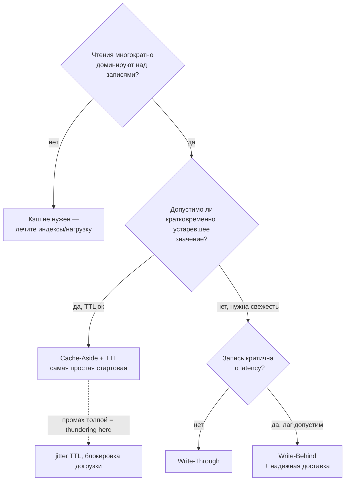
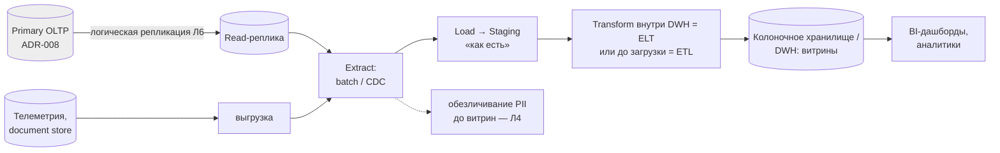

# Диаграммы — Лекция 8: Масштабирование, кэширование и аналитика

**Этап:** diagrams · **База:** outline.md (перечень Д1–Д8) · Формат: Mermaid + ASCII-дублирование; уровень WHAT/WHY.

## Д1. Лестница оптимизаций (порядок действий при росте)
```mermaid
flowchart LR
    A[1. Измерь:\nметрики и top-N запросов] --> B[2. Индексы:\nдешевле всего]
    B --> C[3. Кэш:\nускоряет горячее чтение]
    C --> D[4. Read-реплики:\nmасштаб чтения\n(Л6)]
    D --> E[5. Отдельные контуры:\nDWH для OLAP,\ntiering для cold]
    E --> F[6. Шардинг/сегментация:\nпоследняя ступень\n(Л7)]
```
Смысл: сверху вниз по стоимости и риску; пропуск шага «измерь» превращает всё в гадание.
ASCII: `Измерь → Индексы → Кэш → Реплики → DWH/Tiering → Шарды`

## Д2. Карта температуры данных (lifecycle)
```mermaid
flowchart LR
    H[Горячие\nминуты-дни\nбыстрый носитель+кэш] -->|правило остывания| W[Тёплые\nдни-месяцы\nосновная СУБД]
    W -->|retention-политика Л4| C[Холодные\nмесяцы-годы\nархив/DWH, дешёвый сторидж]
    C -->|истечение retention| X[Удаление/crypto-shredding\n(Л4/Л6)]
```
Аннотация: границы классов задаёт бизнес-частота доступа, а не возраст записи сам по себе.

## Д3. Четыре стратегии кэширования (последовательности)
Cache-Aside:
```
GET k: кэш? HIT → отдать; MISS → читать источник → положить в кэш → отдать
SET v: запись в источник → инвалидировать ключ кэша
```
Write-Through: `SET v → (синхронно) кэш И источник → подтвердить` — чтение всегда свежее, запись медленнее.
Write-Behind: `SET v → кэш → подтвердить; асинхронно → источник` — быстрая запись, риск потери при падении кэша.
Read-Through: приложение знает только кэш-слой; слой сам догружает из источника.
Общая подпись под всеми: **кэш = derived store; источник истины — OLTP-СУБД**.

## Д4. Дерево выбора кэш-стратегии


## Д5. Экономика B-Tree-индекса (весы)
```
 ПОЛЬЗА                                ЦЕНА
 точечный поиск O(log n)      vs   каждая INSERT/UPDATE обслуживает индекс
 диапазонные выборки          vs   место на диске (копия ключей)
 покрытие частых WHERE        vs   планировщик может его игнорировать
                               vs   иллюзия: «индекс есть» ≠ «используется»
Вердикт курса: индекс добавляется под конкретный top-запрос и с явной строкой цены.
```

## Д6. OLTP vs OLAP: физика хранения
```
Row-based (OLTP): [имя|город|дата|км|тариф] ← одна запись целиком — быстрый доступ к «объекту»
Columnar (OLAP):  имя:  aaa aab aac ...     город: мск спб мск ...   км: 12 40 7 ...
                  агрегат SUM(км) читает только столбец км → меньше I/O, сильное сжатие
Конфликт: та же таблица не может быть идеальна обоими способами → два контура.
Netflix/Uber-рамка: чужие масштабы — контекст, а не рецепт [детали — требуется проверка].
```

## Д7. ETL/ELT-конвейер аналитики (рекомендуемая форма ответа кейса)

Метрики контура: лаг доставки, успешность прогонов, объём инкремента.

## Д8. Секция «Стратегия масштабирования» в Blueprint v2 (сборка артефакта)
```
Blueprint v2 (§ Стратегия масштабирования)
├── Карта hot/warm/cold (Д2) + ссылки на retention (Л4)
├── Кэш: стратегия + инвалидация + поведение при промахе/падении (Д3/Д4) + метрика hit ratio
├── Матрица «top-запрос → индекс → цена → вердикт» (Д5)
├── Аналитический контур: источник → extract → staging → витрины → BI (Д7)
└── ADR-013 (валидность по критериям Л7)
```

## Соответствие блокам лекции
Д1 → Т1/управление; Д2 → Т1; Д3–Д4 → Т2; Д5 → Т3; Д6–Д7 → Т4; Д8 → Case Study/практика. Для будущих слайдов: С6–С13 (теория), С14–С17 (кейс).
