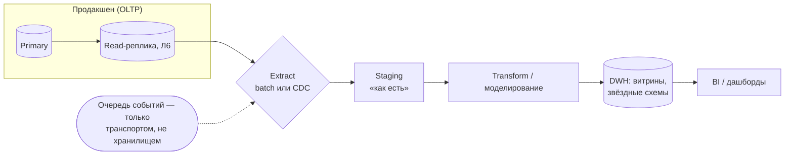
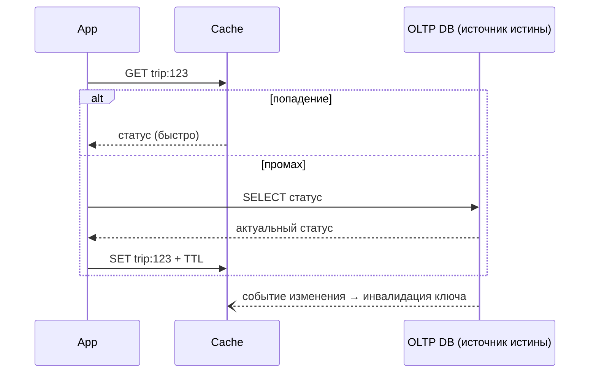

# Лекция 8. Масштабирование: производительность, кэширование и аналитика (OLTP vs OLAP)

> Статус: кандидат в final. Причина: ожидает human review / human fact-check. Источник истины темы: specs/syllabus.md, Лекция 8.
> **Курс:** Проектирование ИТ-решений: System Design и архитектура данных · **Длительность:** 80 мин
> **Материалы:** `slides.md` (кандидат), `practice.md`, `diagrams.md` (Д1–Д8), `case.md`
> **Зависимости:** Лекция 7 (собранный Blueprint); опирается на ADR-008 (Л4), ADR-010 (Л5), ADR-011 (Л6)

---

## Оглавление

1. Цель занятия
2. Learning Objectives
3. План занятия
4. Hook: инцидент роста
5. Теоретический блок (Т1–Т7)
6. Case Study: каршеринг x10
7. Связка с управленческими решениями
8. Ключевые термины
9. Визуальные материалы
10. Анти-паттерны и разбор типичных ошибок студентов
11. Типичные вопросы студентов (FAQ)
12. Практическое задание
13. Резюме
14. Связка с курсом «Базы данных»
15. Мостик — курс завершён
16. Вопросы для самопроверки
17. Источники и фактическая честность

---

## Цель занятия

Создание базы данных — это только начало её жизненного цикла. На лекции разбирается, что происходит, когда проект «успешен»: нагрузка и объём данных растут, и система начинает деградировать не из-за плохого кода, а из-за отсутствия стратегии роста. Вы освоите четыре механизма работы с ростом — классификацию горячих/тёплых/холодных данных, кэширование с продуманной инвалидацией, компромиссы индексирования и разделение транзакционной (OLTP) и аналитической (OLAP) нагрузок через хранилище данных (DWH, ETL/ELT). Итоговый результат оформляется как секция «Стратегия масштабирования» вашего Architecture Blueprint — того документа, который станет техническим заданием для курса «Базы данных».

Формулировка цели через глагол действия: **научиться проектировать поведение системы при кратном росте нагрузки** — измерять, классифицировать данные по «температуре», выбирать механизмы ускорения через trade-offs и разделять конфликтующие типы нагрузки.

## Learning Objectives

По таксономии Блума — от знания к оценке:

1. **Знать/понимать:** объяснять, почему деградация при росте нелинейна; различать row-based и columnar хранение и обосновывать, почему одна таблица не может быть идеальна для обеих нагрузок.
2. **Применять:** классифицировать датасеты реальной системы по классам hot/warm/cold и связывать класс с носителем, lifecycle-политикой и retention-рамкой (преемственность с Л4 и Л6).
3. **Применять/анализировать:** выбирать стратегию кэширования (Cache-Aside / Read-Through / Write-Through / Write-Behind) под конкретный профиль запросов и описывать проблему инвалидации через треугольник «свежесть ↔ латентность ↔ сложность».
4. **Анализировать:** оценивать экономику B-Tree-индексов: польза для чтения против цены записи (write amplification); строить матрицу «запрос → индекс → цена» и обосновывать отказ от индекса.
5. **Оценивать/создавать:** проектировать аналитический контур (read-реплика → extract → staging → витрина → BI) с выбором ETL vs ELT и согласованным лагом; критически разбирать публичные кейсы Netflix/Uber, перенося паттерны только через призму собственного контекста (масштаб, команда, бюджет).

Каждый objective проверяем: LO2 — картой температуры в практике, LO3 — карточкой кэша, LO4 — матрицей индексов с хотя бы одним обоснованным отказом, LO5 — эскизом ETL-потока и ADR-013.

## План занятия

Поминутная разбивка (блок-распределение lesson-contract §2: Hook 5 / Теория 30 / Case 20 / Практика 15–20 / Резюме 10):

| Время | Мин | Блок | Содержание |
|---|---|---|---|
| 0:00–0:05 | 5 | Hook | Инцидент квартального отчёта на проде каршеринга |
| 0:05–0:11 | 6 | Теория Т1 | Рост нелинеен; hot/warm/cold; lifecycle и retention |
| 0:11–0:20 | 9 | Теория Т2 | Кэширование: иерархия латентности, 4 стратегии, инвалидация, thundering herd, hit ratio |
| 0:20–0:26 | 6 | Теория Т3 | B-Tree, экономика индекса, write amplification, мини-ADR на индекс |
| 0:26–0:35 | 9 | Теория Т4 | OLTP vs OLAP: физика хранения, DWH, звёздная схема, ETL/ELT, пайплайн |
| 0:35–0:40 | 5 | Теория Т5+Т6 | Публичные кейсы Netflix/Uber (осторожно); академический стандарт, Must Read Kleppmann |
| 0:40–1:00 | 20 | Case Study | Каршеринг x10: пять шагов стратегии + ADR-013 |
| 1:00–1:12 | 12 | Управленческие выводы | Стоимость владения, метрики, бюджет, data-инженер, техдолг |
| 1:12–1:16 | 4 | Мини-практика | Классификация шести датасетов по температуре + риски |
| 1:16–1:20 | 4 | Резюме | Пять ключевых идей, FAQ-дополнения |
| 1:20–1:25 | 5 | Мостик + самопроверка | Передача в курс «Базы данных»; домашняя практика (подробно — `practice.md`) |
| | **85** | | **Итого: 85 мин (в допуске контракта ≤ 90)** |

## Hook: инцидент роста — 5 мин

Понедельник, утро. Диспетчер службы такси смотрит на карту, которая не обновляется. Причина: аналитик открыл квартальный дашборд загрузки парка — большой запрос агрегации по миллионам строк телеметрии выполнялся прямо в продуктовой OLTP-базе. Через несколько минут p95 поиска свободных машин деградировал в десятки раз [учебные числа, порядок величины иллюстративный], приложения клиентов «стояли», диспетчеры жаловались, выручка за час простоя — прямая потеря.

Отчёт никто не «ломал»: код корректный, индексы на месте, данные целые. Просто этому отчёту **негде было исполняться** — у системы не было аналитического контура и стратегии роста.

Вопрос аудитории: кто виноват — автор отчёта, администратор БД или архитектор? Обсуждение 2 минуты. Ответ вы увидите к концу лекции: отсутствующая стратегия роста — это часть архитектуры, а не чья-то халатность. Архитектор обязан был спроектировать систему так, чтобы успех (x10 по нагрузке) не убил продукт.

Контекст знакомый: тот же сервис каршеринга из Лекций 1–7. Но коммерческий успех умножил нагрузку: флот вырос примерно со 200 до 2000 автомобилей [примерно], три города плюс новый регион, суточная телеметрия — миллионы событий координат и статусов.

## Теоретический блок — 30 мин

### Т1. Проблема роста и температура данных (6 мин)

**Почему рост нелинеен.** Связка «объём данных × интенсивность запросов × параллелизм» деградирует быстрее, чем растёт каждый множитель по отдельности. Интуиция менеджера обманчива: система, работавшая «с запасом» при 200 машинах, при 2000 может деградировать не в 10 раз, а существенно сильнее — потому что:
- индексы перестают помещаться в оперативную память и «спускаются» на диск (каждый уровень B-Tree — дополнительные операции ввода-вывода);
- буферный пул СУБД не успевает держать «горячие» страницы: начинается thrashing — постоянное вытеснение;
- конкуренция за блокировки (locks) растёт нелинейно: чем больше параллельных писателей, тем чаще конфликты (привет, уровни изоляции из Л4);
- план запроса, выбранный планировщиком на малой статистике, на большой таблице становится катастрофическим.

**Сигналы, что пора стратегией роста** (эмпирический чек-лист, не пороги):
1. p95 пользовательских операций растёт при стабильном функционале;
2. один медленный запрос влияет на всех остальных (общий ресурс — диск/буфер/блокировки);
3. бэкапы и репликация перестают успевать в окно (прямая связь с RPO/RTO из Л6);
4. операционные задачи (обслуживание таблиц, переиндексация) не влезают в ночное окно.

**Горячие/тёплые/холодные данные** — классификация по частоте и свежести доступа, а НЕ по возрасту записи. Это принципиально: вчерашняя запись, которую никто не читает, холодна; трёхлетняя справка, которую каждый день открывают юристы, горяча.

| Класс | Окно доступа | Характер доступа | Где живёт (класс решения) | Пример каршеринга |
|---|---|---|---|---|
| Горячие (hot) | минуты–дни | часто, latency-чувствительно | быстрый носитель, кэш, активная реплика | статус активных поездок, координаты парка сейчас |
| Тёплые (warm) | дни–месяцы | умеренно, штатный OLTP | основная СУБД, обычные индексы | завершённые поездки за месяц, история аренды |
| Холодные (cold) | месяцы–годы | редко, пакетно/ад-хок | архив/DWH, дешёвый объектный сторидж | телеметрия прошлого года, выгруженные счета |

**Lifecycle-политика** — правило «когда данные остывают и куда переезжают» — это управленческое решение, привязанное к retention из Data Governance (Л4) и комплаенсу копий (Л6). Две типовые ошибки политики:
- хранить горячим то, что никто не читает (дорогой носитель занят мёртвыми данными → рост стоимости и времени бэкапа);
- архивировать то, чем пользуются ежедневно (пользователь ждёт выгрузку из cold-хранилища минуты → деградация сервиса).

**Связка с реляционным моделированием (курс «Базы данных»).** Температура — внешний атрибут проектирования схемы: для hot-данных важны нормальная форма и быстрые точечные выборки (Л3), для cold — компактность хранения и колоночная физика (Т4). Одна и та же логическая сущность (например, `trip`) физически живёт в разных мирах на разных этапах жизни — и это нужно учитывать уже при проектировании ключей и схем выгрузки.

### Т2. Кэширование: четыре стратегии и цена инвалидации (9 мин)

**Иерархия памяти как метафора архитектуры.** Регистры → оперативная память → SSD → сеть → другой датацентр: разница в латентности между соседними уровнями — порядки величин [порядки общеизвестны; точные наносекунды/миллисекунды зависят от железа и среды]. Кэш в system design — воспроизведение этой идеи прикладным слоем: дорогое и медленное представление результата держать ближе к тому, кто его просит.

**Ключевой принцип курса: кэш — производное состояние (derived store), никогда не источник истины.** Перекличка с Polyglot Persistence из Л4 (Source of Truth vs Derived Store). Проверочный вопрос к любому кэш-проекту: *если кэш полностью исчезнет, система должна пережить это, перестроив содержимое из СУБД*. Если ответ «потеряем данные» — это не кэш, а неправильно выбранное хранилище.

Четыре канонические стратегии (визуально — Д3):

| Стратегия | Поток данных | Свежесть | Сложность | Когда уместна |
|---|---|---|---|---|
| **Cache-Aside** | приложение само: промах → чтение из БД → запись в кэш | контроль у приложения; риск устаревания между событиями | средняя; самая частая стартовая | чтение значительно дороже записи; живой трафик |
| **Read-Through** | кэш-слой сам догружает из источника при промахе | как выше, но логика централизована в слое | нужен слой-прослойка | много клиентов с единой логикой догрузки |
| **Write-Through** | запись синхронно в кэш и в источник | максимальная согласованность чтения после записи | замедляет каждую запись | чтения сразу после записи критичны |
| **Write-Behind** | запись в кэш, асинхронная доставка в источник | быстрая запись; риск потери при падении кэша | нужна надёжная доставка/повторы | write-heavy, допустим лаг до источника |

Выбор стратегии — всегда trade-off, а не мода: Cache-Aside проста, но «холодный промах» платит полной латентностью; Write-Through даёт свежесть, но превращает каждую запись в две; Write-Behind ускоряет запись, но ломает derived-дисциплину (данные живут в кэше дольше, чем в источнике) и требует компенсировать риск потери.

**Инвалидация — главная цена кэширования.** Варианты:
1. **по событию**: изменилась запись → сбросили/обновили ключ (свежесть лучше, нужна шина событий или аккуратная интеграция — перекличка с event-driven подходом из Л7);
2. **TTL (time to live, время жизни)**: протухло → следующий читатель перечитал из источника (проще всего, но между «протуханием» и перечитанием клиент видит устаревшие данные);
3. **комбинация**: событийная инвалидация + короткий TTL как страховка на случай потерянного события (рекомендуемый дефолт).

Треугольник trade-off: **свежесть ↔ латентность/стоимость источника ↔ сложность**. Нельзя максимизировать все три вершины одновременно — это и есть ответ на вопрос «почему нельзя просто закешировать всё».

**Побочные эффекты, о которых спрашивают на собеседованиях и защитах проектов:**
- **thundering herd (эффект «стада»)**: после истечения популярного ключа (или падения кэша) толпа одновременно промахнувшихся запросов идёт напрямую в продакшен-БД — и кладёт её. Смягчения общеизвестны: рандомизация TTL (чтобы ключи не протухали синхронно), блокировка/одиночная догрузка («пока обновляется — отдаём старое»), прогрев кэша. Названия конкретных реализаций оставляем на уровне концепций — детали относятся к курсу реализации;
- **волны TTL**: массовое одновременное истечение одинаково проставленных TTL — частный случай предыдущего пункта;
- **hit ratio (доля попадений)** — обязательная метрика: без измерения доли попадений кэширование превращается в гадание. Правило: если hit ratio ниже ожидаемого (для конкретного профиля нагрузки) — либо кешируем не то, либо инвалидируем слишком агрессивно.

Пример класса реализации: in-memory key-value хранилища (Redis, Memcached и аналоги из этого класса) — подходят для структурированного кэша с TTL и событийной инвалидацией, но неудачны как единственное хранилище критичных данных (см. анти-паттерн 2). Конкретный выбор продукта относится к ADR и вашему контексту, а не к «стандарту отрасли».

### Т3. Индексирование: B-Tree и экономика индекса (6 мин)

Идея B-Tree (общеизвестный учебный факт из любых курсов структур данных): сбалансированное многопутевое дерево поиска; выборка по значению проходит несколько «ступеней» вместо обхода всех строк таблицы; глубина логарифмическая от числа строк. Для нашего курса важен не алгоритм (это предмет курса «Базы данных»), а **экономика индекса**:

- индекс — это отсортированная копия ключа с указателями на строки → занимает дополнительное место (иногда сопоставимое с самой таблицей);
- каждая вставка/обновление/удаление обслуживает **все** индексы таблицы → write amplification: больше индексов — медленнее запись;
- планировщик СУБД может отказаться от использования индекса (выбор на основе статистики) — **«индекс есть» ≠ «индекс используется»**;
- индекс помогает точечным и диапазонным выборкам, но не спасает тяжёлую агрегацию по всей таблице (это к Т4: сканирование миллиардов строк — физически другая задача).

**Правило курса:** индексы добавляют по профилю реальных запросов (top-N самых медленных/частых), а не «на всякий случай». Каждый новый индекс — мини-ADR: какой запрос лечим, чем платим, как измерим эффект. Пример структуры такого мини-ADR (не более 10 строк — формат иллюстрации):

```
ADR-0xx: Индекс trip(city_id, status, created_at)
Лечим:    поиск активных поездок по городу (p95 800 мс → цель <200 мс, учебные значения)
Платим:   % замедления вставки телеметрии, +место
Метрика:  p95 эндпоинта, статистика использований индексов СУБД
Вердикт:  принять / отвергнуть через 2 недели наблюдения
```

**Разбор альтернатив (micro-decision):** проблема — «поиск свободных машин рядом». Варианты: (а) обычный B-Tree по `(city_id, status)` — просто, но гео-фильтр остаётся «в фильтре»; (б) специализированные гео-структуры (семейства R-tree, GeoHash-кодирование) — эффективнее по расстоянию, сложнее сопровождение; (в) вынести поиск карты целиком в geo-сервис/поисковый движок — снимает нагрузку с OLTP, но добавляет второй источник правды о позициях (риск рассинхрона!). Для масштаба учебного кейса выбираем (а) + кэш (Т2) как минимально достаточное решение — и фиксируем, при каком росте переходим к (б)/(в). Это и есть мышление через trade-offs, а не «правильный инструмент по умолчанию».

### Т4. OLTP против OLAP: два физических мира (9 мин)

Рамка из Л4 теперь на уровне физического хранения (визуально — Д6):

- **OLTP (Online Transaction Processing)** — обработка транзакций в реальном времени: много коротких операций над единицами-десятками записей, strong consistency (ACID, Л4), нормализованная схема (3НФ, Л3). Физика: **row-based** хранение — «взять всю запись целиком» дёшево, потому что поля одной записи лежат рядом.
- **OLAP (Online Analytical Processing)** — аналитическая обработка: мало сложных запросов, агрегирующих миллионы-миллиарды строк за годы истории. Физика: **columnar** хранение — агрегат по одному столбцу читает только этот столбец; однотипные значения в столбце сильно сжимаются (словарное/RLE-кодирование — на уровне концепции). Сканирование миллиардов строк становится возможным именно поэтому.

**Фундаментальный конфликт:** одна и та же таблица физически не может быть одновременно идеальна для точечной транзакции и для полного сканирования — различаются порядок хранения, схема (нормальная vs денормализованная) и набор индексов. Иллюстрация из `knowledge/databases/oltp-olap.md`: запрос среднего чека по году в OLTP-БД должен прочитать все строки таблицы заказов, хотя нужны только колонки `price` и `date`; в колоночной — читаются только эти две колонки в сжатом виде (ускорение на порядки [порядки — иллюстративные, зависят от окружения]).

Правильный ответ на конфликт — **отдельный аналитический контур**, а не «оптимизировать отчёт» и не «запретить аналитиков». Оба неверных ответа — кандидаты в анти-паттерны (см. раздел 10).

**Data Warehouse (DWH, хранилище данных)** — централизованное хранилище для аналитики (термин уже в `knowledge/glossary.md`). Аналитические модели — звёздная (star schema: одна таблица фактов + денормализованные измерения) и снежинка (snowflake: частично нормализованные измерения). Обратите внимание на важное уточнение к Л3: **денормализация в DWH — осознанный компромисс, а не всеядный анти-паттерн**. В OLTP нормализация защищает целостность ввода (там данные меняются), в OLAP сканирование только читает (меняет их ETL-процесс), поэтому избыточное хранение JOIN-результатов оправдано скоростью. Условия применимости денормализации мы сформулируем явно в разделе FAQ и анти-паттернов.

**ETL vs ELT** (оба термина в глоссарии):
- **ETL (Extract-Transform-Load)** — преобразуем данные *до* загрузки в хранилище: контроль схемы, дисциплина, исторически первый подход; отдельный transform-слой усложняет сопровождение.
- **ELT (Extract-Load-Transform)** — загружаем «как есть», преобразуем внутри мощного колоночного движка; типично для современного облачного стека; гибкость и скорость внедрения ценой требования вычислительных ресурсов хранилища.

Выбор — trade-off: дисциплина данных против гибкости и скорости внедрения. Никакая из схем не «единственно верная».

**Канонический пайплайн (визуально — Д7):**



Ключевые свойства пайплайна:
1. Извлекаем с **read-реплики**, а не с primary — снимаем read-нагрузку с транзакционной системы (прямое использование решения Л6);
2. Лаг пайплайна («данные на утро» vs «почти real-time») — **параметр бизнес-ожиданий**, согласуемый с NFR из Л1, а не техническая деталь near-real-time по умолчанию;
3. Очереди/CDC-транспорты выступают только **транспортным слоем** событий — персистентным хранилищем истины остаётся СУБД (lesson-contract §4.3);
4. Границы вывода данных из контура: PII и требования резиденции (Л4) определяют, какие данные вообще уходят в DWH и в каком виде (обезличивание).

Примеры классов колоночных решений: MPP-колоночные СУБД и облачные DWH (ClickHouse, Snowflake и аналоги этого класса) [конкретные вендорские свойства сознательно вне рамок курса — это WHAT-уровень].

### Т5. Разбор публичных архитектур: Netflix и Uber (2 мин, составная часть блока теории)

Курс требует «разбора реальных архитектур» — и делает это честно: **только как публично известное**, никогда как «инсайдерский случай».

- **Netflix** широко публиковал (в инженерном блоге и на конференциях) использование Cassandra для высоконагруженного хранения и построение облачных аналитических пайплайнов [точные публикации и даты — факт-чек не пройден, см. fact-check.md].
- **Uber** публиковал описания платформы потоковой обработки и Schema Registry [детали — факт-чек не пройден].

Методологический вывод важнее фактологии: эти архитектуры живут у компаний с тысячами инженеров и десятками тысяч запросов в секунду. **Перенос «как у Uber» в команду из восьми человек — анти-паттерн** (см. раздел 10, пункт 5): вы получаете стоимость владения корпоративной архитектурой без того масштаба, который её оправдывает. Правильное использование кейсов — вопрос «какой *принцип* здесь работает (разделение контуров, derived-состояния, event transport) и какая у него цена в моём контексте?».

### Т6. Академический стандарт и Must Read (3 мин, составная часть блока теории)

Must Read лекции: **Martin Kleppmann, «Designing Data-Intensive Applications» (O'Reilly, 2017)** — фундаментальная книга о том, как ведут себя данные при росте: главы о репликации, пакетной и потоковой обработке и производных данных (выводимых представлениях) [точные номера глав зависят от издания — факт-чек не пройден, см. fact-check.md]. Рекомендуемая тактика чтения: сначала глава о репликации (свяжет Л6 и эту лекцию), затем — о производных данных (Т2/Т4 станут строже).

**Как читать техническую книгу в условиях дефицита времени (ритуал, а не совет «читайте больше»):**
1. ставьте вопрос до открытия главы («почему аналитический запрос кладёт транзакционную систему?»);
2. читайте оглавление и выводы глав целиком, основной текст — выборочно под вопрос;
3. после каждой прочитанной секции формулируйте одно предложение «как это меняет мой Blueprint» — это и есть материал для ADR;
4. расхождение книги с локальной практикой — не ошибка источника, а сигнал проверить контекст (версия движка, масштаб, модель нагрузки).

Академический стандарт оформления раздела: количественные значения в конспекте помечены как учебные порядки величин; публичные кейсы — только со ссылкой на общедоступные материалы; вендорные свойства — вне рамок курса. Ссылочный аппарат лекций курса строится по единому правилу: источник → что именно подтверждает → статус проверки. База знаний: `knowledge/databases/oltp-olap.md`, `knowledge/databases/storage-selection.md`, `knowledge/databases/dbms-types.md`.

### Т7. Сквозной мини-пример: один запрос через все слои роста (составная часть блока теории, читается вместе с Т1–Т4)

Возьмём один реальный запрос каршеринга — «показать пользователю активную поездку с текущим статусом» — и проведём его через все механизмы лекции, чтобы увидеть, как решения складываются в единую картину:

1. **Профиль:** чтение, очень частое (каждые несколько секунд на активного пользователя), latency-чувствительное → кандидат №1 на кэширование (Т2).
2. **Класс данных:** минуты–дни → hot (Т1). Носитель: in-memory key-value слой + быстрая OLTP-выборка при промахе.
3. **Индексная поддержка промаха:** точечный выбор по `trip_id` обслуживается первичным ключом (PK из Л3) — отдельный индекс не нужен; иллюстрирует правило «не плодим индексы без измеренной пользы» (Т3).
4. **Свежесть:** статус меняется событиями («поездка начата/завершена») → инвалидация по событию + короткий TTL-страховка (Т2).
5. **Граница ответственности:** аналитическая версия этого факта (средняя длительность поездки за квартал) живёт уже в DWH (Т4) — тот же бизнес-объект, разные контуры, разная свежесть, разная физика хранения.
6. **Фиксация:** пункты 1–4 — одна страница ADR-013; пункт 5 — ссылка на ETL-поток.

Мини-вывод для студентов: зрелая архитектура роста — это не список технологий, а **карта «запрос → класс данных → механизм → цена → артефакт решения»**. Умея построить такую карту для одного запроса, вы умеете построить её для десяти.

## Case Study: каршеринг x10 — стратегия масштабирования (20 мин)

Контекст: тот же каршеринг из Лекций 1–7. Флот ~200 → ~2000 авто [примерно], новый регион, суточная телеметрия — миллионы событий. Инцидент из Hook произошёл. Команда 8 человек, бюджет ограничен, SLA на поиск машины — из ADR-002 (Л1). Артефакт разбора: секция Blueprint «Стратегия масштабирования» + ADR-013.

**Шаг 1. Профилируем, не угадываем.** Собираем top-запросы по фактической нагрузке (не по ощущениям):

| Операция | Тип | Частота | Тяжесть | Боль |
|---|---|---|---|---|
| Поиск свободных машин | чтение | очень часто | лёгкая, но с гео-фильтром | p95 деградировал |
| Статус активной поездки | чтение+запись | очень часто | лёгкая | видна пользователю каждую секунду |
| Телеметрия координат | запись | массовая | лёгкая запись | write amplification от индексов |
| Квартальные отчёты | чтение | редко | крайне тяжёлая | ложила весь прод |

Приоритет оптимизаций — по вкладу в боль, а не по громкости жалобы.

**Шаг 2. Карта температуры.** Телеметрия последних 48 часов — hot (быстрый сторидж, частичный TTL); статусы активных поездок — hot; история завершённых поездок — warm (основная СУБД); всё старше 6 месяцев — cold → DWH/архив. Retention-рамка из Л4/Л6 сохраняется: «остывание» не означает бесконтрольное копирование PII.

**Шаг 3. Кэш для горячего чтения.** Статус поездки и карта доступности: **Cache-Aside с инвалидацией по событию** (изменился статус → сброс ключа) **+ короткий TTL как страховка** на случай потерянного события. Жёсткое правило проекта: кэш — derived store, источник истины — OLTP-СУБД; ADR-008 (Л4) не пересматривается, а дополняется. Проверка зрелости решения: моделируем падение кэша — пользователи видят полную латентность СУБД, но данные корректны; система жива.

**Шаг 4. Ревизия индексов.** Под top-запросы: составной индекс `(город, статус, гео-поле)` [уровень WHAT] лечит p95 поиска; **удаляем неиспользуемые индексы** телеметрии (цена их присутствия — замедление массовой вставки). Каждый пункт — строка матрицы «запрос → индекс → цена → вердикт» (формат из практики).

**Шаг 5. Аналитический контур.** Тяжёлые отчёты уходят из прода: ежедневный batch-ETL (вариант CDC near-real-time рассмотрен и отвергнут как дороже при приемлемом бизнес-лаге «данные на утро») с read-реплик (решение Л6!) в колоночное хранилище; BI подключается к DWH. Прода больше не «читают аналитики».

**Итоговый артефакт — ADR-013 «Разделение OLTP/OLAP и кэш статусов»:**

| Поле | Содержание |
|---|---|
| Статус | Принят (учебный) |
| Контекст | Рост x10; инцидент квартального отчёта; p95 поиска деградировал; команда 8 чел. |
| Решение | Отдельный аналитический контур: batch-ETL с read-реплики в колоночное хранилище; Cache-Aside + событийная инвалидация + TTL для статусов |
| Альтернатива 1 | Отчёты на read-реплике без DWH — дешевле, но ломаются об объём истории и физику row-based сканирования |
| Альтернатива 2 | Полный CQRS + Event Sourcing (Л7) — избыточен для команды 8 чел.: стоимость владения не окупается |
| Альтернатива 3 | Ничего не менять — принятие регулярных инцидентов с потерей выручки |
| Последствия | +операционка двух систем; лаг аналитики как осознанная жертва; новые метрики (lag, hit ratio); кэш требует культуры «может протухнуть» |

Урок кейса: ни одно решение не «лучшее вообще» — каждое держится на контексте (масштаб x10, бюджет, команда, NFR). При масштабе x10000 выбор мог бы сместиться к альтернативе 2 — и это нормально.

**Мини-альтернативы к основному решению кейса (разбор конфигураций с trade-offs).** Перед финальным ADR-013 команда честно сравнивает четыре конфигурации:

| Конфигурация | Состав | Плюсы | Минусы | Вердикт для контекста x10 |
|---|---|---|---|---|
| А: «Реплика вместо DWH» | отчёты на read-реплике, без колоночного хранилища | минимальная стоимость, быстро | упирается в объём истории и row-based физику; BI-нагрузка конкурирует с пользователями | промежуточное решение на 1–2 квартала |
| Б: «Кэш всего подряд» | агрессивное кэширование всех чтений | p95 падает почти везде | рассинхрон статусов, операционка, ложное ощущение решённости | отвергнуто (анти-паттерн 4) |
| В: «Полный CQRS + Event Sourcing» | событийная шина + проекции (Л7) | идеальная свежесть проекций, аудит | стоимость владения для команды 8 чел.; миграция данных | отвергнуто по бюджету; вернуться при x100 |
| Г: выбранное | Cache-Aside точечно + batch-ETL в колоночное хранилище | лечит измеренную боль; цена понятна | две системы, лаг аналитики | принято |

Обратите внимание: отличие принятой конфигурации Г от отвергнутой А — не «модность», а **измеренный объём истории и тяжесть агрегаций**. Это образец того, как надо аргументировать выбор на защите.

**Второй, короткий кейс: «как бы это решалось в другом домене» — розничная сеть (ритейл).** Та же структура проблем: касса (OLTP, сотни транзакций в минуту на магазин) не должна выполнять годовой отчёт по продажам; актуальные остатки — hot (кэшируются с инвалидацией по событию «приход/продажа»), история продаж — cold (витрины для категорийного менеджмента). Отличие от каршеринга: лаг «данные на утро» для сети приемлем почти везде, кроме акций в реальном времени — значит batch-ETL там ещё более оправдан, а CDC — редкость. Принцип переносится, конкретные решения — нет.

## Связка с управленческими решениями

- **Каждая оптимизация — новый компонент со стоимостью владения.** Кэш = ещё один сервис: мониторинг, отказоустойчивость, культура отношения «кэш может протухнуть/исчезнуть». Вопрос руководителю: окупается ли выигрыш p95 ценой эксплуатации дополнительного узла?
- **Метрики решений:** p95/p99 по эндпоинтам, hit ratio кэша, доля времени top-запросов, лаг ETL, размер «горячего» множества. Без них оптимизация — ритуал, а не управление.
- **Когда появляется data-инженер:** как только регулярные отчёты начинают конкурировать с транзакциями — сигнал, что нужен отдельный контур и человек, а не «ещё один индекс».
- **Бюджетный взгляд:** колоночное хранилище + ETL обычно дороже «дашборда на проде» на старте, но дешевле инцидентов и рефакторингов на росте; tiering холодных данных (перевод архива на дешёвый сторидж) снижает стоимость хранения [направления оценки — учебные, точные значения зависят от окружения].
- **«Временные» решения имеют свойство оставаться:** отчёт на проде, «подключим аналитиков к primary» — фиксируйте как технический долг с планом закрытия и владельцем.
- **SLA/SLO-аспект (уточнение терминологии, сквозная связь с Л1):** разделяйте обязательства перед клиентом (SLA, Service Level Agreement) и внутренние целевые уровни (SLO, Service Level Objective): кэш улучшает соблюдение SLO по латентности, но вводит риск устаревания данных — это тоже предмет договорённости, а не «техническая мелочь».

**Как это применяется в реальной команде (роли/ритуалы/артефакты):**

| Роль | Что делает по теме лекции | Артефакт |
|---|---|---|
| Tech Lead / архитектор | утверждает ADR-013, приоритеты оптимизаций | ADR, roadmap долга |
| Backend-разработчик | реализует Cache-Aside и событийную инвалидацию | код + метрика hit ratio |
| DBA | профилирует top-запросы, ведёт матрицу индексов | отчёт по статистике СУБД |
| Data-инженер (при появлении) | строит ETL-контур, отвечает за лаг | пайплайн + SLA на данные |
| Product Owner | договаривается о лаге «данные на утро» | NFR-обновление |

Ритуалы: ежемесячный обзор p95 и «узких мест», квартальная ревизия индексов (в т.ч. удаление), постмортем инцидентов роста.

**Еженедельный ритуал команды (20–30 минут):** разбор четырёх метрик недели — p95 ключевых эндпоинтов, hit ratio кэша, лаг ETL, доля времени top-запросов. Формат: один экран с графиками, решения фиксируются в backlog; всё, что требует архитектурного решения (новый контур, новая стратегия кэша), уходит в ADR, а не в чин. Ритуал превращает «стратегию масштабирования» из раздела документа в управляемый процесс.

### Как эти темы появляются в реальной эксплуатации (продолжение управленческого блока)

- **Отчётность по деградации.** На ежемесячном обзоре инфраструктуры архитектор показывает не «что болело», а динамику четырёх чисел: p95 ключевых эндпоинтов, hit ratio, долю времени top-запросов, лаг ETL. Если числа не собираются — стратегия роста существует только на слайде.
- **Инцидент как вход в backlog.** Постмортем «дашборда на проде» порождает задачи разного горизонта: немедленную (права аналитиков на реплику), среднесрочную (кэш статусов), структурную (DWH). Зрелый менеджер различает горизонты и не подменяет структурную задачу немедленной.
- **Разговор с финансами.** Колоночное хранилище оплачивается по объёму и запросам; холодный архив — по байтам дешёвого сториджа. Опорный аргумент: стоимость одного часа простоя продакшена против стоимости месяца владения контуром [точные соотношения зависят от окружения — учебная рамка].
- **Комплаенс-контроль перемещений.** Каждое правило «остывания» данных должно отвечать на вопрос Л4: какие PII переезжают, обезличены ли они, где резидентны. Техническое решение без ответа на этот вопрос — риск регуляторный, а не «деталь DBA».

## Ключевые термины

Соответствуют `knowledge/glossary.md` (OLTP, OLAP, DWH, ETL, ELT — canonical-определения оттуда); остальные — термины занятия:

| Термин | Определение (для данного курса) |
|---|---|
| Горячие/тёплые/холодные данные | классификация по частоте и свежести доступа (не по возрасту записи) |
| Cache-Aside | стратегия: приложение само читает из источника при промахе и кладёт в кэш |
| Read-Through | кэш-слой сам догружает данные из источника при промахе |
| Write-Through | синхронная запись в кэш и в источник |
| Write-Behind | запись в кэш с асинхронной доставкой в источник |
| Инвалидация кэша | сброс/обновление ключа при изменении исходных данных |
| TTL (Time To Live) | время жизни записи кэша до автоматического протухания |
| Hit ratio | доля запросов, обслуженных из кэша без обращения к источнику |
| Thundering herd | одномоментный «удар» толпы промахнувшихся запросов в источник |
| B-Tree | сбалансированное многопутевое дерево поиска — база большинства реляционных индексов |
| Write amplification | удорожание записи из-за обслуживания всех индексов таблицы |
| Row-based / Columnar storage | построчное / колоночное физическое хранение |
| Star / Snowflake schema | звёздная / снежинкообразная аналитическая модель (факты + измерения) |
| Staging | промежуточная зона загрузки сырых данных в аналитическом контуре |
| Витрина данных | подготовная аналитическая модель под конкретный бизнес-сюжет |
| CDC (Change Data Capture) | захват изменений источника потоком для near-real-time доставки |
| Materialized view | материализованное представление — заранее сохранённый результат запроса (промежуточный класс между кэшем и витриной) |

## Визуальные материалы

Реализованы в `diagrams.md` (Д1–Д8); здесь — ключевые для повествования.

**Схема 1. Карта температуры данных (Mermaid):**


**Схема 2. Стратегия Cache-Aside (Д3, сводная последовательность):**



**Схема 3. Аналитический контур (Д7)** — Mermaid-пайплайн приведён в Т4.
**Схема 4. Матрица «запрос → индекс → цена»** — табличный шаблон в разделе «Практическое задание» и в `practice.md`.
**Схема 5. Сравнительная таблица OLTP/OLAP** — расширенная версия `knowledge/databases/oltp-olap.md` (тип нагрузки, объём за запрос, схема, storage, consistency, retention, latency, пользователи).

## Анти-паттерны и разбор типичных ошибок студентов

1. **«Аналитика на проде».** Тяжёлые OLAP-сканеры внутри OLTP-системы: один дашборд кладёт весь бизнес. Признаки: p95 всех операций растёт во время отчётных окон; долговыполняющиеся запросы в активных сессиях. Лечение: отдельный контур (Т4); минимальный промежуточный вариант — read-only права аналитиков на реплику (но помните: реплика лечит конкуренцию, но не физику row-based сканирования).
2. **«Кэш как источник истины».** Состояние хранится только в кэше, TTL считается «бэкапом». Признак: при очистке кэша данные восстанавливаются только «по счастью». Последствие: потеря данных при падении. Лечение: derived-store-дисциплина (Л4) и обязательная возможность rebuild-from-source.
3. **«Индексы на будущее».** Набор индексов «пригодится, когда вырастем» без измеренной пользы. Цена: write amplification, место, планы обслуживания. Признак: индексы с нулевым счётчиком использований. Лечение: матрица «запрос → индекс → цена», регулярная ревизия и удаление.
4. **«Кэшируем всё подряд».** Отсутствие метрик (hit ratio) и политики инвалидации → рассинхронизированное состояние, которое «почти правильное». Признак: тикеты «у клиента показало старый статус». Лечение: кешируем только измеренное горячее чтение; инвалидация по событию + TTL-страховка.
5. **«Архитектура Uber для MVP».** Копирование публичных архитектур без проверки контекста (масштаб, команда, бюджет). Последствие: стоимость владения enterprise-решений при нагрузке стартапа. Лечение: вопрос «какой принцип и какая его цена в моём контексте?» (Т5).
6. **Неявная денормализация «для скорости» в OLTP.** Противоречие с Л3 снимается явным условием применимости: денормализация допустима как осознанный компромисс, зафиксированный в ADR, при измеренной проблеме чтения и принятом риске аномалий обновления; в DWH она — стандарт моделирования, потому что цель — сканирование, а не целостность ввода. Любая денормализация без ADR и метрики — анти-паттерн.

### Разбор типичных ошибок студентов при проектировании стратегии роста

Распознавательные признаки каждой ошибки — чтобы вы умели находить их в собственных работах до защиты:

1. **«Оптимизация до измерения».** В практике появляется кэш «для ускорения», хотя top-запросы не профилировались. Признак в тексте работы: нет ни одной метрики (p95, hit ratio, доля времени запросов). Возврат: шаг 1 кейса — сначала таблица профилей нагрузки.
2. **«Кэш = второй источник истины».** Формулировка «данные хранятся в Redis, из БД синхронизируем раз в сутки». Признак: при моделировании падения кэша теряются данные. Возврат: derived-тест («переживёт ли система полное обнуление?»).
3. **«Индексы про запас».** Матрица индексов состоит только из «добавить», ни одного обоснованного отказа. Признак: пустая колонка цены. Возврат: обязательный «удаляемый индекс» в задании (рубрика даёт за это 20 баллов).
4. **«DWH для всех».** MVP командой из двух человек масштабируется до корпоративного хранилища. Признак: стоимость владения не обсуждается вообще. Возврат: альтернативы ADR + явный вопрос «при каком росте решение станет оправданным?».
5. **«Лаг — не проблема».** ETL «раз в сутки» без согласования с бизнесом. Признак: в карточке потока нет поля «лаг и его приемлемость». Возврат: NFR-рамка Л1 — лаг есть бизнес-параметр, а не техническая деталь.
6. **«Чужой масштаб как свой».** Копирование стека «как у Netflix» в учебный проект. Признак: ссылка на публичную архитектуру без анализа собственного контекста. Возврат: Т5 и анти-паттерн 5.

## Типичные вопросы студентов (FAQ)

— **Кэш же ускоряет всё — почему не включить его сразу на всех таблицах?**
Потому что он платит свежестью и сложностью: каждое кешируемое состояние требует инвалидации, метрик и поведения при промахе/падении. Экономия имеет смысл только там, где чтение измеренно дороже записи.

— **Если кэш — «производные данные», почему Redis называют базой данных?**
Это маркетинговое расширение термина: по функции в наших архитектурах он derived store. Проверочный тест «переживёт ли система полное обнуление хранилища?» отделяет кэш от источника истины.

— **Чем materialized view отличается от кэша и от витрины?**
Materialized view живёт внутри СУБД и обновляется по расписанию/триггеру — компромисс между «всегда свежие JOIN на лету» и отдельным контуром. Витрина — результат ETL в DWH, с другим циклом обновления и другой ответственностью.

— **Мы маленькая команда, нам точно нужен отдельный DWH?**
Не обязательно «сейчас»: минимальная версия — отчёты на read-реплике. Порог перехода — когда объём истории и тяжесть агрегаций делают реплику непригодной (Т4, альтернатива 1 ADR-013). Фиксируйте решение в ADR с явным «когда пересмотреть».

— **ETL или ELT — что моднее?**
Ни то, ни другое. Выбор по контексту: дисциплина схемы и контроль качества до загрузки (ETL) против гибкости и мощности колоночного движка (ELT). Модность не входит в критерии trade-off.

## Практическое задание

Полный текст с рубрикой — `practice.md` (секция «Стратегия масштабирования» итогового Blueprint, шаблон ADR-013, критерии оценки). Кратко, что делается на занятии (4 мин мини-практика + домашняя работа 60–90 мин):

**Мини-практика в аудитории.** Классифицируйте шесть датасетов по температуре и назовите риск каждого размещения: координаты машин сейчас; поездки год назад; квитанции об оплате; логи ошибок; паспортные данные пользователей; черновики поездок. Ожидаемые границы ответов: «координаты сейчас» — hot (риск: рассинхрон кэша); «поездки год назад» — cold→DWH (риск: лаг); «паспортные данные» — особый случай: не «холодная копия везде», а ограничение копирования PII рамкой Л4 (ожидаемый «правильный» ответ студента включает комплаенс-осознание).

**Домашняя работа (по syllabus — практический результат Л8):** добавить в свой Blueprint раздел «Стратегия масштабирования»: (1) карта hot/warm/cold с привязкой к retention; (2) карточка кэша с политикой инвалидации и derived-дисциплиной; (3) матрица «запрос → индекс → цена» с минимум одним обоснованным отказом; (4) эскиз ETL-потока без нагрузки на primary; (5) ADR-013 с двумя альтернативами и полем «ничего не менять». Rubric — в `practice.md` (100 баллов: 20/25/20/20/15).

## Резюме

Пять ключевых идей (соответствуют блоку «Резюме» из плана занятия):
1. **Сначала измерение, потом механизм.** Рост меняет природу проблем; оптимизации приоритизируются по профилю запросов, а не по громкости жалоб.
2. **Температура данных определяет носитель и lifecycle-политику**, связанную с retention (Л4) и комплаенсом копий (Л6).
3. **Кэш платит свежестью и сложностью; он всегда derived.** Источник истины — СУБД; проверка зрелости — «что будет при полном обнулении кэша?».
4. **Индекс — сделка чтения с записью**: добавляется по top-N реальных запросов, каждый — мини-ADR с полем цены; неиспользуемые удаляются.
5. **OLTP и OLAP физически несовместимы** — разделение контуров через DWH и ETL/ELT; чужие архитектуры (Netflix/Uber) переносятся только через призму своего контекста.

## Связка с курсом «Базы данных»

Syllabus требует явной связи каждой лекции с курсом «Базы данных»; для Л8 она особенно плотная — это лекция о **жизненном цикле** спроектированной БД.

| Тема этой лекции | Что фиксируете здесь (WHAT/WHY) | Что реализуете в курсе «Базы данных» (HOW) |
|---|---|---|
| Температура данных (Т1) | классификацию датасетов и lifecycle-правила в Blueprint | табличные пространства, политики партиционирования, выгрузку архива |
| Кэширование (Т2) | стратегию, ключи, инвалидацию, метрику hit ratio в ADR-013 | работу с in-memory key-value API, сериализацию значений, обработку промахов |
| Индексирование (Т3) | матрицу «запрос → индекс → цена», обоснованные отказы | DDL индексов (B-Tree и семейства гео-структур), чтение планов запросов, статистику использований |
| OLTP vs OLAP (Т4) | границу контуров, пайплайн ETL/ELT, лаг как NFR | колоночные движки, звёздные схемы, оркестрацию загрузки |
| Реплика-источник ETL (Т4) | решение «извлекаем с read-реплики» (связь с Л6) | настройку репликации и read-only эндпоинтов |

Практическая рамка: ваш Blueprint v2 с секцией «Стратегия масштабирования» передаётся в курс «Базы данных» как техническое задание — ровно так, как сформулировано в syllabus: архитектурный уровень отвечает на WHAT и WHY, семестр реализации — на HOW. Ошибки, сделанные здесь (например, «аналитика на primary»), там превращаются в работающий, но уязвимый код; правильные решения экономят недели переделки.

## Мостик — курс завершён

Спека курса: `next: none` — следующая остановка самостоятельная работа. Итоговое задание: обновить Architecture Blueprint до v2 с секцией «Стратегия масштабирования» (карта hot/cold, схема кэша, топ-запросы × индексы, эскиз ETL-потока) и защитить по рубрике Лекции 7. Прямая передача в курс «Базы данных»: там решения Blueprint станут физической реализацией (PostgreSQL, MongoDB, Redis, Qdrant и другие инструменты лабораторных работ) — архитектурный уровень WHAT/WHY, который вы проектировали весь курс, переводится в HOW.

## Вопросы для самопроверки

По таксономии Блума — знание → понимание → применение → анализ → оценка → создание:

1. **(знание)** Назовите четыре канонические стратегии кэширования и признак, по которому Cache-Aside отличается от Read-Through.
2. **(понимание)** Почему деградация при росте нелинейна? Приведите три механизма из Т1.
3. **(применение)** Для кэша статусов поездок выберите стратегию и политику инвалидации; опишите поведение системы при падении кэша.
4. **(анализ)** Таблица с пятью индексами стала медленнее на вставках. Объясните механизм (write amplification) и ваше решение по матрице «запрос → индекс → цена».
5. **(оценка)** Коллега предлагает «архитектуру как у Netflix» для MVP из восьми человек. Оцените предложение: какие вопросы trade-off нужно задать первыми?
6. **(создание)** Спроектируйте путь квартального отчёта: от какого источника (primary/реплика) идёт извлечение, через какие стадии проходит, где согласуется лаг и какие данные не покидают OLTP-контур и почему (PII/резиденция)?
7. **(создание/оценка)** Сформулируйте явное условие применимости денормализации: когда она легальный компромисс и когда анти-паттерн (сверьте с Л3 и Т4).

## Источники и фактическая честность

- **Must Read:** Martin Kleppmann, «Designing Data-Intensive Applications» (O'Reilly, 2017) — главы о репликации, пакетной/потоковой обработке и производных данных [точные номера глав под издание — факт-чек не пройден, см. fact-check.md].
- **База знаний курса:** `knowledge/databases/oltp-olap.md`, `knowledge/databases/storage-selection.md`, `knowledge/databases/dbms-types.md`, `knowledge/system-design/trade-offs.md`, `knowledge/system-design/nfr.md`, `knowledge/glossary.md`.
- **Публичные кейсы Netflix/Uber:** только общедоступные инженерные публикации; конкретные утверждения помечены как непроверенные и не подаются как «реальный случай из их практики» без ссылки.
- Все количественные значения — учебные порядки величин / «для иллюстрации»; точные значения зависят от окружения. Уровень WHAT/WHY, без production-деталей (lesson-contract §4.5).
