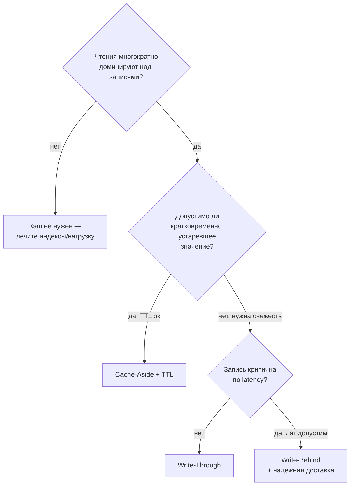

# Слайды — Лекция 8: Масштабирование, кэширование и аналитика (OLTP vs OLAP)

> **СТАТУС: КАНДИДАТ** (сгенерированы из draft/final 12.10.2026 до человеческого вердикта review и заполнения fact-check). Формат: `## N.` + title; bullets ≤6; заметки спикера ≥2 предложений; Mermaid по diagrams.md. Всего слайдов: 25 (≤30 ✓).

## 1. Титульный
- Курс: System Design и архитектура данных · Лекция 8 (завершающая)
- Тема: Масштабирование: производительность, кэширование и аналитика (OLTP vs OLAP)
- 80 мин · Практический результат: секция «Стратегия масштабирования» Blueprint v2
**Заметки:** Это финальная лекция курса: всё, что было собрано в Blueprint на Л7, проверяется ростом. Объявите, что сегодня каждый добавит в свой проект новый раздел и ADR-013. Тайминг держим по контракту: 5+30+20+15+10.

## 2. План занятия
- Hook: инцидент роста (5) → Теория: рост/hot-cold, кэш, индексы, OLTP/OLAP (30)
- Case Study: каршеринг x10 (20) → Управленческие выводы (15) → Резюме и мостик (10)
**Заметки:** Подчеркните связку с прошлым занятием: вчера защищали целостный Blueprint — сегодня выясняем, выживет ли он при умножении нагрузки. Домашний артефакт анонсируйте сразу, чтобы студенты собирали его по ходу лекции.

## 3. Learning objectives
- LO1 классифицировать hot/warm/cold · LO2 выбрать стратегию кэша и описать инвалидацию
- LO3 объяснить компромиссы B-Tree · LO4 разделить OLTP/OLAP и обосновать DWH
- LO5 описать ETL/ELT-поток · LO6 критически разобрать кейсы Netflix/Uber
**Заметки:** Каждый LO проверяемый: на практике и в вопросах самопроверки. Сформулируйте, что «правильного ответа про СУБД» не будет — оценивается ход мысли и trade-offs, как на защитах Л7.

## 4. Что покажем и чем закончим
- Покажем: типовой инцидент роста и четыре механизма против него
- Соберём: карту температуры, схему кэша, матрицу индексов, эскиз ETL
- Закончим: ADR-013 и Blueprint v2 → переход к курсу «Базы данных»
**Заметки:** Механизмы не изолированы — они надстраиваются над принятыми ADR (полиглотный стек Л4, реплики Л6). В конце вернёмся к обещанию: Hook-история получит архитектурный ответ.

## 5. Hook: отчёт, который положил прод
- Понедельник: квартальный BI-дашборд запускается прямо в продуктовой OLTP-БД
- p95 поиска машин деградирует в разы [учебные числа]; клиенты видят «нет машин»
- Вопрос: виноват автор отчёта или архитектор?
**Заметки:** Расскажите историю живо: сканирование миллионов строк телеметрии конкурирует с транзакциями. Не давайте ответ сразу — правильная рамка: отсутствующая стратегия роста тоже часть архитектуры. Флот вырос ~x10 за полгода — успех стал проблемой.

## 6. Рост меняет природу проблем
- Деградация нелинейна: данные × запросы × параллелизм
- Симптомы: p95 растёт при стабильном функционале; один запрос влияет на всех
- Бэкапы/репликация перестают успевать в окно (RPO/RTO из Л6)
- Правило: сначала измерь, потом оптимизируй
**Заметки:** Опора: Д1 (лестница оптимизаций). Покажите порядок ступеней: метрики → индексы → кэш → реплики → контуры/DWH → шардинг. Пропуск первой ступени превращает оптимизацию в гадание и ритуал — это управленческая проблема, а не техническая.

## 7. Температура данных: hot / warm / cold
- Горячие: минуты–дни, latency-чувствительны → быстрый носитель, кэш
- Тёплые: дни–месяцы → основная СУБД; Холодные: месяцы–годы → архив/DWH
- Границы задаёт частота доступа бизнеса, а не возраст записи
- Lifecycle связан с retention (Л4) и комплаенсом копий (Л6)
**Заметки:** Д2. Примеры из кейса: координаты парка — hot, завершённые поездки — warm, телеметрия годичной давности — cold. Отдельно отметьте PII: перемещение холодных копий в архив/DWH не снимает требований GDPR/152-ФЗ — подпись DPO нужна и здесь.

## 8. Кэш: ускоритель, а не источник истины
- Иерархия латентности RAM→SSD→сеть — метафора прикладного кэша
- Принцип: кэш = derived store; после потери — восстановление из СУБД
- Метрика успеха: hit ratio; без неё кэширование — гадание
- Класс реализаций: in-memory key-value (например Redis/Memcached)
**Заметки:** Свяжите с Polyglot Persistence Л4 (Source of Truth vs Derived Store). Задайте аудитории вопрос: что увидит клиент через минуту после изменения статуса, если инвалидации нет? Это мостик к следующему слайду про стратегии. Числа латентности — порядки величин [факт-чек №5].

## 9. Четыре стратегии кэширования
- Cache-Aside: приложение читает/кладёт/сбрасывает — стартовая
- Read-Through: слой сам догружает из источника
- Write-Through: синхронно в кэш и источник — свежо, запись дороже
- Write-Behind: быстро, но риск потери данных при падении кэша
- Выбор = треугольник: свежесть ↔ латентность ↔ сложность
**Заметки:** Д3 + таблица сравнения из draft §Т2. Разберите каждую последовательностью GET/SET. Спросите студентов: для статусов поездок какая стратегия? (Ответ в кейсе: Cache-Aside + событийная инвалидация.) Подчеркните: универсальной стратегии нет — только контекст.

## 10. Инвалидация — главная цена кэша
- По событию: изменилась запись → сбросили ключ
- По TTL: протухло → перечитали; комбинация — чаще всего
- Побочные эффекты: thundering herd, волны TTL (jitter, блокировка догрузки)
- Проверка зрелости: что делает система при падении кэша?
**Заметки:** Термины смягчений зависят от реализации [факт-чек №9]. История про «клиент видит устаревшую машину» из Hook — прямое следствие отсутствия инвалидации. Это также организационный вопрос: кто владеет политикой устаревания — продукт или разработка?

## 11. Дерево выбора стратегии кэша

**Заметки:** Д4. Прогоните по дереву два примера: карта доступности машин и журнал списаний. Первый — Cache-Aside+TTL; второй может оказаться Write-Through. Спросите, где дерево даёт неверный совет (подсказка: при сильной связности данных инвалидация дорожает).

## 12. Индекс: сделка чтения с записью
- B-Tree: логарифмический поиск вместо обхода всей таблицы (учебный факт)
- Цена: место, write amplification (каждая запись обслуживает все индексы)
- Планировщик вправе индекс игнорировать: «есть ≠ используется»
- Правила: под top-N реальных запросов; каждый — мини-ADR с полем цены
**Заметки:** Д5 (весы). Алгоритмы — курс «Базы данных»; здесь важна экономика. Приведите кейс-пример: составной индекс (город, статус, гео) лечит p95 поиска, но замедляет массовую запись телеметрии — решение фиксируем в матрице. Индексы «на будущее» — анти-паттерн.

## 13. OLTP vs OLAP: физика хранения
- Row-based (OLTP): вся запись целиком — точечные транзакции, ACID
- Columnar (OLAP): читаем только нужные столбцы — агрегаты, сжатие, скан миллиардов
- Одна таблица не идеальна для обоих → два контура, а не «оптимизировать отчёт»
- DWH: звёздные модели; денормализация осознанная (контраст НФФ Л3)
**Заметки:** Д6. Возврат к рамке Л4, теперь на уровне байтов. Ключевая мысль: конфликт физический, поэтому «подкрутить индексы» для квартального отчёта — путь в тупик. Аналитика требует своей физической организации данных.

## 14. ETL/ELT: как данные переезжают в аналитику
- ETL: преобразуем до загрузки — дисциплина схемы; ELT: грузим «как есть», преобразуем внутри DWH
- Поток: read-реплика (Л6) → extract (batch/CDC) → staging → витрины → BI
- Лаг пайплайна — договорённость с бизнесом («утро» vs near-real-time), не баг
- PII обезличивается до витрин; часть данных в DWH не едет вовсе
**Заметки:** Д7. Напомните, что источник извлечения — реплика из ADR-011: решение Л6 оказалось фундаментом аналитики. Сравните стоимость batch и CDC. Отметьте роль DPO в согласовании потоков (перекличка Л4/Л6).

## 15. Кейсы больших систем: Netflix и Uber
- Netflix публиковал опыт Cassandra для высоконагруженного хранения; аналитика — облачные хранилища/пайплайны [факт-чек №1–2]
- Uber публиковал Schema Registry и потоковые платформы [факт-чек №3]
- Урок: паттерны живут при тысячах инженеров; перенос «как у Uber» в команду 8 человек — анти-паттерн
- Свой контекст: NFR, бюджет, команда, масштаб x10 ≠ x10000
**Заметки:** Только общедоступное, детали не выдумываем — всё под маркерами проверки. Ведущий вопрос аудитории: что из их арсенала оправдано у нас уже сейчас? (Ответ: идея разделения контуров — да; конкретные платформы — почти никогда.)

## 16. Case Study: каршеринг x10 — вводная
- Было: 200 авто, MVP-индексы «на глаз», аналитика в проде, кэша нет
- Стало: флот ~x10, новый регион, требования дашбордов, деградация p95
- Цель: удержать пользовательский SLA И дать аналитику без простоев прода
- Ограничения: бюджет умеренный, data-инженера нет, compliance-рамка Л4/Л6
**Заметки:** Переход к групповой работе (20 мин). Раздайте case.md; напомните роли стейкхолдеров (CTO/продукт/аналитик/DPO/ops) — интересы столкнутся, и это правильно. Артефакты: карта температуры, схема кэша, матрица индексов, эскиз ETL, ADR-013.

## 17. Шаг 1–2: профилирование и карта температуры
- Никаких оптимизаций без top-N запросов и метрик
- Hot: координаты/статусы сейчас, телеметрия ≤48ч; Warm: история поездок; Cold: ≥6 мес → архив/DWH
- Каждая строка карты: носитель + правило остывания + retention/PII-заметка
**Заметки:** Типичная ошибка групп — начать с «давайте кэш». Верните к лестнице Д1: сначала измерение. Проверьте, что группы различают частоту доступа и возраст данных (геотреки вчерашних поездок могут быть ещё горячими).

## 18. Шаг 3: кэш статусов поездок
- Cache-Aside: чтение карты доступности/статуса, MISS → источник
- Инвалидация по событию (смена статуса → сброс ключа) + короткий TTL-страховка
- Падение кэша = деградация скорости, НЕ потеря данных (derived store)
- Метрики: hit ratio, p95 эндпоинта
**Заметки:** Здесь закрываем второй симптом Hook'а («клиенты видят нет машин»). Спросите группы: почему не Write-Through? (Запись статусов идёт из телеметрии пакетно, синхронная запись в кэш дорога, а устаревание на секунды терпимо.) Ответ должен звучать через треугольник trade-off.

## 19. Шаг 4: ревизия индексов
- Матрица: запрос → индекс (колонки, порядок) → польза → цена → вердикт
- Добавили: составной (город, статус, гео) под поиск; убрали: неиспользуемые «на будущее»
- Помним: планировщик может игнорировать индекс; heavy-scan индексы не спасают
**Заметки:** Требуйте от групп минимум одну строку «не добавляем/удаляем» — это признак понимания цены. Свяжите с практикой Л5: пулы соединений и лишние round-trip'ы тоже относятся к профилю запросов.

## 20. Шаг 5: аналитический контур
- Источник извлечения — read-реплика (ADR-011), не primary
- Batch-ETL ежедневно; CDC near-real-time — только если бизнес готов платить
- Колоночное (columnar) хранилище (класс ClickHouse/Snowflake) → витрины → BI
- PII: обезличивание до витрин; геотреки — по решению DPO
**Заметки:** Д7 как шаблон ответа. Альтернатива «дашборды на read-реплике без DWH» обсуждается честно: дешевле, но упирается в объём истории и физику сканов. Это и есть контекстность решения — урок курса.

## 21. ADR-013 «Разделение OLTP/OLAP и кэш статусов»
- Контекст: x10, инцидент BI-на-проде, деградация p95
- Решение: DWH через ETL с реплик + Cache-Aside с событийной инвалидацией
- Альтернативы: отчёты на реплике без DWH; полный CQRS+Event Sourcing (избыточно для 8 чел., Л7)
- Последствия: +2 компонента операционки, лаг аналитики, новые метрики lag/hit-ratio
**Заметки:** Проверьте по критериям валидности Л7: контекст привязан к NFR, альтернативы не соломенные, последствия включают жертвы. Подчеркните: ADR не отменяет ADR-008, а дополняет его — так живёт реальный архив решений.

## 22. Управление: цена каждого механизма
- Кэш/DWH = новые компоненты со стоимостью владения и дежурством
- Метрики решений: p95/p99, hit ratio, доля top-запросов, лаг ETL
- Сигнал нанять data-инженера: отчёты конкурируют с транзакциями
- «Временное» на проде живёт годами — фиксируйте как долг
**Заметки:** Мини-практика (4 мин): классифицировать 6 датасетов по температуре (из draft §6). Соберите 2–3 ответа вслух. Управленческая мысль: архитектурный рост — это и бюджет, и люди, и процессы, а не только технологии.

## 23. Анти-паттерны лекции
- «Аналитика на проде»: один дашборд кладёт весь бизнес
- «Кэш как источник истины»: потеря кэша = потеря данных
- Рядом: индексы «на будущее», кэш «всего подряд», архитектура Uber для MVP
**Заметки:** Для каждого спросите аудиторию: какой сигнал вовремя заметит проблему? (Метрики, тест падения кэша, статистика использования индексов уровня pg_stat, проверка контекста перед копированием.) Эти четыре — частые герои постмортемов роста.

## 24. Резюме: пять идей
- Сначала измерение, потом механизм (лестница Д1)
- Температура данных определяет носитель и lifecycle
- Кэш всегда derived; платит свежестью и сложностью инвалидации
- Индекс — сделка чтения с записью; DWH — отдельный физический мир
- Чужие архитектуры переносятся только через свой контекст
**Заметки:** Прогоните ответы на вопросы самопроверки (draft §12) выборочно. Must Read: Kleppmann DDIA — главы про репликацию/потоки/производные данные [факт-чек №12]. Спросите: какой пункт сегодня изменил ваш Blueprint?

## 25. Мостик: курс завершён — проект продолжается
- Итог: Architecture Blueprint v2 со «Стратегией масштабирования» + ADR-013, защита по рубрике Л7
- Дальше: самостоятельная работа → курс «Базы данных» (PostgreSQL, MongoDB, Redis, Qdrant)
- Там наши WHAT/WHY-решения станут физической реализацией
**Заметки:** Финальное слово: мы прошли путь от хаоса требований (Л1) до стратегии роста (Л8) — и это конец этапа проектирования, а не работы с данными. Поблагодарите за сквозные кейсы и напомните дедлайн Blueprint v2.
